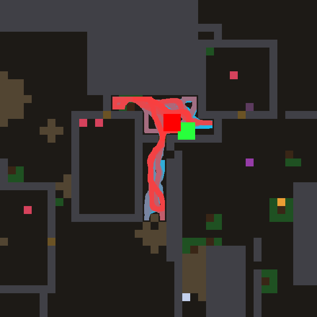
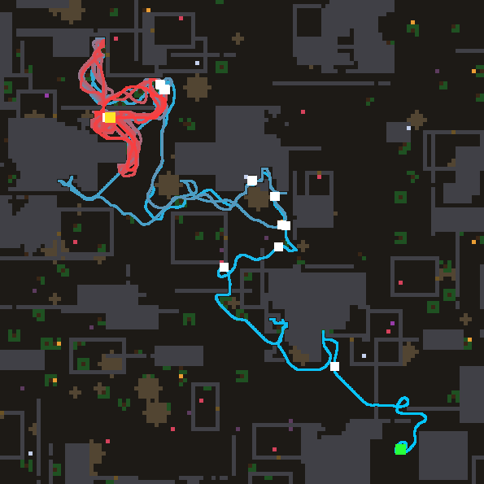

# night lab — 2026-11-04T11:35:33

Model `agent-in-session (mailbox)` | 12.0 h | world default | train [0, 1, 2, 3, 4, 5, 6, 7, 8, 9, 10, 11, 12, 13, 14, 15, 16, 17, 18, 19] | holdout [20, 21, 22, 23, 24, 25, 26, 27, 28, 29, 30, 31, 32, 33, 34, 35] | 8000 ticks/life | tune 5 | deep every 5 | theory every 6 | observe every 8

- anchor #0 `laws/atlas_wave.nomos`: train 14.8 meals [28, 27, 10, 35, 13, 4, 5, 5, 33, 12, 5, 7, 23, 23, 18, 8, 0, 28, 5, 6], holdout 19.6

- anchor #1 `laws/atlas_confine.nomos`: train 25.7 meals [37, 39, 18, 30, 23, 22, 13, 34, 26, 13, 33, 36, 33, 24, 29, 30, 0, 34, 14, 26], holdout 25.7

- anchor #2 `laws/atlas_ghost.nomos`: train 19.2 meals [28, 5, 25, 11, 13, 18, 16, 33, 29, 12, 4, 24, 21, 32, 16, 26, 0, 28, 23, 20], holdout 18.6

> 11:41 model job `design` started

---

## Turn 0 -> island #3

**Hypothesis:** The map gets a FOOTPRINT memory: a slowly fading `trail` of where the agent has stood, scrolling with the map. Remembered sources (a `ghost` that lingers at 0.99) are wiped wherever the agent has walked, and smelled sources painted onto trodden ground lose most of their weight, while seen morsels keep full weight. Poisoned cells (`bad`) block the wave. This breaks the smell trap, where the bearing flips and leads the agent back and forth over the same cells. Ground the agent has already searched stops calling, so the wave goes to sources it has not checked yet and to the frontier, and the confinement damping keeps nooks from dominating.

Prediction 27.5, got **24.2** meals, fitness 473, per world [41, 42, 15, 24, 12, 27, 16, 36, 30, 2, 36, 25, 32, 33, 31, 33, 0, 17, 12, 21]; model 42.1 s, repairs 0

value on the test map: max 1.00, mean 0.53, 0% at the cap -> healthy: the best neighbour points at the source

```nomos
channel source
channel solid
channel thing
channel bad
channel here
channel leak
channel value
channel trail
channel ghost
channel confinement
channel injection

# footprint memory: 1 where the agent stands, fading slowly, scrolls with the map
rule walk:
  when 1
  set trail = max(here, 0.995 * trail)

# sources linger, but are wiped wherever the agent has recently walked
rule linger:
  when 1
  set ghost = max(source, 0.99 * ghost) * (1 - trail)

rule calc_conf:
  when 1
  set confinement = sum8(solid)

# seen morsels stay true; remembered/smelled sources lose weight on trodden ground and in nooks
rule inject:
  when 1
  set injection = max(thing * (1 - bad), max(source, ghost) * (1 - 0.7 * trail)) * (1 - bad) / (1 + 0.5 * confinement)

# Bellman wave; a burned cell does not pass the wave
rule wave:
  when 1
  set value = max(injection, max(0.94 * max4(value), 0.916214 * max8(value))) * (1 - solid * (1 - leak)) * (1 - 0.9 * bad)
```

> 11:51 model job `design` started

---

## Turn 1 -> island #4

**Hypothesis:** Every frontier mark is painted at the same 0.12, so a crack in a wall that leads nowhere pulls the agent as hard as the mouth of a big unexplored region. I add an `openness` field (unknown territory, smoothed a few rings out) and weight frontier sources by it, so exploration flows toward where the most unseen ground is, while food sources keep confinement suppression and burned cells stop the wave. On worlds where meals come from exploring, the agent should reach new food faster and waste fewer trips into small pockets.

Prediction 27.0, got **27.2** meals, fitness 539, per world [38, 30, 17, 38, 21, 26, 25, 31, 31, 27, 27, 24, 25, 26, 30, 31, 0, 42, 22, 34]; model 48.1 s, repairs 0

value on the test map: max 1.00, mean 0.53, 0% at the cap -> healthy: the best neighbour points at the source

```nomos
channel source
channel solid
channel free
channel thing
channel scent
channel bad
channel leak
channel value
channel unknown
channel openness
channel frontier
channel confinement
channel injection

# what is not yet known (neither seen free nor seen solid)
rule known:
  when 1
  set unknown = (1 - free) * (1 - solid)

# how much unknown lies around a cell, spread a few rings out (bounded below 1)
rule spread:
  when 1
  set openness = 0.5 * avg8(unknown) + 0.45 * avg8(openness)

# the faint frontier marks: a source that is neither smell nor a seen morsel
rule mark:
  when 1
  set frontier = where((source > 0) and (source < 0.13) and (thing < 0.01) and (scent < 0.01), 1, 0)

rule calc_conf:
  when 1
  set confinement = sum8(solid)

# frontier counts by the unknown territory behind it; food as before; burned cells inject nothing
rule inject:
  when 1
  set injection = where(frontier > 0, source * (0.3 + 2 * openness), max(thing, source)) * (1 - bad) / (1 + 0.5 * confinement)

# Bellman wave; a burned cell does not pass the wave
rule wave:
  when 1
  set value = max(injection, max(0.94 * max4(value), 0.916214 * max8(value))) * (1 - solid * (1 - leak)) * (1 - 0.9 * bad)
```

> 12:07 model job `design` started

### Holdout checkpoint at 0.57 h

```
  #4   train 27.2 meals  holdout 25.1  (tuned 5x) | Every frontier mark is painted at the same 0.12, so a crack in a wall that leads nowhere pulls the agent as ha
  #3   train 24.2 meals  holdout 20.2  (tuned 5x) | The map gets a FOOTPRINT memory: a slowly fading `trail` of where the agent has stood, scrolling with the map.
  #0   train 14.8 meals  holdout 19.6  (hand-written) | the reference Bellman wave
  #1   train 25.7 meals  holdout 25.7  (hand-written) | Confinement suppression (night lab 2026-09-23, champion #35): a source hemmed in by solid counts less, so loca
  #2   train 19.2 meals  holdout 18.6  (hand-written) | sources linger (ghost), erased under the agent
  CONTROL: #1's law, constants tuned by random search 9x: train 25.7 meals, holdout 25.7
```

---

## Turn 2 -> island #5

**Hypothesis:** The map gets a WEAR memory: footprints accumulate (bounded) where the agent stands and spread into a halo of worn ground, so a smell that keeps pointing into ground the agent has already circled loses its pull (the geodesic-bearing limit cycle breaks) while seen morsels keep full weight. Frontier near worn ground is mildly discounted and the wave passes trodden cells slightly less well, so the agent prefers fresh routes and unexplored territory once it starts looping — this should rescue the trap worlds (world 16) without hurting the direct approach to visible food.

Prediction 28.0, got **24.9** meals, fitness 500, per world [25, 21, 22, 19, 30, 24, 23, 30, 38, 16, 25, 29, 28, 25, 35, 30, 0, 37, 7, 35]; model 48.1 s, repairs 0; vocabulary twin of #4

value on the test map: max 0.70, mean 0.42, 0% at the cap -> healthy: the best neighbour points at the source

```nomos
channel source
channel solid
channel free
channel thing
channel scent
channel bad
channel leak
channel here
channel value
channel unknown
channel openness
channel frontier
channel confinement
channel trail
channel worn
channel injection

# what is not yet known (neither seen free nor seen solid)
rule known:
  when 1
  set unknown = (1 - free) * (1 - solid)

# how much unknown lies around a cell, spread a few rings out (bounded below 1)
rule spread:
  when 1
  set openness = 0.5 * avg8(unknown) + 0.45 * avg8(openness)

# the faint frontier marks: a source that is neither smell nor a seen morsel
rule mark:
  when 1
  set frontier = where((source > 0) and (source < 0.13) and (thing < 0.01) and (scent < 0.01), 1, 0)

rule calc_conf:
  when 1
  set confinement = sum8(solid)

# footprints: ground stood on accumulates (bounded at 1), fades slowly; scrolls with the map
rule tread:
  when 1
  set trail = where(here > 0.5, min(1, trail + 0.03), 0.998 * trail)

# a halo of worn ground: where the agent has been circling
rule wear:
  when 1
  set worn = max(trail, 0.85 * max8(worn))

# frontier by unknown behind it; smell that keeps pointing into worn ground loses its pull; seen food untouched
rule inject:
  when 1
  set injection = where(frontier > 0, source * (0.3 + 2 * openness) * (1 - 0.4 * worn), max(thing, source * (1 - 0.8 * worn * (1 - thing)))) * (1 - bad) / (1 + 0.5 * confinement)

# Bellman wave; burned cells block, trodden cells pass a little less (prefer fresh routes)
rule wave:
  when 1
  set value = max(injection, max(0.94 * max4(value), 0.916214 * max8(value))) * (1 - solid * (1 - leak)) * (1 - 0.9 * bad) * (1 - 0.1 * trail)
```

> 12:29 model job `design` started

---

## Turn 3 -> island #6

**Hypothesis:** The wave stops spreading at one flat price: each cell now has its own step cost. Known-free ground is cheap (0.95), unknown ground is expensive (0.89, because it may hide a wall), and ground hugging walls costs more. Diagonal spreading is also blocked where it would cut a solid corner. Plans then follow corridors the agent has actually seen and go through door centres, instead of straight lines through imagined space into walls. This should cut the time lost bumping and re-planning when a guessed shortcut turns out to be stone. The agent turns to the unknown only when the frontier is worth it.

Prediction 28.5, got **24.2** meals, fitness 489, per world [34, 33, 24, 34, 25, 22, 21, 37, 36, 34, 14, 22, 23, 22, 14, 18, 0, 34, 6, 32]; model 102.2 s, repairs 0

value on the test map: max 1.00, mean 0.59, 0% at the cap -> healthy: the best neighbour points at the source

```nomos
channel source
channel solid
channel free
channel thing
channel scent
channel bad
channel leak
channel value
channel unknown
channel openness
channel frontier
channel confinement
channel injection
channel step
channel stepd

# what is not yet known (neither seen free nor seen solid)
rule known:
  when 1
  set unknown = (1 - free) * (1 - solid)

# how much unknown lies around a cell, spread a few rings out (bounded below 1)
rule spread:
  when 1
  set openness = 0.5 * avg8(unknown) + 0.45 * avg8(openness)

# the faint frontier marks: a source that is neither smell nor a seen morsel
rule mark:
  when 1
  set frontier = where((source > 0) and (source < 0.13) and (thing < 0.01) and (scent < 0.01), 1, 0)

rule calc_conf:
  when 1
  set confinement = sum8(solid)

# frontier weighted by the unknown behind it; burned cells inject nothing
rule inject:
  when 1
  set injection = where(frontier > 0, source * (0.3 + 2 * openness), max(thing, source)) * (1 - bad) / (1 + 0.5 * confinement)

# per-cell step price: seen-free ground is cheap, guessed ground dear, wall-hugging dearer
rule price:
  when 1
  set step = (0.89 + 0.06 * free) * (1 - 0.01 * sum8(solid))

# the diagonal price is the orthogonal one to the power sqrt 2
rule priced:
  when 1
  set stepd = exp(1.4142 * log(0.0001 + step))

# priced wave; a diagonal only passes if neither corner it squeezes past is solid
rule wave:
  when 1
  set value = max(injection, step * max4(value), stepd * max(shift(value, -1, -1) * (1 - max(shift(solid, -1, 0), shift(solid, 0, -1)) * (1 - leak)), shift(value, 1, -1) * (1 - max(shift(solid, 1, 0), shift(solid, 0, -1)) * (1 - leak)), shift(value, -1, 1) * (1 - max(shift(solid, -1, 0), shift(solid, 0, 1)) * (1 - leak)), shift(value, 1, 1) * (1 - max(shift(solid, 1, 0), shift(solid, 0, 1)) * (1 - leak)))) * (1 - solid * (1 - leak)) * (1 - 0.9 * bad)
```

> 12:35 model job `observe` started

---

## Observer: #4 on world 16


`{'meals': 0, 'ticks': 3511, 'alive': False, 'distance': 420.1, 'cells_visited': 59, 'last500_box': '4x12', 'doors': 0, 'breaks': 0, 'idle_presses': 205, 'nightcaps': 0}`

The agent is born in a small sealed pocket under the rock massif, a strip roughly 4x12 cells walled on every side, and spends all 3511 ticks pacing back and forth inside it until it starves, without ever reaching food. Food is close: berries lie just outside the pocket to the lower left and in the room to the right, and the brown cells in the pocket's walls look like doors or rubble that would have let it out. It does try to get out (205 idle presses), but it never opens a door or chips anything, so it keeps pressing the same stone that will not give. Two parts of the law work against it here: once the pocket is mapped there are no frontier sources inside, and the confinement divisor `1/(1 + 0.5*sum8(solid))` damps exactly the cells along the walls where any way out must begin. The fix I would name is a bounded "tried" memory channel: it builds up on solid cells next to `here` while the agent stands pressing them, decays slowly, and multiplies that cell's leak by (1 - tried). Then the wave stops flowing through stone it has already pushed on and moves round the wall to the next untried segment, which is where the doors are.

### Holdout checkpoint at 1.16 h

```
  #4   train 27.2 meals  holdout 25.1  (tuned 6x) | Every frontier mark is painted at the same 0.12, so a crack in a wall that leads nowhere pulls the agent as ha
  #5   train 25.7 meals  holdout 27.7  (tuned 5x) | The map gets a WEAR memory: footprints accumulate (bounded) where the agent stands and spread into a halo of w
  #6   train 24.2 meals  holdout 28.5  (tuned 1x) | The wave stops spreading at one flat price: each cell now has its own step cost. Known-free ground is cheap (0
  #3   train 24.2 meals  holdout 20.2  (tuned 5x) | The map gets a FOOTPRINT memory: a slowly fading `trail` of where the agent has stood, scrolling with the map.
  #0   train 14.8 meals  holdout 19.6  (hand-written) | the reference Bellman wave
  #1   train 25.7 meals  holdout 25.7  (hand-written) | Confinement suppression (night lab 2026-09-23, champion #35): a source hemmed in by solid counts less, so loca
  #2   train 19.2 meals  holdout 18.6  (hand-written) | sources linger (ghost), erased under the agent
  CONTROL: #1's law, constants tuned by random search 17x: train 28.5 meals, holdout 27.0
```

> 12:58 model job `deep` started

---

## Turn 4 (DEEP) -> island #7

**Hypothesis:** The map gets a per-cell FRUSTRATION memory (`tried`): a solid cell the wave keeps leading the agent into accumulates "I pressed here and it did not give", which closes that cell's leak locally (independent of the per-hue lesson, which is too coarse or too slow when one stone sits on the smell's bearing) and kills the pull through it. In the same move, wall faces that separate known-free ground from unknown ground become faint CRACK sources weighted by leak and by (1 - tried), not divided by confinement — so a sealed pocket (world 16) gets systematically probed wall cell by wall cell, doors and rubble first because their taught leak is high, instead of one stone being pressed 205 times; in op

Prediction 28.0, got **28.6** meals, fitness 568, per world [13, 19, 32, 25, 22, 24, 36, 42, 29, 34, 31, 29, 24, 32, 22, 39, 23, 33, 27, 35]; model 88.3 s, repairs 0

value on the test map: max 1.00, mean 0.53, 0% at the cap -> healthy: the best neighbour points at the source

```nomos
channel source
channel solid
channel free
channel thing
channel scent
channel bad
channel leak
channel here
channel value
channel unknown
channel openness
channel frontier
channel confinement
channel injection
channel step
channel stepd
channel hv
channel tried
channel block
channel crack

# what is not yet known (neither seen free nor seen solid)
rule known:
  when 1
  set unknown = (1 - free) * (1 - solid)

# how much unknown lies around a cell, spread a few rings out (bounded)
rule spread:
  when 1
  set openness = 0.6 * avg8(unknown) + 0.45 * avg8(openness)

# the faint frontier marks: a source that is neither smell nor a seen morsel
rule mark:
  when 1
  set frontier = where((source > 0) and (source < 0.14) and (thing < 0.01) and (scent < 0.01), 1, 0)

rule calc_conf:
  when 1
  set confinement = sum8(solid)

# frontier weighted by the unknown behind it; burned cells inject nothing
rule inject:
  when 1
  set injection = where(frontier > 0, source * (0.4 + 2 * openness), max(thing, source)) * (1 - bad) / (1 + 0.5 * confinement)

# the best value among the agent's eight neighbours, held at the agent's cell
rule lookout:
  when 1
  set hv = where(here > 0.5, max8(value), 0)

# frustration: a solid neighbour the wave leads the agent into, and it is still solid; fades slowly
rule press:
  when 1
  set tried = min(1, 0.9995 * tried + where((solid > 0.5) and (max8(here) > 0.5) and (value > 0.001) and (value >= max8(hv) - 0.000001), 0.012 * (1.2 - leak), 0))

# effective blockage: a stone already pressed in vain lets nothing through
rule blocked:
  when 1
  set block = solid * (1 - leak * (1 - tried))

# a wall face between known-free ground and the unknown is a faint maybe-door, until tried
rule cracks:
  when 1
  set crack = where((solid > 0.3) and (max8(free) > 0.5) and (max8(unknown) > 0.3), 0.06 * (1 - tried), 0)

# per-cell step price: seen-free ground is cheap, guessed ground dear, wall-hugging dearer
rule price:
  when 1
  set step = (0.89 + 0.05 * free) * (1 - 0.01 * sum8(solid))

# the diagonal price is the orthogonal one to the power sqrt 2
rule priced:
  when 1
  set stepd = exp(1.4142 * log(0.0001 + step))

# priced wave; diagonals squeeze past corners only as far as the corners let through
rule wave:
  when 1
  set value = max(injection, crack, step * max4(value), stepd * max(shift(value, -1, -1) * (1 - max(shift(block, -1, 0), shift(block, 0, -1))), shift(value, 1, -1) * (1 - max(shift(block, 1, 0), shift(block, 0, -1))), shift(value, -1, 1) * (1 - max(shift(block, -1, 0), shift(block, 0, 1))), shift(value, 1, 1) * (1 - max(shift(block, 1, 0), shift(block, 0, 1))))) * (1 - block) * (1 - 0.9 * bad)
```

### Holdout checkpoint at 1.73 h

```
  #6   train 28.5 meals  holdout 33.6  (tuned 5x) | The wave stops spreading at one flat price: each cell now has its own step cost. Known-free ground is cheap (0
  #7   train 28.6 meals  holdout 27.9  (tuned 3x) | The map gets a per-cell FRUSTRATION memory (`tried`): a solid cell the wave keeps leading the agent into accum
  #4   train 27.2 meals  holdout 25.1  (tuned 7x) | Every frontier mark is painted at the same 0.12, so a crack in a wall that leads nowhere pulls the agent as ha
  #5   train 25.7 meals  holdout 27.7  (tuned 5x) | The map gets a WEAR memory: footprints accumulate (bounded) where the agent stands and spread into a halo of w
  #3   train 24.2 meals  holdout 20.2  (tuned 5x) | The map gets a FOOTPRINT memory: a slowly fading `trail` of where the agent has stood, scrolling with the map.
  #0   train 14.8 meals  holdout 19.6  (hand-written) | the reference Bellman wave
  #1   train 25.7 meals  holdout 25.7  (hand-written) | Confinement suppression (night lab 2026-09-23, champion #35): a source hemmed in by solid counts less, so loca
  #2   train 19.2 meals  holdout 18.6  (hand-written) | sources linger (ghost), erased under the agent
  CONTROL: #1's law, constants tuned by random search 24x: train 28.5 meals, holdout 27.0
```

> 13:28 model job `design` started

---

## Turn 5 -> island #8

**Hypothesis:** The map learns BOREDOM: a bounded footprint `trail` piles up where the agent keeps standing, and where it exceeds what one passing visit leaves, the ground is `worn` (spread as a decaying flood through free cells). Walls bordering worn ground, and not yet pressed in vain (`tried`), turn into dig sources weighted by their taught leak and the unknown behind them, and boredom raises how much wave those untried walls let through — so a sealed or looping agent stops pacing and probes its walls one after another, each refused stone closing as the next lights up, until a door or rubble gives (world 16), while an agent that keeps walking never wears anything and runs the #6 wave unchanged.

Prediction 29.5, got **22.1** meals, fitness 434, per world [33, 32, 26, 20, 23, 24, 14, 28, 34, 18, 23, 20, 21, 28, 24, 13, 0, 29, 19, 13]; model 74.2 s, repairs 0; vocabulary twin of #7

value on the test map: max 1.00, mean 0.53, 0% at the cap -> healthy: the best neighbour points at the source

```nomos
channel source
channel solid
channel free
channel thing
channel scent
channel bad
channel leak
channel here
channel value
channel unknown
channel openness
channel frontier
channel injection
channel step
channel stepd
channel hv
channel tried
channel trail
channel worn
channel block
channel dig
rule known:
  when 1
  set unknown = (1 - free) * (1 - solid)
rule spread:
  when 1
  set openness = 0.6 * avg8(unknown) + 0.45 * avg8(openness)
rule mark:
  when 1
  set frontier = where((source > 0) and (source < 0.14) and (thing < 0.01) and (scent < 0.01), 1, 0)
# footprints: bounded, slowly fading; one passing visit stays well under the wear line
rule footprint:
  when 1
  set trail = min(1, 0.997 * trail + 0.05 * here)
# worn ground: the excess of footprints, flooded a few cells through free ground
rule wear:
  when 1
  set worn = max(clamp(2.5 * (trail - 0.6), 0, 1), 0.85 * max8(worn)) * (1 - solid)
# frontier weighted by unknown behind it and dimmed on worn ground; burned cells inject nothing
rule inject:
  when 1
  set injection = where(frontier > 0, source * (0.4 + 2 * openness) * (1 - 0.6 * worn), max(thing, source)) * (1 - bad) / (1 + 0.5 * sum8(solid))
rule lookout:
  when 1
  set hv = where(here > 0.5, max8(value), 0)
# frustration: a solid neighbour the wave leads the agent into, still solid; fades slowly
rule press:
  when 1
  set tried = min(1, 0.9995 * tried + where((solid > 0.5) and (max8(here) > 0.5) and (value > 0.001) and (value >= max8(hv) - 0.000001), 0.012 * (1.2 - leak), 0))
# boredom raises what an untried wall lets through; a stone pressed in vain lets nothing
rule blocked:
  when 1
  set block = solid * (1 - max(leak, 0.8 * max8(worn)) * (1 - tried))
# a wall beside worn ground is a dig site: doors (high leak) and walls with unknown behind first
rule digsite:
  when 1
  set dig = where(solid > 0.5, 0.5 * max8(worn) * (1 - tried) * (0.3 + leak) * (0.5 + openness), 0)
rule price:
  when 1
  set step = (0.89 + 0.05 * free) * (1 - 0.01 * sum8(solid))
rule priced:
  when 1
  set stepd = exp(1.4142 * log(0.0001 + step))
# priced wave through effective blockage; dig sites shine even where the wall is shut
rule wave:
  when 1
  set value = max(dig, max(injection, step * max4(value), stepd * max(shift(value, -1, -1) * (1 - max(shift(block, -1, 0), shift(block, 0, -1))), shift(value, 1, -1) * (1 - max(shift(block, 1, 0), shift(block, 0, -1))), shift(value, -1, 1) * (1 - max(shift(block, -1, 0), shift(block, 0, 1))), shift(value, 1, 1) * (1 - max(shift(block, 1, 0), shift(block, 0, 1))))) * (1 - block) * (1 - 0.9 * bad))
```

> 13:33 model job `theory` started

---

## Theory (after 6 design turns)

HELPS: how the wave SPREADS matters most. Confinement (sources hemmed in by solid count less, #1) lifted Bellman 14.8 -> 25.7. Per-cell step cost (cheap known-free, dear unknown, #6) is the real champion: holdout 33.6 against the tuned control's 27.0. Weighting frontier marks by the size of what lies beyond (#4) helped train, less holdout.
HURTS: every footprint memory (trail #3, wear #5, boredom #8) loses 1-6 meals. Penalising where I stood bends the wave away from good corridors and food that respawns. Frustration on pressed stone (#7) gained nothing and dropped on holdout. Lingering sources alone are weak (#2).
FAILURE: sealed pockets (world 16). Once a pocket is mapped it holds no frontier, and confinement mutes everything near its walls, so the wave goes flat and the agent paces. It presses one stone and never tries the brown, leaky cells.
UNTRIED: when the reachable region holds no source, an escape wave seeded at the most leaky solids; commitment/heading; using `bad`; a distance discount from the agent.

### Holdout checkpoint at 2.24 h

```
  #6   train 28.5 meals  holdout 33.6  (tuned 5x) | The wave stops spreading at one flat price: each cell now has its own step cost. Known-free ground is cheap (0
  #7   train 28.6 meals  holdout 27.9  (tuned 5x) | The map gets a per-cell FRUSTRATION memory (`tried`): a solid cell the wave keeps leading the agent into accum
  #4   train 27.2 meals  holdout 25.1  (tuned 8x) | Every frontier mark is painted at the same 0.12, so a crack in a wall that leads nowhere pulls the agent as ha
  #5   train 25.7 meals  holdout 27.7  (tuned 5x) | The map gets a WEAR memory: footprints accumulate (bounded) where the agent stands and spread into a halo of w
  #3   train 24.2 meals  holdout 20.2  (tuned 5x) | The map gets a FOOTPRINT memory: a slowly fading `trail` of where the agent has stood, scrolling with the map.
  #8   train 22.1 meals  holdout  -    (tuned 4x) | The map learns BOREDOM: a bounded footprint `trail` piles up where the agent keeps standing, and where it exce
  #0   train 14.8 meals  holdout 19.6  (hand-written) | the reference Bellman wave
  #1   train 25.7 meals  holdout 25.7  (hand-written) | Confinement suppression (night lab 2026-09-23, champion #35): a source hemmed in by solid counts less, so loca
  #2   train 19.2 meals  holdout 18.6  (hand-written) | sources linger (ghost), erased under the agent
  CONTROL: #1's law, constants tuned by random search 32x: train 28.5 meals, holdout 27.0
```

> 13:53 model job `design` started

---

## Turn 6 -> island #9

**Hypothesis:** When the region the agent can reach holds no source, the map should say so and turn its own walls into goals. A DESPAIR field floods out from the agent's cell through non-solid cells whenever the best value beside the agent is near zero; solid cells bordering that despairing region become ESCAPE sources weighted by their leak, so the wave leads the agent into the wall most likely to give (untested hues stay at the curious innate leak, stone already pressed in vain has been taught low). This touches only sealed pockets and dead ends, where the champion goes flat, so it should rescue world 16 and similar starvations without bending the wave anywhere food or frontier exists.

Prediction 30.0, got **21.2** meals, fitness 424, per world [34, 27, 21, 36, 17, 20, 15, 19, 20, 6, 17, 25, 28, 26, 3, 21, 0, 36, 19, 34]; model 50.2 s, repairs 0; vocabulary twin of #6

value on the test map: max 1.00, mean 0.51, 0% at the cap -> healthy: the best neighbour points at the source

```nomos
channel source
channel solid
channel free
channel thing
channel scent
channel bad
channel leak
channel here
channel value
channel unknown
channel openness
channel frontier
channel confinement
channel injection
channel step
channel stepd
channel hv
channel despair
channel escape

# what is not yet known (neither seen free nor seen solid)
rule known:
  when 1
  set unknown = (1 - free) * (0.8 - solid)

# how much unknown lies around a cell, spread a few rings out (bounded below 1)
rule spread:
  when 1
  set openness = 0.64 * avg8(unknown) + 0.45 * avg8(openness)

# the faint frontier marks: a source that is neither smell nor a seen morsel
rule mark:
  when 1
  set frontier = where((source > 0) and (source < 0.14) and (thing < 0.01) and (scent < 0.01), 1.2, 0)

rule calc_conf:
  when 1
  set confinement = sum8(solid)

# frontier weighted by the unknown behind it; burned cells inject nothing
rule inject:
  when 1
  set injection = where(frontier > 0, source * (0.42 + 2 * openness), max(thing, source)) * (1 - bad) / (1 + 0.56 * confinement)

# the best value beside the agent, held at its own cell
rule lookout:
  when 1
  set hv = where(here > 0.5, max8(value), 0)

# despair: born at the agent when nothing reachable shines, flooded through non-solid cells, fading with distance
rule hopeless:
  when 1
  set despair = where(here > 0.5, clamp(1 - 25 * hv, 0, 1), 0.97 * max8(despair) * (1 - solid))

# escape: a solid cell on the rim of a despairing region becomes a goal, as bright as it is leaky
rule rim:
  when 1
  set escape = where(solid > 0.3, 0.5 * max8(despair) * leak * (1 - bad), 0)

# per-cell step price: seen-free ground is cheap, guessed ground dear, wall-hugging dearer
rule price:
  when 1
  set step = (0.89 + 0.047 * free) * (1 - 0.0107 * sum8(solid))

# the diagonal price is the orthogonal one to the power sqrt 2
rule priced:
  when 1
  set stepd = exp(1.4142 * log(0.0001 + step))

# priced wave seeded by sources and escapes; diagonals squeeze past corners only as far as they leak
rule wave:
  when 1
  set value = max(injection, escape, step * max4(value), stepd * max(shift(value, -1, -1) * (1 - max(shift(solid, -1, 0), shift(solid, 0, -1)) * (1 - leak)), shift(value, 1, -1) * (1 - max(shift(solid, 1, 0), shift(solid, 0, -1)) * (1 - leak)), shift(value, -1, 1) * (1 - max(shift(solid, -1, 0), shift(solid, 0, 1)) * (1 - leak)), shift(value, 1, 1) * (1 - max(shift(solid, 1, 0), shift(solid, 0, 1)) * (1 - leak)))) * (1 - solid * (1 - leak)) * (1 - 0.9 * bad)
```

> 14:13 model job `design` started

---

## Turn 7 -> island #10

**Hypothesis:** The wave gets a sense of being TRAPPED. A `hope` flood carries the best source reachable over open ground (orthogonally, through non-solid cells only) back to the agent. When the agent's own cell holds no hope, a `need` signal goes out from it across the whole map, walls included. That need lights every wall face touching known-free ground as an escape source, as bright as its taught `leak`. So in a sealed pocket (world 16) the wave stops going flat. It points at the leakiest wall, the brown door or rubble, not the stone that has already refused. In open worlds need stays near zero and the champion #6 priced wave is unchanged, so the fix costs nothing where the agent already eats.

Prediction 29.5, got **25.4** meals, fitness 513, per world [36, 24, 27, 25, 30, 29, 21, 40, 29, 23, 29, 24, 33, 22, 34, 31, 0, 6, 24, 20]; model 60.1 s, repairs 0

value on the test map: max 1.00, mean 0.53, 0% at the cap -> healthy: the best neighbour points at the source

```nomos
channel source
channel solid
channel free
channel thing
channel scent
channel bad
channel leak
channel here
channel value
channel unknown
channel openness
channel frontier
channel injection
channel step
channel stepd
channel hope
channel need
channel door

# what is not yet known (neither seen free nor seen solid)
rule known:
  when 1
  set unknown = (1 - free) * (1 - solid)

# how much unknown lies around a cell, spread a few rings out (bounded)
rule spread:
  when 1
  set openness = 0.6 * avg8(unknown) + 0.45 * avg8(openness)

# the faint frontier marks: a source that is neither smell nor a seen morsel
rule mark:
  when 1
  set frontier = where((source > 0) and (source < 0.14) and (thing < 0.01) and (scent < 0.01), 1, 0)

# frontier weighted by the unknown behind it; confined and burned sources count less
rule inject:
  when 1
  set injection = where(frontier > 0, source * (0.4 + 2 * openness), max(thing, source)) * (1 - bad) / (1 + 0.5 * sum8(solid))

# HOPE: the best source reachable over open ground, flooded orthogonally through non-solid cells
rule reach:
  when 1
  set hope = max(injection, 0.97 * max4(hope)) * (1 - solid)

# NEED: how hopeless the agent's own cell is, broadcast across the whole map (walls too), fading with distance
rule despair:
  when 1
  set need = max(here * clamp(1 - 30 * hope, 0, 1), 0.93 * max8(need))

# ESCAPE seeds: wall faces touching known-free ground, as bright as they are leaky, lit only by need
rule doors:
  when 1
  set door = where((solid > 0.5) and (max4(free) > 0.5), need * leak, 0)

# per-cell step price: seen-free ground is cheap, guessed ground dear, wall-hugging dearer
rule price:
  when 1
  set step = (0.89 + 0.05 * free) * (1 - 0.01 * sum8(solid))

# the diagonal price is the orthogonal one to the power sqrt 2
rule priced:
  when 1
  set stepd = exp(1.4142 * log(0.0001 + step))

# priced wave seeded by food, frontier AND (when trapped) escape doors; diagonals do not cut corners
rule wave:
  when 1
  set value = max(injection, door, step * max4(value), stepd * max(shift(value, -1, -1) * (1 - max(shift(solid, -1, 0), shift(solid, 0, -1)) * (1 - leak)), shift(value, 1, -1) * (1 - max(shift(solid, 1, 0), shift(solid, 0, -1)) * (1 - leak)), shift(value, -1, 1) * (1 - max(shift(solid, -1, 0), shift(solid, 0, 1)) * (1 - leak)), shift(value, 1, 1) * (1 - max(shift(solid, 1, 0), shift(solid, 0, 1)) * (1 - leak)))) * (1 - solid * (1 - leak)) * (1 - 0.9 * bad)
```

> 14:18 model job `observe` started

---

## Observer: #6 on world 16



`{'meals': 0, 'ticks': 3604, 'alive': False, 'distance': 404.8, 'cells_visited': 81, 'last500_box': '14x12', 'doors': 1, 'breaks': 4, 'idle_presses': 89, 'nightcaps': 0}`

The agent is born in a narrow sealed T of corridors (a short east-west passage and a one-cell-wide shaft running south) and spends its whole life of 3604 ticks shuttling inside it: up the shaft, along the top passage, back down to the dead end at the bottom, again and again, until the track is a solid red smear and it starves where it began. It is not ignoring food it can reach, because nothing edible lies in the pocket; the two pink morsels in the room just west sit behind a wall it never gets through. Its 89 idle presses and 4 breaks show it repeatedly pushing at the corridor walls and the brown rock at the shaft's foot without ever committing to tunnelling out, so after the first few hundred ticks it is pacing between the ends of a corridor it has already fully mapped. The failure is confinement in a room it has exhausted: once every cell of the pocket is known, the only remaining pulls are faint frontier sources just beyond the walls, and the law divides every injection by one plus about half the count of solid neighbours, which is largest in exactly the one-cell shafts and wall-side cells where those exits are, so the escape signal is crushed to roughly a fifth while nothing e

### Holdout checkpoint at 2.76 h

```
  #6   train 28.5 meals  holdout 33.6  (tuned 5x) | The wave stops spreading at one flat price: each cell now has its own step cost. Known-free ground is cheap (0
  #7   train 28.6 meals  holdout 27.9  (tuned 5x) | The map gets a per-cell FRUSTRATION memory (`tried`): a solid cell the wave keeps leading the agent into accum
  #4   train 27.2 meals  holdout 25.1  (tuned 8x) | Every frontier mark is painted at the same 0.12, so a crack in a wall that leads nowhere pulls the agent as ha
  #5   train 25.7 meals  holdout 27.7  (tuned 5x) | The map gets a WEAR memory: footprints accumulate (bounded) where the agent stands and spread into a halo of w
  #10  train 25.4 meals  holdout  -    (tuned 1x) | The wave gets a sense of being TRAPPED. A `hope` flood carries the best source reachable over open ground (ort
  #3   train 24.2 meals  holdout 20.2  (tuned 5x) | The map gets a FOOTPRINT memory: a slowly fading `trail` of where the agent has stood, scrolling with the map.
  #8   train 22.1 meals  holdout  -    (tuned 5x) | The map learns BOREDOM: a bounded footprint `trail` piles up where the agent keeps standing, and where it exce
  #9   train 21.2 meals  holdout  -    (tuned 5x) | When the region the agent can reach holds no source, the map should say so and turn its own walls into goals. 
  #0   train 14.8 meals  holdout 19.6  (hand-written) | the reference Bellman wave
  #1   train 25.7 meals  holdout 25.7  (hand-written) | Confinement suppression (night lab 2026-09-23, champion #35): a source hemmed in by solid counts less, so loca
  #2   train 19.2 meals  holdout 18.6  (hand-written) | sources linger (ghost), erased under the agent
  CONTROL: #1's law, constants tuned by random search 39x: train 28.5 meals, holdout 27.0
```

> 14:33 model job `design` started

---

## Turn 8 -> island #11

**Hypothesis:** Keep #6's priced, confined wave, and add a TRAPPED gate plus an escape-and-commit wave. The `reach` flood fills open (non-solid) ground from real hope (frontier marks and seen morsels, not smell). If no hope reaches the agent's cell, `trap` turns on around the agent. The wall faces bordering known-free ground then become sources, brighter where `leak` is higher (doors, rubble). A `dug` memory on the face actually being pressed first raises its pull and then drops it to nothing once it saturates. So the agent commits to ONE wall until it chips, then gives up on stone and moves to the next face, instead of pacing in a sealed pocket (world 16). In open ground `trap` stays at 0, so the champion'

Prediction 29.5, got **26.9** meals, fitness 543, per world [29, 37, 24, 36, 20, 21, 18, 37, 33, 28, 25, 27, 29, 40, 27, 30, 0, 29, 28, 19]; model 146.3 s, repairs 0

value on the test map: max 1.00, mean 0.53, 0% at the cap -> healthy: the best neighbour points at the source

```nomos
channel source
channel solid
channel free
channel thing
channel scent
channel bad
channel leak
channel here
channel value
channel unknown
channel openness
channel frontier
channel confinement
channel injection
channel step
channel stepd
channel reach
channel trap
channel hv
channel dug
channel esc
rule known:
  when 1
  set unknown = (1 - free) * (1 - solid)
rule spread:
  when 1
  set openness = 0.6 * avg8(unknown) + 0.45 * avg8(openness)
rule mark:
  when 1
  set frontier = where((source > 0) and (source < 0.14) and (thing < 0.01) and (scent < 0.01), 1, 0)
rule calc_conf:
  when 1
  set confinement = sum8(solid)
rule inject:
  when 1
  set injection = where(frontier > 0, source * (0.4 + 2 * openness), max(thing, source)) * (1 - bad) / (1 + 0.5 * confinement)
# hope over open ground only: frontier or a seen morsel, fading 0.02 per cell
rule hope:
  when 1
  set reach = max(where((frontier > 0) or (thing > 0.01), 1 - bad, 0), max4(reach) - 0.02) * where(solid < 0.5, 1, 0)
# trapped = no hope reaches the agent's cell; broadcast as a cone around the agent
rule trapped:
  when 1
  set trap = where(here > 0.5, where(reach < 0.01, 1, 0), max(0, max8(trap) - 0.15))
rule lookout:
  when 1
  set hv = where(here > 0.5, max8(value), 0)
# commitment: the face the wave is pressing the agent into accumulates; fades slowly
rule digging:
  when 1
  set dug = min(1, 0.9995 * dug + where((solid > 0.3) and (max4(free) > 0.5) and (max8(here) > 0.5) and (trap > 0.5) and (value > 0.001) and (value >= max8(hv) - 0.000001), 0.01, 0))
# escape wave from wall faces (solid touching known-free): leakier faces brighter, pull rises then dies as dug saturates
rule escape:
  when 1
  set esc = where((solid > 0.3) and (max4(free) > 0.5), (0.3 + 0.5 * leak) * (1 + 4 * dug) * (1 - dug) * (1 - bad), where(solid > 0.3, 0, max(0.93 * max4(esc), 0.9 * max8(esc))))
rule price:
  when 1
  set step = (0.89 + 0.05 * free) * (1 - 0.01 * sum8(solid))
rule priced:
  when 1
  set stepd = exp(1.4142 * log(0.0001 + step))
# priced wave as #6; the escape wave enters only where the agent is trapped
rule wave:
  when 1
  set value = max(max(injection, step * max4(value), stepd * max(shift(value, -1, -1) * (1 - max(shift(solid, -1, 0), shift(solid, 0, -1)) * (1 - leak)), shift(value, 1, -1) * (1 - max(shift(solid, 1, 0), shift(solid, 0, -1)) * (1 - leak)), shift(value, -1, 1) * (1 - max(shift(solid, -1, 0), shift(solid, 0, 1)) * (1 - leak)), shift(value, 1, 1) * (1 - max(shift(solid, 1, 0), shift(solid, 0, 1)) * (1 - leak)))) * (1 - solid * (1 - leak)) * (1 - 0.9 * bad), trap * esc)
```

### Holdout checkpoint at 3.31 h

```
  #6   train 28.5 meals  holdout 33.6  (tuned 6x) | The wave stops spreading at one flat price: each cell now has its own step cost. Known-free ground is cheap (0
  #7   train 28.6 meals  holdout 27.9  (tuned 5x) | The map gets a per-cell FRUSTRATION memory (`tried`): a solid cell the wave keeps leading the agent into accum
  #11  train 26.9 meals  holdout 30.1  (tuned 2x) | Keep #6's priced, confined wave, and add a TRAPPED gate plus an escape-and-commit wave. The `reach` flood fill
  #4   train 27.2 meals  holdout 25.1  (tuned 8x) | Every frontier mark is painted at the same 0.12, so a crack in a wall that leads nowhere pulls the agent as ha
  #5   train 25.7 meals  holdout 27.7  (tuned 5x) | The map gets a WEAR memory: footprints accumulate (bounded) where the agent stands and spread into a halo of w
  #10  train 25.4 meals  holdout  -    (tuned 5x) | The wave gets a sense of being TRAPPED. A `hope` flood carries the best source reachable over open ground (ort
  #3   train 24.2 meals  holdout 20.2  (tuned 5x) | The map gets a FOOTPRINT memory: a slowly fading `trail` of where the agent has stood, scrolling with the map.
  #8   train 22.1 meals  holdout  -    (tuned 5x) | The map learns BOREDOM: a bounded footprint `trail` piles up where the agent keeps standing, and where it exce
  #0   train 14.8 meals  holdout 19.6  (hand-written) | the reference Bellman wave
  #1   train 25.7 meals  holdout 25.7  (hand-written) | Confinement suppression (night lab 2026-09-23, champion #35): a source hemmed in by solid counts less, so loca
  #2   train 19.2 meals  holdout 18.6  (hand-written) | sources linger (ghost), erased under the agent
  CONTROL: #1's law, constants tuned by random search 46x: train 28.5 meals, holdout 27.0
```

> 15:04 model job `deep` started

---

## Turn 9 (DEEP) -> island #12

**Hypothesis:** Keep #6's priced, confined wave as the agent's PROMISE (`real`), and run a second, leak-free flood over open ground only (`reach`). When the agent's own ground holds no promise, a LOST signal spreads out from it and seeds an ESCAPE wave on the wall faces of known ground: each face weighted by its leak (brown before stone), by the unknown behind it, and by any promise leaking through it. The wave ends ON the chosen wall, so the agent presses it. A COMMIT memory (`dig`) charges the face it keeps pressing, in proportion to the leak, so it keeps chipping one rubble cell until it gives instead of pacing between faces. Stone teaches its leak down, so its charge fades. When the cell opens, the char

Prediction 29.5, got **25.3** meals, fitness 512, per world [25, 22, 24, 34, 16, 27, 27, 39, 31, 26, 20, 10, 27, 18, 29, 35, 0, 35, 25, 36]; model 132.2 s, repairs 0

value on the test map: max 0.98, mean 0.43, 0% at the cap -> healthy: the best neighbour points at the source

```nomos
channel source
channel solid
channel free
channel thing
channel scent
channel bad
channel leak
channel here
channel value
channel openness
channel injection
channel step
channel real
channel reach
channel lost
channel hv
channel dig
channel esc
rule spread:
  when 1
  set openness = 0.64 * avg8((1 - free) * (0.8 - solid)) + 0.45 * avg8(openness)
rule inject:
  when 1
  set injection = where((source > 0) and (source < 0.14) and (thing < 0.01) and (scent < 0.01), 1.2 * source * (0.42 + 2 * openness), max(thing, source)) * (1 - bad) / (1 + 0.56 * sum8(solid))
rule price:
  when 1
  set step = (0.89 + 0.047 * free) * (1 - 0.0107 * sum8(solid))
# #6's priced, confined, corner-respecting wave: what the senses promise
rule wave:
  when 1
  set real = max(injection, step * max4(real), exp(1.4142 * log(0.0001 + step)) * max(shift(real, -1, -1) * (1 - max(shift(solid, -1, 0), shift(solid, 0, -1)) * (1 - leak)), shift(real, 1, -1) * (1 - max(shift(solid, 1, 0), shift(solid, 0, -1)) * (1 - leak)), shift(real, -1, 1) * (1 - max(shift(solid, -1, 0), shift(solid, 0, 1)) * (1 - leak)), shift(real, 1, 1) * (1 - max(shift(solid, 1, 0), shift(solid, 0, 1)) * (1 - leak)))) * (1 - solid * (1.4 - leak)) * (0.98 - 0.9 * bad)
# the same promise flooded over open ground only: no leaks, no doors
rule flood:
  when 1
  set reach = max(injection, 0.95 * max8(reach)) * where(solid < 0.5, 1, 0)
# LOST: nothing promised on the agent's own ground; broadcast outward, fading with distance
rule trapped:
  when 1
  set lost = where(here > 0.5, clamp(1 - 25 * max(reach, max8(reach)), 0, 1), 0.85 * max8(lost))
rule lookout:
  when 1
  set hv = where(here > 0.5, max8(value), 0)
# COMMIT: the solid the agent is led into while lost charges by its leak; once open it still pulls; erased underfoot
rule commit:
  when 1
  set dig = clamp((0.99 * dig + where((solid > 0.5) and (max8(here) > 0.5) and (value > 0.001) and (value >= max8(hv) - 0.000001), 0.04 * leak * lost, 0)) * (1 - here), 0, 0.4)
# ESCAPE: seeded on wall faces by leak x unknown behind x promise leaking through; runs over open ground, ends ON the wall
rule escape:
  when 1
  set esc = max(min(0.8, lost * where((solid > 0.5) and (max4(free) > 0.5), leak * (0.1 + 0.5 * openness + 3 * real), 0) + dig), max(0.93 * max4(esc), 0.9 * max8(esc)) * where(solid > 0.5, 0, 1))
rule out:
  when 1
  set value = max(real, esc)
```

### Holdout checkpoint at 3.83 h

```
  #6   train 28.5 meals  holdout 33.6  (tuned 6x) | The wave stops spreading at one flat price: each cell now has its own step cost. Known-free ground is cheap (0
  #7   train 28.6 meals  holdout 27.9  (tuned 6x) | The map gets a per-cell FRUSTRATION memory (`tried`): a solid cell the wave keeps leading the agent into accum
  #11  train 26.9 meals  holdout 30.1  (tuned 5x) | Keep #6's priced, confined wave, and add a TRAPPED gate plus an escape-and-commit wave. The `reach` flood fill
  #4   train 27.2 meals  holdout 25.1  (tuned 8x) | Every frontier mark is painted at the same 0.12, so a crack in a wall that leads nowhere pulls the agent as ha
  #5   train 25.7 meals  holdout 27.7  (tuned 5x) | The map gets a WEAR memory: footprints accumulate (bounded) where the agent stands and spread into a halo of w
  #10  train 25.4 meals  holdout  -    (tuned 5x) | The wave gets a sense of being TRAPPED. A `hope` flood carries the best source reachable over open ground (ort
  #12  train 25.3 meals  holdout  -    (tuned 3x) | Keep #6's priced, confined wave as the agent's PROMISE (`real`), and run a second, leak-free flood over open g
  #3   train 24.2 meals  holdout 20.2  (tuned 5x) | The map gets a FOOTPRINT memory: a slowly fading `trail` of where the agent has stood, scrolling with the map.
  #0   train 14.8 meals  holdout 19.6  (hand-written) | the reference Bellman wave
  #1   train 25.7 meals  holdout 25.7  (hand-written) | Confinement suppression (night lab 2026-09-23, champion #35): a source hemmed in by solid counts less, so loca
  #2   train 19.2 meals  holdout 18.6  (hand-written) | sources linger (ghost), erased under the agent
  CONTROL: #1's law, constants tuned by random search 52x: train 28.5 meals, holdout 27.0
```

> 15:32 model job `design` started

---

## Turn 10 -> island #13

**Hypothesis:** The wave gets COMMITMENT TO DIGGING. A solid cell the wave actually leads the agent into gains a bounded `dig` mark (fading slowly, seeded weakly onto the solid cells next to it so a tunnel keeps a direction), and a dug cell becomes a source of its own weighted by its learned `leak`: rubble that chips keeps pulling the agent back to the same face until it breaks, stone that taught a low leak lets the mark fade, a door opens at once and the mark vanishes with its solidity. In a sealed pocket (world 16) the pacing between faint pulls turns into persistent pressing on one brown face, and elsewhere a half-chipped way to food is no longer abandoned the moment a frontier mark flickers.

Prediction 29.5, got **26.6** meals, fitness 524, per world [34, 40, 26, 36, 18, 20, 36, 35, 37, 26, 35, 9, 22, 33, 11, 18, 25, 30, 12, 28]; model 68.2 s, repairs 0; vocabulary twin of #7, #9, #11, #8, #6

value on the test map: max 1.00, mean 0.51, 0% at the cap -> healthy: the best neighbour points at the source

```nomos
channel source
channel solid
channel free
channel thing
channel scent
channel bad
channel leak
channel here
channel value
channel unknown
channel openness
channel frontier
channel confinement
channel injection
channel step
channel stepd
channel hv
channel dig
channel digsrc

# what is not yet known (neither seen free nor seen solid)
rule known:
  when 1
  set unknown = (1 - free) * (0.8 - solid)

# how much unknown lies around a cell, spread a few rings out (bounded below 1)
rule spread:
  when 1
  set openness = 0.64 * avg8(unknown) + 0.45 * avg8(openness)

# the faint frontier marks: a source that is neither smell nor a seen morsel
rule mark:
  when 1
  set frontier = where((source > 0) and (source < 0.14) and (thing < 0.01) and (scent < 0.01), 1.2, 0)

rule calc_conf:
  when 1
  set confinement = sum8(solid)

# frontier weighted by the unknown behind it; burned cells inject nothing
rule inject:
  when 1
  set injection = where(frontier > 0, source * (0.42 + 2 * openness), max(thing, source)) * (1 - bad) / (1 + 0.56 * confinement)

# the best value among the agent's eight neighbours, held at the agent's cell
rule lookout:
  when 1
  set hv = where(here > 0.5, max8(value), 0)

# commitment: a solid neighbour the wave leads the agent into is marked; the mark fades slowly and seeds the solid cells beside it
rule commit:
  when 1
  set dig = min(1, max(0.998 * dig + where((solid > 0.5) and (max8(here) > 0.5) and (value > 0.001) and (value >= max8(hv) - 0.000001), 0.05, 0), 0.5 * max4(dig) * solid)) * where(solid > 0.2, 1, 0.97)

# a dug face pulls by how much its hue is known to give
rule pull:
  when 1
  set digsrc = 0.35 * dig * solid * leak

# per-cell step price: seen-free ground is cheap, guessed ground dear, wall-hugging dearer
rule price:
  when 1
  set step = (0.89 + 0.047 * free) * (1 - 0.011 * sum8(solid))

# the diagonal price is the orthogonal one to the power sqrt 2
rule priced:
  when 1
  set stepd = exp(1.4142 * log(0.0001 + step))

# priced wave; diagonals pass a corner only as far as it leaks; dug faces are sources past the wall's mute
rule wave:
  when 1
  set value = max(digsrc, max(injection, step * max4(value), stepd * max(shift(value, -1, -1) * (1 - max(shift(solid, -1, 0), shift(solid, 0, -1)) * (1 - leak)), shift(value, 1, -1) * (1 - max(shift(solid, 1, 0), shift(solid, 0, -1)) * (1 - leak)), shift(value, -1, 1) * (1 - max(shift(solid, -1, 0), shift(solid, 0, 1)) * (1 - leak)), shift(value, 1, 1) * (1 - max(shift(solid, 1, 0), shift(solid, 0, 1)) * (1 - leak)))) * (1 - solid * (1 - leak)) * (1 - 0.9 * bad))
```

> 15:54 model job `design` started

---

## Turn 11 -> island #14

**Hypothesis:** The wave gets MOMENTUM. A `last` channel holds the previous thought's centre cell, which after the map scrolls sits exactly behind the agent; `behind` latches it (decaying), and `ahead` marks the one neighbour of the agent that lies straight opposite (shift(behind, 2d) gated by shift(here, d)). The planning wave `w` is #6's priced, confined wave untouched, and only the read-out `value` gives the ahead cell a few percent bonus, with no feedback into the wave. Near-ties (two equidistant foods, two ways round a wall, a smell bearing that flips) then resolve in favour of the direction already walked, so reactive limit cycles stop, and every honest gradient still wins.

Prediction 29.5, got **28.0** meals, fitness 558, per world [28, 32, 20, 44, 39, 35, 25, 36, 31, 26, 24, 32, 28, 24, 33, 26, 0, 32, 18, 27]; model 78.2 s, repairs 0; vocabulary twin of #6

value on the test map: max 1.00, mean 0.53, 0% at the cap -> healthy: the best neighbour points at the source

```nomos
channel source
channel solid
channel free
channel thing
channel scent
channel bad
channel leak
channel here
channel value
channel unknown
channel openness
channel frontier
channel confinement
channel injection
channel step
channel stepd
channel w
channel last
channel behind
channel ahead
# what is not yet known (neither seen free nor seen solid)
rule known:
  when 1
  set unknown = (1 - free) * (1 - solid)
# how much unknown lies around a cell, spread a few rings out (bounded)
rule spread:
  when 1
  set openness = 0.6 * avg8(unknown) + 0.45 * avg8(openness)
# the faint frontier marks: a source that is neither smell nor a seen morsel
rule mark:
  when 1
  set frontier = where((source > 0) and (source < 0.14) and (thing < 0.01) and (scent < 0.01), 1, 0)
rule calc_conf:
  when 1
  set confinement = sum8(solid)
# frontier weighted by the unknown behind it; confined and burned cells inject less
rule inject:
  when 1
  set injection = where(frontier > 0, source * (0.4 + 2 * openness), max(thing, source)) * (1 - bad) / (1 + 0.5 * confinement)
# per-cell step price: seen-free ground is cheap, guessed ground dear, wall-hugging dearer
rule price:
  when 1
  set step = (0.89 + 0.05 * free) * (1 - 0.01 * sum8(solid))
# the diagonal price is the orthogonal one to the power sqrt 2
rule priced:
  when 1
  set stepd = exp(1.4142 * log(0.0001 + step))
# the planning wave (#6), kept in its own channel so the momentum bonus never feeds back
rule wave:
  when 1
  set w = max(injection, step * max4(w), stepd * max(shift(w, -1, -1) * (1 - max(shift(solid, -1, 0), shift(solid, 0, -1)) * (1 - leak)), shift(w, 1, -1) * (1 - max(shift(solid, 1, 0), shift(solid, 0, -1)) * (1 - leak)), shift(w, -1, 1) * (1 - max(shift(solid, -1, 0), shift(solid, 0, 1)) * (1 - leak)), shift(w, 1, 1) * (1 - max(shift(solid, 1, 0), shift(solid, 0, 1)) * (1 - leak)))) * (1 - solid * (1 - leak)) * (1 - 0.9 * bad)
# where the agent stood last step; after a scroll this cell sits behind it
rule trail:
  when 1
  set last = here
# latch the cell it came from (fades if it stands still)
rule came:
  when 1
  set behind = max(last * (1 - here), 0.9 * behind)
# the neighbour of the agent straight opposite the cell it came from
rule heading:
  when 1
  set ahead = shift(behind, 2, 0) * shift(here, 1, 0) + shift(behind, -2, 0) * shift(here, -1, 0) + shift(behind, 0, 2) * shift(here, 0, 1) + shift(behind, 0, -2) * shift(here, 0, -1) + shift(behind, 2, 2) * shift(here, 1, 1) + shift(behind, -2, 2) * shift(here, -1, 1) + shift(behind, 2, -2) * shift(here, 1, -1) + shift(behind, -2, -2) * shift(here, -1, -1)
# read-out: the wave, with a small bonus for keeping on straight
rule read:
  when 1
  set value = w * (1 + 0.05 * ahead)
```

> 16:00 model job `theory` started

### Holdout checkpoint at 4.45 h

```
  #6   train 28.5 meals  holdout 33.6  (tuned 7x) | The wave stops spreading at one flat price: each cell now has its own step cost. Known-free ground is cheap (0
  #7   train 28.6 meals  holdout 27.9  (tuned 6x) | The map gets a per-cell FRUSTRATION memory (`tried`): a solid cell the wave keeps leading the agent into accum
  #14  train 28.0 meals  holdout 28.8  (tuned 0x) | The wave gets MOMENTUM. A `last` channel holds the previous thought's centre cell, which after the map scrolls
  #11  train 26.9 meals  holdout 30.1  (tuned 6x) | Keep #6's priced, confined wave, and add a TRAPPED gate plus an escape-and-commit wave. The `reach` flood fill
  #4   train 27.2 meals  holdout 25.1  (tuned 8x) | Every frontier mark is painted at the same 0.12, so a crack in a wall that leads nowhere pulls the agent as ha
  #13  train 26.6 meals  holdout  -    (tuned 5x) | The wave gets COMMITMENT TO DIGGING. A solid cell the wave actually leads the agent into gains a bounded `dig`
  #5   train 25.7 meals  holdout 27.7  (tuned 5x) | The map gets a WEAR memory: footprints accumulate (bounded) where the agent stands and spread into a halo of w
  #10  train 25.4 meals  holdout  -    (tuned 5x) | The wave gets a sense of being TRAPPED. A `hope` flood carries the best source reachable over open ground (ort
  #0   train 14.8 meals  holdout 19.6  (hand-written) | the reference Bellman wave
  #1   train 25.7 meals  holdout 25.7  (hand-written) | Confinement suppression (night lab 2026-09-23, champion #35): a source hemmed in by solid counts less, so loca
  #2   train 19.2 meals  holdout 18.6  (hand-written) | sources linger (ghost), erased under the agent
  CONTROL: #1's law, constants tuned by random search 61x: train 28.5 meals, holdout 27.0
```

---

## Theory (after 12 design turns)

HELPS: how the wave SPREADS. Confinement (#1) lifted Bellman 14.8 -> 25.7; per-cell step cost (#6: known-free cheap, unknown dear) is champion, holdout 33.6 vs tuned control 27.0. Frontier weighted by what lies beyond (#4) fits train, not holdout. Momentum (#14, 28.0 untuned) is near-neutral; tuning may tip it.
HURTS: footprint memories (trail #3, wear #5, boredom #8) cost 2-6 meals: they bend the wave off good corridors and respawning food. Every trapped/despair/escape gate (#9-#13) lost 2-7: "no reachable source" fires in open worlds too, where hope is only far, and the escape wave steals the agent from food. Frustration (#7) gained nothing, dropped on holdout.
FAILURE: sealed pockets (world 16): no frontier, confinement mutes walls, the agent shuttles a T for life, 89 idle presses, never commits to the brown rock.
UNTRIED: using `bad`; a distance discount from the agent; letting leak alone (not a gate) shape the wave in pockets; escape that cannot touch open-world behaviour.

> 16:16 model job `design` started

---

## Turn 12 -> island #15

**Hypothesis:** A LEXICOGRAPHIC two-tier wave. Tier 1 is #6's priced, confined wave, but it passes a solid only once that hue has been TAUGHT to give (a door), not on the innate guess. Tier 2 is a separate `dig` wave seeded by the horizon ring and the smell, flowing through every wall in proportion to its taught leak (stone pressed shut, rubble chipped open), and added to `value` 1e5 times fainter, so it can only decide where tier 1 is effectively dead. No gate and no threshold, so it cannot touch open-world foraging. In a sealed pocket it gives a single stable dig target (the rubble) to commit to, instead of #6 shuttling between leaks.

Prediction 29.0, got **27.5** meals, fitness 557, per world [25, 29, 29, 22, 14, 22, 28, 33, 35, 29, 33, 38, 31, 31, 35, 29, 0, 39, 25, 23]; model 108.1 s, repairs 0

value on the test map: max 1.00, mean 0.53, 0% at the cap -> healthy: the best neighbour points at the source

```nomos
channel source
channel solid
channel free
channel thing
channel scent
channel bad
channel leak
channel value
channel unknown
channel openness
channel frontier
channel confinement
channel injection
channel step
channel stepd
channel block
channel rim
channel dig

# what is not yet known (neither seen free nor seen solid)
rule known:
  when 1
  set unknown = (1 - free) * (1 - solid)

# how much unknown lies around a cell, spread a few rings out (bounded)
rule spread:
  when 1
  set openness = 0.6 * avg8(unknown) + 0.45 * avg8(openness)

# the faint frontier marks: a source that is neither smell nor a seen morsel
rule mark:
  when 1
  set frontier = where((source > 0) and (source < 0.14) and (thing < 0.01) and (scent < 0.01), 1, 0)

rule calc_conf:
  when 1
  set confinement = sum8(solid)

# frontier weighted by the unknown behind it; confined and burned cells inject less
rule inject:
  when 1
  set injection = where(frontier > 0, source * (0.4 + 2 * openness), max(thing, source)) * (1 - bad) / (1 + 0.5 * confinement)

# per-cell step price: seen-free ground cheap, guessed ground dear, wall-hugging dearer
rule price:
  when 1
  set step = (0.89 + 0.05 * free) * (1 - 0.01 * sum8(solid))

rule priced:
  when 1
  set stepd = exp(1.4142 * log(0.0001 + step))

# tier 1 sees through a solid only once its hue is taught to give (door), not on the innate guess
rule blocked:
  when 1
  set block = solid * (1 - clamp(2.5 * (leak - 0.4), 0, 1))

# tier 2 sources: the horizon ring (a way out of anything) and the smell
rule rims:
  when 1
  set rim = max(where(max(abs(posx() - 0.5), abs(posy() - 0.5)) > 0.44, 0.3, 0), scent) * (1 - bad)

# tier 2: a digging wave through every wall as far as its leak lets it (stone taught shut, rubble taught open)
rule digging:
  when 1
  set dig = max(rim, step * max4(dig), stepd * max8(dig)) * (1 - solid * (1 - leak)) * (1 - 0.9 * bad)

# tier 1 priced wave, corner-squeezed diagonals; the dig wave 1e5 fainter decides only where tier 1 is dead
rule wave:
  when 1
  set value = max(0.00001 * dig, max(injection, step * max4(value), stepd * max(shift(value, -1, -1) * (1 - max(shift(block, -1, 0), shift(block, 0, -1))), shift(value, 1, -1) * (1 - max(shift(block, 1, 0), shift(block, 0, -1))), shift(value, -1, 1) * (1 - max(shift(block, -1, 0), shift(block, 0, 1))), shift(value, 1, 1) * (1 - max(shift(block, 1, 0), shift(block, 0, 1))))) * (1 - block) * (1 - 0.9 * bad))
```

### Holdout checkpoint at 4.98 h

```
  #6   train 28.5 meals  holdout 33.6  (tuned 7x) | The wave stops spreading at one flat price: each cell now has its own step cost. Known-free ground is cheap (0
  #7   train 28.6 meals  holdout 27.9  (tuned 7x) | The map gets a per-cell FRUSTRATION memory (`tried`): a solid cell the wave keeps leading the agent into accum
  #14  train 28.0 meals  holdout 28.8  (tuned 5x) | The wave gets MOMENTUM. A `last` channel holds the previous thought's centre cell, which after the map scrolls
  #15  train 27.5 meals  holdout  -    (tuned 3x) | A LEXICOGRAPHIC two-tier wave. Tier 1 is #6's priced, confined wave, but it passes a solid only once that hue 
  #11  train 26.9 meals  holdout 30.1  (tuned 6x) | Keep #6's priced, confined wave, and add a TRAPPED gate plus an escape-and-commit wave. The `reach` flood fill
  #4   train 27.2 meals  holdout 25.1  (tuned 8x) | Every frontier mark is painted at the same 0.12, so a crack in a wall that leads nowhere pulls the agent as ha
  #13  train 26.6 meals  holdout  -    (tuned 5x) | The wave gets COMMITMENT TO DIGGING. A solid cell the wave actually leads the agent into gains a bounded `dig`
  #5   train 25.7 meals  holdout 27.7  (tuned 5x) | The map gets a WEAR memory: footprints accumulate (bounded) where the agent stands and spread into a halo of w
  #0   train 14.8 meals  holdout 19.6  (hand-written) | the reference Bellman wave
  #1   train 25.7 meals  holdout 25.7  (hand-written) | Confinement suppression (night lab 2026-09-23, champion #35): a source hemmed in by solid counts less, so loca
  #2   train 19.2 meals  holdout 18.6  (hand-written) | sources linger (ghost), erased under the agent
  CONTROL: #1's law, constants tuned by random search 71x: train 28.5 meals, holdout 27.0
```

> 16:40 model job `design` started

---

## Turn 13 -> island #16

**Hypothesis:** The agent presses walls but never COMMITS to one: every press changes the picture and the wave leads it elsewhere, so rubble is chipped once and abandoned (89 idle presses, 4 breaks, a life shuttling the T in world 16). A new `dig` channel gives a solid the wave actually led the agent into a held claim, grown in proportion to that solid's taught `leak` (rubble and doors build it, stone that never gives barely does), injected OUTSIDE the solid mask so the agent comes back and keeps pressing until it gives, and erased once the cell is walked on. In open worlds presses are rare and food sources dwarf the 0.35*leak claim, so foraging is untouched while sealed pockets get tunnelled out.

Prediction 29.5, got **28.8** meals, fitness 576, per world [33, 31, 36, 34, 16, 29, 20, 32, 40, 27, 15, 39, 32, 34, 19, 23, 28, 42, 17, 29]; model 64.1 s, repairs 0; vocabulary twin of #13, #7, #9, #6, #11, #8

value on the test map: max 0.98, mean 0.41, 0% at the cap -> healthy: the best neighbour points at the source

```nomos
channel source
channel solid
channel free
channel thing
channel scent
channel bad
channel leak
channel here
channel value
channel unknown
channel openness
channel frontier
channel confinement
channel injection
channel step
channel stepd
channel hv
channel dig

# what is not yet known (neither seen free nor seen solid)
rule known:
  when 0.7089
  set unknown = (1 - free) * (0.8013 - solid)

# how much unknown lies around a cell, spread a few rings out (bounded below 1)
rule spread:
  when 1.087
  set openness = 0.6435 * avg8(unknown) + 0.45 * avg8(openness)

# the faint frontier marks: a source that is neither smell nor a seen morsel
rule mark:
  when 1.102
  set frontier = where((source > 0) and (source < 0.1403) and (thing < 0.01) and (scent < 0.01), 1.21, 0)

rule calc_conf:
  when 1.124
  set confinement = sum8(solid)

# frontier weighted by the unknown behind it; burned cells inject nothing
rule inject:
  when 1.768
  set injection = where(frontier > 0, source * (0.4183 + 2 * openness), max(thing, source)) * (1 - bad) / (1 + 0.5618 * confinement)

# the best value among the agent's eight neighbours, held at the agent's cell
rule lookout:
  when 1
  set hv = where(here > 0.5, max8(value), 0)

# DIG commitment: a solid the wave leads the agent into gains a held claim, in proportion to how much it gives (leak); erased once walked on
rule commit:
  when 1
  set dig = min(1, 0.998 * dig + where((solid > 0.3) and (max8(here) > 0.5) and (value > 0.001) and (value >= max8(hv) - 0.000001), 0.15 * leak, 0)) * (1 - here)

# per-cell step price: seen-free ground is cheap, guessed ground dear, wall-hugging dearer
rule price:
  when 1
  set step = (0.89 + 0.04745 * free) * (1 - 0.01066 * sum8(solid))

# the diagonal price is the orthogonal one to the power sqrt 2
rule priced:
  when 1
  set stepd = exp(1.4142 * log(0.0001 + step))

# #6's priced wave; a claimed dig site is a source OUTSIDE the solid mask, so the agent returns to press it until it gives
rule wave:
  when 1
  set value = max(0.35 * dig * leak * (1 - bad), max(injection, step * max4(value), stepd * max(shift(value, -0.7359, -0.7829) * (0.8127 - max(shift(solid, -1, 0), shift(solid, 0, -0.8763)) * (1 - leak)), shift(value, 1, -1) * (1 - max(shift(solid, 0.9087, 0), shift(solid, 0, -1.052)) * (1 - leak)), shift(value, -1.472, 1.315) * (1 - max(shift(solid, -1.026, 0), shift(solid, 0, 1.361)) * (1 - leak)), shift(value, 1.212, 1) * (1 - max(shift(solid, 1, 0), shift(solid, 0, 0.9299)) * (1.73 - leak)))) * (1 - solid * (1.396 - leak)) * (0.981 - 0.9 * bad))
```

> 16:45 model job `observe` started

---

## Observer: #16 on world 10



`{'meals': 15, 'ticks': 8000, 'alive': True, 'distance': 1697.4, 'cells_visited': 621, 'last500_box': '22x17', 'doors': 0, 'breaks': 0, 'idle_presses': 55, 'nightcaps': 1}`

The agent starts in the south-east, travels a winding but productive road north-west through the middle of the map, and eats most of its meals along that corridor while the track is still blue. Once it reaches the upper-left rooms, the whole red half of its life is spent tracing tight loops around one grey rock block and its walls, in an area of about 22x17 cells. In that time it eats almost nothing more, presses walls 55 times without opening a single door, and never returns to the food scattered across the east and south. The failing is a dig commitment that has gone stale. The claim on a solid cell is erased only when the agent walks onto that cell, which it can never do while the wall holds. So a wall that will not give keeps a 0.998-per-pass claim that draws the agent back to press it again and again, while its exploration frontier fades behind it. The fix I would make first is to give up on the dig claim after failed presses. Each idle press at a claimed site should erase or sharply decay that site's dig value and mark it as burned (bad), so a wall that refuses once stops being a source and the frontier wave can pull the agent out of the pocket.

> 17:01 model job `deep` started

---

## Turn 14 (DEEP) -> island #17

**Hypothesis:** Remove #16's self-feeding dig claim (it drew its own value, so the commit re-armed itself and went stale around one rock) and replace it with a BEYOND-THE-WALL frontier: an unknown cell right behind a solid that the agent can stand beside becomes a faint source, weighted by that solid's leak and by the unknown mass behind it, and its wave must cross the solid through the ordinary leak mask. In open worlds this source is squared down by the leak twice and loses to every real frontier, so it cannot steal the agent; in a sealed pocket it is the only hope left, and it ranks the walls by what pressing has taught: a door or rubble hue that gives keeps its pull (commitment by learning, not by a sta

Prediction 29.5, got **27.6** meals, fitness 556, per world [22, 33, 36, 31, 19, 32, 25, 37, 28, 21, 32, 43, 33, 37, 25, 26, 0, 30, 11, 32]; model 110.2 s, repairs 0; vocabulary twin of #6, #16

value on the test map: max 0.98, mean 0.41, 0% at the cap -> healthy: the best neighbour points at the source

```nomos
channel source
channel solid
channel free
channel thing
channel scent
channel bad
channel leak
channel value
channel unknown
channel openness
channel frontier
channel confinement
channel injection
channel step
channel stepd
channel rim
channel beyond

# what is not yet known (neither seen free nor seen solid)
rule known:
  when 1
  set unknown = (1 - free) * (0.8013 - solid)

# how much unknown lies around a cell, spread a few rings out (bounded below 1)
rule spread:
  when 1
  set openness = 0.6435 * avg8(unknown) + 0.45 * avg8(openness)

# the faint frontier marks: a source that is neither smell nor a seen morsel
rule mark:
  when 1
  set frontier = where((source > 0) and (source < 0.1403) and (thing < 0.01) and (scent < 0.01), 1.21, 0)

rule calc_conf:
  when 1
  set confinement = sum8(solid)

# a solid face the agent can reach (touches known-free ground), as permeable as its hue has proved
rule face:
  when 1
  set rim = where((solid > 0.3) and (max8(free) > 0.5), solid * leak, 0)

# an unknown cell just behind a reachable face, not already a frontier mark: hope past the wall
rule past:
  when 1
  set beyond = where((unknown > 0.3) and (frontier < 0.5), max8(rim), 0)

# frontier weighted by the unknown behind it; past-the-wall hope weighted by leak; burned cells inject nothing
rule inject:
  when 1
  set injection = max(where(frontier > 0, source * (0.4183 + 2 * openness), max(thing, source)) / (1 + 0.5618 * confinement), 0.12 * beyond * (0.4 + 2 * openness)) * (1 - bad)

# per-cell step price: seen-free ground is cheap, guessed ground dear, wall-hugging dearer
rule price:
  when 1
  set step = (0.89 + 0.04745 * free) * (1 - 0.01066 * sum8(solid))

# the diagonal price is the orthogonal one to the power sqrt 2
rule priced:
  when 1
  set stepd = exp(1.4142 * log(0.0001 + step))

# #6's priced wave; a solid passes only what its leak lets through, so beyond-hope is dimmed by the wall it hides behind
rule wave:
  when 1
  set value = max(injection, step * max4(value), stepd * max(shift(value, -0.7359, -0.7829) * (0.8127 - max(shift(solid, -1, 0), shift(solid, 0, -0.8763)) * (1 - leak)), shift(value, 1, -1) * (1 - max(shift(solid, 0.9087, 0), shift(solid, 0, -1.052)) * (1 - leak)), shift(value, -1.472, 1.315) * (1 - max(shift(solid, -1.026, 0), shift(solid, 0, 1.361)) * (1 - leak)), shift(value, 1.212, 1) * (1 - max(shift(solid, 1, 0), shift(solid, 0, 0.9299)) * (1.73 - leak)))) * (1 - solid * (1.396 - leak)) * (0.981 - 0.9 * bad)
```

### Holdout checkpoint at 5.59 h

```
  #16  train 28.8 meals  holdout 32.6  (tuned 5x) | The agent presses walls but never COMMITS to one: every press changes the picture and the wave leads it elsewh
  #6   train 28.5 meals  holdout 33.6  (tuned 7x) | The wave stops spreading at one flat price: each cell now has its own step cost. Known-free ground is cheap (0
  #7   train 28.6 meals  holdout 27.9  (tuned 8x) | The map gets a per-cell FRUSTRATION memory (`tried`): a solid cell the wave keeps leading the agent into accum
  #14  train 28.0 meals  holdout 28.8  (tuned 5x) | The wave gets MOMENTUM. A `last` channel holds the previous thought's centre cell, which after the map scrolls
  #15  train 27.5 meals  holdout  -    (tuned 5x) | A LEXICOGRAPHIC two-tier wave. Tier 1 is #6's priced, confined wave, but it passes a solid only once that hue 
  #17  train 27.6 meals  holdout  -    (tuned 0x) | Remove #16's self-feeding dig claim (it drew its own value, so the commit re-armed itself and went stale aroun
  #11  train 26.9 meals  holdout 30.1  (tuned 6x) | Keep #6's priced, confined wave, and add a TRAPPED gate plus an escape-and-commit wave. The `reach` flood fill
  #4   train 27.2 meals  holdout 25.1  (tuned 8x) | Every frontier mark is painted at the same 0.12, so a crack in a wall that leads nowhere pulls the agent as ha
  #0   train 14.8 meals  holdout 19.6  (hand-written) | the reference Bellman wave
  #1   train 25.7 meals  holdout 25.7  (hand-written) | Confinement suppression (night lab 2026-09-23, champion #35): a source hemmed in by solid counts less, so loca
  #2   train 19.2 meals  holdout 18.6  (hand-written) | sources linger (ghost), erased under the agent
  CONTROL: #1's law, constants tuned by random search 78x: train 28.5 meals, holdout 27.0
```
