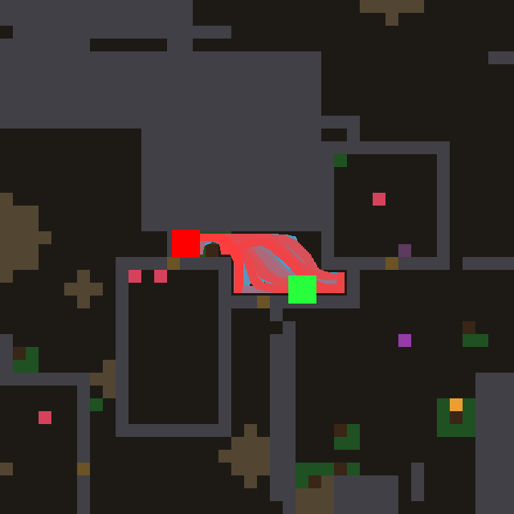

# night lab — 2026-11-04T11:35:33

Model `agent-in-session (mailbox)` | 12.0 h | world default | train [0, 1, 2, 3, 4, 5, 6, 7, 8, 9, 10, 11, 12, 13, 14, 15, 16, 17, 18, 19] | holdout [20, 21, 22, 23, 24, 25, 26, 27, 28, 29, 30, 31, 32, 33, 34, 35] | 8000 ticks/life | tune 5 | deep every 5 | theory every 6 | observe every 8

- anchor #0 `laws/atlas_wave.nomos`: train 14.8 meals [28, 27, 10, 35, 13, 4, 5, 5, 33, 12, 5, 7, 23, 23, 18, 8, 0, 28, 5, 6], holdout 19.6

- anchor #1 `laws/atlas_confine.nomos`: train 25.7 meals [37, 39, 18, 30, 23, 22, 13, 34, 26, 13, 33, 36, 33, 24, 29, 30, 0, 34, 14, 26], holdout 25.7

- anchor #2 `laws/atlas_ghost.nomos`: train 19.2 meals [28, 5, 25, 11, 13, 18, 16, 33, 29, 12, 4, 24, 21, 32, 16, 26, 0, 28, 23, 20], holdout 18.6

> 11:41 model job `design` started

---

## Turn 0 -> island #3

**Hypothesis:** The map gets a FOOTPRINT memory: a slowly fading `trail` of where the agent has stood, scrolling with the map. Remembered sources (a `ghost` that lingers at 0.99) are wiped wherever the agent has walked, and smelled sources painted onto trodden ground lose most of their weight, while seen morsels keep full weight. Poisoned cells (`bad`) block the wave. This breaks the smell trap, where the bearing flips and leads the agent back and forth over the same cells. Ground the agent has already searched stops calling, so the wave goes to sources it has not checked yet and to the frontier, and the confinement damping keeps nooks from dominating.

Prediction 27.5, got **24.2** meals, fitness 473, per world [41, 42, 15, 24, 12, 27, 16, 36, 30, 2, 36, 25, 32, 33, 31, 33, 0, 17, 12, 21]; model 42.1 s, repairs 0

value on the test map: max 1.00, mean 0.53, 0% at the cap -> healthy: the best neighbour points at the source

```nomos
channel source
channel solid
channel thing
channel bad
channel here
channel leak
channel value
channel trail
channel ghost
channel confinement
channel injection

# footprint memory: 1 where the agent stands, fading slowly, scrolls with the map
rule walk:
  when 1
  set trail = max(here, 0.995 * trail)

# sources linger, but are wiped wherever the agent has recently walked
rule linger:
  when 1
  set ghost = max(source, 0.99 * ghost) * (1 - trail)

rule calc_conf:
  when 1
  set confinement = sum8(solid)

# seen morsels stay true; remembered/smelled sources lose weight on trodden ground and in nooks
rule inject:
  when 1
  set injection = max(thing * (1 - bad), max(source, ghost) * (1 - 0.7 * trail)) * (1 - bad) / (1 + 0.5 * confinement)

# Bellman wave; a burned cell does not pass the wave
rule wave:
  when 1
  set value = max(injection, max(0.94 * max4(value), 0.916214 * max8(value))) * (1 - solid * (1 - leak)) * (1 - 0.9 * bad)
```

> 11:51 model job `design` started

---

## Turn 1 -> island #4

**Hypothesis:** Every frontier mark is painted at the same 0.12, so a crack in a wall that leads nowhere pulls the agent as hard as the mouth of a big unexplored region. I add an `openness` field (unknown territory, smoothed a few rings out) and weight frontier sources by it, so exploration flows toward where the most unseen ground is, while food sources keep confinement suppression and burned cells stop the wave. On worlds where meals come from exploring, the agent should reach new food faster and waste fewer trips into small pockets.

Prediction 27.0, got **27.2** meals, fitness 539, per world [38, 30, 17, 38, 21, 26, 25, 31, 31, 27, 27, 24, 25, 26, 30, 31, 0, 42, 22, 34]; model 48.1 s, repairs 0

value on the test map: max 1.00, mean 0.53, 0% at the cap -> healthy: the best neighbour points at the source

```nomos
channel source
channel solid
channel free
channel thing
channel scent
channel bad
channel leak
channel value
channel unknown
channel openness
channel frontier
channel confinement
channel injection

# what is not yet known (neither seen free nor seen solid)
rule known:
  when 1
  set unknown = (1 - free) * (1 - solid)

# how much unknown lies around a cell, spread a few rings out (bounded below 1)
rule spread:
  when 1
  set openness = 0.5 * avg8(unknown) + 0.45 * avg8(openness)

# the faint frontier marks: a source that is neither smell nor a seen morsel
rule mark:
  when 1
  set frontier = where((source > 0) and (source < 0.13) and (thing < 0.01) and (scent < 0.01), 1, 0)

rule calc_conf:
  when 1
  set confinement = sum8(solid)

# frontier counts by the unknown territory behind it; food as before; burned cells inject nothing
rule inject:
  when 1
  set injection = where(frontier > 0, source * (0.3 + 2 * openness), max(thing, source)) * (1 - bad) / (1 + 0.5 * confinement)

# Bellman wave; a burned cell does not pass the wave
rule wave:
  when 1
  set value = max(injection, max(0.94 * max4(value), 0.916214 * max8(value))) * (1 - solid * (1 - leak)) * (1 - 0.9 * bad)
```

> 12:07 model job `design` started

### Holdout checkpoint at 0.57 h

```
  #4   train 27.2 meals  holdout 25.1  (tuned 5x) | Every frontier mark is painted at the same 0.12, so a crack in a wall that leads nowhere pulls the agent as ha
  #3   train 24.2 meals  holdout 20.2  (tuned 5x) | The map gets a FOOTPRINT memory: a slowly fading `trail` of where the agent has stood, scrolling with the map.
  #0   train 14.8 meals  holdout 19.6  (hand-written) | the reference Bellman wave
  #1   train 25.7 meals  holdout 25.7  (hand-written) | Confinement suppression (night lab 2026-09-23, champion #35): a source hemmed in by solid counts less, so loca
  #2   train 19.2 meals  holdout 18.6  (hand-written) | sources linger (ghost), erased under the agent
  CONTROL: #1's law, constants tuned by random search 9x: train 25.7 meals, holdout 25.7
```

---

## Turn 2 -> island #5

**Hypothesis:** The map gets a WEAR memory: footprints accumulate (bounded) where the agent stands and spread into a halo of worn ground, so a smell that keeps pointing into ground the agent has already circled loses its pull (the geodesic-bearing limit cycle breaks) while seen morsels keep full weight. Frontier near worn ground is mildly discounted and the wave passes trodden cells slightly less well, so the agent prefers fresh routes and unexplored territory once it starts looping — this should rescue the trap worlds (world 16) without hurting the direct approach to visible food.

Prediction 28.0, got **24.9** meals, fitness 500, per world [25, 21, 22, 19, 30, 24, 23, 30, 38, 16, 25, 29, 28, 25, 35, 30, 0, 37, 7, 35]; model 48.1 s, repairs 0; vocabulary twin of #4

value on the test map: max 0.70, mean 0.42, 0% at the cap -> healthy: the best neighbour points at the source

```nomos
channel source
channel solid
channel free
channel thing
channel scent
channel bad
channel leak
channel here
channel value
channel unknown
channel openness
channel frontier
channel confinement
channel trail
channel worn
channel injection

# what is not yet known (neither seen free nor seen solid)
rule known:
  when 1
  set unknown = (1 - free) * (1 - solid)

# how much unknown lies around a cell, spread a few rings out (bounded below 1)
rule spread:
  when 1
  set openness = 0.5 * avg8(unknown) + 0.45 * avg8(openness)

# the faint frontier marks: a source that is neither smell nor a seen morsel
rule mark:
  when 1
  set frontier = where((source > 0) and (source < 0.13) and (thing < 0.01) and (scent < 0.01), 1, 0)

rule calc_conf:
  when 1
  set confinement = sum8(solid)

# footprints: ground stood on accumulates (bounded at 1), fades slowly; scrolls with the map
rule tread:
  when 1
  set trail = where(here > 0.5, min(1, trail + 0.03), 0.998 * trail)

# a halo of worn ground: where the agent has been circling
rule wear:
  when 1
  set worn = max(trail, 0.85 * max8(worn))

# frontier by unknown behind it; smell that keeps pointing into worn ground loses its pull; seen food untouched
rule inject:
  when 1
  set injection = where(frontier > 0, source * (0.3 + 2 * openness) * (1 - 0.4 * worn), max(thing, source * (1 - 0.8 * worn * (1 - thing)))) * (1 - bad) / (1 + 0.5 * confinement)

# Bellman wave; burned cells block, trodden cells pass a little less (prefer fresh routes)
rule wave:
  when 1
  set value = max(injection, max(0.94 * max4(value), 0.916214 * max8(value))) * (1 - solid * (1 - leak)) * (1 - 0.9 * bad) * (1 - 0.1 * trail)
```

> 12:29 model job `design` started

---

## Turn 3 -> island #6

**Hypothesis:** The wave stops spreading at one flat price: each cell now has its own step cost. Known-free ground is cheap (0.95), unknown ground is expensive (0.89, because it may hide a wall), and ground hugging walls costs more. Diagonal spreading is also blocked where it would cut a solid corner. Plans then follow corridors the agent has actually seen and go through door centres, instead of straight lines through imagined space into walls. This should cut the time lost bumping and re-planning when a guessed shortcut turns out to be stone. The agent turns to the unknown only when the frontier is worth it.

Prediction 28.5, got **24.2** meals, fitness 489, per world [34, 33, 24, 34, 25, 22, 21, 37, 36, 34, 14, 22, 23, 22, 14, 18, 0, 34, 6, 32]; model 102.2 s, repairs 0

value on the test map: max 1.00, mean 0.59, 0% at the cap -> healthy: the best neighbour points at the source

```nomos
channel source
channel solid
channel free
channel thing
channel scent
channel bad
channel leak
channel value
channel unknown
channel openness
channel frontier
channel confinement
channel injection
channel step
channel stepd

# what is not yet known (neither seen free nor seen solid)
rule known:
  when 1
  set unknown = (1 - free) * (1 - solid)

# how much unknown lies around a cell, spread a few rings out (bounded below 1)
rule spread:
  when 1
  set openness = 0.5 * avg8(unknown) + 0.45 * avg8(openness)

# the faint frontier marks: a source that is neither smell nor a seen morsel
rule mark:
  when 1
  set frontier = where((source > 0) and (source < 0.13) and (thing < 0.01) and (scent < 0.01), 1, 0)

rule calc_conf:
  when 1
  set confinement = sum8(solid)

# frontier weighted by the unknown behind it; burned cells inject nothing
rule inject:
  when 1
  set injection = where(frontier > 0, source * (0.3 + 2 * openness), max(thing, source)) * (1 - bad) / (1 + 0.5 * confinement)

# per-cell step price: seen-free ground is cheap, guessed ground dear, wall-hugging dearer
rule price:
  when 1
  set step = (0.89 + 0.06 * free) * (1 - 0.01 * sum8(solid))

# the diagonal price is the orthogonal one to the power sqrt 2
rule priced:
  when 1
  set stepd = exp(1.4142 * log(0.0001 + step))

# priced wave; a diagonal only passes if neither corner it squeezes past is solid
rule wave:
  when 1
  set value = max(injection, step * max4(value), stepd * max(shift(value, -1, -1) * (1 - max(shift(solid, -1, 0), shift(solid, 0, -1)) * (1 - leak)), shift(value, 1, -1) * (1 - max(shift(solid, 1, 0), shift(solid, 0, -1)) * (1 - leak)), shift(value, -1, 1) * (1 - max(shift(solid, -1, 0), shift(solid, 0, 1)) * (1 - leak)), shift(value, 1, 1) * (1 - max(shift(solid, 1, 0), shift(solid, 0, 1)) * (1 - leak)))) * (1 - solid * (1 - leak)) * (1 - 0.9 * bad)
```

> 12:35 model job `observe` started

---

## Observer: #4 on world 16



`{'meals': 0, 'ticks': 3511, 'alive': False, 'distance': 420.1, 'cells_visited': 59, 'last500_box': '4x12', 'doors': 0, 'breaks': 0, 'idle_presses': 205, 'nightcaps': 0}`

The agent is born in a small sealed pocket under the rock massif, a strip roughly 4x12 cells walled on every side, and spends all 3511 ticks pacing back and forth inside it until it starves, without ever reaching food. Food is close: berries lie just outside the pocket to the lower left and in the room to the right, and the brown cells in the pocket's walls look like doors or rubble that would have let it out. It does try to get out (205 idle presses), but it never opens a door or chips anything, so it keeps pressing the same stone that will not give. Two parts of the law work against it here: once the pocket is mapped there are no frontier sources inside, and the confinement divisor `1/(1 + 0.5*sum8(solid))` damps exactly the cells along the walls where any way out must begin. The fix I would name is a bounded "tried" memory channel: it builds up on solid cells next to `here` while the agent stands pressing them, decays slowly, and multiplies that cell's leak by (1 - tried). Then the wave stops flowing through stone it has already pushed on and moves round the wall to the next untried segment, which is where the doors are.

### Holdout checkpoint at 1.16 h

```
  #4   train 27.2 meals  holdout 25.1  (tuned 6x) | Every frontier mark is painted at the same 0.12, so a crack in a wall that leads nowhere pulls the agent as ha
  #5   train 25.7 meals  holdout 27.7  (tuned 5x) | The map gets a WEAR memory: footprints accumulate (bounded) where the agent stands and spread into a halo of w
  #6   train 24.2 meals  holdout 28.5  (tuned 1x) | The wave stops spreading at one flat price: each cell now has its own step cost. Known-free ground is cheap (0
  #3   train 24.2 meals  holdout 20.2  (tuned 5x) | The map gets a FOOTPRINT memory: a slowly fading `trail` of where the agent has stood, scrolling with the map.
  #0   train 14.8 meals  holdout 19.6  (hand-written) | the reference Bellman wave
  #1   train 25.7 meals  holdout 25.7  (hand-written) | Confinement suppression (night lab 2026-09-23, champion #35): a source hemmed in by solid counts less, so loca
  #2   train 19.2 meals  holdout 18.6  (hand-written) | sources linger (ghost), erased under the agent
  CONTROL: #1's law, constants tuned by random search 17x: train 28.5 meals, holdout 27.0
```

> 12:58 model job `deep` started

---

## Turn 4 (DEEP) -> island #7

**Hypothesis:** The map gets a per-cell FRUSTRATION memory (`tried`): a solid cell the wave keeps leading the agent into accumulates "I pressed here and it did not give", which closes that cell's leak locally (independent of the per-hue lesson, which is too coarse or too slow when one stone sits on the smell's bearing) and kills the pull through it. In the same move, wall faces that separate known-free ground from unknown ground become faint CRACK sources weighted by leak and by (1 - tried), not divided by confinement — so a sealed pocket (world 16) gets systematically probed wall cell by wall cell, doors and rubble first because their taught leak is high, instead of one stone being pressed 205 times; in op

Prediction 28.0, got **28.6** meals, fitness 568, per world [13, 19, 32, 25, 22, 24, 36, 42, 29, 34, 31, 29, 24, 32, 22, 39, 23, 33, 27, 35]; model 88.3 s, repairs 0

value on the test map: max 1.00, mean 0.53, 0% at the cap -> healthy: the best neighbour points at the source

```nomos
channel source
channel solid
channel free
channel thing
channel scent
channel bad
channel leak
channel here
channel value
channel unknown
channel openness
channel frontier
channel confinement
channel injection
channel step
channel stepd
channel hv
channel tried
channel block
channel crack

# what is not yet known (neither seen free nor seen solid)
rule known:
  when 1
  set unknown = (1 - free) * (1 - solid)

# how much unknown lies around a cell, spread a few rings out (bounded)
rule spread:
  when 1
  set openness = 0.6 * avg8(unknown) + 0.45 * avg8(openness)

# the faint frontier marks: a source that is neither smell nor a seen morsel
rule mark:
  when 1
  set frontier = where((source > 0) and (source < 0.14) and (thing < 0.01) and (scent < 0.01), 1, 0)

rule calc_conf:
  when 1
  set confinement = sum8(solid)

# frontier weighted by the unknown behind it; burned cells inject nothing
rule inject:
  when 1
  set injection = where(frontier > 0, source * (0.4 + 2 * openness), max(thing, source)) * (1 - bad) / (1 + 0.5 * confinement)

# the best value among the agent's eight neighbours, held at the agent's cell
rule lookout:
  when 1
  set hv = where(here > 0.5, max8(value), 0)

# frustration: a solid neighbour the wave leads the agent into, and it is still solid; fades slowly
rule press:
  when 1
  set tried = min(1, 0.9995 * tried + where((solid > 0.5) and (max8(here) > 0.5) and (value > 0.001) and (value >= max8(hv) - 0.000001), 0.012 * (1.2 - leak), 0))

# effective blockage: a stone already pressed in vain lets nothing through
rule blocked:
  when 1
  set block = solid * (1 - leak * (1 - tried))

# a wall face between known-free ground and the unknown is a faint maybe-door, until tried
rule cracks:
  when 1
  set crack = where((solid > 0.3) and (max8(free) > 0.5) and (max8(unknown) > 0.3), 0.06 * (1 - tried), 0)

# per-cell step price: seen-free ground is cheap, guessed ground dear, wall-hugging dearer
rule price:
  when 1
  set step = (0.89 + 0.05 * free) * (1 - 0.01 * sum8(solid))

# the diagonal price is the orthogonal one to the power sqrt 2
rule priced:
  when 1
  set stepd = exp(1.4142 * log(0.0001 + step))

# priced wave; diagonals squeeze past corners only as far as the corners let through
rule wave:
  when 1
  set value = max(injection, crack, step * max4(value), stepd * max(shift(value, -1, -1) * (1 - max(shift(block, -1, 0), shift(block, 0, -1))), shift(value, 1, -1) * (1 - max(shift(block, 1, 0), shift(block, 0, -1))), shift(value, -1, 1) * (1 - max(shift(block, -1, 0), shift(block, 0, 1))), shift(value, 1, 1) * (1 - max(shift(block, 1, 0), shift(block, 0, 1))))) * (1 - block) * (1 - 0.9 * bad)
```
