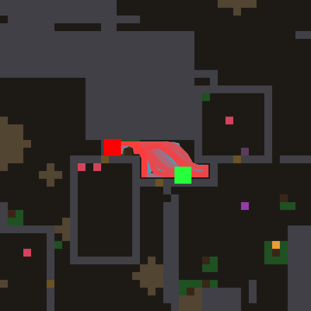
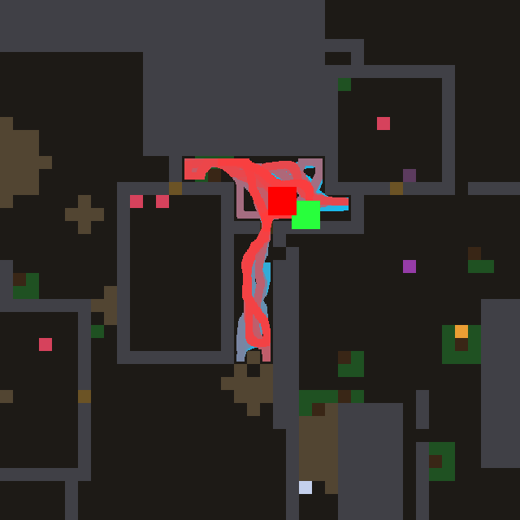
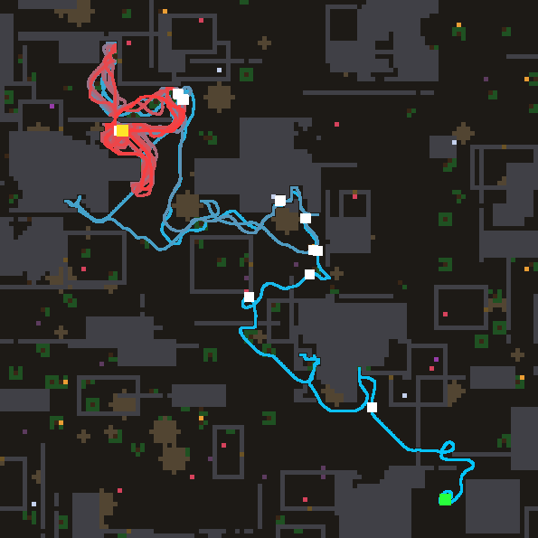
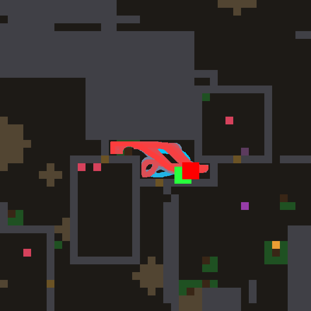
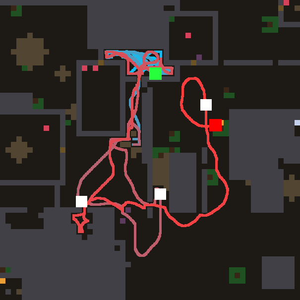
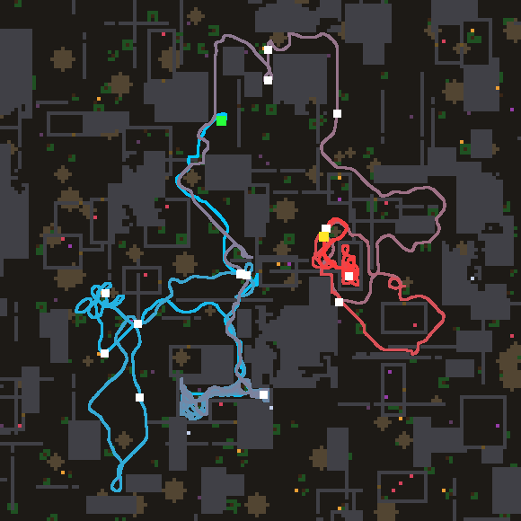

# Night lab summary — 2026-11-04T11:35:33
Model `agent-in-session (mailbox)`, 12.80 h, 29 design turns (5 deep), model busy 0.70 h, waited for other users 0 min, resumed 1x.
```
                                   train  immortal   holdout  immortal
reference wave (#0)                 14.8  11/20    19.6  15/16
confine, hand-written (#1)          25.7  19/20    25.7  14/16
CONTROL: #1 tuned 158x              28.5  19/20    27.0  15/16
#31 (turn 28, tuned 2x)             29.9  20/20    28.5  15/16
#21 (turn 18, tuned 7x)             29.1  19/20    27.8  15/16
#18 (turn 15, tuned 7x)             28.6  19/20    27.8  16/16
#17 (turn 14, tuned 7x)             28.4  19/20    26.6  16/16
#25 (turn 22, tuned 5x)             28.6  20/20    27.1  14/16
```

**FINAL worlds** (32 worlds nobody selected on, not even the model through the prompt):

```
reference wave (#0)                 18.8 meals  immortal 28/32
confine, hand-written (#1)          24.5 meals  immortal 28/32
CONTROL: #1 tuned 158x              26.2 meals  immortal 29/32
#6 tuned 7x                         28.6 meals  immortal 29/32
#16 tuned 6x                        29.7 meals  immortal 30/32
#11 tuned 6x                        30.2 meals  immortal 29/32
#31 tuned 2x                        29.1 meals  immortal 30/32
#21 tuned 7x                        27.8 meals  immortal 28/32
#6 as written                       27.2 meals  immortal 29/32
```
Design turns: 29 valid (29 first try, 0 after repair), 0 never loaded, 0 constants-only twins. Evaluations: {'llm': 187, 'control': 158, 'holdout': 15}.

Prediction error (|predicted - actual| meals, before tuning): first half 3.2, second half 3.3 over 29 predictions — no gain in prediction.

## Timeline

```
   0.57 h  turns   2  champion #4 train  27.2 hold 25.125  |  control train  25.7 hold 25.6875
   1.16 h  turns   4  champion #4 train  27.2 hold 25.125  |  control train  28.5 hold 27.0
   1.73 h  turns   5  champion #6 train  28.5 hold 33.625  |  control train  28.5 hold 27.0
   2.24 h  turns   6  champion #6 train  28.5 hold 33.625  |  control train  28.5 hold 27.0
   2.76 h  turns   8  champion #6 train  28.5 hold 33.625  |  control train  28.5 hold 27.0
   3.31 h  turns   9  champion #6 train  28.5 hold 33.625  |  control train  28.5 hold 27.0
   3.83 h  turns  10  champion #6 train  28.5 hold 33.625  |  control train  28.5 hold 27.0
   4.45 h  turns  12  champion #6 train  28.5 hold 33.625  |  control train  28.5 hold 27.0
   4.98 h  turns  13  champion #6 train  28.5 hold 33.625  |  control train  28.5 hold 27.0
   5.59 h  turns  15  champion #16 train  28.8 hold 32.625  |  control train  28.5 hold 27.0
   6.18 h  turns  16  champion #18 train  28.6 hold 27.8125  |  control train  28.5 hold 27.0
   6.72 h  turns  17  champion #18 train  28.6 hold 27.8125  |  control train  28.5 hold 27.0
   7.23 h  turns  18  champion #18 train  28.6 hold 27.8125  |  control train  28.5 hold 27.0
   7.78 h  turns  19  champion #21 train  29.1 hold 27.8125  |  control train  28.5 hold 27.0
   8.29 h  turns  20  champion #21 train  29.1 hold 27.8125  |  control train  28.5 hold 27.0
   8.79 h  turns  21  champion #21 train  29.1 hold 27.8125  |  control train  28.5 hold 27.0
   9.35 h  turns  23  champion #21 train  29.1 hold 27.8125  |  control train  28.5 hold 27.0
   9.85 h  turns  24  champion #21 train  29.1 hold 27.8125  |  control train  28.5 hold 27.0
  10.36 h  turns  25  champion #21 train  29.1 hold 27.8125  |  control train  28.5 hold 27.0
  10.90 h  turns  26  champion #21 train  29.1 hold 27.8125  |  control train  28.5 hold 27.0
  11.41 h  turns  28  champion #21 train  29.1 hold 27.8125  |  control train  28.5 hold 27.0
  12.01 h  turns  29  champion #31 train  29.9 hold  28.5  |  control train  28.5 hold 27.0
  12.09 h  turns  29  champion #31 train  29.9 hold  28.5  |  control train  28.5 hold 27.0
```

## Champion #6

**Hypothesis:** The wave stops spreading at one flat price: each cell now has its own step cost. Known-free ground is cheap (0.95), unknown ground is expensive (0.89, because it may hide a wall), and ground hugging walls costs more. Diagonal spreading is also blocked where it would cut a solid corner. Plans then follow corridors the agent has actually seen and go through door centres, instead of straight lines through imagined space into walls. This should cut the time lost bumping and re-planning when a guessed shortcut turns out to be stone. The agent turns to the unknown only when the frontier is worth it.

As written: 24.2 meals; tuned 7x: 28.5.

```nomos
channel source
channel solid
channel free
channel thing
channel scent
channel bad
channel leak
channel value
channel unknown
channel openness
channel frontier
channel confinement
channel injection
channel step
channel stepd

# what is not yet known (neither seen free nor seen solid)
rule known:
  when 0.7089
  set unknown = (1 - free) * (0.8013 - solid)

# how much unknown lies around a cell, spread a few rings out (bounded below 1)
rule spread:
  when 1.087
  set openness = 0.6435 * avg8(unknown) + 0.45 * avg8(openness)

# the faint frontier marks: a source that is neither smell nor a seen morsel
rule mark:
  when 1.102
  set frontier = where((source > 0) and (source < 0.1403) and (thing < 0.01) and (scent < 0.01), 1.21, 0)

rule calc_conf:
  when 1.124
  set confinement = sum8(solid)

# frontier weighted by the unknown behind it; burned cells inject nothing
rule inject:
  when 1.768
  set injection = where(frontier > 0, source * (0.4183 + 2 * openness), max(thing, source)) * (1 - bad) / (1 + 0.5618 * confinement)

# per-cell step price: seen-free ground is cheap, guessed ground dear, wall-hugging dearer
rule price:
  when 1
  set step = (0.89 + 0.04745 * free) * (1 - 0.01066 * sum8(solid))

# the diagonal price is the orthogonal one to the power sqrt 2
rule priced:
  when 1
  set stepd = exp(1.4142 * log(0.0001 + step))

# priced wave; a diagonal only passes if neither corner it squeezes past is solid
rule wave:
  when 1
  set value = max(injection, step * max4(value), stepd * max(shift(value, -0.7359, -0.7829) * (0.8127 - max(shift(solid, -1, 0), shift(solid, 0, -0.8763)) * (1 - leak)), shift(value, 1, -1) * (1 - max(shift(solid, 0.9087, 0), shift(solid, 0, -1.052)) * (1 - leak)), shift(value, -1.472, 1.315) * (1 - max(shift(solid, -1.026, 0), shift(solid, 0, 1.361)) * (1 - leak)), shift(value, 1.212, 1) * (1 - max(shift(solid, 1, 0), shift(solid, 0, 0.9299)) * (1.73 - leak)))) * (1 - solid * (1.396 - leak)) * (0.981 - 0.9 * bad)
```

## Theory, first version (1.99 h)

HELPS: how the wave SPREADS matters most. Confinement (sources hemmed in by solid count less, #1) lifted Bellman 14.8 -> 25.7. Per-cell step cost (cheap known-free, dear unknown, #6) is the real champion: holdout 33.6 against the tuned control's 27.0. Weighting frontier marks by the size of what lies beyond (#4) helped train, less holdout.
HURTS: every footprint memory (trail #3, wear #5, boredom #8) loses 1-6 meals. Penalising where I stood bends the wave away from good corridors and food that respawns. Frustration on pressed stone (#7) gained nothing and dropped on holdout. Lingering sources alone are weak (#2).
FAILURE: sealed pockets (world 16). Once a pocket is mapped it holds no frontier, and confinement mutes everything near its walls, so the wave goes flat and the agent paces. It presses one stone and never tries the brown, leaky cells.
UNTRIED: when the reachable region holds no source, an escape wave seeded at the most leaky solids; commitment/heading; using `bad`; a distance discount from the agent.

## Theory, last version (9.81 h)

HELPS: how the wave SPREADS. Confinement (#1) lifted Bellman 14.8 -> 25.7. Per-cell step cost (#6: known-free cheap, unknown dear) is still the holdout champion (33.6 vs control 27.0). Dig commitment (#16) holds holdout 32.6. A dig claim with its own clock (#21) won train 29.1 but fell to 27.8 on holdout. The clock frees the agent too late: it still laps its start chamber pressing the same faces (51 idle presses), and it starved at a rock with food beside it.
HURTS: anything that outvalues real food. Second fields (#25 walk, #26 reach -5.8), grove sums (#24 -6.1, near the sum cliff), wall memories that change what the wave carries (#23 -2.4), footprints and escape gates (#19, #20). Ghost (#22) and larder (#18) are neutral.
UNTRIED: a dig value capped BELOW any food source, so food always outbids a wall. Gating a dig on "no food wave reaches here". Using `bad`. A distance discount from the agent.

## Observations

**#4 on world 16** — 

The agent is born in a small sealed pocket under the rock massif, a strip roughly 4x12 cells walled on every side, and spends all 3511 ticks pacing back and forth inside it until it starves, without ever reaching food. Food is close: berries lie just outside the pocket to the lower left and in the room to the right, and the brown cells in the pocket's walls look like doors or rubble that would have let it out. It does try to get out (205 idle presses), but it never opens a door or chips anything, so it keeps pressing the same stone that will not give. Two parts of the law work against it here: once the pocket is mapped there are no frontier sources inside, and the confinement divisor `1/(1 + 0.5*sum8(solid))` damps exactly the cells along the walls where any way out must begin. The fix I would name is a bounded "tried" memory channel: it builds up on solid cells next to `here` while the agent stands pressing them, decays slowly, and multiplies that cell's leak by (1 - tried). Then the wave stops flowing through stone it has already pushed on and moves round the wall to the next untried segment, which is where the doors are.

**#6 on world 16** — 

The agent is born in a narrow sealed T of corridors (a short east-west passage and a one-cell-wide shaft running south) and spends its whole life of 3604 ticks shuttling inside it: up the shaft, along the top passage, back down to the dead end at the bottom, again and again, until the track is a solid red smear and it starves where it began. It is not ignoring food it can reach, because nothing edible lies in the pocket; the two pink morsels in the room just west sit behind a wall it never gets through. Its 89 idle presses and 4 breaks show it repeatedly pushing at the corridor walls and the brown rock at the shaft's foot without ever committing to tunnelling out, so after the first few hundred ticks it is pacing between the ends of a corridor it has already fully mapped. The failure is confinement in a room it has exhausted: once every cell of the pocket is known, the only remaining pulls are faint frontier sources just beyond the walls, and the law divides every injection by one plus about half the count of solid neighbours, which is largest in exactly the one-cell shafts and wall-side cells where those exits are, so the escape signal is crushed to roughly a fifth while nothing e

**#16 on world 10** — 

The agent starts in the south-east, travels a winding but productive road north-west through the middle of the map, and eats most of its meals along that corridor while the track is still blue. Once it reaches the upper-left rooms, the whole red half of its life is spent tracing tight loops around one grey rock block and its walls, in an area of about 22x17 cells. In that time it eats almost nothing more, presses walls 55 times without opening a single door, and never returns to the food scattered across the east and south. The failing is a dig commitment that has gone stale. The claim on a solid cell is erased only when the agent walks onto that cell, which it can never do while the wall holds. So a wall that will not give keeps a 0.998-per-pass claim that draws the agent back to press it again and again, while its exploration frontier fades behind it. The fix I would make first is to give up on the dig claim after failed presses. Each idle press at a claimed site should erase or sharply decay that site's dig value and mark it as burned (bad), so a wall that refuses once stops being a source and the frontier wave can pull the agent out of the pocket.

**#18 on world 16** — 

The agent is born in a narrow walled pocket, a strip about four cells high and a dozen long, pinned between the big rock mass above and the walled room below. It spends its whole life of 3529 ticks there: it sweeps back and forth along the strip in tight loops and diagonal scrapes, visiting only 48 cells, and never gets into the open ground where food is growing all around. It is not ignoring visible food, because none is in sight from inside the pocket. What kills it is pacing and pressing against the pocket's walls: 169 idle presses and no door ever opened, so something keeps drawing it back to the same wall faces even though pressing them never works. The first fix would be habituation in the leak and beyond-wall pull: every press or long stay at a wall face that gives nothing should leave a slowly fading "tried, nothing here" mark that switches off the rim and beyond injection behind that face and lowers its leak. The wave would then stop pulling the agent into dead rock, and the remaining weaker gradients, such as the true opening at the end of the strip or an untried wall, would win.

**#21 on world 16** — 

The agent spends its whole early life (all the cyan) inside the small walled chamber beside its start, running laps tight against the chamber's rim and pressing the same faces again and again. That is where the 51 idle presses and most of the 23 breaks went, while open ground and food lay a short corridor away. Only late, once it is already hungry, does it leave by the corridor south. It then roams widely and well, eating three meals in quick succession on a big loop through the lower-middle and eastern rooms. It starves on the far east side, pressed against the big rock block, with a food morsel just beside it: it was probably back to working a wall face when the energy ran out. The one mechanism I would fix first is the habituation on spent wall faces, because as written it never switches on. A face's age is capped at 1 but has to pass about 1.19 before the face counts as spent, and spent can only grow, never fade. So a released face is just as attractive as a fresh one once its age decays, and the agent claims it again, which is the wall-pacing loop in the cyan part of the track.

**#31 on world 18** — 

The agent starts top-centre and spends its cyan youth well: it runs south-west on long, purposeful strokes and collects four or five meals across the western rooms. Then it gets caught at the bottom-centre, where the grey-blue track turns into a dense scribble against one block of rock: it paces back and forth along that face for a long stretch and earns only a single meal there. It escapes north on a wide loop through the top rooms (three more meals). It spends its red old age wound into one small walled room right of centre, circling tightly around a spot where it has already eaten, with short excursions south-east that always come back. The 17x11 last-500 box and 54 idle presses say the same: late in life it is not exploring. It keeps tasting the same walls and the same patch while the whole east and south of the map, still dotted with growing food, stays unvisited. The mechanism I would fix first is a slow-fading "trodden" trace. Every cell the agent stands on would be marked, the mark would fade over a few hundred ticks, and it would divide both the injection and the frontier sources. Ground it has recently walked, and the walls it has recently pressed, would then go dim in th

GIF: `champion.gif` (world 2, first 4000 ticks).
