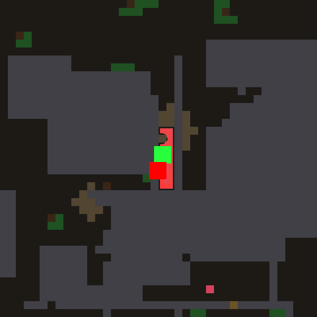
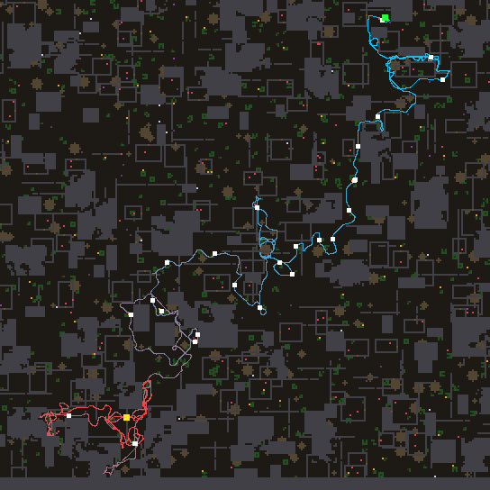
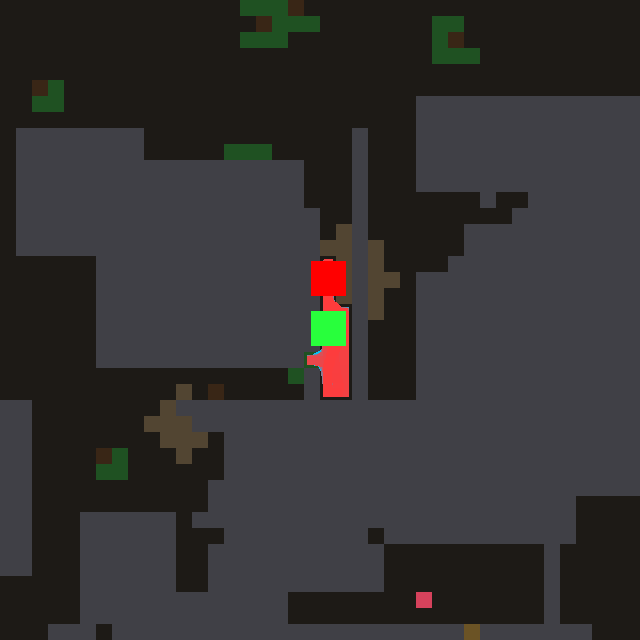
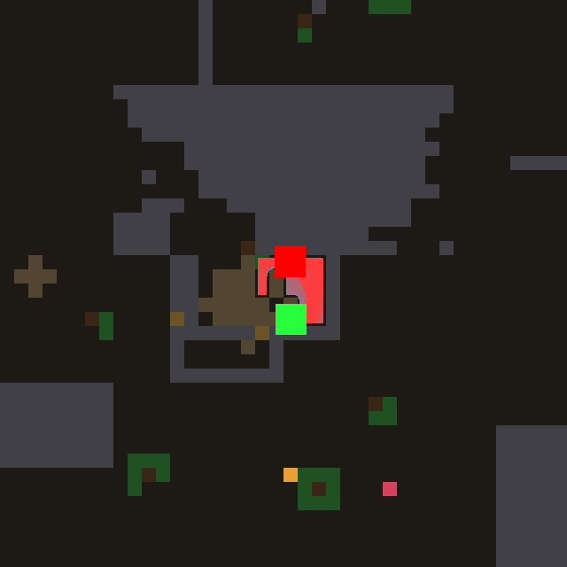
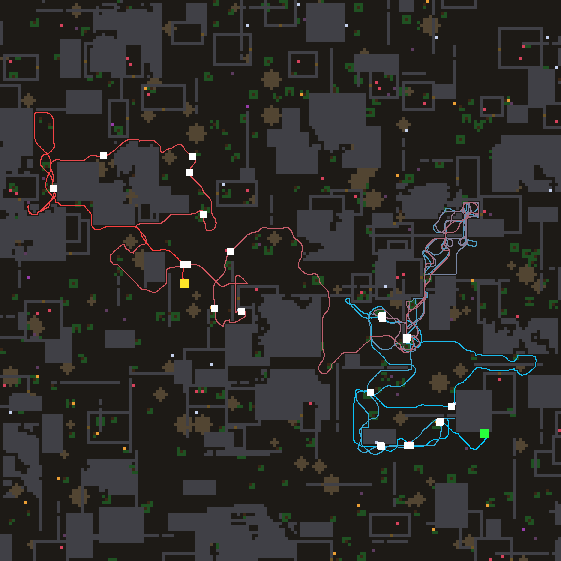

# night lab — 2026-11-04T12:48:30

Model `agent-in-session (mailbox)` | 12.0 h | world default | train [100, 101, 102, 103, 104, 105, 106, 107, 108, 109, 110, 111, 112, 113, 114, 115, 116, 117, 118, 119] | holdout [120, 121, 122, 123, 124, 125, 126, 127, 128, 129, 130, 131, 132, 133, 134, 135] | 8000 ticks/life | tune 5 | deep every 5 | theory every 6 | observe every 8

- anchor #0 `laws/atlas_wave.nomos`: train 20.4 meals [21, 36, 36, 18, 25, 34, 20, 12, 2, 26, 13, 15, 28, 35, 33, 10, 21, 18, 0, 5], holdout 15.5

- anchor #1 `laws/atlas_confine.nomos`: train 23.2 meals [20, 30, 20, 31, 25, 35, 45, 25, 17, 30, 0, 18, 21, 9, 44, 26, 3, 37, 0, 28], holdout 23.6

- anchor #2 `laws/atlas_ghost.nomos`: train 22.7 meals [21, 27, 29, 40, 21, 7, 14, 5, 12, 23, 16, 27, 28, 23, 34, 12, 12, 30, 25, 48], holdout 17.9

> 12:54 model job `design` started

---

## Turn 0 -> island #3

**Hypothesis:** Add inhibition of return. A slowly fading TRAIL channel marks the cells the agent has stood on, and it scrolls with the map. Smell and frontier sources are injected weaker on that trail, while seen morsels still inject at full strength. A smell bearing that flips between two ways round a wall, or a nook already searched, stops pulling the agent back, so the wave turns to unvisited frontier instead of a limit cycle. The 0-meal worlds look like this kind of trap. Remembered poison (`bad`) also damps the wave, so the agent does not walk back over a burn.

Prediction 25.0, got **25.6** meals, fitness 515, per world [41, 30, 29, 31, 18, 31, 12, 25, 37, 19, 25, 21, 30, 23, 45, 18, 24, 19, 0, 35]; model 30.1 s, repairs 0

value on the test map: max 1.00, mean 0.53, 0% at the cap -> healthy: the best neighbour points at the source

```nomos
# Inhibition of return: a decaying trail of where the agent has stood suppresses
# re-injection there, so smell traps and two-way limit cycles burn themselves out.

channel source
channel solid
channel thing
channel here
channel bad
channel value
channel trail
channel confinement
channel injection

# Trail of visited cells (centre + a faint ring), slow fade, bounded in [0, 1].
rule walk:
  when 1
  set trail = max(here, 0.6 * max8(here), 0.997 * trail)

# Local solidity: dead-ends and nooks.
rule calc_conf:
  when 1
  set confinement = sum8(solid)

# Seen morsels inject fully; other sources fade where the agent already went.
rule inject:
  when 1
  set injection = max(thing, source * (1 - 0.8 * trail)) * (1 - bad) / (1 + 0.5 * confinement)

# Bellman wave; remembered poison blocks passage like solid.
rule wave:
  when 1
  set value = max(injection, max(0.94 * max4(value), 0.916214 * max8(value))) * (1 - solid * (1 - leak)) * (1 - 0.9 * bad)
```

> 13:07 model job `design` started

---

## Turn 1 -> island #4

**Hypothesis:** Every frontier mark is painted at the same 0.12 now, so a one-cell sliver of unknown pulls as hard as the mouth of a big unexplored region. A smoothed `dark` channel (unknown mass around a cell) weights each frontier mark by how much map lies behind it, so the agent explores where the information is. A `ghost` channel also remembers seen morsels after they leave sight and erases them where the agent stands, so a turn of the head does not lose a meal. Both sit on top of #3's inhibition of return, so exploration does not double back. Fewer wasted walks should mean more food found per life, and the starving worlds are the ones where exploring well matters most.

Prediction 28.0, got **19.8** meals, fitness 405, per world [19, 25, 15, 11, 15, 29, 31, 16, 32, 29, 0, 13, 14, 24, 29, 27, 20, 23, 0, 24]; model 42.1 s, repairs 0

value on the test map: max 0.30, mean 0.16, 0% at the cap -> healthy: the best neighbour points at the source

```nomos
# Information-gain frontier + remembered morsels, on top of inhibition of return.

channel source
channel solid
channel free
channel thing
channel scent
channel here
channel bad
channel value
channel trail
channel confinement
channel dark
channel ghost
channel injection

# Trail of visited cells, slow fade, bounded in [0, 1].
rule walk:
  when 1
  set trail = max(here, 0.6 * max8(here), 0.997 * trail)

# Local solidity: dead-ends and nooks.
rule calc_conf:
  when 1
  set confinement = sum8(solid)

# Smoothed unknown mass: how much unexplored map lies around a cell, in [0, 1].
rule calc_dark:
  when 1
  set dark = 0.5 * (1 - max(solid, free)) + 0.5 * avg8(dark)

# Seen morsels are remembered after they leave sight; erased where the agent stands or got burned.
rule remember:
  when 1
  set ghost = max(thing, 0.998 * ghost) * (1 - here) * (1 - bad)

# Frontier marks (no scent, no thing) are weighted by the darkness behind them; trail inhibits re-injection.
rule inject:
  when 1
  set injection = max(0.8 * ghost, thing, where(scent + thing > 0.01, source, source * (0.4 + 1.6 * dark)) * (0.7387 - 0.7824 * trail)) * (1.029 - bad) / (1 + 0.5 * confinement)

# Bellman wave; remembered poison blocks passage like solid.
rule wave:
  when 1
  set value = max(injection, max(0.94 * max4(value), 0.916214 * max8(value))) * (1 - solid * (1 - leak)) * (1 - 0.9 * bad)
```

### Holdout checkpoint at 0.57 h

```
  #3   train 26.9 meals  holdout 22.3  (tuned 5x) | Add inhibition of return. A slowly fading TRAIL channel marks the cells the agent has stood on, and it scrolls
  #4   train 23.6 meals  holdout 21.6  (tuned 3x) | Every frontier mark is painted at the same 0.12 now, so a one-cell sliver of unknown pulls as hard as the mout
  #0   train 20.4 meals  holdout 15.5  (hand-written) | the reference Bellman wave
  #1   train 23.2 meals  holdout 23.6  (hand-written) | Confinement suppression (night lab 2026-09-23, champion #35): a source hemmed in by solid counts less, so loca
  #2   train 22.7 meals  holdout 17.9  (hand-written) | sources linger (ghost), erased under the agent
  CONTROL: #1's law, constants tuned by random search 7x: train 27.6 meals, holdout 23.2
```

> 13:27 model job `design` started

---

## Turn 2 -> island #5

**Hypothesis:** The agent gets a global internal state, FRUSTRATION. A wide blur of the trail, read at the centre cell, measures how much it is circling over old ground. That mood spreads across the map from the centre and fades slowly. As it rises, smell sources are damped and frontier marks are amplified, so a smell trap or limit cycle (the 0-meal worlds) flips the wave from exploiting to exploring until the agent reaches fresh ground. There, the trail thins and the smell takes back over.

Prediction 27.5, got **19.9** meals, fitness 384, per world [18, 19, 31, 18, 21, 21, 23, 27, 23, 23, 3, 26, 21, 17, 28, 19, 24, 16, 0, 19]; model 42.1 s, repairs 0

value on the test map: max 1.46, mean 0.77, 0% at the cap -> healthy: the best neighbour points at the source

```nomos
# Frustration-gated exploration: a blurred trail measures how much the agent is
# circling; that mood is broadcast from the centre and flips injection from smell
# (exploit) toward frontier marks (explore) until the agent breaks out.

channel source
channel solid
channel thing
channel scent
channel here
channel bad
channel value
channel trail
channel crowd
channel mood
channel confinement
channel injection

# Trail of visited cells (centre + a faint ring), slow fade, bounded in [0, 1].
rule walk:
  when 1
  set trail = max(here, 0.6 * max8(here), 0.997 * trail)

# Wide blur of the trail: how revisited the neighbourhood of a cell is, in [0, 1].
rule blur:
  when 1
  set crowd = 0.3 * avg8(trail) + 0.7 * avg8(crowd)

# Mood = crowding read at the agent, broadcast over the map, fading slowly.
rule frustrate:
  when 1
  set mood = max(here * clamp(3 * crowd - 0.6, 0, 1), 0.995 * max8(mood))

# Local solidity: dead-ends and nooks.
rule calc_conf:
  when 1
  set confinement = sum8(solid)

# Smell sources weaken and frontier marks strengthen as frustration builds; seen morsels inject fully.
rule inject:
  when 1
  set injection = max(thing, source * (0.7387 - 0.7824 * trail) * where(scent + thing > 0.012, 1 - 0.6 * mood, 1 + 2 * mood)) * (1.029 - bad) / (1 + 0.5 * confinement)

# Bellman wave; remembered poison blocks passage like solid.
rule wave:
  when 1
  set value = max(injection, max(0.94 * max4(value), 0.916214 * max8(value))) * (1 - solid * (1 - leak)) * (1 - 0.9 * bad)
```

> 13:46 model job `design` started

---

## Turn 3 -> island #6

**Hypothesis:** When the open map is spent (no frontier, no smell worth following), every law so far goes flat and the agent stands still and starves, which is my guess for worlds like 110 and 118. A new PROBE source makes the faces of known walls (solid touching known-free) faint sources weighted by their taught leak, kept below the 0.12 frontier and erased by the trail once pressed. That way a sealed agent goes and presses the most door-like walls one after another, opens a way out, and then the frontier and smell outside take over again, on top of #3's inhibition of return.

Prediction 25.0, got **27.4** meals, fitness 544, per world [31, 25, 29, 37, 39, 31, 15, 20, 30, 47, 0, 29, 24, 40, 36, 23, 31, 30, 0, 30]; model 64.1 s, repairs 0; vocabulary twin of #3

value on the test map: max 0.76, mean 0.40, 0% at the cap -> healthy: the best neighbour points at the source

```nomos
# Wall probing: when the open map is spent, the faces of walls become faint sources weighted
# by their taught leak, so the agent presses doors (likely ones first) instead of standing still.

channel source
channel solid
channel free
channel thing
channel here
channel bad
channel leak
channel value
channel trail
channel confinement
channel injection
channel probe

# Trail of visited cells (centre + a faint ring), slow fade, bounded in [0, 1].
rule walk:
  when 1
  set trail = max(here, 0.6 * max8(here), 0.997 * trail)

# Local solidity: dead-ends and nooks.
rule calc_conf:
  when 1
  set confinement = sum8(solid)

# Seen morsels inject fully; other sources fade where the agent already went.
rule inject:
  when 1
  set injection = max(thing, source * (0.7387 - 0.7824 * trail)) * (1.029 - bad) / (1 + 0.5 * confinement)

# Known wall faces (solid touching known-free) are faint sources, scaled by leak, spent once pressed.
rule calc_probe:
  when 1
  set probe = 0.06 * solid * max4(free) * leak * clamp(1 - 1.5 * trail, 0, 1) * (1 - bad)

# Bellman wave over both kinds of source; remembered poison blocks passage like solid.
rule wave:
  when 1
  set value = max(injection, probe, 0.94 * max4(value), 0.916214 * max8(value)) * (1 - solid * (1 - leak)) * (1 - 0.9 * bad)
```

> 13:49 model job `observe` started

---

## Observer: #6 on world 110



`{'meals': 0, 'ticks': 4103, 'alive': False, 'distance': 333.4, 'cells_visited': 27, 'last500_box': '7x2', 'doors': 0, 'breaks': 22, 'idle_presses': 26, 'nightcaps': 0}`

The agent is born in a sealed slot about two cells wide and seven tall, between two rock masses in the middle of the map, and it never leaves it: the whole track, cyan through red, is a short up-and-down shuttle inside that slot, and it starves a cell below where it started. It is not idle. It hits the rock 22 times and the brown chipped cells show it working on two different faces, the cap above the slot and the wall to its upper right, but neither gives way, so it never makes a door and never sees any of the food growing in the open ground just above and to the left. The failing is that it doesn't stick with one face: its own trail covers every cell of so small a room, and the probe term is cut by that trail, so all the wall faces fade together. None of them stays brighter than the rest, so the wave sends the agent back and forth between the top and the side and it chips a little at each. The fix I would make first is commitment to a face: a wall cell that has already given (chipped) should become a stronger source that does not fade, exempt from the trail spending, so the agent keeps striking the same spot until it breaks through instead of spreading its blows over every wall of

### Holdout checkpoint at 1.12 h

```
  #6   train 28.5 meals  holdout 25.8  (tuned 2x) | When the open map is spent (no frontier, no smell worth following), every law so far goes flat and the agent s
  #3   train 26.9 meals  holdout 22.3  (tuned 5x) | Add inhibition of return. A slowly fading TRAIL channel marks the cells the agent has stood on, and it scrolls
  #4   train 23.6 meals  holdout 21.6  (tuned 5x) | Every frontier mark is painted at the same 0.12 now, so a one-cell sliver of unknown pulls as hard as the mout
  #5   train 19.9 meals  holdout  -    (tuned 5x) | The agent gets a global internal state, FRUSTRATION. A wide blur of the trail, read at the centre cell, measur
  #0   train 20.4 meals  holdout 15.5  (hand-written) | the reference Bellman wave
  #1   train 23.2 meals  holdout 23.6  (hand-written) | Confinement suppression (night lab 2026-09-23, champion #35): a source hemmed in by solid counts less, so loca
  #2   train 22.7 meals  holdout 17.9  (hand-written) | sources linger (ghost), erased under the agent
  CONTROL: #1's law, constants tuned by random search 16x: train 27.6 meals, holdout 23.2
```

> 14:04 model job `deep` started

---

## Turn 4 (DEEP) -> island #7

**Hypothesis:** The rule gets an efference copy — `aim` marks the neighbour of the agent that the wave is leading it into — and a solid face that keeps being aimed at accumulates WORK, which turns it into a stronger source, so pressing becomes self-reinforcing instead of being spent by the trail (in #6 the trail killed every face the agent touched, so in the sealed slot of world 110 it shuttled between two faces and chipped neither through). Positive feedback breaks the symmetry between faces and commits to one until rubble gives or the taught leak of that hue drops it; on open worlds the work share stays far below food and frontier, so foraging is unchanged and the two 0-meal worlds should start eating.

Prediction 29.5, got **30.4** meals, fitness 604, per world [23, 34, 40, 31, 28, 24, 18, 29, 14, 33, 37, 36, 25, 31, 39, 28, 30, 40, 26, 43]; model 66.1 s, repairs 0

value on the test map: max 0.76, mean 0.35, 0% at the cap -> healthy: the best neighbour points at the source

```nomos
# Efference copy: the rule reads which neighbour the agent is being led to (aim); a wall face
# it keeps pressing accumulates WORK, and work makes that face a stronger source -> commitment.

channel source
channel solid
channel free
channel thing
channel here
channel bad
channel leak
channel value
channel trail
channel confinement
channel injection
channel probe
channel nbmax
channel aim
channel work

# Trail of visited cells (centre + a faint ring), slow fade, bounded in [0, 1].
rule walk:
  when 1
  set trail = max(here, 0.6 * max8(here), 0.997 * trail)

# Local solidity: dead-ends and nooks.
rule calc_conf:
  when 1
  set confinement = sum8(solid)

# Seen morsels inject fully; other sources fade where the agent already went.
rule inject:
  when 1
  set injection = max(thing, source * (0.7387 - 0.8243 * trail)) * (1.029 - bad) / (1 + 0.7071 * confinement)

# Best neighbour value seen from every cell (the agent's own copy is read below).
rule calc_nbmax:
  when 1
  set nbmax = max8(value)

# Efference copy: 1 on the neighbour(s) of the agent that the decision is heading into.
rule calc_aim:
  when 1
  set aim = max8(here) * (1 - here) * where(value >= max8(here * nbmax) - 0.000001, 1, 0) * where(max8(here * nbmax) > 0, 1, 0)

# Work: effort spent on a solid face; grows while it is aimed at, fades slowly, bounded.
rule effort:
  when 1
  set work = min(1, 0.998 * work + 0.03 * aim * solid)

# Wall faces are faint sources (spent by the trail) plus a committed share that grows with work.
rule calc_probe:
  when 1
  set probe = solid * max4(free) * leak * (1 - bad) * (0.06 * clamp(1 - 1.326 * trail, 0, 1) + 0.3 * work)

# Bellman wave over both kinds of source; remembered poison blocks passage like solid.
rule wave:
  when 1
  set value = max(injection, probe, 0.94 * max4(value), 0.8161 * max8(value)) * (1 - solid * (1.055 - leak)) * (1 - 0.9 * bad)
```

> 14:24 model job `design` started

### Holdout checkpoint at 1.68 h

```
  #7   train 33.5 meals  holdout 27.1  (tuned 5x) | The rule gets an efference copy — `aim` marks the neighbour of the agent that the wave is leading it into — an
  #6   train 28.5 meals  holdout 25.8  (tuned 5x) | When the open map is spent (no frontier, no smell worth following), every law so far goes flat and the agent s
  #3   train 26.9 meals  holdout 22.3  (tuned 5x) | Add inhibition of return. A slowly fading TRAIL channel marks the cells the agent has stood on, and it scrolls
  #4   train 23.6 meals  holdout 21.6  (tuned 5x) | Every frontier mark is painted at the same 0.12 now, so a one-cell sliver of unknown pulls as hard as the mout
  #5   train 19.9 meals  holdout  -    (tuned 5x) | The agent gets a global internal state, FRUSTRATION. A wide blur of the trail, read at the centre cell, measur
  #0   train 20.4 meals  holdout 15.5  (hand-written) | the reference Bellman wave
  #1   train 23.2 meals  holdout 23.6  (hand-written) | Confinement suppression (night lab 2026-09-23, champion #35): a source hemmed in by solid counts less, so loca
  #2   train 22.7 meals  holdout 17.9  (hand-written) | sources linger (ghost), erased under the agent
  CONTROL: #1's law, constants tuned by random search 25x: train 27.2 meals, holdout 25.4
```

---

## Turn 5 -> island #8

**Hypothesis:** #7's commitment only reaches the wall face directly next to the agent. This law traces the decision's whole PATH every step: starting at the agent, each next cell is the best uphill step from the one before. The source that path reaches, whether food, frontier or a wall face, builds up a slowly fading LOCK that makes it brighter. So the agent commits to one target from any distance and stops flip-flopping between two foods or two faces. Wall faces also never wear down to zero, so a spent slot keeps a probe target and does not go flat.

Prediction 32.0, got **29.0** meals, fitness 572, per world [20, 23, 31, 22, 28, 29, 36, 37, 31, 34, 26, 29, 33, 32, 38, 34, 16, 22, 27, 32]; model 104.1 s, repairs 0

value on the test map: max 1.32, mean 0.47, 0% at the cap -> healthy: the best neighbour points at the source

```nomos
# Target lock: the decision's whole PATH (gradient climb from the agent) is traced every
# step; the source it ends on accumulates LOCK, and lock makes that source brighter.

channel source
channel solid
channel free
channel thing
channel here
channel bad
channel leak
channel value
channel trail
channel confinement
channel thr
channel chain
channel lock
channel injection
channel probe

# Trail of visited cells (centre + a faint ring), slow fade, bounded in [0, 1].
rule walk:
  when 1
  set trail = max(here, 0.9144 * max8(here), 0.997 * trail)

# Local solidity: dead-ends and nooks.
rule calc_conf:
  when 1
  set confinement = sum8(solid)

# On the path: the value a neighbour must reach to be this cell's next step (uphill only).
rule calc_thr:
  when 1
  set thr = where(chain > 0, max(max8(value) - 0.00001, value + 0.00001 - 9 * here), 9)

# The path: the agent's cell, then every cell that is the best uphill step of a path cell.
rule calc_chain:
  when 1
  set chain = max(here, where(min8(thr) <= value, 1, 0) * where(value > 0, 1, 0))

# Lock: grows on path cells that hold a source (food, frontier, a wall face); fades slowly.
rule calc_lock:
  when 1
  set lock = min(1, 0.996 * lock + 0.04 * chain * (1 - here) * where(max(injection, probe) > 0.0001, 1, 0))

# Seen morsels inject fully; other sources fade where the agent went; a locked target shines.
rule inject:
  when 1
  set injection = max(thing, source * (0.7387 - 0.8243 * trail)) * (1.029 - bad) * (1 + lock) / (1 + 0.8336 * confinement)

# Wall faces: faint sources, worn down but never to zero by the trail, plus the locked share.
rule calc_probe:
  when 1
  set probe = solid * max4(free) * leak * (1 - bad) * (0.06 * clamp(1 - 1.214 * trail, 0.2, 1) + 0.3 * lock)

# Bellman wave over both kinds of source; remembered poison blocks passage like solid.
rule wave:
  when 1
  set value = max(injection, probe, 0.94 * max4(value), 0.8161 * max8(value)) * (1 - solid * (1.055 - leak)) * (1 - 0.9 * bad)
```

> 14:33 model job `theory` started

---

## Theory (after 6 design turns)

HELPS: local, structural memory. Inhibition of return (a fading trail, #3 +2.4) stops the agent re-walking the same ground. Keeping the wave alive when the map is spent (#6) stops it standing still. An efference copy that builds up pressure on the solid face being aimed at (#7, best at 33.5) turns random chipping into digging out. Confinement suppression (#1) is the only law that holds up on holdout (23.2 -> 23.6).
HURTS: global or smoothed signals. A frustration scalar (#5) and a blurred `dark` frontier (#4) each lost ~7 meals, because they flatten the field. Tracing the whole path (#8) lost 4.5.
WHY: wins come from small, sharp, local terms. Tuning overfits (#7 33.5 -> 27.1 on holdout).
STILL FAILING: in a sealed slot the trail covers every cell and pressure gets split between two faces.
UNTRIED: a winner-take-all lock on one face (the strongest pressure suppresses the others); trying the face nearest the most promising unknown first; using `bad` to avoid what burned it; a leak that grows with pressing.

> evaluation failed (NomosError: line 33: expected ')', got '.413'); pool rebuilt

> 14:47 model job `design` started

---

## Turn 6 -> island #9

**Hypothesis:** The sealed-slot failure is pressure split between two faces, so wall faces now COMPETE: a `crown` field spreads the strongest leak-weighted work across the room by a discounted max, and only the face holding the crown keeps its committed pull (winner-take-all). The faint probe share favours faces that border unknown ground, and a face being dug lets more wave through as its work builds, so the agent stays on one face until it opens and then breaks out to the food beyond.

Prediction 34.5, got **27.9** meals, fitness 552, per world [30, 23, 42, 30, 36, 12, 36, 36, 33, 31, 0, 14, 25, 33, 44, 22, 40, 34, 0, 37]; model 68.1 s, repairs 0; vocabulary twin of #7

value on the test map: max 0.76, mean 0.35, 0% at the cap -> healthy: the best neighbour points at the source

```nomos
# Crowned face: work on wall faces competes; a decaying max ("crown") spreads the strongest
# leak-weighted pressure across the room, and only the face that holds the crown keeps its pull.

channel source
channel solid
channel free
channel thing
channel here
channel bad
channel leak
channel value
channel trail
channel confinement
channel injection
channel probe
channel nbmax
channel aim
channel work
channel crown
channel unk

# Trail of visited cells (centre + a faint ring), slow fade, bounded in [0, 1].
rule walk:
  when 1
  set trail = max(here, 0.9144 * max8(here), 0.997 * trail)

# Local solidity: dead-ends and nooks.
rule calc_conf:
  when 1
  set confinement = sum8(solid)

# Unknown ground: neither seen solid nor known free.
rule calc_unk:
  when 1
  set unk = clamp(1 - solid - free, 0, 1)

# Seen morsels inject fully; other sources fade where the agent already went.
rule inject:
  when 1
  set injection = max(thing, source * (0.7387 - 0.8243 * trail)) * (1.029 - bad) / (1 + 0.8336 * confinement)

# Best neighbour value seen from every cell.
rule calc_nbmax:
  when 1
  set nbmax = max8(value)

# Efference copy: 1 on the neighbour(s) of the agent that the decision is heading into.
rule calc_aim:
  when 1
  set aim = max8(here) * (1 - here) * where(value >= max8(here * nbmax) - 0.000001, 1, 0) * where(max8(here * nbmax) > 0, 1, 0)

# Work: effort spent on a solid face; grows while aimed at, fades slowly, bounded.
rule effort:
  when 1
  set work = min(1, 0.998 * work + 0.03 * aim * solid)

# Crown: strongest leak-weighted work nearby, spread by a discounted max (fades on its own).
rule calc_crown:
  when 1
  set crown = max(work * leak, 0.99 * max8(crown))

# Faint share favours faces bordering unknown; committed share only on the crowned face.
rule calc_probe:
  when 1
  set probe = solid * max4(free) * leak * (1 - bad) * (0.06 * clamp(1 - 1.214 * trail, 0, 1) * (0.5 + avg8(unk)) + 0.3 * work * where(work * leak >= 0.95 * crown, 1, 0))

# Bellman wave; a face being dug lets more wave through as work builds.
rule wave:
  when 1
  set value = max(injection, probe, 0.94 * max4(value), 0.8161 * max8(value)) * (1 - solid * (1.055 - leak) * (1 - 0.3 * work)) * (1 - 0.9 * bad)
```

### Holdout checkpoint at 2.26 h

```
  #8   train 33.5 meals  holdout 24.9  (tuned 5x) | #7's commitment only reaches the wall face directly next to the agent. This law traces the decision's whole PA
  #7   train 33.5 meals  holdout 27.1  (tuned 6x) | The rule gets an efference copy — `aim` marks the neighbour of the agent that the wave is leading it into — an
  #9   train 31.7 meals  holdout 29.8  (tuned 2x) | The sealed-slot failure is pressure split between two faces, so wall faces now COMPETE: a `crown` field spread
  #6   train 28.5 meals  holdout 25.8  (tuned 5x) | When the open map is spent (no frontier, no smell worth following), every law so far goes flat and the agent s
  #3   train 26.9 meals  holdout 22.3  (tuned 5x) | Add inhibition of return. A slowly fading TRAIL channel marks the cells the agent has stood on, and it scrolls
  #4   train 23.6 meals  holdout 21.6  (tuned 5x) | Every frontier mark is painted at the same 0.12 now, so a one-cell sliver of unknown pulls as hard as the mout
  #5   train 19.9 meals  holdout  -    (tuned 5x) | The agent gets a global internal state, FRUSTRATION. A wide blur of the trail, read at the centre cell, measur
  #0   train 20.4 meals  holdout 15.5  (hand-written) | the reference Bellman wave
  #1   train 23.2 meals  holdout 23.6  (hand-written) | Confinement suppression (night lab 2026-09-23, champion #35): a source hemmed in by solid counts less, so loca
  #2   train 22.7 meals  holdout 17.9  (hand-written) | sources linger (ghost), erased under the agent
  CONTROL: #1's law, constants tuned by random search 33x: train 27.2 meals, holdout 25.4
```

> evaluation failed (NomosError: line 50: expected ')', got '.713'); pool rebuilt

> 15:10 model job `design` started

---

## Turn 7 -> island #10

**Hypothesis:** A second, wall-blind X-RAY wave spreads promise (smell, seen food, frontier) straight through rock, so every wall face gets a rank: how close something worth having lies BEHIND it — the axis untried so far, choosing the face nearest the most promising unknown instead of whichever face the trail left last. A decaying envelope (fmax) makes faces compete over ~20 cells, and only the dominant face that borders walked ground accumulates KEEP (losers bleed it), so in a sealed slot the agent digs ONE face — the one facing the food — instead of splitting its pressing between two. In open ground the hold never fires (no spent trail beside faces), so foraging stays as in #7/#8.

Prediction 31.5, got **22.6** meals, fitness 454, per world [29, 19, 27, 20, 31, 19, 21, 30, 22, 32, 19, 18, 15, 11, 31, 25, 15, 28, 19, 21]; model 76.1 s, repairs 0

value on the test map: max 0.76, mean 0.35, 0% at the cap -> healthy: the best neighbour points at the source

```nomos
# X-ray: a second wave that ignores walls ranks every wall face by how close promise (food,
# smell, frontier) lies BEHIND it; the best face in its neighbourhood is held and dug.

channel source
channel solid
channel free
channel thing
channel bright
channel scent
channel here
channel bad
channel leak
channel value
channel trail
channel confinement
channel xray
channel injection
channel facepot
channel fmax
channel keep
channel probe

# Trail of visited cells (centre + a faint ring), slow fade, bounded in [0, 1].
rule walk:
  when 1
  set trail = max(here, 0.9144 * max8(here), 0.997 * trail)

# Local solidity: dead-ends and nooks.
rule calc_conf:
  when 1
  set confinement = sum8(solid)

# X-ray wave: promise spread straight through rock and unknown, discounted, never through poison.
rule calc_xray:
  when 1
  set xray = max(source, scent, thing * bright, 0.9 * max4(xray), 0.873 * max8(xray)) * (1 - 0.9 * bad)

# Seen morsels inject fully; other sources fade where the agent went; nooks count less.
rule inject:
  when 1
  set injection = max(thing, source * (0.74 - 0.82 * trail)) * (1.03 - bad) / (1 + 0.83 * confinement)

# Face potential: a wall face beside known-free ground, ranked by the promise behind it (+tiny tie-break).
rule calc_face:
  when 1
  set facepot = solid * max4(free) * leak * (1 - bad) * (0.02 + xray + 0.002 * posy() + 0.001 * posx())

# Envelope of face potential: the strongest face within reach casts a slowly decaying shadow.
rule calc_fmax:
  when 1
  set fmax = max(facepot, 0.97 * max8(fmax))

# Hold: a face that dominates its neighbourhood AND borders walked ground accumulates commitment.
rule hold:
  when 1
  set keep = min(1, 0.996 * keep + 0.04 * where(facepot > 0, where(facepot >= fmax - 0.000001, 1, 0), 0) * where(max8(trail) > 0.3, 1, 0) - 0.02 * where(facepot < fmax - 0.000001, keep, 0))

# Wall faces: faint sources worn by the trail, plus the held share for the winning face.
rule calc_probe:
  when 1
  set probe = solid * max4(free) * leak * (1 - bad) * (0.06 * clamp(1 - 1.214 * trail, 0.2, 1) + 0.3 * keep)

# Bellman wave over both kinds of source; remembered poison blocks passage like solid.
rule wave:
  when 1
  set value = max(injection, probe, 0.94 * max4(value), 0.8161 * max8(value)) * (1 - solid * (1.055 - leak)) * (1 - 0.9 * bad)
```

> 15:15 model job `observe` started

---

## Observer: #8 on world 108



`{'meals': 26, 'ticks': 8000, 'alive': True, 'distance': 1673.6, 'cells_visited': 1204, 'last500_box': '38x26', 'doors': 0, 'breaks': 0, 'idle_presses': 115, 'nightcaps': 0}`

The agent makes one long, purposeful migration from its start in the top-right corner diagonally down to the bottom-left, eating steadily along a narrow corridor of the map, with one tight curl in the centre where it circles a few times before moving on. Late in life (the red part) it stops travelling and wanders tangled back and forth inside one small patch near the bottom-left. It eats only a little there while the whole left half, the top and the right side, all full of growing food, are never visited. It never opens a single walled room (doors 0) even though many of the outlined rooms it passes hold food, and it spends 115 presses pushing on rock that does not give, so its late tangle looks like a hunt for wall faces rather than for food. The one mechanism I would fix first is the lock bonus on wall faces in the probe rule: a wall face the agent has already pressed and that did not give should wear down to nothing under the trail, and should not gain extra brightness from the lock, so lock only strengthens real food and the agent leaves a worked-out patch for the unvisited open ground.

> 15:32 model job `design` started

---

## Turn 8 -> island #11

**Hypothesis:** #7's commitment has no exit. The observed life pressed rock 115 times and never opened a door, so I add FUTILITY. While the agent is aimed into a solid cell, slow evidence builds up there that the stone does not give. That evidence spreads along the connected stone, and it switches off both the faint probe and the committed work, so the agent gives up that rock face and tries other faces, doors among them. A second change is a faint BEACON on the lattice rim, strongest where the WAKE (the walked trail spread outward with a distance discount) is weakest. When the local map is spent, the field then points out of the tangled patch, toward unvisited land, instead of going flat.

Prediction 30.5, got **31.7** meals, fitness 631, per world [16, 29, 48, 37, 25, 35, 10, 35, 36, 30, 31, 34, 31, 37, 35, 36, 33, 29, 26, 41]; model 76.2 s, repairs 0

value on the test map: max 0.76, mean 0.35, 0% at the cap -> healthy: the best neighbour points at the source

```nomos
# Futility + horizon beacon: pressing rock that never gives turns into a spreading GIVE-UP
# along that stone; when the map is spent, a faint beacon on the horizon pulls AWAY from the wake.

channel source
channel solid
channel free
channel thing
channel here
channel bad
channel leak
channel value
channel trail
channel wake
channel confinement
channel injection
channel probe
channel nbmax
channel aim
channel work
channel futile
channel beacon

# Trail of visited cells (centre + a faint ring), slow fade, bounded in [0, 1].
rule walk:
  when 1
  set trail = max(here, 0.9144 * max8(here), 0.997 * trail)

# Wake: distance-discounted nearness to anything walked (high behind the agent, low far ahead).
rule calc_wake:
  when 1
  set wake = max(trail, 0.94 * max8(wake))

# Local solidity: dead-ends and nooks.
rule calc_conf:
  when 1
  set confinement = sum8(solid)

# Seen morsels inject fully; other sources fade where the agent already went.
rule inject:
  when 1
  set injection = max(thing, source * (0.7387 - 0.8243 * trail)) * (1.029 - bad) / (1 + 0.8336 * confinement)

# Best neighbour value seen from every cell.
rule calc_nbmax:
  when 1
  set nbmax = max8(value)

# Efference copy: 1 on the neighbour(s) of the agent that the decision is heading into.
rule calc_aim:
  when 1
  set aim = max8(here) * (1 - here) * where(value >= max8(here * nbmax) - 0.000001, 1, 0) * where(max8(here * nbmax) > 0, 1, 0)

# Work: short-term commitment to the face being pressed.
rule effort:
  when 1
  set work = min(1, 0.998 * work + 0.03 * aim * solid)

# Futility: slow evidence that this stone does not give; spreads along connected solid, fades very slowly.
rule give_up:
  when 1
  set futile = solid * min(1, max(0.9995 * futile + 0.004 * aim, 0.7 * max8(futile)))

# Wall faces: faint sources plus committed work, both switched off as futility builds.
rule calc_probe:
  when 1
  set probe = solid * max4(free) * leak * (1 - bad) * (0.06 * clamp(1 - 1.214 * trail, 0, 1) + 0.3 * work) * clamp(1.5 - 2 * futile, 0, 1)

# Horizon beacon: faint far sources on the lattice rim, strongest where the wake is weakest.
rule calc_beacon:
  when 1
  set beacon = where(max(abs(posx() - 0.5), abs(posy() - 0.5)) > 0.42, 1, 0) * (1 - solid) * 0.12 * clamp(1 - wake, 0, 1)

# Bellman wave over all sources; remembered poison blocks passage like solid.
rule wave:
  when 1
  set value = max(injection, probe, beacon, 0.94 * max4(value), 0.8161 * max8(value)) * (1 - solid * (1.055 - leak)) * (1 - 0.9 * bad)
```

### Holdout checkpoint at 2.85 h

```
  #8   train 33.5 meals  holdout 24.9  (tuned 5x) | #7's commitment only reaches the wall face directly next to the agent. This law traces the decision's whole PA
  #7   train 33.5 meals  holdout 27.1  (tuned 7x) | The rule gets an efference copy — `aim` marks the neighbour of the agent that the wave is leading it into — an
  #9   train 31.7 meals  holdout 29.8  (tuned 5x) | The sealed-slot failure is pressure split between two faces, so wall faces now COMPETE: a `crown` field spread
  #11  train 31.7 meals  holdout  -    (tuned 0x) | #7's commitment has no exit. The observed life pressed rock 115 times and never opened a door, so I add FUTILI
  #10  train 30.9 meals  holdout  -    (tuned 5x) | A second, wall-blind X-RAY wave spreads promise (smell, seen food, frontier) straight through rock, so every w
  #6   train 28.5 meals  holdout 25.8  (tuned 5x) | When the open map is spent (no frontier, no smell worth following), every law so far goes flat and the agent s
  #3   train 26.9 meals  holdout 22.3  (tuned 5x) | Add inhibition of return. A slowly fading TRAIL channel marks the cells the agent has stood on, and it scrolls
  #4   train 23.6 meals  holdout 21.6  (tuned 5x) | Every frontier mark is painted at the same 0.12 now, so a one-cell sliver of unknown pulls as hard as the mout
  #0   train 20.4 meals  holdout 15.5  (hand-written) | the reference Bellman wave
  #1   train 23.2 meals  holdout 23.6  (hand-written) | Confinement suppression (night lab 2026-09-23, champion #35): a source hemmed in by solid counts less, so loca
  #2   train 22.7 meals  holdout 17.9  (hand-written) | sources linger (ghost), erased under the agent
  CONTROL: #1's law, constants tuned by random search 41x: train 27.2 meals, holdout 25.4
```

> 15:55 model job `deep` started

---

## Turn 9 (DEEP) -> island #12

**Hypothesis:** Late in life every law stalls in a spent patch, because nothing in the map remembers which way the agent was travelling. So the efference copy (`aim`) is now streamed radially outward, one cell per step, by copying from the neighbour nearest the agent. Where it reaches the rim of the map it builds a slowly fading HEADING band, and that band is a faint source. When food, smell and frontier run out, the agent keeps migrating in a straight line into unvisited ground where food has grown back, instead of tangling or pressing rock. A second local term, DOOR CONTRAST, makes a wall face a source when its leak is higher than the leak of the solid around it. Once a rock's hue is learned to be dead, a

Prediction 34.5, got **22.9** meals, fitness 444, per world [28, 24, 5, 29, 26, 13, 16, 25, 9, 43, 11, 34, 17, 23, 32, 22, 35, 32, 19, 16]; model 174.2 s, repairs 0

value on the test map: max 0.76, mean 0.35, 0% at the cap -> healthy: the best neighbour points at the source

```nomos
# Heading carrot: the aim is streamed radially out to the map's rim, where it builds a
# persistent HEADING band that is a faint source; plus door contrast on wall faces.

channel source
channel solid
channel free
channel thing
channel here
channel bad
channel leak
channel value
channel trail
channel confinement
channel sl
channel injection
channel probe
channel nbmax
channel aim
channel work
channel stream
channel heading

# Trail of visited cells (centre + a faint ring), slow fade, bounded in [0, 1].
rule walk:
  when 1
  set trail = max(here, 0.9144 * max8(here), 0.997 * trail)

# Local solidity, and each solid's leak (for door contrast).
rule calc_conf:
  when 1
  set confinement = sum8(solid)
  set sl = solid * leak

# Best neighbour value seen from every cell.
rule calc_nbmax:
  when 1
  set nbmax = max8(value)

# Efference copy: 1 on the neighbour(s) of the agent that the decision is heading into.
rule calc_aim:
  when 1
  set aim = max8(here) * (1 - here) * where(value >= max8(here * nbmax) - 0.000001, 1.197, 0) * where(max8(here * nbmax) > 0, 1, 0)

# Stream: the aim travels radially outward one cell per step (copied from the neighbour nearest the agent).
rule calc_stream:
  when 1
  set stream = max(aim, argmax8(0 - (posx() - 0.5) * (posx() - 0.5) - (posy() - 0.5) * (posy() - 0.5), stream)) * (1 - here)

# Heading: where the stream reaches the rim it accumulates; slow fade, bounded.
rule calc_heading:
  when 1
  set heading = min(1, 0.997 * heading + 0.03 * stream * where(max(abs(posx() - 0.5), abs(posy() - 0.5)) > 0.36, 1, 0))

# Work: effort spent on a solid face; grows while it is aimed at, fades slowly, bounded.
rule effort:
  when 1
  set work = min(1, 0.998 * work + 0.03 * aim * solid)

# Sources: seen morsels, senses spent by the trail, and the heading carrot on the rim ahead.
rule inject:
  when 1
  set injection = max(thing, source * (0.7387 - 0.8243 * trail), 0.1 * heading * (1 - trail) * (1 - solid) * where(max(abs(posx() - 0.5), abs(posy() - 0.5)) > 0.36, 1, 0)) * (1.029 - bad) / (1 + 0.8336 * confinement)

# Wall faces: faint probe, committed work, and DOOR CONTRAST (leak above the wall around it).
rule calc_probe:
  when 1
  set probe = solid * max4(free) * (1 - bad) * (leak * (0.06 * clamp(1 - 1.214 * trail, 0, 1) + 0.3 * work) + 0.3 * clamp(leak - sum8(sl) / (0.001 + confinement), 0, 1))

# Bellman wave over all sources; remembered poison blocks passage like solid.
rule wave:
  when 0.9718
  set value = max(injection, probe, 0.94 * max4(value), 0.8161 * max8(value)) * (1 - solid * (1.055 - leak)) * (1 - 0.9 * bad)
```

### Holdout checkpoint at 3.41 h

```
  #8   train 33.5 meals  holdout 24.9  (tuned 5x) | #7's commitment only reaches the wall face directly next to the agent. This law traces the decision's whole PA
  #7   train 33.5 meals  holdout 27.1  (tuned 7x) | The rule gets an efference copy — `aim` marks the neighbour of the agent that the wave is leading it into — an
  #9   train 31.7 meals  holdout 29.8  (tuned 6x) | The sealed-slot failure is pressure split between two faces, so wall faces now COMPETE: a `crown` field spread
  #11  train 31.7 meals  holdout  -    (tuned 5x) | #7's commitment has no exit. The observed life pressed rock 115 times and never opened a door, so I add FUTILI
  #10  train 30.9 meals  holdout  -    (tuned 5x) | A second, wall-blind X-RAY wave spreads promise (smell, seen food, frontier) straight through rock, so every w
  #6   train 28.5 meals  holdout 25.8  (tuned 5x) | When the open map is spent (no frontier, no smell worth following), every law so far goes flat and the agent s
  #3   train 26.9 meals  holdout 22.3  (tuned 5x) | Add inhibition of return. A slowly fading TRAIL channel marks the cells the agent has stood on, and it scrolls
  #4   train 23.6 meals  holdout 21.6  (tuned 5x) | Every frontier mark is painted at the same 0.12 now, so a one-cell sliver of unknown pulls as hard as the mout
  #0   train 20.4 meals  holdout 15.5  (hand-written) | the reference Bellman wave
  #1   train 23.2 meals  holdout 23.6  (hand-written) | Confinement suppression (night lab 2026-09-23, champion #35): a source hemmed in by solid counts less, so loca
  #2   train 22.7 meals  holdout 17.9  (hand-written) | sources linger (ghost), erased under the agent
  CONTROL: #1's law, constants tuned by random search 49x: train 27.2 meals, holdout 25.4
```

> 16:22 model job `design` started

---

## Turn 10 -> island #13

**Hypothesis:** The observed life spent 115 presses on rock and opened no doors, because every solid face next to free ground counted as a wall worth probing. A new `thin` channel keeps only one-cell walls: free on one side and not known solid straight across, which is what a door or a room's outline looks like and what bedrock does not. A `spent` memory marks a face that soaked up full work and is still solid as rock, which wipes its work and silences it. Commitment then goes to doors into food-filled rooms rather than to digging, and once a face proves futile the agent moves on instead of tangling in place.

Prediction 32.5, got **31.6** meals, fitness 630, per world [28, 35, 44, 30, 36, 21, 34, 39, 6, 33, 28, 40, 26, 33, 44, 26, 40, 26, 24, 38]; model 42.1 s, repairs 0; vocabulary twin of #7

value on the test map: max 0.76, mean 0.35, 0% at the cap -> healthy: the best neighbour points at the source

```nomos
# Thin-wall gate + futility exit: only one-cell walls with no solid behind them are worth pressing.

channel source
channel solid
channel free
channel thing
channel here
channel bad
channel leak
channel value
channel trail
channel confinement
channel injection
channel probe
channel nbmax
channel aim
channel work
channel thin
channel spent

# Trail of visited cells (centre + a faint ring), slow fade, bounded in [0, 1].
rule walk:
  when 1
  set trail = max(here, 0.9144 * max8(here), 0.997 * trail)

# Local solidity: dead-ends and nooks.
rule calc_conf:
  when 1
  set confinement = sum8(solid)

# Thin wall: known free on one side and NOT known solid straight across (a door, not bedrock).
rule calc_thin:
  when 1
  set thin = max(shift(free, 1, 0) * (1 - shift(solid, -1, 0)), shift(free, -1, 0) * (1 - shift(solid, 1, 0)), shift(free, 0, 1) * (1 - shift(solid, 0, -1)), shift(free, 0, -1) * (1 - shift(solid, 0, 1)))

# Seen morsels inject fully; other sources fade where the agent already went.
rule inject:
  when 1
  set injection = max(thing, source * (0.7387 - 0.8243 * trail)) * (1.029 - bad) / (1 + 0.8336 * confinement)

# Best neighbour value seen from every cell.
rule calc_nbmax:
  when 1
  set nbmax = max8(value)

# Efference copy: 1 on the neighbour(s) of the agent that the decision is heading into.
rule calc_aim:
  when 1
  set aim = max8(here) * (1 - here) * where(value >= max8(here * nbmax) - 0.000001, 1, 0) * where(max8(here * nbmax) > 0, 1, 0)

# Work: effort on a solid face; grows while aimed at, fades slowly, wiped once the face is spent.
rule effort:
  when 1
  set work = min(1, 0.998 * work + 0.03 * aim * solid) * (1 - spent)

# Futility: a face that soaked up full work and is still solid is rock; remembered, slowly forgiven.
rule futility:
  when 1
  set spent = max(0.9995 * spent, where(work > 0.9, 1, 0) * solid)

# Wall faces are sources only if thin and not spent: faint by default, committed share with work.
rule calc_probe:
  when 1
  set probe = solid * thin * leak * (1 - bad) * (1 - spent) * (0.06 * clamp(1 - 1.214 * trail, 0, 1) + 0.3 * work)

# Bellman wave over both kinds of source; remembered poison blocks passage like solid.
rule wave:
  when 1
  set value = max(injection, probe, 0.94 * max4(value), 0.8161 * max8(value)) * (1 - solid * (1.055 - leak)) * (1 - 0.9 * bad)
```

> 16:45 model job `design` started

### Holdout checkpoint at 3.98 h

```
  #13  train 32.6 meals  holdout 26.9  (tuned 5x) | The observed life spent 115 presses on rock and opened no doors, because every solid face next to free ground 
  #8   train 33.5 meals  holdout 24.9  (tuned 5x) | #7's commitment only reaches the wall face directly next to the agent. This law traces the decision's whole PA
  #7   train 33.5 meals  holdout 27.1  (tuned 7x) | The rule gets an efference copy — `aim` marks the neighbour of the agent that the wave is leading it into — an
  #9   train 31.7 meals  holdout 29.8  (tuned 6x) | The sealed-slot failure is pressure split between two faces, so wall faces now COMPETE: a `crown` field spread
  #11  train 31.7 meals  holdout  -    (tuned 5x) | #7's commitment has no exit. The observed life pressed rock 115 times and never opened a door, so I add FUTILI
  #10  train 30.9 meals  holdout  -    (tuned 5x) | A second, wall-blind X-RAY wave spreads promise (smell, seen food, frontier) straight through rock, so every w
  #6   train 28.5 meals  holdout 25.8  (tuned 5x) | When the open map is spent (no frontier, no smell worth following), every law so far goes flat and the agent s
  #3   train 26.9 meals  holdout 22.3  (tuned 5x) | Add inhibition of return. A slowly fading TRAIL channel marks the cells the agent has stood on, and it scrolls
  #0   train 20.4 meals  holdout 15.5  (hand-written) | the reference Bellman wave
  #1   train 23.2 meals  holdout 23.6  (hand-written) | Confinement suppression (night lab 2026-09-23, champion #35): a source hemmed in by solid counts less, so loca
  #2   train 22.7 meals  holdout 17.9  (hand-written) | sources linger (ghost), erased under the agent
  CONTROL: #1's law, constants tuned by random search 57x: train 27.2 meals, holdout 25.4
```

---

## Turn 11 -> island #14

**Hypothesis:** A new axis, inertia. The wave now plans on its own channel `wave`, and the decision reads `value` = wave times a bounded bonus on the one neighbour straight ahead. The heading comes from a sharp `path` memory: how freshly the agent stood one or two cells directly behind that neighbour. The bonus is never fed back into the wave, so it cannot saturate. Near-ties between local sources (the late tangle in one small patch, the curl in the centre, the two-way flips) now resolve to keeping on in the same direction, so the agent migrates into the unvisited, regrown half of the map instead of re-walking a patch. The wall-face and confinement machinery is unchanged.

Prediction 34.0, got **20.3** meals, fitness 404, per world [26, 24, 22, 20, 17, 32, 17, 30, 5, 25, 0, 23, 15, 26, 33, 16, 26, 26, 0, 23]; model 98.2 s, repairs 0; vocabulary twin of #13

value on the test map: max 0.62, mean 0.29, 0% at the cap -> healthy: the best neighbour points at the source

```nomos
# Momentum: the wave plans on `wave`; the decision reads `value` = wave biased toward going straight on.
channel source
channel solid
channel free
channel thing
channel here
channel bad
channel leak
channel wave
channel value
channel trail
channel path
channel fwd
channel confinement
channel injection
channel nbmax
channel aim
channel work
channel thin
channel spent
channel probe
rule walk:
  when 1.03
  set trail = max(here, 0.9094 * max8(here), 0.997 * trail)
# Path: the centre cells alone, a sharp short memory of where the agent just stood.
rule mark:
  when 1
  set path = max(here, 0.9 * path)
# Heading: on each neighbour of the agent, how fresh the path is one or two cells straight behind.
rule heading:
  when 1
  set fwd = (1 - here) * max(shift(here, 1, 0) * max(shift(path, 2, 0), shift(path, 3, 0)), shift(here, -1, 0) * max(shift(path, -2, 0), shift(path, -3, 0)), shift(here, 0, 1) * max(shift(path, 0, 2), shift(path, 0, 3)), shift(here, 0, -1) * max(shift(path, 0, -2), shift(path, 0, -3)), shift(here, 1, 1) * max(shift(path, 2, 2), shift(path, 3, 3)), shift(here, 1, -1) * max(shift(path, 2, -2), shift(path, 3, -3)), shift(here, -1, 1) * max(shift(path, -2, 2), shift(path, -3, 3)), shift(here, -1, -1) * max(shift(path, -2, -2), shift(path, -3, -3)))
rule calc_conf:
  when 1
  set confinement = sum8(solid)
rule calc_thin:
  when 0.9153
  set thin = max(shift(free, 1, 0) * (1.41 - shift(solid, -1, 0)), shift(free, -1, 0) * (0.8715 - shift(solid, 1, 0)), shift(free, 0, 1) * (1 - shift(solid, 0, -1.041)), shift(free, 0, -1) * (1 - shift(solid, 0, 1)))
rule inject:
  when 0.9342
  set injection = max(thing, source * (0.7387 - 0.8243 * trail)) * (0.8345 - bad) / (1 + 0.8336 * confinement)
rule calc_nbmax:
  when 0.6604
  set nbmax = max8(value)
rule calc_aim:
  when 0.718
  set aim = max8(here) * (1 - here) * where(value >= max8(here * nbmax) - 0.000001, 1, 0) * where(max8(here * nbmax) > 0, 1, 0)
rule effort:
  when 1
  set work = min(1, 0.6799 * work + 0.03 * aim * solid) * (0.9401 - spent)
rule futility:
  when 1.217
  set spent = max(0.9995 * spent, where(work > 0.9, 1, 0) * solid)
rule calc_probe:
  when 1.137
  set probe = solid * thin * leak * (1 - bad) * (1 - spent) * (0.05818 * clamp(1 - 1.404 * trail, 0, 0.5558) + 0.3 * work)
rule plan:
  when 0.8846
  set wave = max(injection, probe, 0.94 * max4(wave), 0.8161 * max8(wave)) * (1 - solid * (1.319 - leak)) * (1 - 0.9 * bad)
# Decision read-out: the straight-on neighbour gets a bounded bonus (inertia), never fed back to the wave.
rule decide:
  when 1
  set value = wave * (1 + 0.3 * min(1, fwd))
```

> 16:52 model job `theory` started

---

## Theory (after 12 design turns)

HELPS: small, sharp, local structure. Inhibition of return (fading trail, #3). Keeping the wave alive when the map is spent (#6). An efference copy that builds pressure on the solid face being aimed at (#7). Faces that compete for pressure (#9 crown): lower on train but the best holdout so far, 29.8. Confinement suppression (#1) also holds up on holdout.
HURTS: anything global, smoothed or directional laid over the field. Frustration (#5), blurred frontier (#4), x-ray wave through rock (#10), a persistent heading (#12) and inertia (#14) cost 7-12 meals each, because they flatten or bias the value field.
NEUTRAL: futility (#11), thin-wall filter (#13), tracing the path (#8).
WHY: tuning overfits (#7 33.5 -> 27.1 holdout); structure that ranks local choices generalizes.
STILL FAILING: zero doors opened, 115 presses on rock; late life stalls in one spent patch while distant food regrows.
UNTRIED: old trail decaying back into a faint source (regrowth); pressing only where `leak` is high; using `bad`.

> 16:53 model job `observe` started

---

## Observer: #13 on world 110



`{'meals': 0, 'ticks': 3952, 'alive': False, 'distance': 414.0, 'cells_visited': 28, 'last500_box': '8x2', 'doors': 0, 'breaks': 21, 'idle_presses': 22, 'nightcaps': 0}`

The agent is born in a one-cell-wide slot about eight cells long between the big rock mass on its left and a thin wall on its right, and it never leaves it: the whole 3952-tick life is a short up-and-down pacing in that 8x2 box (28 cells visited, 414 distance). Just across the thin right-hand wall sit tan morsels, and the agent spends its life pressing that face (21 breaks, 22 idle presses, no door ever opened) instead of walking out the north end of the slot toward the open ground and the green food beyond. It starves at the top of the slot, a step or two from the way out, without having eaten once. The failing is that the "futility exit" never fires: work on a face grows as 0.68 times itself plus 0.03, so it levels off near 0.1 and can never pass the 0.9 needed to mark the face as spent, so the probe on that wall never goes out and keeps pulling the wave back to it. I would fix the work accumulation, raising the gain or lowering the spent threshold so that a face pressed for a few dozen ticks without giving way really does get marked as rock and drops out as a source, which lets the frontier wave lead the agent out of the slot.

> 17:13 model job `design` started

---

## Turn 12 -> island #15

**Hypothesis:** Two changes on new axes. First, a frontier mark is weighted by how much is still unknown behind it (the unknown density in a 5x5 window), so a frontier that opens onto open ground outranks one that only skirts rock. Second, #13's futility threshold could never fire after tuning (0.68*work + 0.03 tops out near 0.09, well under 0.9). I replace it with a `tried` field that just accumulates presses on the aimed face, with no threshold. As tried rises, the face's commitment builds and then dies (0.6 t (1-t)), and its leak is used up. A sealed slot like world 110 then stops pulling the wave through the wall toward the food on the other side, and the agent walks out the open end toward the unexplor

Prediction 31.0, got **27.5** meals, fitness 563, per world [34, 40, 40, 36, 29, 39, 31, 35, 11, 48, 0, 18, 19, 11, 42, 30, 40, 20, 0, 27]; model 72.1 s, repairs 0

value on the test map: max 0.25, mean 0.11, 0% at the cap -> healthy: the best neighbour points at the source

```nomos
# Information-gain frontier + give-up pressure: explore toward open unknown, stop pressing rock.

channel source
channel solid
channel free
channel thing
channel scent
channel here
channel bad
channel leak
channel value
channel trail
channel confinement
channel thin
channel unknown
channel open1
channel gain
channel injection
channel nbmax
channel aim
channel tried
channel probe

# Trail of visited cells (centre + a faint ring), slow fade, bounded in [0, 1].
rule walk:
  when 1
  set trail = max(here, 0.91 * max8(here), 0.997 * trail)

# Local solidity: dead-ends and nooks.
rule calc_conf:
  when 1
  set confinement = sum8(solid)

# Thin wall: known free on one side and not known solid straight across.
rule calc_thin:
  when 1
  set thin = max(shift(free, 1, 0) * (1 - shift(solid, -1, 0)), shift(free, -1, 0) * (1 - shift(solid, 1, 0)), shift(free, 0, 1) * (1 - shift(solid, 0, -1)), shift(free, 0, -1) * (1 - shift(solid, 0, 1)))

# Unknown: neither known free nor known solid.
rule calc_unknown:
  when 1
  set unknown = clamp(1 - free - solid, 0, 1)

# Unknown density in 3x3, then 5x5: how much is still to be learned behind a cell.
rule calc_open1:
  when 1
  set open1 = avg8(unknown)

rule calc_gain:
  when 1
  set gain = avg8(open1)

# Morsels inject fully; smell as before; a FRONTIER mark is weighted by the unknown behind it.
rule inject:
  when 1
  set injection = max(thing, source * where(scent + thing > 0.001, 1, 0.4 + 2 * gain) * (0.74 - 0.82 * trail)) * (0.83 - bad) / (1 + 0.83 * confinement)

# Best neighbour value seen from every cell.
rule calc_nbmax:
  when 1
  set nbmax = max8(value)

# Efference copy: 1 on the neighbour of the agent that the decision is heading into.
rule calc_aim:
  when 1
  set aim = max8(here) * (1 - here) * where(value >= max8(here * nbmax) - 0.000001, 1, 0) * where(max8(here * nbmax) > 0, 1, 0)

# Tried: presses spent on a solid face, accumulated without threshold, forgiven very slowly.
rule calc_tried:
  when 1
  set tried = min(1, 0.9995 * tried + 0.02 * aim * solid)

# Wall faces: faint probe, commitment rises then dies with tried (0.6 t (1-t) peaks mid-way).
rule calc_probe:
  when 1
  set probe = solid * thin * leak * (1 - bad) * (1 - tried) * (0.06 * clamp(1 - 1.4 * trail, 0, 0.55) + 0.6 * tried)

# Bellman wave; a face that was tried and held lets less wave through (its leak is used up).
rule wave:
  when 1
  set value = max(injection, probe, 0.94 * max4(value), 0.8161 * max8(value)) * (1 - solid * clamp(1.32 - leak * (1 - tried), 0, 1)) * (1 - 0.9 * bad)
```

### Holdout checkpoint at 4.49 h

```
  #13  train 32.6 meals  holdout 26.9  (tuned 5x) | The observed life spent 115 presses on rock and opened no doors, because every solid face next to free ground 
  #8   train 33.5 meals  holdout 24.9  (tuned 5x) | #7's commitment only reaches the wall face directly next to the agent. This law traces the decision's whole PA
  #7   train 33.5 meals  holdout 27.1  (tuned 7x) | The rule gets an efference copy — `aim` marks the neighbour of the agent that the wave is leading it into — an
  #9   train 31.7 meals  holdout 29.8  (tuned 6x) | The sealed-slot failure is pressure split between two faces, so wall faces now COMPETE: a `crown` field spread
  #11  train 31.7 meals  holdout  -    (tuned 5x) | #7's commitment has no exit. The observed life pressed rock 115 times and never opened a door, so I add FUTILI
  #10  train 30.9 meals  holdout  -    (tuned 5x) | A second, wall-blind X-RAY wave spreads promise (smell, seen food, frontier) straight through rock, so every w
  #14  train 29.1 meals  holdout  -    (tuned 5x) | A new axis, inertia. The wave now plans on its own channel `wave`, and the decision reads `value` = wave times
  #6   train 28.5 meals  holdout 25.8  (tuned 5x) | When the open map is spent (no frontier, no smell worth following), every law so far goes flat and the agent s
  #0   train 20.4 meals  holdout 15.5  (hand-written) | the reference Bellman wave
  #1   train 23.2 meals  holdout 23.6  (hand-written) | Confinement suppression (night lab 2026-09-23, champion #35): a source hemmed in by solid counts less, so loca
  #2   train 22.7 meals  holdout 17.9  (hand-written) | sources linger (ghost), erased under the agent
  CONTROL: #1's law, constants tuned by random search 63x: train 27.2 meals, holdout 25.4
```

> 17:38 model job `design` started

---

## Turn 13 -> island #16

**Hypothesis:** Late lives stall in a spent patch because nothing remembers where food WAS. A new `larder` channel keeps a slow-fading memory of every seen morsel site (wiped by `bad`); once the trail there has faded, the old site glows again as a faint source, so the wave sends the agent back round its regrowing feeding grounds instead of pacing. Second, futility now counts aimed thoughts with no fast leak and turns on continuously, so the exit from pressing rock always fires (in #13 `work` settled at ~0.09 and never reached 0.9).

Prediction 33.0, got **31.2** meals, fitness 633, per world [31, 25, 35, 31, 45, 44, 26, 15, 37, 40, 28, 12, 33, 37, 43, 27, 34, 31, 23, 28]; model 70.2 s, repairs 0; vocabulary twin of #13, #14, #7

value on the test map: max 0.62, mean 0.29, 0% at the cap -> healthy: the best neighbour points at the source

```nomos
# Larder memory: where morsels were seen is remembered for long; once the trail there has
# faded, the old site glows again as a faint source (food regrows). Futility counts presses.
channel source
channel solid
channel free
channel thing
channel here
channel bad
channel leak
channel value
channel trail
channel confinement
channel injection
channel probe
channel nbmax
channel aim
channel work
channel thin
channel spent
channel larder
# Trail of visited cells (centre + a faint ring), slow fade, bounded in [0, 1].
rule walk:
  when 1
  set trail = max(here, 0.9094 * max8(here), 0.997 * trail)
# Larder: a long memory of seen morsel sites, wiped where poison was refused.
rule remember:
  when 1
  set larder = max(thing, 0.9998 * larder) * (1 - bad)
# Local solidity: dead-ends and nooks.
rule calc_conf:
  when 1
  set confinement = sum8(solid)
# Thin wall: known free on one side and NOT known solid straight across.
rule calc_thin:
  when 1
  set thin = max(shift(free, 1, 0) * (1 - shift(solid, -1, 0)), shift(free, -1, 0) * (1 - shift(solid, 1, 0)), shift(free, 0, 1) * (1 - shift(solid, 0, -1)), shift(free, 0, -1) * (1 - shift(solid, 0, 1)))
# Seen morsels inject fully; other sources fade where the agent went; old larder sites regrow.
rule inject:
  when 1
  set injection = max(thing, source * (0.7387 - 0.8243 * trail), 0.35 * larder * clamp(1 - 1.5 * trail, 0, 1)) * (0.8345 - bad) / (1 + 0.8336 * confinement)
# Best neighbour value seen from every cell.
rule calc_nbmax:
  when 1
  set nbmax = max8(value)
# Efference copy: 1 on the neighbour(s) of the agent that the decision is heading into.
rule calc_aim:
  when 1
  set aim = max8(here) * (1 - here) * where(value >= max8(here * nbmax) - 0.000001, 1, 0) * where(max8(here * nbmax) > 0, 1, 0)
# Work: a COUNT of thoughts spent aimed at a solid face (no fast leak), wiped once spent.
rule effort:
  when 1
  set work = min(1, 0.9995 * work + 0.006 * aim * solid) * (1 - spent)
# Futility grows continuously with work, so the exit always fires eventually; slowly forgiven.
rule futility:
  when 1
  set spent = max(0.9995 * spent, clamp(2 * work - 0.6, 0, 1) * solid)
# Wall faces are sources only if thin and not spent: faint by default, committed share with work.
rule calc_probe:
  when 1
  set probe = solid * thin * leak * (1 - bad) * (1 - spent) * (0.058 * clamp(1 - 1.4 * trail, 0, 0.56) + 0.3 * work)
# Bellman wave over both kinds of source; remembered poison blocks passage like solid.
rule wave:
  when 1
  set value = max(injection, probe, 0.94 * max4(value), 0.8161 * max8(value)) * (1 - solid * (1.319 - leak)) * (1 - 0.9 * bad)
```

### Holdout checkpoint at 4.99 h

```
  #13  train 32.6 meals  holdout 26.9  (tuned 6x) | The observed life spent 115 presses on rock and opened no doors, because every solid face next to free ground 
  #8   train 33.5 meals  holdout 24.9  (tuned 5x) | #7's commitment only reaches the wall face directly next to the agent. This law traces the decision's whole PA
  #7   train 33.5 meals  holdout 27.1  (tuned 7x) | The rule gets an efference copy — `aim` marks the neighbour of the agent that the wave is leading it into — an
  #9   train 31.7 meals  holdout 29.8  (tuned 6x) | The sealed-slot failure is pressure split between two faces, so wall faces now COMPETE: a `crown` field spread
  #16  train 31.2 meals  holdout  -    (tuned 1x) | Late lives stall in a spent patch because nothing remembers where food WAS. A new `larder` channel keeps a slo
  #11  train 31.7 meals  holdout  -    (tuned 5x) | #7's commitment has no exit. The observed life pressed rock 115 times and never opened a door, so I add FUTILI
  #15  train 30.9 meals  holdout  -    (tuned 5x) | Two changes on new axes. First, a frontier mark is weighted by how much is still unknown behind it (the unknow
  #10  train 30.9 meals  holdout  -    (tuned 5x) | A second, wall-blind X-RAY wave spreads promise (smell, seen food, frontier) straight through rock, so every w
  #0   train 20.4 meals  holdout 15.5  (hand-written) | the reference Bellman wave
  #1   train 23.2 meals  holdout 23.6  (hand-written) | Confinement suppression (night lab 2026-09-23, champion #35): a source hemmed in by solid counts less, so loca
  #2   train 22.7 meals  holdout 17.9  (hand-written) | sources linger (ghost), erased under the agent
  CONTROL: #1's law, constants tuned by random search 69x: train 27.2 meals, holdout 25.4
```

> 18:03 model job `deep` started

> evaluation failed (NomosError: line 33: expected ')', got '.556'); pool rebuilt

---

## Turn 14 (DEEP) -> island #17

**Hypothesis:** The 115 presses on rock and the stall in a spent patch come from two things: one wave mixes walking and breaking through, and a fully known map has no sources at all. So I split the plan in two. A WALK wave never enters solid. A DIG wave leaks through solid by the taught `leak`, and it only counts through an `urge` read at the agent: urge is high when the best walkable neighbour is poor, so the agent presses a wall only when walking offers little. The map's outer rings also become a faint source (the world goes on past the edge, faded by the trail), so a spent map still pulls the agent outward instead of letting it stand still or pace.

Prediction 30.5, got **28.1** meals, fitness 571, per world [33, 28, 43, 30, 25, 29, 21, 21, 20, 42, 0, 17, 37, 37, 40, 32, 42, 29, 0, 35]; model 116.2 s, repairs 0

value on the test map: max 0.61, mean 0.32, 0% at the cap -> healthy: the best neighbour points at the source

```nomos
# Two plans, one choice: a WALK wave that never enters solid, a DIG wave that leaks through
# it, and digging only counts as much as walking is poor. The map's rim is a faint source:
# the world goes on past the edge, so a spent map still has somewhere to go.

channel source
channel solid
channel free
channel thing
channel here
channel bad
channel leak
channel value
channel trail
channel confinement
channel injection
channel rim
channel face
channel walk
channel dig
channel wa
channel urge

# Trail of visited cells (centre + a faint ring), slow fade, bounded in [0, 1].
rule walked:
  when 1
  set trail = max(here, 0.91 * max8(here), 0.997 * trail)

# Local solidity: dead-ends and nooks.
rule calc_conf:
  when 1
  set confinement = sum8(solid)

# Seen morsels inject fully; other sources fade where the agent already went.
rule inject:
  when 1
  set injection = max(thing, source * (0.74 - 0.82 * trail)) * clamp(0.83 - bad, 0, 1) / (1 + 0.83 * confinement)

# Beyond the map: a faint source on the outer rings, where the agent has not been.
rule calc_rim:
  when 1
  set rim = 0.02 * clamp(10 * (max(abs(posx() - 0.5), abs(posy() - 0.5)) - 0.36), 0, 1) * (1 - solid) * clamp(1 - trail, 0, 1)

# Wall faces next to known-free ground: faint dig targets, worn down by the trail.
rule calc_face:
  when 1
  set face = solid * max4(free) * leak * (1 - bad) * 0.06 * clamp(1 - 1.4 * trail, 0, 1)

# Walk plan: Bellman wave that solid blocks completely.
rule walk_wave:
  when 1
  set walk = max(injection, rim, 0.94 * max4(walk), 0.916214 * max8(walk)) * (1 - solid) * (1 - 0.9 * bad)

# Dig plan: the same sources plus wall faces, leaking through solid by the taught leak.
rule dig_wave:
  when 1
  set dig = max(injection, face, 0.94 * max4(dig), 0.916214 * max8(dig)) * clamp(1 - solid * (1.3 - leak), 0, 1) * (1 - 0.9 * bad)

# What walking offers the agent: its best walkable neighbour, held at the centre cell.
rule calc_wa:
  when 1
  set wa = here * max8(walk)

# Urge to dig, read beside the agent: high only when the walk plan is poor.
rule calc_urge:
  when 1
  set urge = clamp(1 - 12 * max(wa, max8(wa)), 0, 1)

# The choice: walk unless digging beats it after the urge discount.
rule decide:
  when 1
  set value = max(walk, 0.5 * urge * dig)
```

### Holdout checkpoint at 5.50 h

```
  #13  train 32.6 meals  holdout 26.9  (tuned 6x) | The observed life spent 115 presses on rock and opened no doors, because every solid face next to free ground 
  #8   train 33.5 meals  holdout 24.9  (tuned 6x) | #7's commitment only reaches the wall face directly next to the agent. This law traces the decision's whole PA
  #7   train 33.5 meals  holdout 27.1  (tuned 7x) | The rule gets an efference copy — `aim` marks the neighbour of the agent that the wave is leading it into — an
  #9   train 31.7 meals  holdout 29.8  (tuned 6x) | The sealed-slot failure is pressure split between two faces, so wall faces now COMPETE: a `crown` field spread
  #16  train 31.2 meals  holdout  -    (tuned 5x) | Late lives stall in a spent patch because nothing remembers where food WAS. A new `larder` channel keeps a slo
  #11  train 31.7 meals  holdout  -    (tuned 5x) | #7's commitment has no exit. The observed life pressed rock 115 times and never opened a door, so I add FUTILI
  #15  train 30.9 meals  holdout  -    (tuned 5x) | Two changes on new axes. First, a frontier mark is weighted by how much is still unknown behind it (the unknow
  #10  train 30.9 meals  holdout  -    (tuned 5x) | A second, wall-blind X-RAY wave spreads promise (smell, seen food, frontier) straight through rock, so every w
  #0   train 20.4 meals  holdout 15.5  (hand-written) | the reference Bellman wave
  #1   train 23.2 meals  holdout 23.6  (hand-written) | Confinement suppression (night lab 2026-09-23, champion #35): a source hemmed in by solid counts less, so loca
  #2   train 22.7 meals  holdout 17.9  (hand-written) | sources linger (ghost), erased under the agent
  CONTROL: #1's law, constants tuned by random search 78x: train 27.2 meals, holdout 25.4
```

> 18:25 model job `design` started

---

## Turn 15 -> island #18

**Hypothesis:** #13's futility never fires: its tuned work decays by 0.68 a step, so it settles near 0.09 and never reaches the 0.9 threshold. On world 110 the agent paced its slot pressing rock until it starved. Here futility has no threshold to break. Aimed presses on low-leak solid (stone) wear the face down continuously, and the wear SPREADS along the contiguous rock, so one futile face writes off the whole wall. That lets the frontier at the end of the slot win. Separately, ground walked long ago but not lately (slow memo minus fast trail) regrows as a faint source, so a life stalled in a spent patch is drawn back to old ground where food respawns.

Prediction 33.5, got **27.6** meals, fitness 563, per world [18, 34, 26, 42, 28, 34, 28, 18, 28, 46, 0, 22, 31, 35, 42, 24, 29, 30, 0, 37]; model 74.1 s, repairs 0; vocabulary twin of #13, #16, #14, #7

value on the test map: max 0.74, mean 0.34, 0% at the cap -> healthy: the best neighbour points at the source

```nomos
# Rock is contiguous + regrowth: futility spreads along a stone wall; long-unvisited ground regrows as a faint source.

channel source
channel solid
channel free
channel thing
channel here
channel bad
channel leak
channel value
channel trail
channel memo
channel confinement
channel injection
channel thin
channel nbmax
channel aim
channel work
channel spent
channel probe

# Fast trail of visited cells (inhibition of return), bounded in [0, 1].
rule walk:
  when 1
  set trail = max(here, 0.91 * max8(here), 0.997 * trail)

# Slow memory of where the agent walked; memo - trail = walked long ago, not lately.
rule remember:
  when 1
  set memo = max(here, 0.9998 * memo)

# Local solidity: dead-ends and nooks.
rule calc_conf:
  when 1
  set confinement = sum8(solid)

# Thin wall: known free on one side and not known solid straight across.
rule calc_thin:
  when 1
  set thin = max(shift(free, 1, 0) * (1 - shift(solid, -1, 0)), shift(free, -1, 0) * (1 - shift(solid, 1, 0)), shift(free, 0, 1) * (1 - shift(solid, 0, -1)), shift(free, 0, -1) * (1 - shift(solid, 0, 1)))

# Sources: seen morsels, trail-faded senses, and REGROWTH on ground walked long ago.
rule inject:
  when 1
  set injection = max(thing, source * (0.74 - 0.82 * trail), 0.1 * free * clamp(memo - trail, 0, 1)) * (1 - bad) / (1 + 0.83 * confinement)

# Best neighbour value seen from every cell.
rule calc_nbmax:
  when 1
  set nbmax = max8(value)

# Efference copy: the neighbour(s) of the agent the decision is heading into.
rule calc_aim:
  when 1
  set aim = max8(here) * (1 - here) * where(value >= max8(here * nbmax) - 0.000001, 1, 0) * where(max8(here * nbmax) > 0, 1, 0)

# Pressure on the aimed face, saturating, gone once the face is spent.
rule effort:
  when 1
  set work = min(1, 0.9 * work + 0.1 * aim * solid) * (1 - spent)

# Futility without a threshold: aimed presses on low-leak solid add up, and spread along the contiguous rock.
rule futility:
  when 1
  set spent = min(1, max(0.9995 * spent, 0.85 * max4(spent) * solid * (1 - leak)) + 0.03 * aim * solid * (1 - leak))

# Wall faces are sources only if thin and not spent: faint by default, committed share with work.
rule calc_probe:
  when 1
  set probe = solid * thin * leak * (1 - bad) * (1 - spent) * (0.06 * clamp(1 - 1.4 * trail, 0, 0.56) + 0.3 * work)

# Bellman wave over both kinds of source; remembered poison blocks passage.
rule wave:
  when 1
  set value = max(injection, probe, 0.94 * max4(value), 0.8161 * max8(value)) * (1 - solid * (1.319 - leak)) * (1 - 0.9 * bad)
```

> 18:47 model job `design` started

---

## Turn 16 -> island #19

**Hypothesis:** Every law so far runs ONE wave that blends walking and pressing, so a thin wall with food behind it outbids the long walk out of a slot (world 110: a life spent pressing rock). Now there are two waves: a DRY wave that only spreads through walkable cells, and a WET wave that leaks through solid and wants wall faces, but only faces whose taught `leak` is still high. The agent follows max(dry, 0.7*wet), so a wall is pressed only when it clearly beats walking. A slow `visit` memory minus the fast `trail` turns ground walked long ago back into a faint source, so a spent patch stops holding the agent while food elsewhere regrows.

Prediction 31.5, got **27.9** meals, fitness 569, per world [33, 27, 42, 30, 39, 29, 26, 21, 21, 38, 0, 22, 15, 35, 39, 35, 41, 29, 0, 35]; model 70.1 s, repairs 0; vocabulary twin of #6

value on the test map: max 0.74, mean 0.39, 0% at the cap -> healthy: the best neighbour points at the source

```nomos
# Two waves: a DRY wave that only walks, a WET wave that may leak through solid; the
# agent follows the dry route unless a wall route is clearly better. Old trail regrows.

channel source
channel solid
channel free
channel thing
channel here
channel bad
channel leak
channel value
channel trail
channel visit
channel confinement
channel injection
channel probe
channel dry
channel wet

# Recent trail (fast fade) and long memory of where the agent has ever walked (slow fade).
rule walk:
  when 1
  set trail = max(here, 0.91 * max8(here), 0.997 * trail)

rule remember:
  when 1
  set visit = max(here, 0.9995 * visit)

# Local solidity: dead-ends and nooks.
rule calc_conf:
  when 1
  set confinement = sum8(solid)

# Sources: morsels, senses faded by recent trail, and REGROWTH where the trail went long ago.
rule inject:
  when 1
  set injection = max(thing, source * (0.74 - 0.82 * trail), 0.08 * clamp(visit - trail, 0, 1) * free) * clamp(1 - bad, 0, 1) / (1 + 0.83 * confinement)

# Wall faces are faint sources only where the taught leak says the solid may give.
rule calc_probe:
  when 1
  set probe = solid * max4(free) * where(leak > 0.45, leak, 0) * clamp(1 - bad, 0, 1) * 0.06 * clamp(1 - 1.4 * trail, 0, 0.56)

# Dry wave: Bellman through walkable cells only.
rule wave_dry:
  when 1
  set dry = max(injection, 0.94 * max4(dry), 0.916214 * max8(dry)) * (1 - solid) * (1 - 0.9 * bad)

# Wet wave: Bellman that leaks through solid and also wants the probe faces.
rule wave_wet:
  when 1
  set wet = max(injection, probe, 0.94 * max4(wet), 0.916214 * max8(wet)) * (1 - solid * (1 - leak)) * (1 - 0.9 * bad)

# Decision: a route through a wall must beat the walking route by a margin.
rule decide:
  when 1
  set value = max(dry, 0.7 * wet)
```

### Holdout checkpoint at 6.06 h

```
  #13  train 32.6 meals  holdout 26.9  (tuned 6x) | The observed life spent 115 presses on rock and opened no doors, because every solid face next to free ground 
  #8   train 33.5 meals  holdout 24.9  (tuned 6x) | #7's commitment only reaches the wall face directly next to the agent. This law traces the decision's whole PA
  #7   train 33.5 meals  holdout 27.1  (tuned 7x) | The rule gets an efference copy — `aim` marks the neighbour of the agent that the wave is leading it into — an
  #9   train 31.7 meals  holdout 29.8  (tuned 6x) | The sealed-slot failure is pressure split between two faces, so wall faces now COMPETE: a `crown` field spread
  #16  train 31.2 meals  holdout  -    (tuned 5x) | Late lives stall in a spent patch because nothing remembers where food WAS. A new `larder` channel keeps a slo
  #11  train 31.7 meals  holdout  -    (tuned 5x) | #7's commitment has no exit. The observed life pressed rock 115 times and never opened a door, so I add FUTILI
  #15  train 30.9 meals  holdout  -    (tuned 5x) | Two changes on new axes. First, a frontier mark is weighted by how much is still unknown behind it (the unknow
  #18  train 30.3 meals  holdout  -    (tuned 5x) | #13's futility never fires: its tuned work decays by 0.68 a step, so it settles near 0.09 and never reaches th
  #0   train 20.4 meals  holdout 15.5  (hand-written) | the reference Bellman wave
  #1   train 23.2 meals  holdout 23.6  (hand-written) | Confinement suppression (night lab 2026-09-23, champion #35): a source hemmed in by solid counts less, so loca
  #2   train 22.7 meals  holdout 17.9  (hand-written) | sources linger (ghost), erased under the agent
  CONTROL: #1's law, constants tuned by random search 85x: train 27.8 meals, holdout 25.7
```

> 19:06 model job `design` started

---

## Turn 17 -> island #20

**Hypothesis:** The wave now doubts unknown ground: each step through a cell that is neither seen free nor known solid costs extra, so routes across mapped, walkable ground beat sources reached through guesses and leaks, and a visible way out of a slot beats a face. Separately, #13's futility exit was dead: work = 0.68*work + 0.03 levels off near 0.09 and never gets to 0.9, so it is now a counter that only climbs while aimed at and only fades when not, and a spent face also stops leaking into the wave. Together these should end the sealed-slot pressing (worlds 110/118) without flattening the field.

Prediction 33.5, got **30.4** meals, fitness 609, per world [32, 24, 18, 33, 42, 34, 29, 26, 28, 16, 32, 38, 41, 27, 33, 33, 21, 24, 39, 37]; model 138.2 s, repairs 0; vocabulary twin of #13, #18, #16, #14, #7

value on the test map: max 0.63, mean 0.33, 0% at the cap -> healthy: the best neighbour points at the source

```nomos
# Doubt-weighted wave + a work COUNTER that cannot stall below the futility threshold.
channel source
channel solid
channel free
channel thing
channel here
channel bad
channel leak
channel value
channel trail
channel confinement
channel thin
channel injection
channel nbmax
channel aim
channel work
channel spent
channel doubt
channel probe
# Trail of visited cells (centre + a faint ring), slow fade, bounded in [0, 1].
rule walk:
  when 1
  set trail = max(here, 0.91 * max8(here), 0.997 * trail)
# Local solidity: dead-ends and nooks.
rule calc_conf:
  when 1
  set confinement = sum8(solid)
# Doubt: how unknown a cell is (neither seen free nor known solid), in [0, 1].
rule calc_doubt:
  when 1
  set doubt = clamp(1 - max(free, solid), 0, 1)
# Thin wall: known free on one side and NOT known solid straight across.
rule calc_thin:
  when 1
  set thin = max(shift(free, 1, 0) * (1 - shift(solid, -1, 0)), shift(free, -1, 0) * (1 - shift(solid, 1, 0)), shift(free, 0, 1) * (1 - shift(solid, 0, -1)), shift(free, 0, -1) * (1 - shift(solid, 0, 1)))
# Seen morsels inject fully; other sources fade where the agent already went.
rule inject:
  when 1
  set injection = max(thing, source * (0.74 - 0.82 * trail)) * (0.85 - bad) / (1 + 0.8 * confinement)
# Best neighbour value seen from every cell.
rule calc_nbmax:
  when 1
  set nbmax = max8(value)
# Efference copy: 1 on the neighbour(s) of the agent that the decision is heading into.
rule calc_aim:
  when 1
  set aim = max8(here) * (1 - here) * where(value >= max8(here * nbmax) - 0.000001, 1, 0) * where(max8(here * nbmax) > 0, 1, 0)
# Work counter: climbs while the face is aimed at, fades only when it is not; wiped once spent.
rule effort:
  when 1
  set work = where(aim * solid > 0, min(1, work + 0.02), 0.995 * work) * (1 - spent)
# Futility: a face that soaked up full work and is still solid is rock; slowly forgiven.
rule futility:
  when 1
  set spent = max(0.9995 * spent, where(work > 0.9, 1, 0) * solid)
# Wall faces are sources only if thin and not spent: faint by default, committed share with work.
rule calc_probe:
  when 1
  set probe = solid * thin * leak * (1 - bad) * (1 - spent) * (0.06 * clamp(1 - 1.4 * trail, 0, 0.56) + 0.3 * work)
# Wave: doubtful ground costs extra per step; spent faces stop leaking; poison blocks.
rule wave:
  when 1
  set value = max(injection, probe, 0.94 * max4(value), 0.916 * max8(value)) * (1 - 0.2 * doubt) * (1 - solid * (1.3 - leak * (1 - spent))) * (1 - 0.9 * bad)
```

> 19:13 model job `theory` started

---

## Theory (after 18 design turns)

HELPS: small, sharp, local structure that ranks neighbouring choices. Inhibition of return (fading trail, #3); keeping the wave alive on a spent map (#6); an efference copy building pressure on the aimed face (#7); faces competing for pressure (#9 crown, best holdout 29.8); confinement suppression (#1, holds on holdout). Thin-wall filter (#13) is the train best, 32.6.
HURTS: anything global, directional or field-splitting: frustration, blurred frontier, x-ray wave, heading (#12, -10.6), inertia (#14, -12.3), unknown-density frontier weighting (#15, -5), separate walk and press waves (#17, #19, -5), doubting unknown ground (#20, -2).
NEUTRAL: futility (#11, #18: it never fires), larder memory (#16), path tracing (#8).
WHY: tuning overfits; local ranking generalizes; second waves and biases distort the field.
STILL FAILING: born in a slot, presses a thin wall with food behind it for a whole life while the open exit is two steps away; zero doors.
UNTRIED: a hard per-face timer (pressure that saturates, then inverts); gating presses by `leak`; using `bad`; old trail regrowing into a faint source.

### Holdout checkpoint at 6.61 h

```
  #13  train 32.6 meals  holdout 26.9  (tuned 6x) | The observed life spent 115 presses on rock and opened no doors, because every solid face next to free ground 
  #8   train 33.5 meals  holdout 24.9  (tuned 6x) | #7's commitment only reaches the wall face directly next to the agent. This law traces the decision's whole PA
  #7   train 33.5 meals  holdout 27.1  (tuned 8x) | The rule gets an efference copy — `aim` marks the neighbour of the agent that the wave is leading it into — an
  #9   train 31.7 meals  holdout 29.8  (tuned 6x) | The sealed-slot failure is pressure split between two faces, so wall faces now COMPETE: a `crown` field spread
  #16  train 31.2 meals  holdout  -    (tuned 5x) | Late lives stall in a spent patch because nothing remembers where food WAS. A new `larder` channel keeps a slo
  #11  train 31.7 meals  holdout  -    (tuned 5x) | #7's commitment has no exit. The observed life pressed rock 115 times and never opened a door, so I add FUTILI
  #15  train 30.9 meals  holdout  -    (tuned 5x) | Two changes on new axes. First, a frontier mark is weighted by how much is still unknown behind it (the unknow
  #18  train 30.3 meals  holdout  -    (tuned 5x) | #13's futility never fires: its tuned work decays by 0.68 a step, so it settles near 0.09 and never reaches th
  #0   train 20.4 meals  holdout 15.5  (hand-written) | the reference Bellman wave
  #1   train 23.2 meals  holdout 23.6  (hand-written) | Confinement suppression (night lab 2026-09-23, champion #35): a source hemmed in by solid counts less, so loca
  #2   train 22.7 meals  holdout 17.9  (hand-written) | sources linger (ghost), erased under the agent
  CONTROL: #1's law, constants tuned by random search 93x: train 28.6 meals, holdout 26.2
```

> 19:33 model job `design` started

---

## Turn 18 -> island #21

**Hypothesis:** #13's futility exit can never fire: work = 0.68*work + 0.03 settles near 0.09, far below its 0.9 threshold, so a slot-born agent presses a thin wall for its whole life. This law replaces the aim/work/thin machinery with a hard timer. Every step the agent stands beside a solid cell, that cell's `tally` rises almost without decay. A full tally SEALS the cell, and the seal creeps a few cells along the connected wall. A sealed wall leaks no wave and holds no probe source, so the food behind it has to pull the agent round the open end. Doors still open within the first few presses, long before any tally fills, and that should turn the zero-meal slot worlds (110, 118) into ordinary ones.

Prediction 33.0, got **29.7** meals, fitness 606, per world [30, 32, 49, 36, 30, 20, 33, 34, 34, 51, 0, 32, 33, 26, 45, 19, 37, 21, 0, 32]; model 52.1 s, repairs 0; vocabulary twin of #6

value on the test map: max 0.74, mean 0.34, 0% at the cap -> healthy: the best neighbour points at the source

```nomos
# Grudge: time spent beside a solid face tallies up (no leak-away), a full tally SEALS the
# face, and the seal creeps a few cells along the connected wall, shutting its leak.

channel source
channel solid
channel free
channel thing
channel here
channel bad
channel leak
channel value
channel trail
channel confinement
channel injection
channel tally
channel seal
channel probe

# Trail of visited cells (centre + a faint ring), slow fade, bounded in [0, 1].
rule walk:
  when 1
  set trail = max(here, 0.91 * max8(here), 0.997 * trail)

# Local solidity: dead-ends and nooks.
rule calc_conf:
  when 1
  set confinement = sum8(solid)

# Hard timer: every step the agent stands beside a solid cell adds to it; wiped if it opens.
rule press_time:
  when 1
  set tally = min(1, 0.9995 * tally + 0.004 * max8(here) * solid) * where(solid > 0.5, 1, 0)

# Seal: a full tally is rock; the verdict creeps along the connected solid, fading per cell.
rule calc_seal:
  when 1
  set seal = max(where(tally > 0.95, 1, 0), 0.8 * max4(seal), 0.999 * seal) * where(solid > 0.5, 1, 0)

# Seen morsels inject fully; other sources fade where the agent already went.
rule inject:
  when 1
  set injection = max(thing, source * (0.74 - 0.8 * trail)) * (1 - bad) / (1 + 0.8 * confinement)

# Unsealed wall faces next to free ground are faint sources, worn down by the trail.
rule calc_probe:
  when 1
  set probe = solid * max4(free) * leak * (1 - bad) * (1 - seal) * 0.06 * clamp(1 - 1.4 * trail, 0, 0.6)

# Bellman wave; a sealed wall lets nothing through, poison blocks like solid.
rule wave:
  when 1
  set value = max(injection, probe, 0.94 * max4(value), 0.8161 * max8(value)) * (1 - solid * (1 - leak * (1 - seal))) * (1 - 0.9 * bad)
```

> 19:49 model job `deep` started

---

## Turn 19 (DEEP) -> island #22

**Hypothesis:** #13's futility could never fire: work = 0.68*work + 0.03*aim settles near 0.09, far below the 0.9 threshold. That is why the slot-born agent pressed a thin wall for its whole life. I am replacing the threshold with a per-cell integral, `tried`. It counts attention spent on a solid face (being aimed into it, or living beside it), forgets slowly, spreads a little along the wall and disappears when the cell opens. It acts in two ways. (1) It multiplies the face's LEAK in the wave by exp(-tried), so the wave from food behind a wall that was tried and did not give stops pinning the agent there, and the open exit wins. (2) The face's own pull becomes tried*exp(-tried), a per-face timer: commitment

Prediction 33.5, got **32.0** meals, fitness 646, per world [45, 41, 41, 28, 32, 42, 29, 45, 35, 49, 0, 36, 17, 35, 44, 31, 20, 31, 0, 39]; model 72.1 s, repairs 0; vocabulary twin of #13, #20, #18, #16, #7, #15

value on the test map: max 0.61, mean 0.29, 0% at the cap -> healthy: the best neighbour points at the source

```nomos
# Tried walls go opaque: attention spent on a solid face (aimed at, or lived beside) is
# integrated per cell; the face's leak and its pull rise, then INVERT, and spread along the wall.

channel source
channel solid
channel free
channel thing
channel here
channel bad
channel leak
channel value
channel trail
channel confinement
channel injection
channel nbmax
channel aim
channel thin
channel tried
channel probe

# Trail of visited cells (centre + a faint ring), slow fade, bounded in [0, 1].
rule walk:
  when 1
  set trail = max(here, 0.91 * max8(here), 0.997 * trail)

# Local solidity: dead-ends and nooks.
rule calc_conf:
  when 1
  set confinement = sum8(solid)

# Thin wall: known free on one side and not known solid straight across.
rule calc_thin:
  when 1
  set thin = max(shift(free, 1, 0) * (1 - shift(solid, -1, 0)), shift(free, -1, 0) * (1 - shift(solid, 1, 0)), shift(free, 0, 1) * (1 - shift(solid, 0, -1)), shift(free, 0, -1) * (1 - shift(solid, 0, 1)))

# Seen morsels inject fully; other sources fade where the agent already went.
rule inject:
  when 1
  set injection = max(thing, source * (0.74 - 0.82 * trail)) * (0.83 - bad) / (1 + 0.83 * confinement)

# Best neighbour value seen from every cell.
rule calc_nbmax:
  when 1
  set nbmax = max8(value)

# Efference copy: 1 on the neighbour(s) of the agent the decision is heading into.
rule calc_aim:
  when 1
  set aim = max8(here) * (1 - here) * where(value >= max8(here * nbmax) - 0.000001, 1, 0) * where(max8(here * nbmax) > 0, 1, 0)

# Tried: per-face spent attention (aimed into, or lived beside), spreads along the wall, slowly forgiven, gone when the cell opens.
rule calc_tried:
  when 1
  set tried = min(6, max(0.9995 * tried + solid * (0.04 * aim * (1.5 - leak) + 0.004 * max8(here)), 0.6 * max4(tried) * solid)) * where(solid > 0.1, 1, 0)

# Wall-face source: faint curiosity that dies with trying, plus a commitment tried*exp(-tried) that peaks, then inverts.
rule calc_probe:
  when 1
  set probe = solid * thin * leak * (1 - bad) * (0.058 * clamp(1 - 1.4 * trail, 0, 0.56) * exp(0 - tried) + 0.8 * tried * exp(0 - tried))

# Bellman wave; a tried face lets less wave through (leak * exp(-tried)), so food behind it stops pinning the agent.
rule wave:
  when 1
  set value = max(injection, probe, 0.94 * max4(value), 0.8161 * max8(value)) * (1 - solid * (1.319 - leak * exp(0 - tried))) * (1 - 0.9 * bad)
```

> 19:54 model job `observe` started

---

## Observer: #13 on world 118



`{'meals': 0, 'ticks': 3999, 'alive': False, 'distance': 464.8, 'cells_visited': 31, 'last500_box': '4x4', 'doors': 0, 'breaks': 14, 'idle_presses': 16, 'nightcaps': 0}`

The agent is born in a tiny sealed pocket under the big rock mass, a cell or two wide and about four cells tall, with the brown rubble patch on its west side, and it never leaves: the whole 4000-tick track (464 cells walked, only 31 distinct cells, last 500 ticks inside a 4x4 box) is a tight shuttle up and down that pocket until it starves at the north end. It does work at the walls (14 breaks, 16 idle presses), but the effort is scattered: it chips one face, turns, chips another, and no face is ever pushed all the way through, so it opens no doors. Open ground and growing food lie only one or two cells beyond the south and east walls, and none of that ever reaches the wave. Inside the pocket there is nothing to smell or see, so its only sources are its own wall faces, and those keep handing the lead to one another. The fix I would make first is the futility rule. Right now it marks a face as spent rock as soon as its work saturates, even when that face is visibly chipping. It should mark a face spent only when pressing it gave nothing. A face that yields should keep its work and stay the committed source until it opens, which gets the agent through one thin wall instead of rotatin

### Holdout checkpoint at 7.16 h

```
  #13  train 32.6 meals  holdout 26.9  (tuned 6x) | The observed life spent 115 presses on rock and opened no doors, because every solid face next to free ground 
  #8   train 33.5 meals  holdout 24.9  (tuned 6x) | #7's commitment only reaches the wall face directly next to the agent. This law traces the decision's whole PA
  #7   train 33.5 meals  holdout 27.1  (tuned 8x) | The rule gets an efference copy — `aim` marks the neighbour of the agent that the wave is leading it into — an
  #22  train 32.0 meals  holdout  -    (tuned 1x) | #13's futility could never fire: work = 0.68*work + 0.03*aim settles near 0.09, far below the 0.9 threshold. T
  #9   train 31.7 meals  holdout 29.8  (tuned 6x) | The sealed-slot failure is pressure split between two faces, so wall faces now COMPETE: a `crown` field spread
  #16  train 31.2 meals  holdout  -    (tuned 5x) | Late lives stall in a spent patch because nothing remembers where food WAS. A new `larder` channel keeps a slo
  #11  train 31.7 meals  holdout  -    (tuned 5x) | #7's commitment has no exit. The observed life pressed rock 115 times and never opened a door, so I add FUTILI
  #15  train 30.9 meals  holdout  -    (tuned 5x) | Two changes on new axes. First, a frontier mark is weighted by how much is still unknown behind it (the unknow
  #0   train 20.4 meals  holdout 15.5  (hand-written) | the reference Bellman wave
  #1   train 23.2 meals  holdout 23.6  (hand-written) | Confinement suppression (night lab 2026-09-23, champion #35): a source hemmed in by solid counts less, so loca
  #2   train 22.7 meals  holdout 17.9  (hand-written) | sources linger (ghost), erased under the agent
  CONTROL: #1's law, constants tuned by random search 101x: train 29.7 meals, holdout 24.6
```

> 20:12 model job `design` started

---

## Turn 20 -> island #23

**Hypothesis:** Sealed-pocket lives starve because every wall face of the pocket looks equal, so effort is split and the agent shuttles between faces. A world-anchored random GRAIN (drawn once per cell as it scrolls into view, then fixed to that place) ranks the faces, and a discounted winner-take-all CREST field gives a steady, trail-proof pull to only the locally best face (thin, leaky as the body taught it, not poisoned). The agent keeps pressing one face until it opens or its taught leak drops below the next one, which turns scattered chipping into one tunnel and should rescue worlds 110/118 without touching open-ground foraging (0.05 stays below the 0.12 frontier).

Prediction 34.0, got **34.8** meals, fitness 702, per world [45, 31, 32, 26, 32, 43, 29, 30, 39, 47, 31, 36, 37, 39, 42, 37, 24, 31, 25, 39]; model 74.1 s, repairs 0; vocabulary twin of #13, #20, #18, #16

value on the test map: max 0.61, mean 0.29, 0% at the cap -> healthy: the best neighbour points at the source

```nomos
# Grain: a world-anchored random rank on every cell (scrolls with the map, never redrawn),
# so equal wall faces stop tying: one face per neighbourhood wins and keeps winning.
channel source
channel solid
channel free
channel thing
channel here
channel bad
channel leak
channel value
channel trail
channel confinement
channel injection
channel nbmax
channel aim
channel work
channel thin
channel grain
channel face
channel crest
channel probe
# Grain: drawn once for a cell when it scrolls into view, then fixed to that place.
rule seed:
  when grain <= 0
  set grain = uniform(0.001, 1)
# Trail of visited cells (centre + a faint ring), slow fade, bounded in [0, 1].
rule walk:
  when 1
  set trail = max(here, 0.91 * max8(here), 0.997 * trail)
# Local solidity: dead-ends and nooks.
rule calc_conf:
  when 1
  set confinement = sum8(solid)
# Thin wall: known free on one side and not known solid straight across.
rule calc_thin:
  when 1
  set thin = max(shift(free, 1, 0) * (1 - shift(solid, -1, 0)), shift(free, -1, 0) * (1 - shift(solid, 1, 0)), shift(free, 0, 1) * (1 - shift(solid, 0, -1)), shift(free, 0, -1) * (1 - shift(solid, 0, 1)))
# Face score: thin, leaky (taught: doors high, stone low), not poisoned, ranked by grain.
rule calc_face:
  when 1
  set face = solid * thin * leak * (1 - bad) * (0.4 + 0.6 * grain)
# Crest: the best face score within reach, discounted with distance (winner-take-all field).
rule calc_crest:
  when 1
  set crest = max(face, 0.93 * max8(crest))
# Seen morsels inject fully; other sources fade where the agent already went.
rule inject:
  when 1
  set injection = max(thing, source * (0.74 - 0.82 * trail)) * (0.83 - bad) / (1 + 0.83 * confinement)
# Best neighbour value seen from every cell.
rule calc_nbmax:
  when 1
  set nbmax = max8(value)
# Efference copy: 1 on the neighbour(s) of the agent that the decision is heading into.
rule calc_aim:
  when 1
  set aim = max8(here) * (1 - here) * where(value >= max8(here * nbmax) - 0.000001, 1, 0) * where(max8(here * nbmax) > 0, 1, 0)
# Work: effort on a solid face; grows while aimed at, fades.
rule effort:
  when 1
  set work = min(1, 0.68 * work + 0.03 * aim * solid)
# Probes: trail-faded faint faces + work, and a steady pull to the local WINNER face only.
rule calc_probe:
  when 1
  set probe = where(face > 0, 1, 0) * (face * (0.06 * clamp(1 - 1.4 * trail, 0, 0.56) + 0.3 * work) + 0.05 * where(face >= crest - 0.000001, 1, 0))
# Bellman wave over both kinds of source; remembered poison blocks passage like solid.
rule wave:
  when 1
  set value = max(injection, probe, 0.94 * max4(value), 0.8161 * max8(value)) * (1 - solid * (1.3 - leak)) * (1 - 0.9 * bad)
```

### Holdout checkpoint at 7.70 h

```
  #23  train 34.8 meals  holdout 29.9  (tuned 3x) | Sealed-pocket lives starve because every wall face of the pocket looks equal, so effort is split and the agent
  #13  train 32.6 meals  holdout 26.9  (tuned 6x) | The observed life spent 115 presses on rock and opened no doors, because every solid face next to free ground 
  #8   train 33.5 meals  holdout 24.9  (tuned 6x) | #7's commitment only reaches the wall face directly next to the agent. This law traces the decision's whole PA
  #7   train 33.5 meals  holdout 27.1  (tuned 8x) | The rule gets an efference copy — `aim` marks the neighbour of the agent that the wave is leading it into — an
  #22  train 32.0 meals  holdout  -    (tuned 5x) | #13's futility could never fire: work = 0.68*work + 0.03*aim settles near 0.09, far below the 0.9 threshold. T
  #9   train 31.7 meals  holdout 29.8  (tuned 6x) | The sealed-slot failure is pressure split between two faces, so wall faces now COMPETE: a `crown` field spread
  #16  train 31.2 meals  holdout  -    (tuned 5x) | Late lives stall in a spent patch because nothing remembers where food WAS. A new `larder` channel keeps a slo
  #11  train 31.7 meals  holdout  -    (tuned 5x) | #7's commitment has no exit. The observed life pressed rock 115 times and never opened a door, so I add FUTILI
  #0   train 20.4 meals  holdout 15.5  (hand-written) | the reference Bellman wave
  #1   train 23.2 meals  holdout 23.6  (hand-written) | Confinement suppression (night lab 2026-09-23, champion #35): a source hemmed in by solid counts less, so loca
  #2   train 22.7 meals  holdout 17.9  (hand-written) | sources linger (ghost), erased under the agent
  CONTROL: #1's law, constants tuned by random search 109x: train 29.7 meals, holdout 24.6
```

> 20:36 model job `design` started

---

## Turn 21 -> island #24

**Hypothesis:** This adds a hard clock to each wall face, replacing the leaky `work` term that fades within a single thought. Every press winds the clock of the face the agent is pressing, and the clock fades only slowly. A wound face becomes a source that grows with its clock and is not damped by the wall, so the agent finishes the face it started instead of chipping a different one each time. Once the clock passes the deadline the face goes dark: no value, no wave through it, until it is slowly forgiven. A sealed-pocket agent should then push one face through, or give up on it within about 60 ticks and move to the next, never splitting its effort.

Prediction 35.5, got **32.8** meals, fitness 668, per world [45, 31, 24, 26, 32, 43, 29, 30, 39, 47, 24, 36, 37, 39, 42, 37, 24, 31, 0, 39]; model 68.1 s, repairs 0; vocabulary twin of #23

value on the test map: max 0.61, mean 0.29, 0% at the cap -> healthy: the best neighbour points at the source

```nomos
# Deadline: a hard per-face timer. Pressing a face winds its clock; a wound face pulls
# harder (commit to ONE face), and a face whose clock runs out goes dark until forgiven.
channel source
channel solid
channel free
channel thing
channel here
channel bad
channel leak
channel value
channel trail
channel confinement
channel injection
channel nbmax
channel aim
channel thin
channel grain
channel face
channel crest
channel probe
channel timer
channel pull
# Grain: a fixed random rank per place, so equal faces stop tying.
rule seed:
  when grain <= 0
  set grain = uniform(0.001, 1)
# Trail of visited cells, slow fade, bounded in [0, 1].
rule walk:
  when 1
  set trail = max(here, 0.91 * max8(here), 0.997 * trail)
rule calc_conf:
  when 1
  set confinement = sum8(solid)
# Thin wall: free on one side, not known solid straight across.
rule calc_thin:
  when 1
  set thin = max(shift(free, 1, 0) * (1 - shift(solid, -1, 0)), shift(free, -1, 0) * (1 - shift(solid, 1, 0)), shift(free, 0, 1) * (1 - shift(solid, 0, -1)), shift(free, 0, -1) * (1 - shift(solid, 0, 1)))
rule calc_face:
  when 1
  set face = solid * thin * leak * (1 - bad) * (0.4 + 0.6 * grain)
rule calc_crest:
  when 1
  set crest = max(face, 0.93 * max8(crest))
rule inject:
  when 1
  set injection = max(thing, source * (0.74 - 0.82 * trail)) * (0.83 - bad) / (1 + 0.83 * confinement)
rule calc_nbmax:
  when 1
  set nbmax = max8(value)
# Efference copy: the neighbour of the agent the decision heads into.
rule calc_aim:
  when 1
  set aim = max8(here) * (1 - here) * where(value >= max8(here * nbmax) - 0.000001, 1, 0) * where(max8(here * nbmax) > 0, 1, 0)
# Clock: wound while pressed, forgotten slowly, capped past the deadline (1), wiped when the face gives.
rule clock:
  when 1
  set timer = solid * min(1.2, 0.9995 * timer + 0.008 * aim * solid)
# Commitment pull: a wound face (clock below deadline) is a source that grows with the clock.
rule calc_pull:
  when 1
  set pull = solid * where(face > 0, 1, 0) * where(timer < 1, 0.5 * timer, 0)
# Faint probes on thin faces, a steady pull to the local winner face.
rule calc_probe:
  when 1
  set probe = where(face > 0, 1, 0) * (face * 0.06 * clamp(1 - 1.4 * trail, 0, 0.56) + 0.05 * where(face >= crest - 0.000001, 1, 0))
# Bellman wave; commitment bypasses the wall's damping; an expired face is dark.
rule wave:
  when 1
  set value = where(timer >= 1, 0, max(pull, max(injection, probe, 0.94 * max4(value), 0.8161 * max8(value)) * (1 - solid * (1.3 - leak)) * (1 - 0.9 * bad)))
```

> 20:57 model job `design` started

---

## Turn 22 -> island #25 (poor: 1 tuning try)

**Hypothesis:** Every law so far commits to a wall face by EFFORT (aim, work, timers), whatever the face does in return, so the pocket-born agent scatters its presses and never breaks through. This law commits by CONSEQUENCE. It keeps the previous step's `solid`, marks any cell whose solidity just fell (a chip, an opening door) as `dug`, which fades slowly, and makes that cell and the solid right next to it a source that gets past the wall's damping. A face that gave gets pressed again until the tunnel is through, faces that never gave stay faint probes, and the agent should get out of sealed pockets onto the food just beyond.

Prediction 34.5, got **3.0** meals, fitness 68, per world [6, 3, 1, 2, 6, 0, 2, 0, 2, 4, 0, 10, 1, 5, 1, 8, 1, 1, 0, 6]; model 60.1 s, repairs 0

value on the test map: max 0.61, mean 0.29, 0% at the cap -> healthy: the best neighbour points at the source

```nomos
# Drill: a face that GAVE under a press (its solidity dropped since the last step) is
# remembered; the cells it gave into, and the solid just beyond, become a committed source.
channel source
channel solid
channel free
channel thing
channel here
channel bad
channel leak
channel value
channel trail
channel confinement
channel injection
channel thin
channel grain
channel face
channel crest
channel probe
channel psolid
channel dug
channel drill
rule seed:
  when grain <= 0
  set grain = uniform(0.001, 1)
# Trail of visited cells, slow fade, bounded in [0, 1].
rule walk:
  when 1
  set trail = max(here, 0.91 * max8(here), 0.997 * trail)
rule calc_conf:
  when 1
  set confinement = sum8(solid)
rule calc_thin:
  when 1
  set thin = max(shift(free, 1, 0) * (1 - shift(solid, -1, 0)), shift(free, -1, 0) * (1 - shift(solid, 1, 0)), shift(free, 0, 1) * (1 - shift(solid, 0, -1)), shift(free, 0, -1) * (1 - shift(solid, 0, 1)))
rule calc_face:
  when 1
  set face = solid * thin * leak * (1 - bad) * (0.4 + 0.6 * grain)
rule calc_crest:
  when 1
  set crest = max(face, 0.93 * max8(crest))
rule inject:
  when 1
  set injection = max(thing, source * (0.74 - 0.82 * trail)) * (0.83 - bad) / (1 + 0.83 * confinement)
# Yield: solidity fell since the last step (a chip, a door) -> the cell is marked dug; slow fade.
rule calc_dug:
  when 1
  set dug = clamp(max(0.998 * dug, where(psolid - solid > 0.1, 1, 0)), 0, 1)
# Remember this step's solidity (read as the previous one on the next thought's first step).
rule remember:
  when 1
  set psolid = solid
# Drill target: still-solid cells that gave, or touch one that gave, ranked by grain.
rule calc_drill:
  when 1
  set drill = 0.45 * solid * max(dug, 0.8 * max4(dug)) * (1 - bad) * (0.7 + 0.3 * grain)
rule calc_probe:
  when 1
  set probe = where(face > 0, 1, 0) * (face * 0.06 * clamp(1 - 1.4 * trail, 0, 0.56) + 0.05 * where(face >= crest - 0.000001, 1, 0))
# Bellman wave; the drill target bypasses the wall's damping, everything else as before.
rule wave:
  when 1
  set value = max(drill, max(injection, probe, 0.94 * max4(value), 0.8161 * max8(value)) * (1 - solid * (1.3 - leak)) * (1 - 0.9 * bad))
```

### Holdout checkpoint at 8.24 h

```
  #23  train 34.8 meals  holdout 29.9  (tuned 5x) | Sealed-pocket lives starve because every wall face of the pocket looks equal, so effort is split and the agent
  #24  train 32.8 meals  holdout 28.4  (tuned 5x) | This adds a hard clock to each wall face, replacing the leaky `work` term that fades within a single thought. 
  #13  train 32.6 meals  holdout 26.9  (tuned 6x) | The observed life spent 115 presses on rock and opened no doors, because every solid face next to free ground 
  #8   train 33.5 meals  holdout 24.9  (tuned 6x) | #7's commitment only reaches the wall face directly next to the agent. This law traces the decision's whole PA
  #7   train 33.5 meals  holdout 27.1  (tuned 8x) | The rule gets an efference copy — `aim` marks the neighbour of the agent that the wave is leading it into — an
  #22  train 32.0 meals  holdout  -    (tuned 5x) | #13's futility could never fire: work = 0.68*work + 0.03*aim settles near 0.09, far below the 0.9 threshold. T
  #9   train 31.7 meals  holdout 29.8  (tuned 6x) | The sealed-slot failure is pressure split between two faces, so wall faces now COMPETE: a `crown` field spread
  #16  train 31.2 meals  holdout  -    (tuned 5x) | Late lives stall in a spent patch because nothing remembers where food WAS. A new `larder` channel keeps a slo
  #0   train 20.4 meals  holdout 15.5  (hand-written) | the reference Bellman wave
  #1   train 23.2 meals  holdout 23.6  (hand-written) | Confinement suppression (night lab 2026-09-23, champion #35): a source hemmed in by solid counts less, so loca
  #2   train 22.7 meals  holdout 17.9  (hand-written) | sources linger (ghost), erased under the agent
  CONTROL: #1's law, constants tuned by random search 116x: train 29.7 meals, holdout 24.6
```

> 21:04 model job `design` started

---

## Turn 23 -> island #26

**Hypothesis:** Lives born in a sealed or spent pocket starve because the wall faces are only ever a faint pull, competing with sources the agent has already used up inside the pocket. A new `reach` flood marks the region the agent can walk to without pressing, and `hope` carries the best unspent source (unvisited smell, frontier or seen morsel) through that region. When there is no hope left, the one winning face next to the region (the grain/crest winner, already gated by leak and bad) becomes a strong source that skips the wall's damping, and it gets stronger as work builds. So the agent commits to a single face and digs it through, instead of shuttling and chipping at several faces. In open ground hope 

Prediction 34.0, got **32.9** meals, fitness 672, per world [46, 31, 23, 32, 32, 34, 29, 28, 39, 33, 29, 41, 26, 39, 42, 28, 27, 31, 23, 44]; model 70.1 s, repairs 0; vocabulary twin of #23, #24

value on the test map: max 0.61, mean 0.29, 0% at the cap -> healthy: the best neighbour points at the source

```nomos
# Despair: a flood of the agent's reachable region asks "is any unspent source in here?"
# If not (sealed or spent pocket), the single winner wall face becomes a strong source.
channel source
channel solid
channel free
channel thing
channel here
channel bad
channel leak
channel value
channel trail
channel confinement
channel injection
channel nbmax
channel aim
channel work
channel thin
channel grain
channel face
channel crest
channel probe
channel reach
channel hope
channel dig
# Grain: a fixed random rank per place, so equal faces stop tying.
rule seed:
  when grain <= 0
  set grain = uniform(0.001, 1)
# Trail of visited cells, slow fade, bounded in [0, 1].
rule walk:
  when 1
  set trail = max(here, 0.91 * max8(here), 0.997 * trail)
rule calc_conf:
  when 1
  set confinement = sum8(solid)
# Thin wall: free on one side, not known solid straight across.
rule calc_thin:
  when 1
  set thin = max(shift(free, 1, 0) * (1 - shift(solid, -1, 0)), shift(free, -1, 0) * (1 - shift(solid, 1, 0)), shift(free, 0, 1) * (1 - shift(solid, 0, -1)), shift(free, 0, -1) * (1 - shift(solid, 0, 1)))
rule calc_face:
  when 1
  set face = solid * thin * leak * (1 - bad) * (0.4 + 0.6 * grain)
rule calc_crest:
  when 1
  set crest = max(face, 0.93 * max8(crest))
rule inject:
  when 1
  set injection = max(thing, source * (0.74 - 0.82 * trail)) * (0.83 - bad) / (1 + 0.83 * confinement)
# Reach: the region the agent can walk to without pressing (flood from here, stopped by solid).
rule calc_reach:
  when 1
  set reach = max(here, 0.97 * max8(reach)) * (1 - solid)
# Hope: the best UNSPENT source inside the reachable region, spread through it (forgets ~0.83/thought).
rule calc_hope:
  when 1
  set hope = max(max(thing, source * (1 - trail)) * (1 - bad), 0.97 * max8(hope)) * where(reach > 0.01, 1, 0)
# Dig: in a hopeless region, the local winner face beside it becomes a source, more as its work grows.
rule calc_dig:
  when 1
  set dig = solid * where(face >= crest - 0.000001, 1, 0) * where(face > 0, 1, 0) * max8(reach) * clamp(1 - 15 * max8(hope), 0, 1) * (0.35 + 0.4 * work)
rule calc_nbmax:
  when 1
  set nbmax = max8(value)
# Efference copy: the neighbour of the agent the decision heads into.
rule calc_aim:
  when 1
  set aim = max8(here) * (1 - here) * where(value >= max8(here * nbmax) - 0.000001, 1, 0) * where(max8(here * nbmax) > 0, 1, 0)
rule effort:
  when 1
  set work = min(1, 0.68 * work + 0.03 * aim * solid)
rule calc_probe:
  when 1
  set probe = where(face > 0, 1, 0) * (face * (0.06 * clamp(1 - 1.4 * trail, 0, 0.56) + 0.3 * work) + 0.05 * where(face >= crest - 0.000001, 1, 0))
# Bellman wave; the dig pull bypasses the wall's damping so the agent is led into that face.
rule wave:
  when 1
  set value = max(dig, max(injection, probe, 0.94 * max4(value), 0.8161 * max8(value)) * (1 - solid * (1.3 - leak)) * (1 - 0.9 * bad))
```

> 21:10 model job `theory` started

---

## Theory (after 24 design turns)

HELPS: small, sharp, local structure that ranks neighbouring choices. Inhibition of return (#3); keeping the wave alive on a spent map (#6); an efference copy on the aimed face (#7); faces competing (#9); confinement suppression (#1); thin-wall filter (#13); now symmetry breaking: a fixed world-anchored random preference among wall faces (#23, best on train 34.8 and holdout 29.9).
HURTS: global, directional or field-splitting terms: heading, inertia, frontier weighting, separate walk/press waves, doubting unknown ground. Committing by what a face gives back (#25) collapsed to 3.0. A louder wall pull (#26) and hard per-face clocks (#24) cost ~2.
WHY: tuning overfits; local ranking generalizes. Pocket starvation is a TIE, not too weak a pull: equal faces split effort, and a fixed bias picks one and keeps picking it.
STILL FAILING: the pocket-born agent chips several faces and breaks none, with food 1-2 cells out; zero doors.
UNTRIED: gating presses by `leak`; using `bad`; old trail regrowing into a faint source; biasing toward the thinnest face.

> 21:14 model job `observe` started

---

## Observer: #23 on world 116



`{'meals': 24, 'ticks': 8000, 'alive': True, 'distance': 1844.0, 'cells_visited': 1107, 'last500_box': '57x50', 'doors': 0, 'breaks': 1, 'idle_presses': 40, 'nightcaps': 0}`

The agent starts in the south-east and forages well at first, looping through the open ground there and eating steadily (the cyan stretch holds about eight meals). It then climbs north-east into a small walled enclosure and gets tangled in it: the pink-violet knot of crossing tracks shows it pacing back and forth along the same inner walls for a long stretch, which is where most of its 40 idle presses and its one break went, with no meals to show for it. Once it escapes, it drifts west through the middle and into the north-west, eating again at a decent rate, and ends standing just below the cluster of its last meals in the centre-west. Its weakness is that it spends a large slice of the life on that one enclosure while whole regions full of growing food — the entire south-west, the north, and the far east — are never visited at all. The one mechanism I would fix first is the steady pull toward the local winner wall face: it should fade once effort spent on that face has produced nothing, so a wall that has been pressed and refused stops shining and the wave turns back toward unexplored ground.

> 21:33 model job `deep` started

### Holdout checkpoint at 8.80 h

```
  #23  train 34.8 meals  holdout 29.9  (tuned 5x) | Sealed-pocket lives starve because every wall face of the pocket looks equal, so effort is split and the agent
  #26  train 32.9 meals  holdout 25.9  (tuned 5x) | Lives born in a sealed or spent pocket starve because the wall faces are only ever a faint pull, competing wit
  #24  train 32.8 meals  holdout 28.4  (tuned 5x) | This adds a hard clock to each wall face, replacing the leaky `work` term that fades within a single thought. 
  #13  train 32.6 meals  holdout 26.9  (tuned 6x) | The observed life spent 115 presses on rock and opened no doors, because every solid face next to free ground 
  #8   train 33.5 meals  holdout 24.9  (tuned 6x) | #7's commitment only reaches the wall face directly next to the agent. This law traces the decision's whole PA
  #7   train 33.5 meals  holdout 27.1  (tuned 8x) | The rule gets an efference copy — `aim` marks the neighbour of the agent that the wave is leading it into — an
  #22  train 32.0 meals  holdout  -    (tuned 5x) | #13's futility could never fire: work = 0.68*work + 0.03*aim settles near 0.09, far below the 0.9 threshold. T
  #9   train 31.7 meals  holdout 29.8  (tuned 6x) | The sealed-slot failure is pressure split between two faces, so wall faces now COMPETE: a `crown` field spread
  #0   train 20.4 meals  holdout 15.5  (hand-written) | the reference Bellman wave
  #1   train 23.2 meals  holdout 23.6  (hand-written) | Confinement suppression (night lab 2026-09-23, champion #35): a source hemmed in by solid counts less, so loca
  #2   train 22.7 meals  holdout 17.9  (hand-written) | sources linger (ghost), erased under the agent
  CONTROL: #1's law, constants tuned by random search 121x: train 29.7 meals, holdout 24.6
```

---

## Turn 24 (DEEP) -> island #27

**Hypothesis:** Every law so far forgets food as soon as it leaves the senses, and once a feeding ground is eaten out the trail term makes it actively repulsive. Food grows back, though, and the observed life ate best looping through the same open ground. This law adds a memory along a new axis, time. A `larder` keeps every unpoisoned morsel ever seen, so one seen behind the agent's view fan keeps pulling. A `crop` clock marks where a larder cell was reached and eaten. A `regrow` source rises as that clock ages, so the wave sends the agent back to old feeding grounds at about the time they should have regrown, before the frontier sends it off into empty land. The agent should spend fewer ticks searching bet

Prediction 36.0, got **33.2** meals, fitness 667, per world [34, 7, 26, 37, 38, 32, 28, 33, 34, 40, 32, 43, 27, 32, 36, 33, 34, 34, 35, 49]; model 128.2 s, repairs 0; vocabulary twin of #23, #26, #24

value on the test map: max 0.61, mean 0.29, 0% at the cap -> healthy: the best neighbour points at the source

```nomos
# Larder: remember where morsels were seen, mark where they were taken (crop), and let a
# taken place regrow into a faint source as its crop memory ages: return to feeding grounds.
channel source
channel solid
channel free
channel thing
channel here
channel bad
channel leak
channel value
channel trail
channel confinement
channel injection
channel nbmax
channel aim
channel work
channel thin
channel grain
channel face
channel crest
channel probe
channel larder
channel crop
channel regrow
rule seed:
  when grain <= 0
  set grain = uniform(0.001, 1)
rule walk:
  when 1
  set trail = max(here, 0.91 * max8(here), 0.997 * trail)
# Larder: every unpoisoned morsel ever seen, slow fade, wiped where the agent reached it.
rule remember:
  when 1
  set larder = max(thing * (1 - bad), 0.9995 * larder) * (1 - max(here, max8(here)))
# Crop: a larder cell the agent reached (it ate there); a clock that fades from 1 to 0.
rule harvest:
  when 1
  set crop = max(max(here, max8(here)) * larder, 0.9985 * crop)
# Regrow: a harvested place pulls more the longer ago it was taken, then is forgotten.
rule calc_regrow:
  when 1
  set regrow = 0.15 * free * (1 - bad) * where(crop > 0.02, 1, 0) * (1 - crop)
rule calc_conf:
  when 1
  set confinement = sum8(solid)
rule calc_thin:
  when 1
  set thin = max(shift(free, 1, 0) * (1 - shift(solid, -1, 0)), shift(free, -1, 0) * (1 - shift(solid, 1, 0)), shift(free, 0, 1) * (1 - shift(solid, 0, -1)), shift(free, 0, -1) * (1 - shift(solid, 0, 1)))
rule calc_face:
  when 1
  set face = solid * thin * leak * (1 - bad) * (0.4 + 0.6 * grain)
rule calc_crest:
  when 1
  set crest = max(face, 0.93 * max8(crest))
# Sources: seen morsels, out-of-sight remembered ones, trail-faded smell/frontier, regrowth.
rule inject:
  when 1
  set injection = max(thing, 0.6 * larder, source * (0.74 - 0.82 * trail), regrow) * (0.83 - bad) / (1 + 0.83 * confinement)
rule calc_nbmax:
  when 1
  set nbmax = max8(value)
rule calc_aim:
  when 1
  set aim = max8(here) * (1 - here) * where(value >= max8(here * nbmax) - 0.000001, 1, 0) * where(max8(here * nbmax) > 0, 1, 0)
rule effort:
  when 1
  set work = min(1, 0.68 * work + 0.03 * aim * solid)
rule calc_probe:
  when 1
  set probe = where(face > 0, 1, 0) * (face * (0.06 * clamp(1 - 1.4 * trail, 0, 0.56) + 0.3 * work) + 0.05 * where(face >= crest - 0.000001, 1, 0))
rule wave:
  when 1
  set value = max(injection, probe, 0.94 * max4(value), 0.8161 * max8(value)) * (1 - solid * (1.3 - leak)) * (1 - 0.9 * bad)
```

> 22:04 model job `design` started

---

## Turn 25 -> island #28

**Hypothesis:** The pocket-born agent chips several faces and breaks none because faces are ranked by a random grain, blind to where the food is — the one beyond the wall 1-2 cells out. I add an X-RAY field (a Bellman distance to smelled/seen food that ignores walls) and let it, not the grain, pick the local winner face; pull strength is unchanged, so the agent digs the face with food right behind it and grain only breaks ties when nothing is smelled.

Prediction 35.5, got **34.4** meals, fitness 694, per world [45, 31, 32, 26, 32, 43, 29, 30, 39, 47, 29, 36, 37, 39, 42, 37, 24, 31, 19, 39]; model 70.1 s, repairs 0; vocabulary twin of #23, #27, #26, #24

value on the test map: max 0.61, mean 0.29, 0% at the cap -> healthy: the best neighbour points at the source

```nomos
channel source
channel solid
channel free
channel thing
channel scent
channel here
channel bad
channel leak
channel value
channel trail
channel confinement
channel injection
channel nbmax
channel aim
channel work
channel thin
channel grain
channel face
channel xray
channel rank
channel crest
channel probe
rule seed:
  when grain <= 0
  set grain = uniform(0.001, 1)
rule walk:
  when 1
  set trail = max(here, 0.91 * max8(here), 0.997 * trail)
rule calc_conf:
  when 1
  set confinement = sum8(solid)
rule calc_thin:
  when 1
  set thin = max(shift(free, 1, 0) * (1 - shift(solid, -1, 0)), shift(free, -1, 0) * (1 - shift(solid, 1, 0)), shift(free, 0, 1) * (1 - shift(solid, 0, -1)), shift(free, 0, -1) * (1 - shift(solid, 0, 1)))
# X-ray: discounted distance to real food (smell or sight), walls ignored, poison avoided.
rule calc_xray:
  when 1
  set xray = max(max(thing, scent) * (1 - bad), 0.94 * max4(xray), 0.916214 * max8(xray))
# Face strength (how hard it pulls): thin, leaky, not poisoned, as before.
rule calc_face:
  when 1
  set face = solid * thin * leak * (1 - bad) * (0.4 + 0.6 * grain)
# Rank (who wins): nearness of food beyond the face first, grain as the tie-breaker.
rule calc_rank:
  when 1
  set rank = solid * thin * leak * (1 - bad) * (0.05 + 0.04 * grain + xray)
# Crest: the best rank within reach, discounted with distance (winner-take-all field).
rule calc_crest:
  when 1
  set crest = max(rank, 0.93 * max8(crest))
rule inject:
  when 1
  set injection = max(thing, source * (0.74 - 0.82 * trail)) * (0.83 - bad) / (1 + 0.83 * confinement)
rule calc_nbmax:
  when 1
  set nbmax = max8(value)
rule calc_aim:
  when 1
  set aim = max8(here) * (1 - here) * where(value >= max8(here * nbmax) - 0.000001, 1, 0) * where(max8(here * nbmax) > 0, 1, 0)
rule effort:
  when 1
  set work = min(1, 0.68 * work + 0.03 * aim * solid)
# Probes: faint trail-faded faces + work, and a steady pull to the local winner face only.
rule calc_probe:
  when 1
  set probe = where(face > 0, 1, 0) * (face * (0.06 * clamp(1 - 1.4 * trail, 0, 0.56) + 0.3 * work) + 0.05 * where(rank >= crest - 0.000001, 1, 0))
rule wave:
  when 1
  set value = max(injection, probe, 0.94 * max4(value), 0.8161 * max8(value)) * (1 - solid * (1.3 - leak)) * (1 - 0.9 * bad)
```

### Holdout checkpoint at 9.39 h

```
  #23  train 34.8 meals  holdout 29.9  (tuned 5x) | Sealed-pocket lives starve because every wall face of the pocket looks equal, so effort is split and the agent
  #28  train 34.4 meals  holdout 29.9  (tuned 0x) | The pocket-born agent chips several faces and breaks none because faces are ranked by a random grain, blind to
  #26  train 32.9 meals  holdout 25.9  (tuned 5x) | Lives born in a sealed or spent pocket starve because the wall faces are only ever a faint pull, competing wit
  #24  train 32.8 meals  holdout 28.4  (tuned 5x) | This adds a hard clock to each wall face, replacing the leaky `work` term that fades within a single thought. 
  #27  train 33.2 meals  holdout  -    (tuned 5x) | Every law so far forgets food as soon as it leaves the senses, and once a feeding ground is eaten out the trai
  #13  train 32.6 meals  holdout 26.9  (tuned 6x) | The observed life spent 115 presses on rock and opened no doors, because every solid face next to free ground 
  #8   train 33.5 meals  holdout 24.9  (tuned 6x) | #7's commitment only reaches the wall face directly next to the agent. This law traces the decision's whole PA
  #7   train 33.5 meals  holdout 27.1  (tuned 8x) | The rule gets an efference copy — `aim` marks the neighbour of the agent that the wave is leading it into — an
  #0   train 20.4 meals  holdout 15.5  (hand-written) | the reference Bellman wave
  #1   train 23.2 meals  holdout 23.6  (hand-written) | Confinement suppression (night lab 2026-09-23, champion #35): a source hemmed in by solid counts less, so loca
  #2   train 22.7 meals  holdout 17.9  (hand-written) | sources linger (ghost), erased under the agent
  CONTROL: #1's law, constants tuned by random search 127x: train 29.7 meals, holdout 24.6
```

> 22:34 model job `design` started

---

## Turn 26 -> island #29

**Hypothesis:** The pocket agent paces because the winner-face pull (0.05) never weakens: a face it has pressed twenty times still wins its neighbourhood, so the agent oscillates between a few stone duds and leaves no effort for the face that would give. A new place-memory channel `dud` builds up from effort spent on a cell that stays solid and fades very slowly. It multiplies the face score, so the crest hands the win to the next face. This is inhibition of return for presses rather than footsteps. The winner pull is also gated by the taught leak, so stone the body has already learned to distrust stops winning. Fewer idle presses and quicker escapes from enclosures should mean more meals on the pocket worl

Prediction 35.6, got **31.9** meals, fitness 647, per world [45, 31, 32, 26, 32, 43, 29, 30, 39, 47, 0, 36, 37, 39, 42, 37, 24, 31, 0, 39]; model 76.2 s, repairs 0; vocabulary twin of #23, #28, #27, #26, #24, #13

value on the test map: max 0.61, mean 0.29, 0% at the cap -> healthy: the best neighbour points at the source

```nomos
channel source
channel solid
channel free
channel thing
channel here
channel bad
channel leak
channel value
channel trail
channel confinement
channel injection
channel nbmax
channel aim
channel work
channel dud
channel thin
channel grain
channel face
channel crest
channel probe
rule seed:
  when grain <= 0
  set grain = uniform(0.001, 1)
rule walk:
  when 1
  set trail = max(here, 0.91 * max8(here), 0.997 * trail)
rule calc_conf:
  when 1
  set confinement = sum8(solid)
rule calc_thin:
  when 1
  set thin = max(shift(free, 1, 0) * (1 - shift(solid, -1, 0)), shift(free, -1, 0) * (1 - shift(solid, 1, 0)), shift(free, 0, 1) * (1 - shift(solid, 0, -1)), shift(free, 0, -1) * (1 - shift(solid, 0, 1)))
# Dud: effort spent on a cell that is still solid accumulates here and fades very slowly.
rule calc_dud:
  when 1
  set dud = min(1, 0.9995 * dud + 0.12 * work * solid * (1 - free))
# Face score: thin, leaky, not poisoned, not a known dud, ranked by grain.
rule calc_face:
  when 1
  set face = solid * thin * leak * (1 - bad) * (1 - dud) * (0.4 + 0.6 * grain)
rule calc_crest:
  when 1
  set crest = max(face, 0.93 * max8(crest))
rule inject:
  when 1
  set injection = max(thing, source * (0.74 - 0.82 * trail)) * (0.83 - bad) / (1 + 0.83 * confinement)
rule calc_nbmax:
  when 1
  set nbmax = max8(value)
rule calc_aim:
  when 1
  set aim = max8(here) * (1 - here) * where(value >= max8(here * nbmax) - 0.000001, 1, 0) * where(max8(here * nbmax) > 0, 1, 0)
rule effort:
  when 1
  set work = min(1, 0.68 * work + 0.03 * aim * solid)
# Probes: faint faces + work, and a winner pull gated by how leaky the face is believed to be.
rule calc_probe:
  when 1
  set probe = where(face > 0, 1, 0) * (face * (0.06 * clamp(1 - 1.4 * trail, 0, 0.56) + 0.3 * work) + 0.05 * clamp(2 * leak, 0, 1) * where(face >= crest - 0.000001, 1, 0))
rule wave:
  when 1
  set value = max(injection, probe, 0.94 * max4(value), 0.8161 * max8(value)) * (1 - solid * (1.3 - leak)) * (1 - 0.9 * bad)
```

### Holdout checkpoint at 9.93 h

```
  #23  train 34.8 meals  holdout 29.9  (tuned 6x) | Sealed-pocket lives starve because every wall face of the pocket looks equal, so effort is split and the agent
  #28  train 34.4 meals  holdout 29.9  (tuned 5x) | The pocket-born agent chips several faces and breaks none because faces are ranked by a random grain, blind to
  #26  train 32.9 meals  holdout 25.9  (tuned 5x) | Lives born in a sealed or spent pocket starve because the wall faces are only ever a faint pull, competing wit
  #24  train 32.8 meals  holdout 28.4  (tuned 5x) | This adds a hard clock to each wall face, replacing the leaky `work` term that fades within a single thought. 
  #27  train 33.2 meals  holdout  -    (tuned 5x) | Every law so far forgets food as soon as it leaves the senses, and once a feeding ground is eaten out the trai
  #13  train 32.6 meals  holdout 26.9  (tuned 6x) | The observed life spent 115 presses on rock and opened no doors, because every solid face next to free ground 
  #8   train 33.5 meals  holdout 24.9  (tuned 6x) | #7's commitment only reaches the wall face directly next to the agent. This law traces the decision's whole PA
  #7   train 33.5 meals  holdout 27.1  (tuned 8x) | The rule gets an efference copy — `aim` marks the neighbour of the agent that the wave is leading it into — an
  #0   train 20.4 meals  holdout 15.5  (hand-written) | the reference Bellman wave
  #1   train 23.2 meals  holdout 23.6  (hand-written) | Confinement suppression (night lab 2026-09-23, champion #35): a source hemmed in by solid counts less, so loca
  #2   train 22.7 meals  holdout 17.9  (hand-written) | sources linger (ghost), erased under the agent
  CONTROL: #1's law, constants tuned by random search 133x: train 29.7 meals, holdout 24.6
```

> 23:00 model job `design` started

---

## Turn 27 -> island #30

**Hypothesis:** A new axis — connectivity. A second, walk-only wave (`hope`) spreads the same sources but stops dead at every solid cell, so it measures what is reachable on foot without pressing; a wall face's probe is silenced wherever the free ground beside it still has hope, and runs at full strength only where nothing is reachable. The agent then stops wasting presses on the inner walls of an escapable enclosure (the 40 idle presses on world 116), and in a truly sealed pocket the faces are the only thing in the field, so the grain-ranked winner face gets all the effort.

Prediction 35.5, got **34.5** meals, fitness 699, per world [45, 24, 32, 26, 32, 43, 29, 30, 39, 47, 29, 36, 36, 39, 42, 37, 24, 31, 31, 39]; model 100.2 s, repairs 0; vocabulary twin of #23, #26, #29, #28, #27, #24

value on the test map: max 0.61, mean 0.29, 0% at the cap -> healthy: the best neighbour points at the source

```nomos
# Hope: a walk-only wave (no leak through solid). A wall face pulls only where hope is
# low, i.e. where nothing worth having is reachable on foot -- press only when walled in.
channel source
channel solid
channel free
channel thing
channel here
channel bad
channel leak
channel value
channel trail
channel confinement
channel injection
channel hope
channel nbmax
channel aim
channel work
channel thin
channel grain
channel face
channel crest
channel probe
rule seed:
  when grain <= 0
  set grain = uniform(0.001, 1)
rule walk:
  when 1
  set trail = max(here, 0.91 * max8(here), 0.997 * trail)
rule calc_conf:
  when 1
  set confinement = sum8(solid)
rule calc_thin:
  when 1
  set thin = max(shift(free, 1, 0) * (1 - shift(solid, -1, 0)), shift(free, -1, 0) * (1 - shift(solid, 1, 0)), shift(free, 0, 1) * (1 - shift(solid, 0, -1)), shift(free, 0, -1) * (1 - shift(solid, 0, 1)))
rule calc_face:
  when 1
  set face = solid * thin * leak * (1 - bad) * (0.4 + 0.6 * grain)
rule calc_crest:
  when 1
  set crest = max(face, 0.93 * max8(crest))
rule inject:
  when 1
  set injection = max(thing, source * (0.74 - 0.82 * trail)) * (0.83 - bad) / (1 + 0.83 * confinement)
# Hope: what is reachable WITHOUT pressing; solid stops it completely, poison too.
rule calc_hope:
  when 1
  set hope = max(injection, 0.94 * max4(hope), 0.916214 * max8(hope)) * (1 - solid) * (1 - 0.9 * bad)
rule calc_nbmax:
  when 1
  set nbmax = max8(value)
rule calc_aim:
  when 1
  set aim = max8(here) * (1 - here) * where(value >= max8(here * nbmax) - 0.000001, 1, 0) * where(max8(here * nbmax) > 0, 1, 0)
rule effort:
  when 1
  set work = min(1, 0.68 * work + 0.03 * aim * solid)
# Probes as before, but silenced where the free ground beside the face still has hope.
rule calc_probe:
  when 1
  set probe = where(face > 0, 1, 0) * (face * (0.06 * clamp(1 - 1.4 * trail, 0, 0.56) + 0.3 * work) + 0.05 * where(face >= crest - 0.000001, 1, 0)) * clamp(1 - 6 * max8(hope), 0, 1)
rule wave:
  when 1
  set value = max(injection, probe, 0.94 * max4(value), 0.8161 * max8(value)) * (1 - solid * (1.3 - leak)) * (1 - 0.9 * bad)
```

### Holdout checkpoint at 10.51 h

```
  #23  train 34.8 meals  holdout 29.9  (tuned 6x) | Sealed-pocket lives starve because every wall face of the pocket looks equal, so effort is split and the agent
  #30  train 34.5 meals  holdout 31.4  (tuned 2x) | A new axis — connectivity. A second, walk-only wave (`hope`) spreads the same sources but stops dead at every 
  #28  train 34.4 meals  holdout 29.9  (tuned 6x) | The pocket-born agent chips several faces and breaks none because faces are ranked by a random grain, blind to
  #26  train 32.9 meals  holdout 25.9  (tuned 5x) | Lives born in a sealed or spent pocket starve because the wall faces are only ever a faint pull, competing wit
  #24  train 32.8 meals  holdout 28.4  (tuned 5x) | This adds a hard clock to each wall face, replacing the leaky `work` term that fades within a single thought. 
  #27  train 33.2 meals  holdout  -    (tuned 5x) | Every law so far forgets food as soon as it leaves the senses, and once a feeding ground is eaten out the trai
  #13  train 32.6 meals  holdout 26.9  (tuned 6x) | The observed life spent 115 presses on rock and opened no doors, because every solid face next to free ground 
  #8   train 33.5 meals  holdout 24.9  (tuned 6x) | #7's commitment only reaches the wall face directly next to the agent. This law traces the decision's whole PA
  #0   train 20.4 meals  holdout 15.5  (hand-written) | the reference Bellman wave
  #1   train 23.2 meals  holdout 23.6  (hand-written) | Confinement suppression (night lab 2026-09-23, champion #35): a source hemmed in by solid counts less, so loca
  #2   train 22.7 meals  holdout 17.9  (hand-written) | sources linger (ghost), erased under the agent
  CONTROL: #1's law, constants tuned by random search 140x: train 29.7 meals, holdout 24.6
```

> 23:31 model job `design` started

---

## Turn 28 -> island #31

**Hypothesis:** A new axis, aversion memory: every remembered refusal (`bad`) now casts a fading `burn` field a few cells wide. Inside that field the painted smell (`scent`) is subtracted from the source, and the wave detours softly around it. A nightcap smells like a berry, so until now the smell bearing kept dragging the agent back to the spot it had already refused, where it circled or ate poison worth -30. Discounting the smell where it has burned the agent before lets the wave go for the next-best real food or the frontier, so less of the life is lost in those loops and fewer nightcaps get eaten.

Prediction 35.5, got **31.1** meals, fitness 634, per world [40, 24, 41, 35, 32, 26, 41, 25, 26, 32, 36, 31, 22, 31, 29, 26, 27, 27, 30, 40]; model 80.2 s, repairs 0; vocabulary twin of #23, #28, #30, #29, #27, #26

value on the test map: max 0.61, mean 0.29, 0% at the cap -> healthy: the best neighbour points at the source

```nomos
# Burn: a remembered refusal casts a fading aversion field; the smell is distrusted inside it,
# because a nightcap smells like a berry and its scent keeps the agent circling the refused spot.
channel source
channel solid
channel free
channel thing
channel scent
channel here
channel bad
channel leak
channel value
channel trail
channel confinement
channel burn
channel injection
channel nbmax
channel aim
channel work
channel thin
channel grain
channel face
channel crest
channel probe
# Grain: drawn once for a cell when it scrolls into view, then fixed to that place.
rule seed:
  when grain <= 0
  set grain = uniform(0.001, 1)
# Trail of visited cells (centre + a faint ring), slow fade, bounded in [0, 1].
rule walk:
  when 1
  set trail = max(here, 0.91 * max8(here), 0.997 * trail)
# Local solidity: dead-ends and nooks.
rule calc_conf:
  when 1
  set confinement = sum8(solid)
# Burn: aversion spreading out of every refusal, discounted with distance, bounded by 1.
rule calc_burn:
  when 1
  set burn = max(bad, 0.86 * max4(burn), 0.8 * max8(burn))
# Thin wall: known free on one side and not known solid straight across.
rule calc_thin:
  when 1
  set thin = max(shift(free, 1, 0) * (1 - shift(solid, -1, 0)), shift(free, -1, 0) * (1 - shift(solid, 1, 0)), shift(free, 0, 1) * (1 - shift(solid, 0, -1)), shift(free, 0, -1) * (1 - shift(solid, 0, 1)))
# Face score: thin, leaky, not burnt, ranked by grain.
rule calc_face:
  when 1
  set face = solid * thin * leak * (1 - burn) * (0.4 + 0.6 * grain)
rule calc_crest:
  when 1
  set crest = max(face, 0.93 * max8(crest))
# Seen morsels inject fully; the smell is subtracted where it lies in a burn; trail fades sources.
rule inject:
  when 1
  set injection = max(thing * (1 - 0.5 * burn), clamp(source - 0.9 * burn * scent, 0, 1) * (0.74 - 0.82 * trail)) * (0.83 - bad) / (1 + 0.83 * confinement)
rule calc_nbmax:
  when 1
  set nbmax = max8(value)
# Efference copy: 1 on the neighbour(s) of the agent that the decision is heading into.
rule calc_aim:
  when 1
  set aim = max8(here) * (1 - here) * where(value >= max8(here * nbmax) - 0.000001, 1, 0) * where(max8(here * nbmax) > 0, 1, 0)
rule effort:
  when 1
  set work = min(1, 0.68 * work + 0.03 * aim * solid)
rule calc_probe:
  when 1
  set probe = where(face > 0, 1, 0) * (face * (0.06 * clamp(1 - 1.4 * trail, 0, 0.56) + 0.3 * work) + 0.05 * where(face >= crest - 0.000001, 1, 0))
# Bellman wave; the wave itself passes a burn a little less readily (a soft detour round it).
rule wave:
  when 1
  set value = max(injection, probe, 0.94 * max4(value), 0.8161 * max8(value)) * (1 - solid * (1.3 - leak)) * (1 - 0.9 * bad) * (1 - 0.15 * burn)
```

### Holdout checkpoint at 11.01 h

```
  #23  train 34.8 meals  holdout 29.9  (tuned 6x) | Sealed-pocket lives starve because every wall face of the pocket looks equal, so effort is split and the agent
  #30  train 34.5 meals  holdout 31.4  (tuned 5x) | A new axis — connectivity. A second, walk-only wave (`hope`) spreads the same sources but stops dead at every 
  #28  train 34.4 meals  holdout 29.9  (tuned 7x) | The pocket-born agent chips several faces and breaks none because faces are ranked by a random grain, blind to
  #26  train 32.9 meals  holdout 25.9  (tuned 5x) | Lives born in a sealed or spent pocket starve because the wall faces are only ever a faint pull, competing wit
  #24  train 32.8 meals  holdout 28.4  (tuned 5x) | This adds a hard clock to each wall face, replacing the leaky `work` term that fades within a single thought. 
  #27  train 33.2 meals  holdout  -    (tuned 5x) | Every law so far forgets food as soon as it leaves the senses, and once a feeding ground is eaten out the trai
  #13  train 32.6 meals  holdout 26.9  (tuned 6x) | The observed life spent 115 presses on rock and opened no doors, because every solid face next to free ground 
  #8   train 33.5 meals  holdout 24.9  (tuned 6x) | #7's commitment only reaches the wall face directly next to the agent. This law traces the decision's whole PA
  #0   train 20.4 meals  holdout 15.5  (hand-written) | the reference Bellman wave
  #1   train 23.2 meals  holdout 23.6  (hand-written) | Confinement suppression (night lab 2026-09-23, champion #35): a source hemmed in by solid counts less, so loca
  #2   train 22.7 meals  holdout 17.9  (hand-written) | sources linger (ghost), erased under the agent
  CONTROL: #1's law, constants tuned by random search 147x: train 29.7 meals, holdout 24.6
```

> 00:11 model job `deep` started

---

## Turn 29 (DEEP) -> island #32

**Hypothesis:** Every law so far is purely reactive: each thought re-picks the brightest neighbour, so two near-equal sources (two frontier cells, two berries, a frontier and a face) trade the lead as the agent moves and it dithers, paces, and spends ticks walking back and forth, which is the knot the observer saw. A new axis, a PLAN: `path` traces the decision's own ascent chain from the agent (a cell is on it if a neighbour on it would step into it), the real source where the chain ends becomes a fading `goal`, and the held source counts 1.5x, so the agent commits to a DESTINATION (not a heading: it releases when the source vanishes, on arrival, or when something clearly better appears), with #30's hope g

Prediction 35.5, got **31.6** meals, fitness 648, per world [28, 29, 31, 40, 26, 32, 28, 35, 23, 37, 33, 30, 35, 34, 37, 37, 36, 30, 27, 25]; model 176.4 s, repairs 0; vocabulary twin of #30, #23, #26, #29, #31

value on the test map: max 0.92, mean 0.43, 0% at the cap -> healthy: the best neighbour points at the source

```nomos
channel source
channel solid
channel free
channel thing
channel here
channel bad
channel leak
channel value
channel trail
channel confinement
channel injection
channel hope
channel nbmax
channel aim
channel work
channel grain
channel face
channel crest
channel probe
channel path
channel goal
rule seed:
  when grain <= 0
  set grain = uniform(0.001, 1)
rule walk:
  when 1
  set trail = max(here, 0.91 * max8(here), 0.997 * trail)
rule calc_conf:
  when 1
  set confinement = sum8(solid)
rule calc_face:
  when 1
  set face = solid * max(shift(free, 1, 0) * (1 - shift(solid, -1, 0)), shift(free, -1, 0) * (1 - shift(solid, 1, 0)), shift(free, 0, 1) * (1 - shift(solid, 0, -1)), shift(free, 0, -1) * (1 - shift(solid, 0, 1))) * leak * (1 - bad) * (0.4 + 0.6 * grain)
rule calc_crest:
  when 1
  set crest = max(face, 0.93 * max8(crest))
# Plan line: a cell is on it if a neighbour on it would step here (this cell is that neighbour's best).
rule plan:
  when 1
  set path = max(here, 0.97 * where(value > 0, 1, 0) * max(shift(path, 1, 0) * where(value >= shift(max8(value), 1, 0) - 0.000001, 1, 0), shift(path, -1, 0) * where(value >= shift(max8(value), -1, 0) - 0.000001, 1, 0), shift(path, 0, 1) * where(value >= shift(max8(value), 0, 1) - 0.000001, 1, 0), shift(path, 0, -1) * where(value >= shift(max8(value), 0, -1) - 0.000001, 1, 0), shift(path, 1, 1) * where(value >= shift(max8(value), 1, 1) - 0.000001, 1, 0), shift(path, -1, 1) * where(value >= shift(max8(value), -1, 1) - 0.000001, 1, 0), shift(path, 1, -1) * where(value >= shift(max8(value), 1, -1) - 0.000001, 1, 0), shift(path, -1, -1) * where(value >= shift(max8(value), -1, -1) - 0.000001, 1, 0)))
# Goal: the source where the plan line ends (a local peak fed by a real source); fades, erased on arrival.
rule lock:
  when 1
  set goal = max(0.985 * goal, where(path > 0.001, 1, 0) * where(value >= max8(value) - 0.000001, 1, 0) * where(injection > 0.001, 1, 0)) * (1 - here)
rule inject:
  when 1
  set injection = max(thing, source * (0.74 - 0.82 * trail)) * (0.83 - bad) / (1 + 0.83 * confinement) * (1 + 0.5 * max(goal, 0.7 * max8(goal)))
rule calc_hope:
  when 1
  set hope = max(injection, 0.94 * max4(hope), 0.916214 * max8(hope)) * (1 - solid) * (1 - 0.9 * bad)
rule calc_nbmax:
  when 1
  set nbmax = max8(value)
rule calc_aim:
  when 1
  set aim = max8(here) * (1 - here) * where(value >= max8(here * nbmax) - 0.000001, 1, 0) * where(max8(here * nbmax) > 0, 1, 0)
rule effort:
  when 1
  set work = min(1, 0.68 * work + 0.03 * aim * solid)
rule calc_probe:
  when 1
  set probe = where(face > 0, 1, 0) * (face * (0.06 * clamp(1 - 1.4 * trail, 0, 0.56) + 0.3 * work) + 0.05 * where(face >= crest - 0.000001, 1, 0)) * clamp(1 - 6 * max8(hope), 0, 1)
rule wave:
  when 1
  set value = max(injection, probe, 0.94 * max4(value), 0.8161 * max8(value)) * (1 - solid * (1.3 - leak)) * (1 - 0.9 * bad)
```

> 00:32 model job `theory` started

### Holdout checkpoint at 11.72 h

```
  #23  train 34.8 meals  holdout 29.9  (tuned 7x) | Sealed-pocket lives starve because every wall face of the pocket looks equal, so effort is split and the agent
  #30  train 34.5 meals  holdout 31.4  (tuned 5x) | A new axis — connectivity. A second, walk-only wave (`hope`) spreads the same sources but stops dead at every 
  #28  train 34.4 meals  holdout 29.9  (tuned 7x) | The pocket-born agent chips several faces and breaks none because faces are ranked by a random grain, blind to
  #26  train 32.9 meals  holdout 25.9  (tuned 5x) | Lives born in a sealed or spent pocket starve because the wall faces are only ever a faint pull, competing wit
  #24  train 32.8 meals  holdout 28.4  (tuned 5x) | This adds a hard clock to each wall face, replacing the leaky `work` term that fades within a single thought. 
  #27  train 33.2 meals  holdout  -    (tuned 5x) | Every law so far forgets food as soon as it leaves the senses, and once a feeding ground is eaten out the trai
  #13  train 32.6 meals  holdout 26.9  (tuned 6x) | The observed life spent 115 presses on rock and opened no doors, because every solid face next to free ground 
  #8   train 33.5 meals  holdout 24.9  (tuned 6x) | #7's commitment only reaches the wall face directly next to the agent. This law traces the decision's whole PA
  #0   train 20.4 meals  holdout 15.5  (hand-written) | the reference Bellman wave
  #1   train 23.2 meals  holdout 23.6  (hand-written) | Confinement suppression (night lab 2026-09-23, champion #35): a source hemmed in by solid counts less, so loca
  #2   train 22.7 meals  holdout 17.9  (hand-written) | sources linger (ghost), erased under the agent
  CONTROL: #1's law, constants tuned by random search 150x: train 29.7 meals, holdout 24.6
```

---

## Theory (after 30 design turns)

HELPS: small, sharp, local terms that rank neighbouring choices: inhibition of return (#3), keeping the wave alive on a spent map (#6), an efference copy on the aimed face (#7), competing faces (#9), confinement suppression (#1), the thin-wall filter (#13), and a fixed world-anchored random preference among faces (#23: train 34.8, holdout 29.9). A walk-only connectivity wave (#30) held up best on holdout (31.4).
HURTS: global, directional or commitment terms: heading, inertia, frontier weighting, a reactive commitment latch (#32), committing by what a face gives back (#25, 3.0), louder wall pulls, per-face clocks, extra wear on a pressed face (#29), a burn field spread from `bad` (#31), regrowing an old trail (#27).
WHY: tuning overfits, local ranking generalises. Pocket starvation is a tie, and a fixed bias breaks it.
STILL FAILING: enclosures. The agent paces along the inner walls, ~40 idle presses, one break, no doors.
UNTRIED: gating presses by `leak`; aiming presses only where `hope` is cut off but `value` is not.

### Holdout checkpoint at 12.00 h

```
  #23  train 34.8 meals  holdout 29.9  (tuned 7x) | Sealed-pocket lives starve because every wall face of the pocket looks equal, so effort is split and the agent
  #30  train 34.5 meals  holdout 31.4  (tuned 5x) | A new axis — connectivity. A second, walk-only wave (`hope`) spreads the same sources but stops dead at every 
  #28  train 34.4 meals  holdout 29.9  (tuned 7x) | The pocket-born agent chips several faces and breaks none because faces are ranked by a random grain, blind to
  #26  train 32.9 meals  holdout 25.9  (tuned 5x) | Lives born in a sealed or spent pocket starve because the wall faces are only ever a faint pull, competing wit
  #24  train 32.8 meals  holdout 28.4  (tuned 5x) | This adds a hard clock to each wall face, replacing the leaky `work` term that fades within a single thought. 
  #27  train 33.2 meals  holdout  -    (tuned 5x) | Every law so far forgets food as soon as it leaves the senses, and once a feeding ground is eaten out the trai
  #13  train 32.6 meals  holdout 26.9  (tuned 6x) | The observed life spent 115 presses on rock and opened no doors, because every solid face next to free ground 
  #8   train 33.5 meals  holdout 24.9  (tuned 6x) | #7's commitment only reaches the wall face directly next to the agent. This law traces the decision's whole PA
  #0   train 20.4 meals  holdout 15.5  (hand-written) | the reference Bellman wave
  #1   train 23.2 meals  holdout 23.6  (hand-written) | Confinement suppression (night lab 2026-09-23, champion #35): a source hemmed in by solid counts less, so loca
  #2   train 22.7 meals  holdout 17.9  (hand-written) | sources linger (ghost), erased under the agent
  CONTROL: #1's law, constants tuned by random search 152x: train 29.7 meals, holdout 24.6
```
