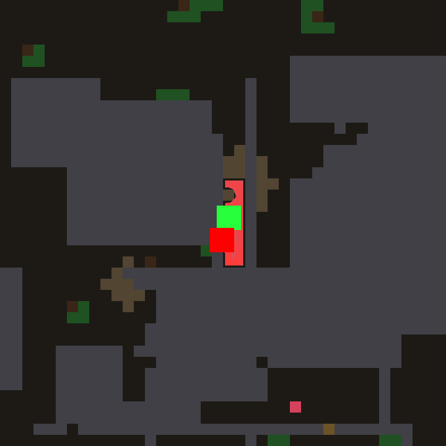
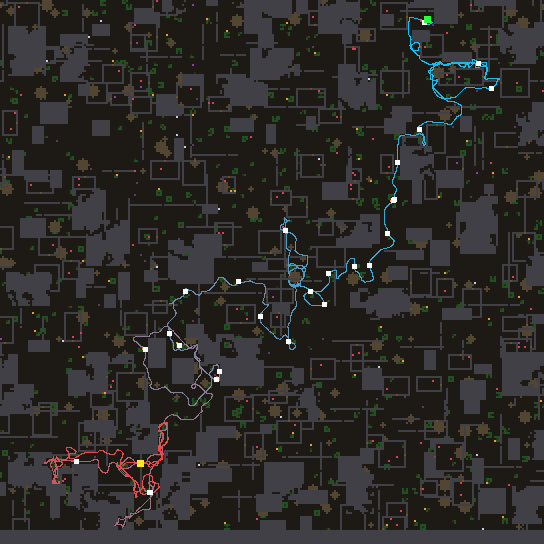
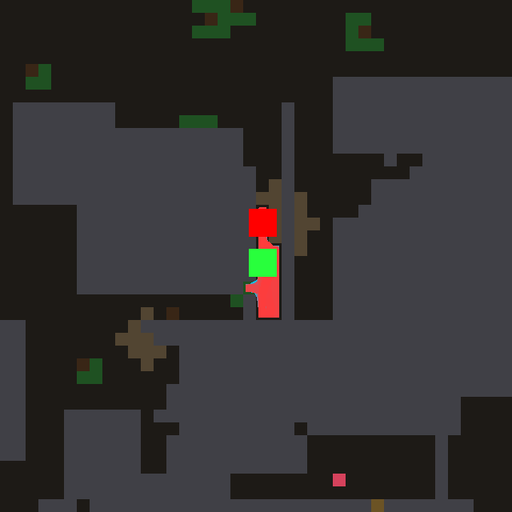
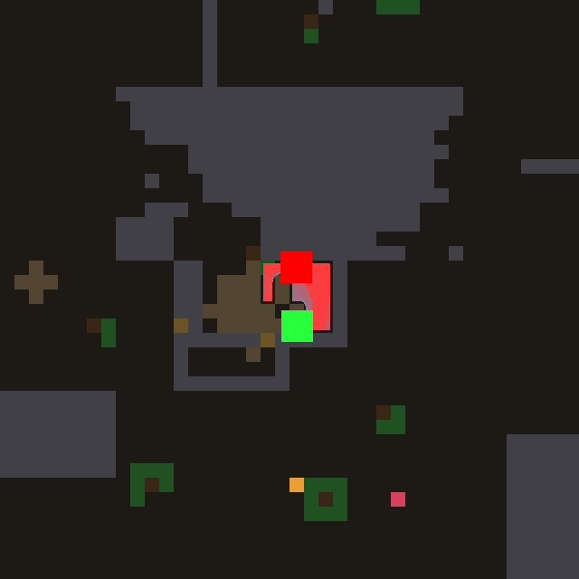
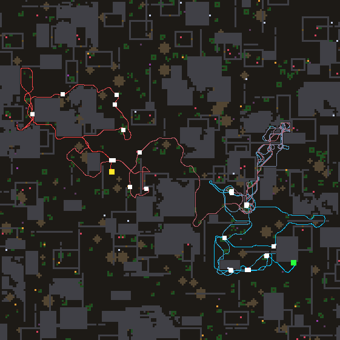

# Night lab summary — 2026-11-04T12:48:30
Model `agent-in-session (mailbox)`, 12.92 h, 30 design turns (6 deep), model busy 0.75 h, waited for other users 0 min, resumed 1x.
```
                                   train  immortal   holdout  immortal
reference wave (#0)                 20.4  17/20    15.5  12/16
confine, hand-written (#1)          23.2  17/20    23.6  13/16
CONTROL: #1 tuned 152x              29.7  18/20    24.6  14/16
#23 (turn 20, tuned 7x)             34.8  20/20    29.9  15/16
#30 (turn 27, tuned 5x)             34.5  20/20    31.4  16/16
#28 (turn 25, tuned 7x)             34.4  20/20    29.9  15/16
#26 (turn 23, tuned 5x)             32.9  20/20    25.9  14/16
#24 (turn 21, tuned 5x)             32.8  19/20    28.4  15/16
```

**FINAL worlds** (32 worlds nobody selected on, not even the model through the prompt):

```
reference wave (#0)                 18.8 meals  immortal 28/32
confine, hand-written (#1)          24.5 meals  immortal 28/32
CONTROL: #1 tuned 152x              25.8 meals  immortal 30/32
#30 tuned 5x                        30.7 meals  immortal 30/32
#9 tuned 6x                         30.2 meals  immortal 31/32
#28 tuned 7x                        30.2 meals  immortal 30/32
#23 tuned 7x                        29.9 meals  immortal 30/32
#9 as written                       31.8 meals  immortal 32/32
```
Design turns: 30 valid (30 first try, 0 after repair), 0 never loaded, 0 constants-only twins. Evaluations: {'llm': 182, 'control': 152, 'holdout': 17}.

Prediction error (|predicted - actual| meals, before tuning): first half 4.9, second half 4.7 over 30 predictions — the theory got better at predicting.

## Timeline

```
   0.57 h  turns   2  champion #3 train  26.9 hold 22.3125  |  control train  27.6 hold 23.25
   1.12 h  turns   4  champion #6 train  28.5 hold 25.8125  |  control train  27.6 hold 23.25
   1.68 h  turns   5  champion #7 train  33.5 hold 27.125  |  control train  27.2 hold 25.375
   2.26 h  turns   7  champion #8 train  33.5 hold 24.875  |  control train  27.2 hold 25.375
   2.85 h  turns   9  champion #8 train  33.5 hold 24.875  |  control train  27.2 hold 25.375
   3.41 h  turns  10  champion #8 train  33.5 hold 24.875  |  control train  27.2 hold 25.375
   3.98 h  turns  11  champion #13 train  32.6 hold 26.875  |  control train  27.2 hold 25.375
   4.49 h  turns  13  champion #13 train  32.6 hold 26.875  |  control train  27.2 hold 25.375
   4.99 h  turns  14  champion #13 train  32.6 hold 26.875  |  control train  27.2 hold 25.375
   5.50 h  turns  15  champion #13 train  32.6 hold 26.875  |  control train  27.2 hold 25.375
   6.06 h  turns  17  champion #13 train  32.6 hold 26.875  |  control train  27.8 hold 25.6875
   6.61 h  turns  18  champion #13 train  32.6 hold 26.875  |  control train  28.6 hold 26.25
   7.16 h  turns  20  champion #13 train  32.6 hold 26.875  |  control train  29.7 hold 24.625
   7.70 h  turns  21  champion #23 train  34.8 hold 29.9375  |  control train  29.7 hold 24.625
   8.24 h  turns  23  champion #23 train  34.8 hold 29.9375  |  control train  29.7 hold 24.625
   8.80 h  turns  24  champion #23 train  34.8 hold 29.9375  |  control train  29.7 hold 24.625
   9.39 h  turns  26  champion #23 train  34.8 hold 29.9375  |  control train  29.7 hold 24.625
   9.93 h  turns  27  champion #23 train  34.8 hold 29.9375  |  control train  29.7 hold 24.625
  10.51 h  turns  28  champion #23 train  34.8 hold 29.9375  |  control train  29.7 hold 24.625
  11.01 h  turns  29  champion #23 train  34.8 hold 29.9375  |  control train  29.7 hold 24.625
  11.72 h  turns  30  champion #23 train  34.8 hold 29.9375  |  control train  29.7 hold 24.625
  12.00 h  turns  30  champion #23 train  34.8 hold 29.9375  |  control train  29.7 hold 24.625
```

## Champion #30

**Hypothesis:** A new axis — connectivity. A second, walk-only wave (`hope`) spreads the same sources but stops dead at every solid cell, so it measures what is reachable on foot without pressing; a wall face's probe is silenced wherever the free ground beside it still has hope, and runs at full strength only where nothing is reachable. The agent then stops wasting presses on the inner walls of an escapable enclosure (the 40 idle presses on world 116), and in a truly sealed pocket the faces are the only thing in the field, so the grain-ranked winner face gets all the effort.

As written: 34.5 meals; tuned 5x: 34.5.

```nomos
# Hope: a walk-only wave (no leak through solid). A wall face pulls only where hope is
# low, i.e. where nothing worth having is reachable on foot -- press only when walled in.
channel source
channel solid
channel free
channel thing
channel here
channel bad
channel leak
channel value
channel trail
channel confinement
channel injection
channel hope
channel nbmax
channel aim
channel work
channel thin
channel grain
channel face
channel crest
channel probe
rule seed:
  when grain <= 0
  set grain = uniform(0.001, 1)
rule walk:
  when 1
  set trail = max(here, 0.91 * max8(here), 0.997 * trail)
rule calc_conf:
  when 1
  set confinement = sum8(solid)
rule calc_thin:
  when 1
  set thin = max(shift(free, 1, 0) * (1 - shift(solid, -1, 0)), shift(free, -1, 0) * (1 - shift(solid, 1, 0)), shift(free, 0, 1) * (1 - shift(solid, 0, -1)), shift(free, 0, -1) * (1 - shift(solid, 0, 1)))
rule calc_face:
  when 1
  set face = solid * thin * leak * (1 - bad) * (0.4 + 0.6 * grain)
rule calc_crest:
  when 1
  set crest = max(face, 0.93 * max8(crest))
rule inject:
  when 1
  set injection = max(thing, source * (0.74 - 0.82 * trail)) * (0.83 - bad) / (1 + 0.83 * confinement)
# Hope: what is reachable WITHOUT pressing; solid stops it completely, poison too.
rule calc_hope:
  when 1
  set hope = max(injection, 0.94 * max4(hope), 0.916214 * max8(hope)) * (1 - solid) * (1 - 0.9 * bad)
rule calc_nbmax:
  when 1
  set nbmax = max8(value)
rule calc_aim:
  when 1
  set aim = max8(here) * (1 - here) * where(value >= max8(here * nbmax) - 0.000001, 1, 0) * where(max8(here * nbmax) > 0, 1, 0)
rule effort:
  when 1
  set work = min(1, 0.68 * work + 0.03 * aim * solid)
# Probes as before, but silenced where the free ground beside the face still has hope.
rule calc_probe:
  when 1
  set probe = where(face > 0, 1, 0) * (face * (0.06 * clamp(1 - 1.4 * trail, 0, 0.56) + 0.3 * work) + 0.05 * where(face >= crest - 0.000001, 1, 0)) * clamp(1 - 6 * max8(hope), 0, 1)
rule wave:
  when 1
  set value = max(injection, probe, 0.94 * max4(value), 0.8161 * max8(value)) * (1 - solid * (1.3 - leak)) * (1 - 0.9 * bad)
```

## Theory, first version (1.78 h)

HELPS: local, structural memory. Inhibition of return (a fading trail, #3 +2.4) stops the agent re-walking the same ground. Keeping the wave alive when the map is spent (#6) stops it standing still. An efference copy that builds up pressure on the solid face being aimed at (#7, best at 33.5) turns random chipping into digging out. Confinement suppression (#1) is the only law that holds up on holdout (23.2 -> 23.6).
HURTS: global or smoothed signals. A frustration scalar (#5) and a blurred `dark` frontier (#4) each lost ~7 meals, because they flatten the field. Tracing the whole path (#8) lost 4.5.
WHY: wins come from small, sharp, local terms. Tuning overfits (#7 33.5 -> 27.1 on holdout).
STILL FAILING: in a sealed slot the trail covers every cell and pressure gets split between two faces.
UNTRIED: a winner-take-all lock on one face (the strongest pressure suppresses the others); trying the face nearest the most promising unknown first; using `bad` to avoid what burned it; a leak that grows with pressing.

## Theory, last version (11.76 h)

HELPS: small, sharp, local terms that rank neighbouring choices: inhibition of return (#3), keeping the wave alive on a spent map (#6), an efference copy on the aimed face (#7), competing faces (#9), confinement suppression (#1), the thin-wall filter (#13), and a fixed world-anchored random preference among faces (#23: train 34.8, holdout 29.9). A walk-only connectivity wave (#30) held up best on holdout (31.4).
HURTS: global, directional or commitment terms: heading, inertia, frontier weighting, a reactive commitment latch (#32), committing by what a face gives back (#25, 3.0), louder wall pulls, per-face clocks, extra wear on a pressed face (#29), a burn field spread from `bad` (#31), regrowing an old trail (#27).
WHY: tuning overfits, local ranking generalises. Pocket starvation is a tie, and a fixed bias breaks it.
STILL FAILING: enclosures. The agent paces along the inner walls, ~40 idle presses, one break, no doors.
UNTRIED: gating presses by `leak`; aiming presses only where `hope` is cut off but `value` is not.

## Observations

**#6 on world 110** — 

The agent is born in a sealed slot about two cells wide and seven tall, between two rock masses in the middle of the map, and it never leaves it: the whole track, cyan through red, is a short up-and-down shuttle inside that slot, and it starves a cell below where it started. It is not idle. It hits the rock 22 times and the brown chipped cells show it working on two different faces, the cap above the slot and the wall to its upper right, but neither gives way, so it never makes a door and never sees any of the food growing in the open ground just above and to the left. The failing is that it doesn't stick with one face: its own trail covers every cell of so small a room, and the probe term is cut by that trail, so all the wall faces fade together. None of them stays brighter than the rest, so the wave sends the agent back and forth between the top and the side and it chips a little at each. The fix I would make first is commitment to a face: a wall cell that has already given (chipped) should become a stronger source that does not fade, exempt from the trail spending, so the agent keeps striking the same spot until it breaks through instead of spreading its blows over every wall of

**#8 on world 108** — 

The agent makes one long, purposeful migration from its start in the top-right corner diagonally down to the bottom-left, eating steadily along a narrow corridor of the map, with one tight curl in the centre where it circles a few times before moving on. Late in life (the red part) it stops travelling and wanders tangled back and forth inside one small patch near the bottom-left. It eats only a little there while the whole left half, the top and the right side, all full of growing food, are never visited. It never opens a single walled room (doors 0) even though many of the outlined rooms it passes hold food, and it spends 115 presses pushing on rock that does not give, so its late tangle looks like a hunt for wall faces rather than for food. The one mechanism I would fix first is the lock bonus on wall faces in the probe rule: a wall face the agent has already pressed and that did not give should wear down to nothing under the trail, and should not gain extra brightness from the lock, so lock only strengthens real food and the agent leaves a worked-out patch for the unvisited open ground.

**#13 on world 110** — 

The agent is born in a one-cell-wide slot about eight cells long between the big rock mass on its left and a thin wall on its right, and it never leaves it: the whole 3952-tick life is a short up-and-down pacing in that 8x2 box (28 cells visited, 414 distance). Just across the thin right-hand wall sit tan morsels, and the agent spends its life pressing that face (21 breaks, 22 idle presses, no door ever opened) instead of walking out the north end of the slot toward the open ground and the green food beyond. It starves at the top of the slot, a step or two from the way out, without having eaten once. The failing is that the "futility exit" never fires: work on a face grows as 0.68 times itself plus 0.03, so it levels off near 0.1 and can never pass the 0.9 needed to mark the face as spent, so the probe on that wall never goes out and keeps pulling the wave back to it. I would fix the work accumulation, raising the gain or lowering the spent threshold so that a face pressed for a few dozen ticks without giving way really does get marked as rock and drops out as a source, which lets the frontier wave lead the agent out of the slot.

**#13 on world 118** — 

The agent is born in a tiny sealed pocket under the big rock mass, a cell or two wide and about four cells tall, with the brown rubble patch on its west side, and it never leaves: the whole 4000-tick track (464 cells walked, only 31 distinct cells, last 500 ticks inside a 4x4 box) is a tight shuttle up and down that pocket until it starves at the north end. It does work at the walls (14 breaks, 16 idle presses), but the effort is scattered: it chips one face, turns, chips another, and no face is ever pushed all the way through, so it opens no doors. Open ground and growing food lie only one or two cells beyond the south and east walls, and none of that ever reaches the wave. Inside the pocket there is nothing to smell or see, so its only sources are its own wall faces, and those keep handing the lead to one another. The fix I would make first is the futility rule. Right now it marks a face as spent rock as soon as its work saturates, even when that face is visibly chipping. It should mark a face spent only when pressing it gave nothing. A face that yields should keep its work and stay the committed source until it opens, which gets the agent through one thin wall instead of rotatin

**#23 on world 116** — 

The agent starts in the south-east and forages well at first, looping through the open ground there and eating steadily (the cyan stretch holds about eight meals). It then climbs north-east into a small walled enclosure and gets tangled in it: the pink-violet knot of crossing tracks shows it pacing back and forth along the same inner walls for a long stretch, which is where most of its 40 idle presses and its one break went, with no meals to show for it. Once it escapes, it drifts west through the middle and into the north-west, eating again at a decent rate, and ends standing just below the cluster of its last meals in the centre-west. Its weakness is that it spends a large slice of the life on that one enclosure while whole regions full of growing food — the entire south-west, the north, and the far east — are never visited at all. The one mechanism I would fix first is the steady pull toward the local winner wall face: it should fade once effort spent on that face has produced nothing, so a wall that has been pressed and refused stops shining and the wave turns back toward unexplored ground.

GIF: `champion.gif` (world 112, first 4000 ticks).
