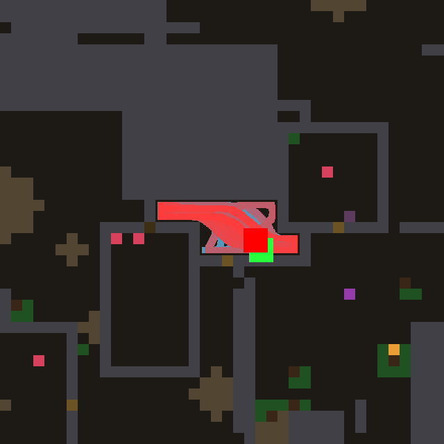
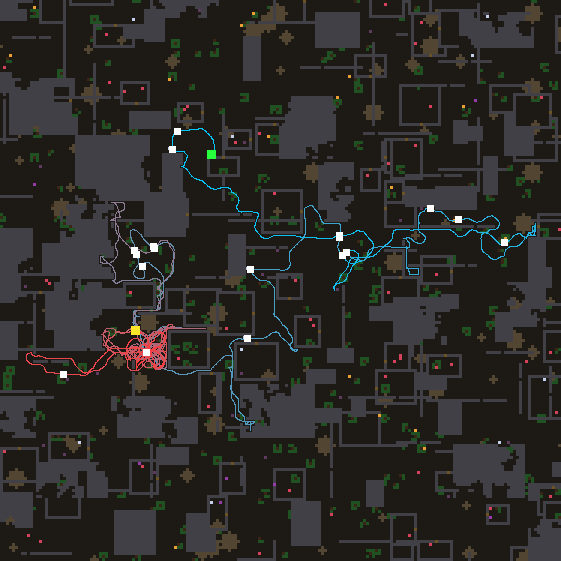
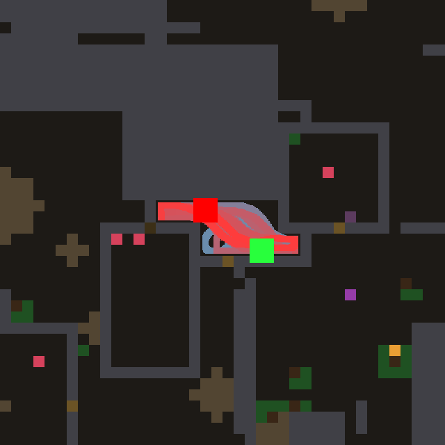
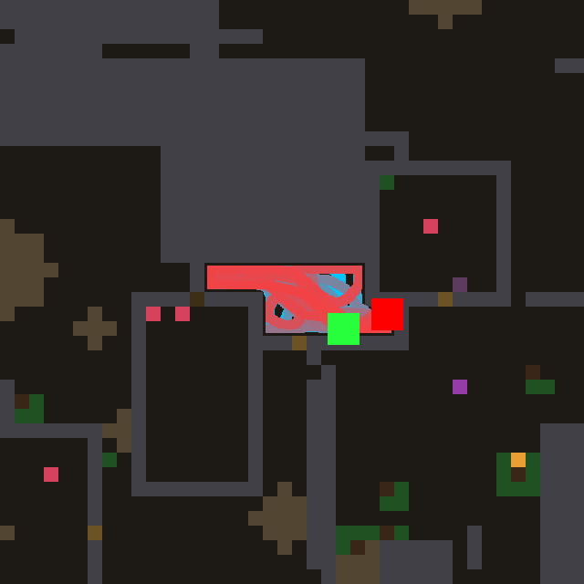
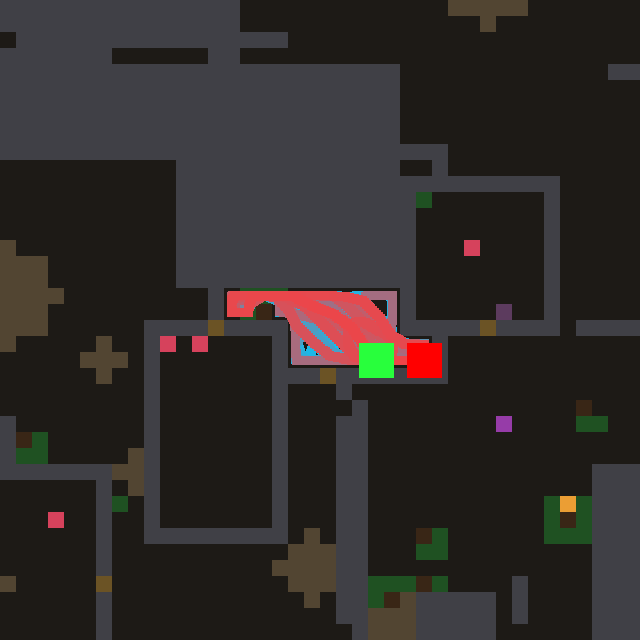
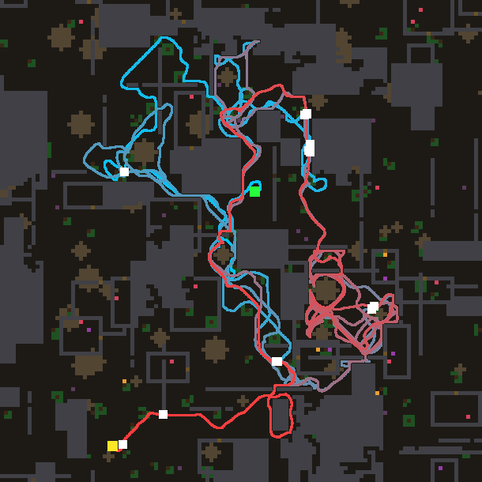

# night lab — 2026-11-04T11:14:39

Model `agent-in-session (mailbox)` | 12.0 h | world default | train [0, 1, 2, 3, 4, 5, 6, 7, 8, 9, 10, 11, 12, 13, 14, 15, 16, 17, 18, 19] | holdout [20, 21, 22, 23, 24, 25, 26, 27, 28, 29, 30, 31, 32, 33, 34, 35] | 8000 ticks/life | tune 5 | deep every 5 | theory every 6 | observe every 8

- anchor #0 `laws/atlas_wave.nomos`: train 14.8 meals [28, 27, 10, 35, 13, 4, 5, 5, 33, 12, 5, 7, 23, 23, 18, 8, 0, 28, 5, 6], holdout 19.6

- anchor #1 `laws/atlas_confine.nomos`: train 25.7 meals [37, 39, 18, 30, 23, 22, 13, 34, 26, 13, 33, 36, 33, 24, 29, 30, 0, 34, 14, 26], holdout 25.7

- anchor #2 `laws/atlas_ghost.nomos`: train 19.2 meals [28, 5, 25, 11, 13, 18, 16, 33, 29, 12, 4, 24, 21, 32, 16, 26, 0, 28, 23, 20], holdout 18.6

> 11:20 model job `design` started

---

## Turn 0 -> island #3

**Hypothesis:** Every frontier mark is worth the same 0.12 today, so a one-cell unknown pocket beside a wall pulls as hard as the edge of a large unexplored region. Weighting each frontier mark by the smoothed amount of unknown around it (information gain) sends the agent toward big unseen areas where new food is likely, while smell and seen morsels keep their value and the confinement suppression is kept.

Prediction 27.0, got **24.2** meals, fitness 472, per world [21, 26, 25, 5, 14, 29, 4, 32, 25, 28, 32, 33, 25, 35, 28, 37, 0, 37, 29, 20]; model 42.1 s, repairs 0

value on the test map: max 0.30, mean 0.16, 0% at the cap -> healthy: the best neighbour points at the source

```nomos
channel source
channel solid
channel free
channel thing
channel scent
channel bad
channel value
channel dark
channel front
channel injection

# how much unknown lies around a cell: a smoothed field of not-yet-known cells
rule darkness:
  when 1
  set dark = 0.5 * (1 - free) * (1 - solid) + 0.5 * avg8(dark)

# the frontier part of source: faint marks where no smell and no morsel are painted
rule split:
  when 1
  set front = where(scent + thing < 0.05, source, 0)

# food counts as told; a frontier counts by the darkness behind it; tight places count less
rule inject:
  when 1
  set injection = max(source - front, thing * (1 - bad), front * (0.3 + 2.0 * dark)) / (1 + 0.5 * sum8(solid))

rule wave:
  when 1
  set value = max(injection, max(0.94 * max4(value), 0.916214 * max8(value))) * (1 - solid * (1 - leak))
```

> 11:31 model job `design` started

---

## Turn 1 -> island #4

**Hypothesis:** A reactive wave lets the agent step back onto the cell it just left whenever two targets are nearly equal, which wastes ticks in back-and-forth limit cycles. A fading footprint channel (trail = max(here, decay*trail), scrolling with the map) dims what the agent READS on its own recent path while the plan wave itself stays untouched, so it commits forward and sweeps instead of dithering, but can still return when the way back is clearly better.

Prediction 27.0, got **25.6** meals, fitness 509, per world [22, 41, 20, 26, 14, 20, 29, 34, 29, 33, 23, 38, 17, 28, 30, 37, 0, 31, 14, 25]; model 30.1 s, repairs 0; vocabulary twin of #3

value on the test map: max 0.30, mean 0.16, 0% at the cap -> healthy: the best neighbour points at the source

```nomos
channel source
channel solid
channel free
channel thing
channel scent
channel bad
channel here
channel value
channel dark
channel front
channel injection
channel wave
channel trail

# where the agent has recently stood (persists and scrolls with the map, fades)
rule track:
  when 1
  set trail = max(here, 0.97 * trail)

rule darkness:
  when 1
  set dark = 0.5 * (1 - free) * (1 - solid) + 0.5 * avg8(dark)

rule split:
  when 1
  set front = where(scent + thing < 0.05, source, 0)

rule inject:
  when 1
  set injection = max(source - front, thing * (1 - bad), front * (0.3 + 2.0 * dark)) / (1 + 0.5 * sum8(solid))

# the plan itself: an ordinary Bellman wave in its own channel
rule plan:
  when 1
  set wave = max(injection, max(0.94 * max4(wave), 0.916214 * max8(wave))) * (1 - solid * (1 - leak))

# what the agent reads: the plan, dimmed on its own fresh footprints (no turning back)
rule read:
  when 1
  set value = wave * (1 - 0.4 * trail)
```

### Holdout checkpoint at 0.54 h

```
  #3   train 25.8 meals  holdout 29.3  (tuned 5x) | Every frontier mark is worth the same 0.12 today, so a one-cell unknown pocket beside a wall pulls as hard as 
  #4   train 25.9 meals  holdout 30.0  (tuned 4x) | A reactive wave lets the agent step back onto the cell it just left whenever two targets are nearly equal, whi
  #0   train 14.8 meals  holdout 19.6  (hand-written) | the reference Bellman wave
  #1   train 25.7 meals  holdout 25.7  (hand-written) | Confinement suppression (night lab 2026-09-23, champion #35): a source hemmed in by solid counts less, so loca
  #2   train 19.2 meals  holdout 18.6  (hand-written) | sources linger (ghost), erased under the agent
  CONTROL: #1's law, constants tuned by random search 9x: train 25.7 meals, holdout 25.7
```

> 11:47 model job `design` started

---

## Turn 2 -> island #5

**Hypothesis:** One discount serves two different promises: food (certain, worth a detour only when near) and the frontier (uncertain, but only informative if the agent commits to a long walk). Splitting the wave into an exploitation wave with a steep discount and an exploration wave with a shallow discount, read as their max, lets far frontiers keep a coherent long-range pull while nearby food still wins when close.

Prediction 27.0, got **21.6** meals, fitness 418, per world [25, 20, 19, 11, 32, 24, 22, 21, 15, 33, 21, 26, 19, 26, 27, 22, 0, 33, 16, 19]; model 28.1 s, repairs 0; vocabulary twin of #4

value on the test map: max 0.30, mean 0.22, 0% at the cap -> healthy: the best neighbour points at the source

```nomos
channel source
channel solid
channel free
channel thing
channel scent
channel bad
channel here
channel value
channel dark
channel front
channel food
channel explore
channel trail

rule track:
  when 1
  set trail = max(here, 0.97 * trail)

rule darkness:
  when 1
  set dark = 0.5 * (1 - free) * (1 - solid) + 0.5 * avg8(dark)

rule split:
  when 1
  set front = where(scent + thing < 0.05, source, 0)

# exploitation wave: smell and morsels, steep discount (food is a near promise)
rule eat:
  when 1
  set food = max(max(source - front, thing * (1 - bad)) / (1 + 0.5 * sum8(solid)), max(0.9 * max4(food), 0.86 * max8(food))) * (1 - solid * (1 - leak))

# exploration wave: frontier weighted by darkness, shallow discount (worth a long walk)
rule roam:
  when 1
  set explore = max(front * (0.3 + 2.0 * dark) / (1 + 0.5 * sum8(solid)), max(0.97 * max4(explore), 0.958 * max8(explore))) * (1 - solid * (1 - leak))

# read the stronger promise, dimmed on fresh footprints
rule read:
  when 1
  set value = max(food, explore) * (1 - 0.4 * trail)
```

> 12:04 model job `design` started

---

## Turn 3 -> island #6

**Hypothesis:** When frontiers on several sides look alike, the agent's target can switch from thought to thought and it sweeps nothing completely. A frozen random preference per place (seeded once, inherited by cells scrolling in, smoothed into regions, and carried with the map) breaks such ties the same way every thought, so the agent commits to one side of the unknown and explores it through; the frontier/food split is also computed inline now, removing a one-pass lag that injected a stale full-strength peak.

Prediction 27.0, got **24.4** meals, fitness 486, per world [22, 24, 17, 33, 33, 32, 4, 30, 32, 25, 26, 37, 23, 31, 29, 33, 0, 20, 15, 21]; model 130.1 s, repairs 0

value on the test map: max 0.15, mean 0.08, 0% at the cap -> healthy: the best neighbour points at the source

```nomos
channel source
channel solid
channel free
channel thing
channel scent
channel bad
channel here
channel value
channel dark
channel injection
channel wave
channel trail
channel whim: init uniform(0.01, 1)
channel taste

rule track:
  when 1
  set trail = max(here, 0.97 * trail)

# a frozen random preference per place; cells scrolling in inherit a random neighbour's
rule seed_whim:
  when whim <= 0
  set whim = clamp(argmax8(rand() * (whim > 0), whim) + uniform(-0.05, 0.05), 0.01, 1)

# smoothed into regions: one side of the map is simply preferred, and stays preferred
rule smooth_whim:
  when 1
  set taste = 0.5 * whim + 0.5 * avg8(taste)

rule darkness:
  when 1
  set dark = 0.5 * (1 - free) * (1 - solid) + 0.5 * avg8(dark)

# frontier (faint marks, no smell or morsel) pull = darkness behind it times the region's standing preference
rule inject:
  when 1
  set injection = max(where(scent + thing < 0.05, 0, source), thing * (1 - bad), where(scent + thing < 0.05, source, 0) * (0.3 + 2.0 * dark) * (0.5 + taste)) / (1 + 0.5 * sum8(solid))

rule plan:
  when 1
  set wave = max(injection, max(0.94 * max4(wave), 0.916214 * max8(wave))) * (1 - solid * (1 - leak))

rule read:
  when 1
  set value = wave * (1 - 0.4 * trail)
```

> 12:09 model job `observe` started

---

## Observer: #3 on world 16



`{'meals': 0, 'ticks': 3747, 'alive': False, 'distance': 283.6, 'cells_visited': 60, 'last500_box': '4x12', 'doors': 3, 'breaks': 5, 'idle_presses': 8, 'nightcaps': 0}`

The agent spends its whole life inside one small walled pocket (a 4x12 box, start and death in the same spot), sweeping back and forth along it and never leaving, so it never even reaches the food lying a short walk away in the neighbouring rooms.
It does press and break things (3 doors, 5 breaks), but after each press it drifts back into the pocket instead of walking through, so the openings it makes do not turn into a route out.
The failure is that inside a sealed pocket every boundary cell is known solid, so there are no frontier marks (unknown cells touching known-free ones) and the value field has nothing to point at except leak through walls, which is weak and spread evenly around the whole box.
A fix: give solid cells that have unknown space behind them (a wall with darkness on its far side, especially one whose leak was taught high by a door opening) a source of their own when no frontier exists, so the wave leads the agent into one specific wall and through it, and keep that target (a lingering source) until it is passed.

### Holdout checkpoint at 1.09 h

```
  #3   train 26.7 meals  holdout 27.3  (tuned 6x) | Every frontier mark is worth the same 0.12 today, so a one-cell unknown pocket beside a wall pulls as hard as 
  #6   train 25.1 meals  holdout 24.9  (tuned 3x) | When frontiers on several sides look alike, the agent's target can switch from thought to thought and it sweep
  #4   train 25.9 meals  holdout 30.0  (tuned 5x) | A reactive wave lets the agent step back onto the cell it just left whenever two targets are nearly equal, whi
  #5   train 21.6 meals  holdout  -    (tuned 5x) | One discount serves two different promises: food (certain, worth a detour only when near) and the frontier (un
  #0   train 14.8 meals  holdout 19.6  (hand-written) | the reference Bellman wave
  #1   train 25.7 meals  holdout 25.7  (hand-written) | Confinement suppression (night lab 2026-09-23, champion #35): a source hemmed in by solid counts less, so loca
  #2   train 19.2 meals  holdout 18.6  (hand-written) | sources linger (ghost), erased under the agent
  CONTROL: #1's law, constants tuned by random search 18x: train 25.7 meals, holdout 25.7
```

> 12:26 model job `deep` started

---

## Turn 4 (DEEP) -> island #7

**Hypothesis:** Exploration is driven only by frontier marks, which exist only where unknown ground touches known-free ground; once the agent has seen every wall of a room, cave or pocket, the value field has nothing to aim at and it sweeps the box until it starves (the observer's world-16 life). A BREACH source on every reachable wall cell with darkness behind it, weighted by the darkness and passed through the wall's taught leak, is weak enough that any food or frontier beats it in the max, but when nothing else calls it leads the agent into the most promising wall, where pressing opens doors and chips rubble; stone that never gives is taught a low leak and drops out, so the agent tries walls in turn. The

Prediction 27.5, got **23.2** meals, fitness 460, per world [26, 30, 27, 34, 40, 23, 4, 28, 31, 26, 30, 34, 11, 19, 2, 33, 0, 22, 24, 20]; model 48.1 s, repairs 0; vocabulary twin of #4

value on the test map: max 0.30, mean 0.16, 0% at the cap -> healthy: the best neighbour points at the source

```nomos
channel source
channel solid
channel free
channel thing
channel scent
channel bad
channel here
channel leak
channel value
channel dark
channel breach
channel injection
channel wave
channel trail

rule track:
  when 1
  set trail = max(here, 0.97 * trail)

rule darkness:
  when 1
  set dark = 0.5 * (1 - free) * (1 - solid) + 0.5 * avg8(dark)

# a wall the agent can reach with darkness behind it is a way out, weighted by how it gave before
rule breach_mark:
  when 1
  set breach = where((solid > 0.5) * (max8(free) > 0.5), dark * leak, 0)

# food as told, frontier by darkness, breaches as a weak fallback the max lets win only when nothing else calls
rule inject:
  when 1
  set injection = max(max(where(scent + thing < 0.05, 0, source), thing * (1 - bad), where(scent + thing < 0.05, source, 0) * (0.3 + 2.0 * dark)) / (1 + 0.5 * sum8(solid)), 0.1 * breach)

rule plan:
  when 1
  set wave = max(injection, max(0.94 * max4(wave), 0.916214 * max8(wave))) * (1 - solid * (1 - leak))

rule read:
  when 1
  set value = wave * (1 - 0.4 * trail)
```

> 12:41 model job `design` started

---

## Turn 5 -> island #8

**Hypothesis:** Food in this world grows on fixed spots that regrow on a timer, yet every law so far forgets a spot as soon as its sighting fades, so the agent re-finds food only by luck. A long LARDER memory of where good morsels were seen, multiplied by a RIPENESS clock that is reset whenever the agent stands on or beside the place and climbs slowly back, injects a source that calls the agent back to a patch about when it should have regrown: a trapline over the remembered map, on top of the darkness-weighted frontier and the footprint trail.

Prediction 27.5, got **24.6** meals, fitness 491, per world [26, 30, 27, 34, 40, 23, 4, 28, 31, 26, 30, 34, 11, 27, 23, 33, 0, 22, 24, 20]; model 40.1 s, repairs 0; vocabulary twin of #7, #4

value on the test map: max 0.30, mean 0.16, 0% at the cap -> healthy: the best neighbour points at the source

```nomos
channel source
channel solid
channel free
channel thing
channel scent
channel bad
channel here
channel value
channel dark
channel larder
channel ripe
channel injection
channel wave
channel trail

rule track:
  when 1
  set trail = max(here, 0.97 * trail)

rule darkness:
  when 1
  set dark = 0.5 * (1 - free) * (1 - solid) + 0.5 * avg8(dark)

# where good food has been seen: a long memory that outlives the fading sighting
rule remember:
  when 1
  set larder = max(thing * (1 - bad), 0.9998 * larder)

# a remembered place ripens with time since the agent last stood on or beside it
rule ripen:
  when 1
  set ripe = where(max(here, max8(here)) > 0, 0, min(1, ripe + 0.0004))

# food and frontier as before; a ripe remembered patch calls the agent back (a trapline)
rule inject:
  when 1
  set injection = max(where(scent + thing < 0.05, 0, source), thing * (1 - bad), where(scent + thing < 0.05, source, 0) * (0.3 + 2.0 * dark), 0.5 * larder * ripe) / (1 + 0.5 * sum8(solid))

rule plan:
  when 1
  set wave = max(injection, max(0.94 * max4(wave), 0.916214 * max8(wave))) * (1 - solid * (1 - leak))

rule read:
  when 1
  set value = wave * (1 - 0.4 * trail)
```

> 12:45 model job `theory` started

---

## Theory (after 6 design turns)

1. Exploration is the lever; frontier quality matters. Darkness-weighted frontier (#3) is the train leader (26.7 tuned, holdout 27.3) over plain confinement (#1, 25.7/25.7).
2. Do not walk back. The footprint trail (#4) is the best holdout (30.0) with equal train (25.9); it rescued worlds 3 and 6 (5->26, 4->29), the dithering worlds.
3. Splitting food and frontier into two waves with different discounts hurts (#5, 21.6): one shared discount keeps food and frontier comparable.
4. Extra pull terms layered on top so far cost meals untuned: random regional preference (#6, 24.4, holdout 24.9), wall breach (#7, 23.2 raw, 26.2 tuned, world 16 still 0), larder/trapline (#8, 24.6 raw, untuned). Each new source competes with the frontier and distracts.
5. Per-world scores swing 2 <-> 28 between near-identical laws: one world is not evidence; trust holdout.
6. World 16 (sealed pocket) starves every law, breach included.

### Holdout checkpoint at 1.62 h

```
  #3   train 26.7 meals  holdout 27.3  (tuned 6x) | Every frontier mark is worth the same 0.12 today, so a one-cell unknown pocket beside a wall pulls as hard as 
  #7   train 26.2 meals  holdout 26.4  (tuned 5x) | Exploration is driven only by frontier marks, which exist only where unknown ground touches known-free ground;
  #6   train 25.1 meals  holdout 24.9  (tuned 7x) | When frontiers on several sides look alike, the agent's target can switch from thought to thought and it sweep
  #4   train 25.9 meals  holdout 30.0  (tuned 5x) | A reactive wave lets the agent step back onto the cell it just left whenever two targets are nearly equal, whi
  #8   train 24.6 meals  holdout  -    (tuned 1x) | Food in this world grows on fixed spots that regrow on a timer, yet every law so far forgets a spot as soon as
  #5   train 21.6 meals  holdout  -    (tuned 5x) | One discount serves two different promises: food (certain, worth a detour only when near) and the frontier (un
  #0   train 14.8 meals  holdout 19.6  (hand-written) | the reference Bellman wave
  #1   train 25.7 meals  holdout 25.7  (hand-written) | Confinement suppression (night lab 2026-09-23, champion #35): a source hemmed in by solid counts less, so loca
  #2   train 19.2 meals  holdout 18.6  (hand-written) | sources linger (ghost), erased under the agent
  CONTROL: #1's law, constants tuned by random search 29x: train 25.7 meals, holdout 25.7
```

> 13:01 model job `design` started

---

## Turn 6 -> island #9

**Hypothesis:** My theory says extra competing pulls distract; modulating the frontier helps (darkness weighting, footprint trail). The smell is painted at a single point along a bearing that flips around walls, so following it directly is fragile, but it says roughly where food is. A broad slowly fading AROMA halo around recent smell points multiplies frontier marks inside it, so exploration is biased toward unknown ground in the smelled direction (finding the actual path around the wall) instead of toward any dark region, with no new competing source.

Prediction 27.0, got **25.9** meals, fitness 521, per world [37, 29, 23, 33, 15, 26, 25, 20, 36, 23, 27, 34, 22, 36, 26, 28, 0, 26, 19, 32]; model 46.1 s, repairs 0; vocabulary twin of #7, #4, #8

value on the test map: max 0.30, mean 0.16, 0% at the cap -> healthy: the best neighbour points at the source

```nomos
channel source
channel solid
channel free
channel thing
channel scent
channel bad
channel here
channel value
channel dark
channel aroma
channel injection
channel wave
channel trail

rule track:
  when 1
  set trail = max(here, 0.97 * trail)

rule darkness:
  when 1
  set dark = 0.5 * (1 - free) * (1 - solid) + 0.5 * avg8(dark)

# a broad, slowly fading halo around where the nose has pointed (crosses walls: it is a belief, not a path)
rule halo:
  when 1
  set aroma = max(scent, 0.85 * max8(aroma), 0.95 * aroma)

# frontier marks are worth more inside the halo: explore toward what is smelled, not just what is dark
rule inject:
  when 1
  set injection = max(where(scent + thing < 0.05, 0, source), thing * (1 - bad), where(scent + thing < 0.05, source, 0) * (0.3 + 2.0 * dark) * (1 + 3.0 * aroma)) / (1 + 0.5 * sum8(solid))

rule plan:
  when 1
  set wave = max(injection, max(0.94 * max4(wave), 0.916214 * max8(wave))) * (1 - solid * (1 - leak))

rule read:
  when 1
  set value = wave * (1 - 0.4 * trail)
```

> 13:18 model job `design` started

---

## Turn 7 -> island #10

**Hypothesis:** Every law so far is a max-wave, which follows the single best target and ignores how much is there: one frontier cell and a whole dark region, one berry and a patch of five pull alike once discounted. Replacing the race with a RELAXATION (each free cell becomes the mean of its neighbours, sources fixed, zero at the outer ring and in walls) gives a harmonic potential with no local maxima away from sources, where many sources in one direction add up, so the agent heads for where most food and most unknown lie and cannot be trapped between two equal targets.

Prediction 22.0, got **14.2** meals, fitness 298, per world [11, 14, 12, 10, 6, 18, 15, 21, 15, 13, 0, 14, 17, 34, 18, 17, 0, 24, 16, 10]; model 34.0 s, repairs 0

value on the test map: max 1.00, mean 0.04, 0% at the cap -> healthy: the best neighbour points at the source

```nomos
channel source
channel solid
channel thing
channel bad
channel value
channel inflow

# what calls: senses as painted, plus seen good morsels; hemmed-in sources count less
rule inject:
  when 1
  set inflow = max(source / (1 + 0.5 * sum8(solid)), thing * (1 - bad))

# a pressure field, not a race: each cell relaxes to the MEAN of its neighbours (bounded by
# the sources, zero at the outer ring), so many sources in one direction pull harder than one
rule relax:
  when 1
  set value = max(inflow, 0.6 * avg8(value) + 0.4 * avg4(value)) * (1 - solid * (1 - leak))
```

### Holdout checkpoint at 2.13 h

```
  #3   train 26.7 meals  holdout 27.3  (tuned 6x) | Every frontier mark is worth the same 0.12 today, so a one-cell unknown pocket beside a wall pulls as hard as 
  #7   train 26.2 meals  holdout 26.4  (tuned 5x) | Exploration is driven only by frontier marks, which exist only where unknown ground touches known-free ground;
  #6   train 25.1 meals  holdout 24.9  (tuned 7x) | When frontiers on several sides look alike, the agent's target can switch from thought to thought and it sweep
  #9   train 25.9 meals  holdout  -    (tuned 5x) | My theory says extra competing pulls distract; modulating the frontier helps (darkness weighting, footprint tr
  #4   train 25.9 meals  holdout 30.0  (tuned 5x) | A reactive wave lets the agent step back onto the cell it just left whenever two targets are nearly equal, whi
  #8   train 24.6 meals  holdout  -    (tuned 5x) | Food in this world grows on fixed spots that regrow on a timer, yet every law so far forgets a spot as soon as
  #5   train 21.6 meals  holdout  -    (tuned 5x) | One discount serves two different promises: food (certain, worth a detour only when near) and the frontier (un
  #10  train 14.2 meals  holdout  -    (tuned 1x) | Every law so far is a max-wave, which follows the single best target and ignores how much is there: one fronti
  #0   train 14.8 meals  holdout 19.6  (hand-written) | the reference Bellman wave
  #1   train 25.7 meals  holdout 25.7  (hand-written) | Confinement suppression (night lab 2026-09-23, champion #35): a source hemmed in by solid counts less, so loca
  #2   train 19.2 meals  holdout 18.6  (hand-written) | sources linger (ghost), erased under the agent
  CONTROL: #1's law, constants tuned by random search 39x: train 25.7 meals, holdout 25.7
```

> 13:28 model job `design` started

---

## Turn 8 -> island #11

**Hypothesis:** Exploration so far is local and isotropic: the darkness-weighted frontier wave keeps the agent re-sweeping the same neighbourhood, while food regrows on fixed spots spread over the whole world. A slowly turning world-fixed COMPASS (a life clock carried by the map, and each cell's projection on a heading that rotates once every few thousand ticks) multiplies frontier marks that lie ahead, so the agent makes long straight excursions into new land and comes round to every side over a life, while food and smell are untouched and still win when present.

Prediction 27.0, got **21.4** meals, fitness 414, per world [27, 17, 15, 17, 31, 26, 31, 23, 25, 23, 1, 18, 24, 18, 26, 17, 0, 34, 26, 29]; model 40.1 s, repairs 0

value on the test map: max 0.39, mean 0.21, 0% at the cap -> healthy: the best neighbour points at the source

```nomos
channel source
channel solid
channel free
channel thing
channel scent
channel bad
channel here
channel value
channel dark
channel clock
channel compass
channel injection
channel wave
channel trail

rule track:
  when 1
  set trail = max(here, 0.97 * trail)

rule darkness:
  when 1
  set dark = 0.5 * (1 - free) * (1 - solid) + 0.5 * avg8(dark)

# a life-long clock, shared by the whole map (cells scrolling in take their neighbours' time)
rule tick:
  when 1
  set clock = max(clock, max8(clock)) + 1

# a slowly turning world-fixed heading: how far each cell lies along it from the agent
rule turn:
  when 1
  set compass = clamp(1 + 2.0 * ((posx() - 0.5) * cos(0.0008 * clock) + (posy() - 0.5) * sin(0.0008 * clock)), 0.1, 3)

# frontier marks ahead along the heading count more: long straight excursions into new land
rule inject:
  when 1
  set injection = max(where(scent + thing < 0.05, 0, source), thing * (1 - bad), where(scent + thing < 0.05, source, 0) * (0.3 + 2.0 * dark) * compass) / (1 + 0.5 * sum8(solid))

rule plan:
  when 1
  set wave = max(injection, max(0.94 * max4(wave), 0.916214 * max8(wave))) * (1 - solid * (1 - leak))

rule read:
  when 1
  set value = wave * (1 - 0.4 * trail)
```

> 13:43 model job `deep` started

---

## Turn 9 (DEEP) -> island #12

**Hypothesis:** The map forgets a wall at the same rate as everything else, so a wall seen a few hundred ticks ago becomes half transparent to the wave and then "unknown" again: the agent is led through stale walls into presses that do nothing and back to re-inspect stone as if it were frontier. A MASONRY memory keeps walls nearly permanent (cleared only where the cell is seen free, so opened doors and chipped rubble disappear), and confinement, darkness, frontier and the wave's passability all read it, while free ground and food are still forgotten so regrowth gets revisited.

Prediction 27.0, got **25.6** meals, fitness 499, per world [18, 27, 33, 30, 24, 38, 25, 36, 40, 10, 23, 33, 23, 26, 26, 27, 0, 19, 16, 38]; model 24.1 s, repairs 0; vocabulary twin of #9, #7, #4, #8

value on the test map: max 0.30, mean 0.16, 0% at the cap -> healthy: the best neighbour points at the source

```nomos
channel source
channel solid
channel free
channel thing
channel scent
channel bad
channel here
channel value
channel wall
channel dark
channel injection
channel wave
channel trail

# walls are permanent: keep a wall far longer than the fading map does, until the cell is seen free (an opened door)
rule masonry:
  when 1
  set wall = max(solid, 0.9995 * wall) * (1 - free)

rule track:
  when 1
  set trail = max(here, 0.97 * trail)

rule darkness:
  when 1
  set dark = 0.5 * (1 - free) * (1 - wall) + 0.5 * avg8(dark)

# confinement and passability read the remembered walls, not the fading evidence
rule inject:
  when 1
  set injection = max(where(scent + thing < 0.05, 0, source), thing * (1 - bad), where(scent + thing < 0.05, source, 0) * (0.3 + 2.0 * dark) * (1 - wall)) / (1 + 0.5 * sum8(wall))

rule plan:
  when 1
  set wave = max(injection, max(0.94 * max4(wave), 0.916214 * max8(wave))) * (1 - wall * (1 - leak))

rule read:
  when 1
  set value = wave * (1 - 0.4 * trail)
```

### Holdout checkpoint at 2.66 h

```
  #3   train 26.7 meals  holdout 27.3  (tuned 7x) | Every frontier mark is worth the same 0.12 today, so a one-cell unknown pocket beside a wall pulls as hard as 
  #7   train 26.2 meals  holdout 26.4  (tuned 5x) | Exploration is driven only by frontier marks, which exist only where unknown ground touches known-free ground;
  #6   train 25.1 meals  holdout 24.9  (tuned 7x) | When frontiers on several sides look alike, the agent's target can switch from thought to thought and it sweep
  #9   train 25.9 meals  holdout  -    (tuned 5x) | My theory says extra competing pulls distract; modulating the frontier helps (darkness weighting, footprint tr
  #4   train 25.9 meals  holdout 30.0  (tuned 5x) | A reactive wave lets the agent step back onto the cell it just left whenever two targets are nearly equal, whi
  #12  train 25.6 meals  holdout  -    (tuned 3x) | The map forgets a wall at the same rate as everything else, so a wall seen a few hundred ticks ago becomes hal
  #8   train 24.6 meals  holdout  -    (tuned 5x) | Food in this world grows on fixed spots that regrow on a timer, yet every law so far forgets a spot as soon as
  #5   train 21.6 meals  holdout  -    (tuned 5x) | One discount serves two different promises: food (certain, worth a detour only when near) and the frontier (un
  #0   train 14.8 meals  holdout 19.6  (hand-written) | the reference Bellman wave
  #1   train 25.7 meals  holdout 25.7  (hand-written) | Confinement suppression (night lab 2026-09-23, champion #35): a source hemmed in by solid counts less, so loca
  #2   train 19.2 meals  holdout 18.6  (hand-written) | sources linger (ghost), erased under the agent
  CONTROL: #1's law, constants tuned by random search 51x: train 27.3 meals, holdout 25.4
```

> 14:00 model job `design` started

---

## Turn 10 -> island #13

**Hypothesis:** The smell is repainted from scratch every thought at a waypoint whose bearing flips between the two ways round a wall, so food-directed walks can dither even with the footprint trail; the plain ghost helped the bare wave by +4 meals but was never tried on top of darkness-weighted exploration. Here only FOOD evidence (smell and seen morsels) lingers in its own NOSE channel, erased when the agent reaches the spot or when it is marked bad, while frontier marks stay instantaneous, so a food target once chosen is held through the flip but exploration still follows the live map.

Prediction 27.0, got **21.5** meals, fitness 424, per world [36, 27, 16, 29, 4, 19, 21, 34, 29, 13, 15, 27, 23, 23, 23, 20, 0, 31, 28, 12]; model 38.1 s, repairs 0; vocabulary twin of #12, #9, #7, #4, #8

value on the test map: max 0.30, mean 0.16, 0% at the cap -> healthy: the best neighbour points at the source

```nomos
channel source
channel solid
channel free
channel thing
channel scent
channel bad
channel here
channel value
channel dark
channel nose
channel injection
channel wave
channel trail

rule track:
  when 1
  set trail = max(here, 0.97 * trail)

rule darkness:
  when 1
  set dark = 0.5 * (1 - free) * (1 - solid) + 0.5 * avg8(dark)

# smell and seen morsels LINGER where they were painted (a flipping bearing keeps its first target);
# reaching the place, or learning it is bad, erases the ghost
rule linger:
  when 1
  set nose = max(scent, thing * (1 - bad), 0.99 * nose) * (1 - max(here, max8(here))) * (1 - bad)

# frontier by darkness as before; food is the lingering nose, so a target once chosen is held
rule inject:
  when 1
  set injection = max(nose, where(scent + thing < 0.05, source, 0) * (0.3 + 2.0 * dark)) / (1 + 0.5 * sum8(solid))

rule plan:
  when 1
  set wave = max(injection, max(0.94 * max4(wave), 0.916214 * max8(wave))) * (1 - solid * (1 - leak))

rule read:
  when 1
  set value = wave * (1 - 0.4 * trail)
```

> 14:14 model job `design` started

---

## Turn 11 -> island #14

**Hypothesis:** Confinement (a count of solid neighbours) cannot tell a dead-end nook, where a source is a trap, from a doorway or corridor mouth, where the frontier opens onto a whole new room; it suppresses both. Reading the map's GEOMETRY with shifted walls separates them: a dead end (three or four sides walled) suppresses sources, a passage (walled on one opposite pair, open on the other) multiplies frontier marks at and beside it, so the agent leaves rooms through their doors instead of combing their corners.

Prediction 27.0, got **16.7** meals, fitness 337, per world [24, 14, 12, 15, 24, 16, 17, 21, 21, 21, 19, 12, 14, 11, 11, 24, 0, 18, 19, 21]; model 54.1 s, repairs 0

value on the test map: max 0.30, mean 0.16, 0% at the cap -> healthy: the best neighbour points at the source

```nomos
channel source
channel solid
channel free
channel thing
channel scent
channel bad
channel here
channel value
channel dark
channel gate
channel dead
channel injection
channel wave
channel trail

rule track:
  when 1
  set trail = max(here, 0.97 * trail)

rule darkness:
  when 1
  set dark = 0.5 * (1 - free) * (1 - solid) + 0.5 * avg8(dark)

# a passage: walled on one opposite pair, open on the other (a doorway or corridor mouth)
rule passage:
  when 1
  set gate = max(shift(solid, 1, 0) * shift(solid, -1, 0) * (1 - shift(solid, 0, 1)) * (1 - shift(solid, 0, -1)), shift(solid, 0, 1) * shift(solid, 0, -1) * (1 - shift(solid, 1, 0)) * (1 - shift(solid, -1, 0)))

# a dead end: three or four of the four sides walled
rule cul_de_sac:
  when 1
  set dead = clamp(sum4(solid) - 2, 0, 2)

# geometry instead of a solid count: dead ends are suppressed, passages to the unknown are promoted
rule inject:
  when 1
  set injection = max(where(scent + thing < 0.05, 0, source) / (1 + 0.5 * dead), thing * (1 - bad), where(scent + thing < 0.05, source, 0) * (0.3 + 2.0 * dark) * (1 + 2.0 * max(gate, max8(gate))) / (1 + 2.0 * dead))

rule plan:
  when 1
  set wave = max(injection, max(0.94 * max4(wave), 0.916214 * max8(wave))) * (1 - solid * (1 - leak))

rule read:
  when 1
  set value = wave * (1 - 0.4 * trail)
```

> 14:17 model job `theory` started

---

## Theory (after 12 design turns)

HELPS: (a) the max-wave itself — relaxation/harmonic averaging collapsed to 14.2 (#10); (b) sum8 confinement on ALL sources — replacing it by dead-end/doorway geometry fell to 16.7 (#14), so sources near any wall mislead; (c) darkness-weighted frontier (#3, best train 26.7, holdout 27.3); (d) footprint trail on the read-out (#4, best holdout 30.0).
HURTS: anything that persists or pulls far. Lingering food ghost 21.5 (#13), far compass 21.4 (#11), two discounts 21.6 (#5), random regional whim 24.4 (#6), larder 24.6 (#8), breach 23.2 (#7). Stale targets and far bias waste walking; the reactive local wave re-plans each thought and wins.
NEUTRAL: permanent walls 25.6 (#12), aroma-modulated frontier 25.9 (#9).
Train differences under ~2 meals are noise (SE ~2, worlds swing 0-40).
UNTRIED: the read-out (tie-breaking, lookahead), what kills a plateau after eating, appetite/poison handling, faster forgetting. World 16 starves all.

> 14:18 model job `observe` started

---

## Observer: #3 on world 2



`{'meals': 18, 'ticks': 8000, 'alive': True, 'distance': 1765.5, 'cells_visited': 956, 'last500_box': '13x13', 'doors': 0, 'breaks': 0, 'idle_presses': 100, 'nightcaps': 1}`

Early in life the agent ranges widely and eats steadily (most meals lie along the long cyan path), but in the late part it gets stuck in one spot at the lower left, looping in tight circles inside a 13x13 box for its last stretch with no meals there.
Many of the remaining food dots sit inside small walled rooms (the outlined squares), and the agent opened 0 doors while making 100 idle presses, so it is being called by food it can smell or see behind walls and keeps pressing stone instead of finding the room's door.
The loops look like the wave leaking through the nearest wall toward the smelled food: the agent is led into the same stone, presses, slides off, circles back, and repeats.
A fix: remember the wall cells it has pressed without result (solid cells next to `here` that stay solid) and stop letting the wave leak through those cells for a long while, so the path through the wall moves to other cells of the room's boundary until it reaches the door, or the agent gives up and leaves.

### Holdout checkpoint at 3.17 h

```
  #3   train 26.7 meals  holdout 27.3  (tuned 7x) | Every frontier mark is worth the same 0.12 today, so a one-cell unknown pocket beside a wall pulls as hard as 
  #7   train 26.2 meals  holdout 26.4  (tuned 6x) | Exploration is driven only by frontier marks, which exist only where unknown ground touches known-free ground;
  #6   train 25.1 meals  holdout 24.9  (tuned 7x) | When frontiers on several sides look alike, the agent's target can switch from thought to thought and it sweep
  #9   train 25.9 meals  holdout  -    (tuned 5x) | My theory says extra competing pulls distract; modulating the frontier helps (darkness weighting, footprint tr
  #4   train 25.9 meals  holdout 30.0  (tuned 5x) | A reactive wave lets the agent step back onto the cell it just left whenever two targets are nearly equal, whi
  #12  train 25.6 meals  holdout  -    (tuned 5x) | The map forgets a wall at the same rate as everything else, so a wall seen a few hundred ticks ago becomes hal
  #8   train 24.6 meals  holdout  -    (tuned 5x) | Food in this world grows on fixed spots that regrow on a timer, yet every law so far forgets a spot as soon as
  #13  train 24.6 meals  holdout  -    (tuned 5x) | The smell is repainted from scratch every thought at a waypoint whose bearing flips between the two ways round
  #0   train 14.8 meals  holdout 19.6  (hand-written) | the reference Bellman wave
  #1   train 25.7 meals  holdout 25.7  (hand-written) | Confinement suppression (night lab 2026-09-23, champion #35): a source hemmed in by solid counts less, so loca
  #2   train 19.2 meals  holdout 18.6  (hand-written) | sources linger (ghost), erased under the agent
  CONTROL: #1's law, constants tuned by random search 63x: train 27.3 meals, holdout 25.4
```

> 14:29 model job `design` started

---

## Turn 12 -> island #15

**Hypothesis:** The observer saw the agent end its life looping in one spot with 100 idle presses and 0 doors, called by food inside walled rooms: the wave leaks through the nearest wall cell, so it is led into the same stone again and again. A STONE memory builds up on wall cells the body keeps leaning on that stay solid (and clears where a cell turns out free), and the wave's leak through a wall is scaled by (1 - stone), so a pressed-and-failed cell stops carrying the wave, the route "through" slides along the room's boundary to the door, or the call fades and the agent leaves to forage elsewhere.

Prediction 27.5, got **23.9** meals, fitness 480, per world [29, 27, 21, 34, 39, 19, 4, 29, 26, 24, 21, 32, 20, 30, 21, 30, 0, 24, 29, 20]; model 8.1 s, repairs 0; vocabulary twin of #8, #13, #12, #9, #7, #4

value on the test map: max 0.30, mean 0.16, 0% at the cap -> healthy: the best neighbour points at the source

```nomos
channel source
channel solid
channel free
channel thing
channel scent
channel bad
channel here
channel value
channel dark
channel stone
channel injection
channel wave
channel trail

rule track:
  when 1
  set trail = max(here, 0.97 * trail)

rule darkness:
  when 1
  set dark = 0.5 * (1 - free) * (1 - solid) + 0.5 * avg8(dark)

# a wall the body has leaned on and that is still a wall is stone: contact builds it up, it fades slowly
rule scorn:
  when 1
  set stone = min(1, 0.9995 * stone + 0.05 * max8(here) * solid) * (1 - free)

rule inject:
  when 1
  set injection = max(where(scent + thing < 0.05, 0, source), thing * (1 - bad), where(scent + thing < 0.05, source, 0) * (0.3 + 2.0 * dark)) / (1 + 0.5 * sum8(solid))

# the wave leaks only through walls not yet found to be stone, so the way "through" moves along the wall to its door
rule plan:
  when 1
  set wave = max(injection, max(0.94 * max4(wave), 0.916214 * max8(wave))) * (1 - solid * (1 - leak * (1 - stone)))

rule read:
  when 1
  set value = wave * (1 - 0.4 * trail)
```

> 14:45 model job `design` started

---

## Turn 13 -> island #16

**Hypothesis:** The persistent max-wave never forgets fast enough: when a morsel is eaten or a smell waypoint moves, its old peak leaves a flat plateau that decays only as fast as it spreads, so for several thoughts every neighbour ties and the gradients of the real current sources are hidden under it (the agent walks blind straight ahead after each meal). A FRESH plan wiped on the first pass of every thought (a life clock gives the phase) and rebuilt from what is sensed now is added to a scaled-down persistent wave that keeps the long view, so the near decision always follows live evidence while the far guidance survives.

Prediction 27.5, got **12.8** meals, fitness 258, per world [15, 13, 12, 10, 13, 8, 18, 18, 15, 3, 17, 13, 12, 15, 17, 16, 0, 19, 3, 18]; model 50.1 s, repairs 0; vocabulary twin of #13, #12, #9, #7, #4, #15

value on the test map: max 0.39, mean 0.07, 0% at the cap -> healthy: the best neighbour points at the source

```nomos
channel source
channel solid
channel free
channel thing
channel scent
channel bad
channel here
channel value
channel dark
channel clock
channel injection
channel fresh
channel wave
channel trail

rule tick:
  when 1
  set clock = max(clock, max8(clock)) + 1

rule track:
  when 1
  set trail = max(here, 0.97 * trail)

rule darkness:
  when 1
  set dark = 0.5 * (1 - free) * (1 - solid) + 0.5 * avg8(dark)

rule inject:
  when 1
  set injection = max(where(scent + thing < 0.05, 0, source), thing * (1 - bad), where(scent + thing < 0.05, source, 0) * (0.3 + 2.0 * dark)) / (1 + 0.5 * sum8(solid))

# a plan rebuilt from scratch every thought (wiped on its first pass): only what is sensed NOW, out to ~5 cells
rule replan:
  when 1
  set fresh = where(clock % 6 < 0.5, 0, max(injection, max(0.94 * max4(fresh), 0.916214 * max8(fresh))) * (1 - solid * (1 - leak)))

# the persistent wave keeps the long view (and its stale plateaus)
rule plan:
  when 1
  set wave = max(injection, max(0.94 * max4(wave), 0.916214 * max8(wave))) * (1 - solid * (1 - leak))

# read the fresh near plan, with the long view added underneath as a guide where nothing is near
rule read:
  when 1
  set value = (fresh + 0.3 * wave) * (1 - 0.4 * trail)
```

### Holdout checkpoint at 3.70 h

```
  #3   train 26.7 meals  holdout 27.3  (tuned 7x) | Every frontier mark is worth the same 0.12 today, so a one-cell unknown pocket beside a wall pulls as hard as 
  #7   train 26.2 meals  holdout 26.4  (tuned 6x) | Exploration is driven only by frontier marks, which exist only where unknown ground touches known-free ground;
  #6   train 25.1 meals  holdout 24.9  (tuned 7x) | When frontiers on several sides look alike, the agent's target can switch from thought to thought and it sweep
  #9   train 25.9 meals  holdout  -    (tuned 5x) | My theory says extra competing pulls distract; modulating the frontier helps (darkness weighting, footprint tr
  #15  train 25.9 meals  holdout  -    (tuned 5x) | The observer saw the agent end its life looping in one spot with 100 idle presses and 0 doors, called by food 
  #4   train 25.9 meals  holdout 30.0  (tuned 5x) | A reactive wave lets the agent step back onto the cell it just left whenever two targets are nearly equal, whi
  #12  train 25.6 meals  holdout  -    (tuned 5x) | The map forgets a wall at the same rate as everything else, so a wall seen a few hundred ticks ago becomes hal
  #8   train 24.6 meals  holdout  -    (tuned 5x) | Food in this world grows on fixed spots that regrow on a timer, yet every law so far forgets a spot as soon as
  #0   train 14.8 meals  holdout 19.6  (hand-written) | the reference Bellman wave
  #1   train 25.7 meals  holdout 25.7  (hand-written) | Confinement suppression (night lab 2026-09-23, champion #35): a source hemmed in by solid counts less, so loca
  #2   train 19.2 meals  holdout 18.6  (hand-written) | sources linger (ghost), erased under the agent
  CONTROL: #1's law, constants tuned by random search 72x: train 27.3 meals, holdout 25.4
```

> 15:02 model job `deep` started

---

## Turn 14 (DEEP) -> island #17

**Hypothesis:** The agent is slow (world 2: 0.22 cells per tick) because the brightest neighbour changes direction often and every turn costs thrust; and wiping the persistent wave (#16, 12.8) showed that holding a course is worth a lot. A MOMENTUM read-out marks the neighbour of the agent that lies straight ahead (opposite the freshest footprint, found with shifted trail and here fields) and boosts it a little, so the agent keeps its heading unless the plan clearly prefers a turn, walking straighter and faster between targets; the plan wave itself is unchanged.

Prediction 27.0, got **13.7** meals, fitness 273, per world [13, 20, 16, 17, 3, 15, 14, 17, 10, 2, 19, 16, 15, 21, 13, 18, 0, 15, 12, 17]; model 46.1 s, repairs 0; vocabulary twin of #13, #12, #9, #7, #4, #16

value on the test map: max 0.30, mean 0.16, 0% at the cap -> healthy: the best neighbour points at the source

```nomos
channel source
channel solid
channel free
channel thing
channel scent
channel bad
channel here
channel value
channel dark
channel ahead
channel injection
channel wave
channel trail

rule track:
  when 1
  set trail = max(here, 0.97 * trail)

rule darkness:
  when 1
  set dark = 0.5 * (1 - free) * (1 - solid) + 0.5 * avg8(dark)

# momentum: a neighbour of the agent is AHEAD by how fresh the footprint is on the opposite side of the agent
rule heading:
  when 1
  set ahead = shift(here, 1, 0) * shift(trail, 2, 0) + shift(here, -1, 0) * shift(trail, -2, 0) + shift(here, 0, 1) * shift(trail, 0, 2) + shift(here, 0, -1) * shift(trail, 0, -2) + shift(here, 1, 1) * shift(trail, 2, 2) + shift(here, -1, -1) * shift(trail, -2, -2) + shift(here, 1, -1) * shift(trail, 2, -2) + shift(here, -1, 1) * shift(trail, -2, 2)

rule inject:
  when 1
  set injection = max(where(scent + thing < 0.05, 0, source), thing * (1 - bad), where(scent + thing < 0.05, source, 0) * (0.3 + 2.0 * dark)) / (1 + 0.5 * sum8(solid))

rule plan:
  when 1
  set wave = max(injection, max(0.94 * max4(wave), 0.916214 * max8(wave))) * (1 - solid * (1 - leak))

# read the plan dimmed on footprints and boosted straight ahead: keep the heading unless the plan clearly says turn
rule read:
  when 1
  set value = wave * (1 - 0.4 * trail) * (1 + 0.15 * ahead)
```

> 15:18 model job `design` started

---

## Turn 15 -> island #18

**Hypothesis:** The wave prices every non-solid cell the same, so a plan to a smell waypoint or a far frontier runs straight through unknown ground as if it were open floor, and the agent is led into walls and dead ends it could not see. Making the step cost depend on KNOWLEDGE (an extra discount for each unknown cell crossed, none on known-free floor) makes the plan prefer routes over ground it has seen, and it weighs a target behind unexplored terrain as the gamble it is, without adding any new source or changing the read-out.

Prediction 27.0, got **27.7** meals, fitness 558, per world [34, 26, 21, 37, 40, 26, 26, 31, 34, 29, 30, 28, 22, 32, 29, 29, 0, 37, 5, 38]; model 40.1 s, repairs 0; vocabulary twin of #13, #12, #9, #7, #4, #17

value on the test map: max 0.30, mean 0.16, 0% at the cap -> healthy: the best neighbour points at the source

```nomos
channel source
channel solid
channel free
channel thing
channel scent
channel bad
channel here
channel value
channel dark
channel injection
channel wave
channel trail

rule track:
  when 1
  set trail = max(here, 0.97 * trail)

rule darkness:
  when 1
  set dark = 0.5 * (1 - free) * (1 - solid) + 0.5 * avg8(dark)

rule inject:
  when 1
  set injection = max(where(scent + thing < 0.05, 0, source), thing * (1 - bad), where(scent + thing < 0.05, source, 0) * (0.3 + 2.0 * dark)) / (1 + 0.5 * sum8(solid))

# a step costs more where the ground is not known to be free: a plan through unknown land may hit a wall
rule plan:
  when 1
  set wave = max(injection, (1 - 0.08 * (1 - free)) * max(0.94 * max4(wave), 0.916214 * max8(wave))) * (1 - solid * (1 - leak))

rule read:
  when 1
  set value = wave * (1 - 0.4 * trail)
```

> 15:23 model job `observe` started

---

## Observer: #18 on world 16



`{'meals': 0, 'ticks': 3679, 'alive': False, 'distance': 614.7, 'cells_visited': 58, 'last500_box': '4x12', 'doors': 1, 'breaks': 5, 'idle_presses': 21, 'nightcaps': 0}`

The agent is born in the same small two-corridor pocket as before and again spends its whole life there: it walks more than the earlier champion (615 cells of distance vs 284) but only ever over the same ~58 cells, sweeping from end to end until it starves at the far end of the upper corridor.
The pocket's only ways out are the brown door/rubble tiles at its ends and below it, and it opened just one door and broke five things while making 21 idle presses, so most of its pressing lands on rock rather than on those tiles.
Food is a few cells away in the neighbouring rooms, but behind solid walls the wave sees only an even leak through every wall cell, so nothing makes a door tile stand out from the rock around it, and once a press fails the agent swings back to the other end.
One mechanism: make the wave leak through a wall cell in proportion to how unlike the surrounding rock it is (the taught per-hue `leak` contrasted against its neighbours' leak, e.g. leak minus the mean leak of the wall cells around it), so door and rubble tiles become the bright exits of a sealed pocket and the agent presses them rather than the rock.

### Holdout checkpoint at 4.23 h

```
  #18  train 27.7 meals  holdout 29.0  (tuned 1x) | The wave prices every non-solid cell the same, so a plan to a smell waypoint or a far frontier runs straight t
  #3   train 26.7 meals  holdout 27.3  (tuned 7x) | Every frontier mark is worth the same 0.12 today, so a one-cell unknown pocket beside a wall pulls as hard as 
  #7   train 26.2 meals  holdout 26.4  (tuned 6x) | Exploration is driven only by frontier marks, which exist only where unknown ground touches known-free ground;
  #6   train 25.1 meals  holdout 24.9  (tuned 8x) | When frontiers on several sides look alike, the agent's target can switch from thought to thought and it sweep
  #9   train 25.9 meals  holdout  -    (tuned 5x) | My theory says extra competing pulls distract; modulating the frontier helps (darkness weighting, footprint tr
  #15  train 25.9 meals  holdout  -    (tuned 5x) | The observer saw the agent end its life looping in one spot with 100 idle presses and 0 doors, called by food 
  #4   train 25.9 meals  holdout 30.0  (tuned 5x) | A reactive wave lets the agent step back onto the cell it just left whenever two targets are nearly equal, whi
  #12  train 25.6 meals  holdout  -    (tuned 5x) | The map forgets a wall at the same rate as everything else, so a wall seen a few hundred ticks ago becomes hal
  #0   train 14.8 meals  holdout 19.6  (hand-written) | the reference Bellman wave
  #1   train 25.7 meals  holdout 25.7  (hand-written) | Confinement suppression (night lab 2026-09-23, champion #35): a source hemmed in by solid counts less, so loca
  #2   train 19.2 meals  holdout 18.6  (hand-written) | sources linger (ghost), erased under the agent
  CONTROL: #1's law, constants tuned by random search 82x: train 27.3 meals, holdout 25.4
```

> 15:36 model job `design` started

---

## Turn 16 -> island #19

**Hypothesis:** In sealed pockets and walled rooms (the observer's world 16 and world 2: many presses, few doors) the wave leaks through every wall cell alike, so the nearest rock is pressed as often as the door. The harness already teaches the leak per hue (a door that opens raises it, rock that does nothing lowers it); a DOORNESS contrast amplifies a wall cell's leak by how much it exceeds the mean leak of the solid cells around it, so a door or rubble tile in a rock wall becomes the one bright exit, while the knowledge-priced wave (#18, best untuned) is kept.

Prediction 28.0, got **24.8** meals, fitness 477, per world [24, 25, 27, 25, 34, 21, 4, 33, 36, 18, 18, 29, 39, 29, 28, 36, 0, 42, 2, 25]; model 8.1 s, repairs 0; vocabulary twin of #15, #18, #8, #13, #12, #9

value on the test map: max 0.30, mean 0.16, 0% at the cap -> healthy: the best neighbour points at the source

```nomos
channel source
channel solid
channel free
channel thing
channel scent
channel bad
channel here
channel leak
channel value
channel dark
channel door
channel injection
channel wave
channel trail

rule track:
  when 1
  set trail = max(here, 0.97 * trail)

rule darkness:
  when 1
  set dark = 0.5 * (1 - free) * (1 - solid) + 0.5 * avg8(dark)

# a wall cell that gives more than the walls around it stands out: contrast of its taught leak against its solid neighbours' mean
rule doorness:
  when 1
  set door = clamp(leak + 2.0 * (leak - sum8(solid * leak) / (sum8(solid) + 0.01)) * min(1, 0.5 * sum8(solid)), 0, 1)

rule inject:
  when 1
  set injection = max(where(scent + thing < 0.05, 0, source), thing * (1 - bad), where(scent + thing < 0.05, source, 0) * (0.3 + 2.0 * dark)) / (1 + 0.5 * sum8(solid))

# unknown ground costs extra; walls pass the wave by their CONTRASTED leak, so doors outshine the rock around them
rule plan:
  when 1
  set wave = max(injection, (1 - 0.08 * (1 - free)) * max(0.94 * max4(wave), 0.916214 * max8(wave))) * (1 - solid * (1 - door))

rule read:
  when 1
  set value = wave * (1 - 0.4 * trail)
```

> 15:51 model job `design` started

---

## Turn 17 -> island #20

**Hypothesis:** Pricing unknown ground (#18) was the first change of the step COST rather than of sources, and it gave the best untuned score (27.7, holdout 29.0); the body (radius 0.45) also pays for walls it walks beside, scraping, sliding and clipping corners, which the wave ignores (the tuner drove the diagonal discount of #4 down to 0.75, a hint that cutting corners near walls costs). Adding a CLEARANCE cost (each step discounted by the number of solid cells around it) makes plans keep to open floor and the middles of corridors, so walks get faster and fewer end in a slide or a press.

Prediction 28.0, got **23.2** meals, fitness 472, per world [48, 28, 23, 20, 17, 17, 14, 32, 29, 31, 23, 29, 21, 25, 24, 25, 0, 28, 5, 26]; model 12.1 s, repairs 0; vocabulary twin of #18, #13, #12, #9, #7, #4

value on the test map: max 0.30, mean 0.16, 0% at the cap -> healthy: the best neighbour points at the source

```nomos
channel source
channel solid
channel free
channel thing
channel scent
channel bad
channel here
channel value
channel dark
channel injection
channel wave
channel trail

rule track:
  when 1
  set trail = max(here, 0.97 * trail)

rule darkness:
  when 1
  set dark = 0.5 * (1 - free) * (1 - solid) + 0.5 * avg8(dark)

rule inject:
  when 1
  set injection = max(where(scent + thing < 0.05, 0, source), thing * (1 - bad), where(scent + thing < 0.05, source, 0) * (0.3 + 2.0 * dark)) / (1 + 0.5 * sum8(solid))

# a step costs more on unknown ground (may be wall) and beside walls (the body scrapes and slides there)
rule plan:
  when 1
  set wave = max(injection, (1 - 0.08 * (1 - free)) * (1 - 0.02 * sum8(solid)) * max(0.94 * max4(wave), 0.916214 * max8(wave))) * (1 - solid * (1 - leak))

rule read:
  when 1
  set value = wave * (1 - 0.4 * trail)
```

> 15:54 model job `theory` started

---

## Theory (after 18 design turns)

CORE (keep): persistent max-wave; sum8 confinement on sources (replacing it by dead-end/doorway geometry: 16.7, #14); darkness-weighted frontier (#3, 26.7/holdout 27.3); footprint trail on the read-out (#4, holdout 30.0).
BEST NEW: step cost by KNOWLEDGE — unknown ground discounted extra (#18: 27.7 untuned, holdout 29.0, best). Plans over seen floor beat plans through guessed floor.
HURTS: breaking the wave's persistence (fresh per-thought plan, #16: 12.8 — the stale plateau is useful commitment); momentum boost on the read-out (#17: 13.7); harmonic averaging (#10: 14.2); persistent extra pulls (ghost food 21.5, compass 21.4, larder 24.6, breach 23.2); clearance cost beside walls (#20: 23.2 raw).
NEUTRAL (within ~2 meals noise): permanent walls 25.6, stone memory 23.9->25.9, door contrast 24.8->27.1 (world 16 still 0), aroma 25.9.
Lesson: the read-out and the wave's dynamics are fragile; change what a step COSTS or what a source IS WORTH, not how values move. Untried: appetite/poison, smell-specific pricing.

### Holdout checkpoint at 4.79 h

```
  #18  train 27.7 meals  holdout 29.0  (tuned 5x) | The wave prices every non-solid cell the same, so a plan to a smell waypoint or a far frontier runs straight t
  #20  train 27.9 meals  holdout 29.8  (tuned 2x) | Pricing unknown ground (#18) was the first change of the step COST rather than of sources, and it gave the bes
  #19  train 27.1 meals  holdout 31.2  (tuned 5x) | In sealed pockets and walled rooms (the observer's world 16 and world 2: many presses, few doors) the wave lea
  #3   train 26.7 meals  holdout 27.3  (tuned 7x) | Every frontier mark is worth the same 0.12 today, so a one-cell unknown pocket beside a wall pulls as hard as 
  #7   train 26.2 meals  holdout 26.4  (tuned 6x) | Exploration is driven only by frontier marks, which exist only where unknown ground touches known-free ground;
  #6   train 25.1 meals  holdout 24.9  (tuned 8x) | When frontiers on several sides look alike, the agent's target can switch from thought to thought and it sweep
  #9   train 25.9 meals  holdout  -    (tuned 5x) | My theory says extra competing pulls distract; modulating the frontier helps (darkness weighting, footprint tr
  #15  train 25.9 meals  holdout  -    (tuned 5x) | The observer saw the agent end its life looping in one spot with 100 idle presses and 0 doors, called by food 
  #0   train 14.8 meals  holdout 19.6  (hand-written) | the reference Bellman wave
  #1   train 25.7 meals  holdout 25.7  (hand-written) | Confinement suppression (night lab 2026-09-23, champion #35): a source hemmed in by solid counts less, so loca
  #2   train 19.2 meals  holdout 18.6  (hand-written) | sources linger (ghost), erased under the agent
  CONTROL: #1's law, constants tuned by random search 92x: train 27.3 meals, holdout 25.4
```

> 16:08 model job `design` started

---

## Turn 18 -> island #21

**Hypothesis:** The map forgets free ground after roughly a thousand ticks, but eaten food regrows only after ~1200, so ground the agent harvested reappears as frontier while it is still bare and pulls the agent back for nothing. A slow SEEN memory (once known free, fading over a couple of thousand ticks) lowers what a frontier mark is worth on ground that was seen before, so exploration prefers virgin ground, where food has never been eaten, and returns to old ground only when the memory has faded, roughly when its food has regrown.

Prediction 28.0, got **27.6** meals, fitness 555, per world [34, 26, 21, 37, 40, 26, 26, 31, 34, 29, 30, 28, 22, 32, 29, 26, 0, 37, 5, 38]; model 10.1 s, repairs 0; vocabulary twin of #20, #18, #13, #12, #9, #7

value on the test map: max 0.06, mean 0.04, 0% at the cap -> healthy: the best neighbour points at the source

```nomos
channel source
channel solid
channel free
channel thing
channel scent
channel bad
channel here
channel value
channel dark
channel seen
channel injection
channel wave
channel trail

rule track:
  when 1
  set trail = max(here, 0.97 * trail)

# a slow memory that this ground was once known free: it outlives the map's own evidence
rule recall:
  when 1
  set seen = max(free, 0.9997 * seen)

rule darkness:
  when 1
  set dark = 0.5 * (1 - free) * (1 - solid) + 0.5 * avg8(dark)

# a frontier on ground seen before (forgotten, likely already harvested) is worth less than virgin ground
rule inject:
  when 1
  set injection = max(where(scent + thing < 0.05, 0, source), thing * (1 - bad), where(scent + thing < 0.05, source, 0) * (0.3 + 2.0 * dark) * (1 - 0.8 * seen)) / (1 + 0.5 * sum8(solid))

rule plan:
  when 1
  set wave = max(injection, (1 - 0.08 * (1 - free)) * max(0.94 * max4(wave), 0.916214 * max8(wave))) * (1 - solid * (1 - leak))

rule read:
  when 1
  set value = wave * (1 - 0.4 * trail)
```

> 16:23 model job `deep` started

---

## Turn 19 (DEEP) -> island #22

**Hypothesis:** Every wave so far multiplies by a discount, so a target's pull decays exponentially with path length and only the ratio of two sources' strengths matters: a crumb of frontier two steps away routinely beats a sure meal fifteen steps away. An ADDITIVE wave (each step subtracts a walking cost, larger on unknown ground, floored at zero) makes pull fall off linearly, so strong sources (seen food, smell) keep their lead over long distances while faint frontier marks only matter nearby: a different far-versus-near trade-off, not a new source.

Prediction 25.0, got **16.9** meals, fitness 338, per world [26, 0, 14, 30, 16, 16, 20, 21, 20, 3, 19, 21, 18, 22, 17, 10, 0, 23, 19, 23]; model 12.1 s, repairs 0; vocabulary twin of #20, #18, #21, #13, #12, #9

value on the test map: max 0.30, mean 0.09, 0% at the cap -> healthy: the best neighbour points at the source

```nomos
channel source
channel solid
channel free
channel thing
channel scent
channel bad
channel here
channel value
channel dark
channel injection
channel wave
channel trail

rule track:
  when 1
  set trail = max(here, 0.97 * trail)

rule darkness:
  when 1
  set dark = 0.5 * (1 - free) * (1 - solid) + 0.5 * avg8(dark)

rule inject:
  when 1
  set injection = max(where(scent + thing < 0.05, 0, source), thing * (1 - bad), where(scent + thing < 0.05, source, 0) * (0.3 + 2.0 * dark)) / (1 + 0.5 * sum8(solid))

# an ADDITIVE wave: each step SUBTRACTS a walking cost (more on unknown ground) instead of multiplying by a discount,
# so a target's pull falls off linearly with path length and a big prize far away can beat a crumb nearby
rule plan:
  when 1
  set wave = max(injection, max4(wave) - 0.02 - 0.01 * (1 - free), max8(wave) - 0.0283 - 0.01 * (1 - free), 0) * (1 - solid * (1 - leak))

rule read:
  when 1
  set value = wave * (1 - 0.4 * trail)
```

### Holdout checkpoint at 5.33 h

```
  #18  train 27.7 meals  holdout 29.0  (tuned 5x) | The wave prices every non-solid cell the same, so a plan to a smell waypoint or a far frontier runs straight t
  #20  train 27.9 meals  holdout 29.8  (tuned 5x) | Pricing unknown ground (#18) was the first change of the step COST rather than of sources, and it gave the bes
  #21  train 27.6 meals  holdout 29.0  (tuned 5x) | The map forgets free ground after roughly a thousand ticks, but eaten food regrows only after ~1200, so ground
  #19  train 27.1 meals  holdout 31.2  (tuned 5x) | In sealed pockets and walled rooms (the observer's world 16 and world 2: many presses, few doors) the wave lea
  #3   train 26.7 meals  holdout 27.3  (tuned 7x) | Every frontier mark is worth the same 0.12 today, so a one-cell unknown pocket beside a wall pulls as hard as 
  #7   train 26.2 meals  holdout 26.4  (tuned 6x) | Exploration is driven only by frontier marks, which exist only where unknown ground touches known-free ground;
  #6   train 25.1 meals  holdout 24.9  (tuned 8x) | When frontiers on several sides look alike, the agent's target can switch from thought to thought and it sweep
  #9   train 25.9 meals  holdout  -    (tuned 5x) | My theory says extra competing pulls distract; modulating the frontier helps (darkness weighting, footprint tr
  #0   train 14.8 meals  holdout 19.6  (hand-written) | the reference Bellman wave
  #1   train 25.7 meals  holdout 25.7  (hand-written) | Confinement suppression (night lab 2026-09-23, champion #35): a source hemmed in by solid counts less, so loca
  #2   train 19.2 meals  holdout 18.6  (hand-written) | sources linger (ghost), erased under the agent
  CONTROL: #1's law, constants tuned by random search 104x: train 27.3 meals, holdout 25.4
```

> 16:38 model job `design` started

---

## Turn 20 -> island #23

**Hypothesis:** Pricing unknown ground helped (#18), but every unknown cell is priced alike, although walls are straight: an unknown cell that continues a seen wall line (walls on two opposite sides, or two wall cells in a row pointing at it) is very likely wall. MAP COMPLETION guesses those cells, so frontier marks on them stop calling (a false frontier along every wall the agent walks beside) and the wave passes them at half strength, so plans stop aiming at the hidden continuation of walls and head for real gaps.

Prediction 28.0, got **29.6** meals, fitness 584, per world [37, 34, 22, 34, 21, 27, 35, 33, 34, 35, 30, 26, 24, 37, 30, 41, 0, 37, 20, 36]; model 10.1 s, repairs 0; vocabulary twin of #17, #22, #20, #18, #21, #13

value on the test map: max 0.30, mean 0.16, 0% at the cap -> healthy: the best neighbour points at the source

```nomos
channel source
channel solid
channel free
channel thing
channel scent
channel bad
channel here
channel value
channel dark
channel guess
channel injection
channel wave
channel trail

rule track:
  when 1
  set trail = max(here, 0.97 * trail)

rule darkness:
  when 1
  set dark = 0.5 * (1 - free) * (1 - solid) + 0.5 * avg8(dark)

# map completion: an unknown cell that continues a straight wall (walls on two opposite sides, or one wall end pointing at it) is probably wall
rule complete:
  when 1
  set guess = (1 - free) * (1 - solid) * max(shift(solid, 1, 0) * shift(solid, -1, 0), shift(solid, 0, 1) * shift(solid, 0, -1), 0.6 * shift(solid, 1, 0) * shift(solid, 2, 0), 0.6 * shift(solid, -1, 0) * shift(solid, -2, 0), 0.6 * shift(solid, 0, 1) * shift(solid, 0, 2), 0.6 * shift(solid, 0, -1) * shift(solid, 0, -2))

# a frontier mark that is probably wall is a false promise
rule inject:
  when 1
  set injection = max(where(scent + thing < 0.05, 0, source), thing * (1 - bad), where(scent + thing < 0.05, source, 0) * (0.3 + 2.0 * dark) * (1 - guess)) / (1 + 0.5 * sum8(solid))

# unknown ground costs extra, and a guessed wall passes only half the wave
rule plan:
  when 1
  set wave = max(injection, (1 - 0.08 * (1 - free)) * max(0.94 * max4(wave), 0.916214 * max8(wave))) * (1 - solid * (1 - leak)) * (1 - 0.5 * guess)

rule read:
  when 1
  set value = wave * (1 - 0.4 * trail)
```

> 16:42 model job `observe` started

---

## Observer: #23 on world 16



`{'meals': 0, 'ticks': 3538, 'alive': False, 'distance': 385.8, 'cells_visited': 65, 'last500_box': '4x12', 'doors': 5, 'breaks': 5, 'idle_presses': 106, 'nightcaps': 0}`

Same world, same trap: the agent is born in the small two-corridor pocket and spends its whole life sweeping it (65 cells visited, a 4x12 box for its last 500 ticks) until it starves at the east end, with food a few cells away in the neighbouring rooms.
It is not passive: it opened 5 doors and broke 5 things, but made 106 idle presses, and after each opening it swings back into the pocket instead of stepping through, so the openings never become a way out.
The pull that brings it back is the pocket itself: all values are local and short-lived, and the footprint trail fades within a few thoughts, so each time it turns round the far end of the pocket looks fresh again.
One mechanism: a slow HABITUATION field that accumulates wherever the agent spends time (much slower to fade than the trail) and dims the value there, so after a few hundred ticks in one small area everything familiar is dark and the only bright cells left are beyond the doors it has opened.

> 16:50 model job `design` started

---

## Turn 21 -> island #24

**Hypothesis:** The smell is painted at a waypoint straight out along the walkable bearing, so whenever the route bends the waypoint lands inside rock, and the wave then leads the agent into that wall to press (world 16: 106 idle presses, world 2: 100). Moving a smell painted on a solid cell to its open (and not guessed-wall) neighbours puts the target beside the wall on the walkable side, so the nose leads along walls toward the gap instead of into them; map completion and knowledge pricing (#23, best) are kept.

Prediction 30.0, got **25.6** meals, fitness 503, per world [26, 33, 24, 42, 16, 27, 4, 32, 35, 20, 39, 32, 28, 14, 36, 36, 0, 35, 15, 18]; model 38.1 s, repairs 0; vocabulary twin of #23, #13, #17, #22, #20, #18

value on the test map: max 0.30, mean 0.16, 0% at the cap -> healthy: the best neighbour points at the source

```nomos
channel source
channel solid
channel free
channel thing
channel scent
channel bad
channel here
channel value
channel dark
channel guess
channel nose
channel injection
channel wave
channel trail

rule track:
  when 1
  set trail = max(here, 0.97 * trail)

rule darkness:
  when 1
  set dark = 0.5 * (1 - free) * (1 - solid) + 0.5 * avg8(dark)

rule complete:
  when 1
  set guess = (1 - free) * (1 - solid) * max(shift(solid, 1, 0) * shift(solid, -1, 0), shift(solid, 0, 1) * shift(solid, 0, -1), 0.6 * shift(solid, 1, 0) * shift(solid, 2, 0), 0.6 * shift(solid, -1, 0) * shift(solid, -2, 0), 0.6 * shift(solid, 0, 1) * shift(solid, 0, 2), 0.6 * shift(solid, 0, -1) * shift(solid, 0, -2))

# a smell painted INSIDE a wall is moved off it: its open neighbours carry it instead, so the nose leads beside the wall, not into it
rule unwall:
  when 1
  set nose = max(scent * (1 - solid), 0.9 * (1 - solid) * (1 - guess) * max8(scent * solid))

rule inject:
  when 1
  set injection = max(where(scent + thing < 0.05, 0, source) * (1 - solid), nose, thing * (1 - bad), where(scent + thing < 0.05, source, 0) * (0.3 + 2.0 * dark) * (1 - guess)) / (1 + 0.5 * sum8(solid))

rule plan:
  when 1
  set wave = max(injection, (1 - 0.08 * (1 - free)) * max(0.94 * max4(wave), 0.916214 * max8(wave))) * (1 - solid * (1 - leak)) * (1 - 0.5 * guess)

rule read:
  when 1
  set value = wave * (1 - 0.4 * trail)
```

> 17:03 model job `design` started

---

## Turn 22 -> island #25

**Hypothesis:** On the trap worlds the agent paces one small area for thousands of ticks because nothing there ever becomes less attractive for longer than the footprint trail lasts (a few thoughts). A slow HABITUATION field piles up wherever the agent dwells and fades over hundreds of ticks, and walking across over-familiar ground costs extra in the wave (a step cost, the kind of change that has paid: #18, #23), so plans out of a paced area get relatively cheaper than plans that cross it again, while ordinary foraging, which keeps moving, is barely touched.

Prediction 29.5, got **27.5** meals, fitness 550, per world [32, 32, 33, 27, 28, 22, 3, 37, 30, 26, 28, 40, 25, 22, 28, 42, 0, 37, 28, 30]; model 14.1 s, repairs 0; vocabulary twin of #23, #24, #17, #15, #22, #20

value on the test map: max 0.30, mean 0.16, 0% at the cap -> healthy: the best neighbour points at the source

```nomos
channel source
channel solid
channel free
channel thing
channel scent
channel bad
channel here
channel value
channel dark
channel guess
channel habit
channel injection
channel wave
channel trail

rule track:
  when 1
  set trail = max(here, 0.97 * trail)

# habituation: time spent on a cell piles up slowly and fades over hundreds of ticks
rule dwell:
  when 1
  set habit = min(1, 0.9995 * habit + 0.01 * here)

rule darkness:
  when 1
  set dark = 0.5 * (1 - free) * (1 - solid) + 0.5 * avg8(dark)

rule complete:
  when 1
  set guess = (1 - free) * (1 - solid) * max(shift(solid, 1, 0) * shift(solid, -1, 0), shift(solid, 0, 1) * shift(solid, 0, -1), 0.6 * shift(solid, 1, 0) * shift(solid, 2, 0), 0.6 * shift(solid, -1, 0) * shift(solid, -2, 0), 0.6 * shift(solid, 0, 1) * shift(solid, 0, 2), 0.6 * shift(solid, 0, -1) * shift(solid, 0, -2))

rule inject:
  when 1
  set injection = max(where(scent + thing < 0.05, 0, source), thing * (1 - bad), where(scent + thing < 0.05, source, 0) * (0.3 + 2.0 * dark) * (1 - guess)) / (1 + 0.5 * sum8(solid))

# walking over over-familiar ground costs extra: plans route out of the area the agent has been pacing
rule plan:
  when 1
  set wave = max(injection, (1 - 0.08 * (1 - free)) * (1 - 0.15 * habit) * max(0.94 * max4(wave), 0.916214 * max8(wave))) * (1 - solid * (1 - leak)) * (1 - 0.5 * guess)

rule read:
  when 1
  set value = wave * (1 - 0.4 * trail)
```

### Holdout checkpoint at 5.89 h

```
  #23  train 29.6 meals  holdout 27.8  (tuned 5x) | Pricing unknown ground helped (#18), but every unknown cell is priced alike, although walls are straight: an u
  #18  train 27.7 meals  holdout 29.0  (tuned 5x) | The wave prices every non-solid cell the same, so a plan to a smell waypoint or a far frontier runs straight t
  #20  train 27.9 meals  holdout 29.8  (tuned 5x) | Pricing unknown ground (#18) was the first change of the step COST rather than of sources, and it gave the bes
  #21  train 27.6 meals  holdout 29.0  (tuned 5x) | The map forgets free ground after roughly a thousand ticks, but eaten food regrows only after ~1200, so ground
  #19  train 27.1 meals  holdout 31.2  (tuned 5x) | In sealed pockets and walled rooms (the observer's world 16 and world 2: many presses, few doors) the wave lea
  #25  train 27.5 meals  holdout  -    (tuned 0x) | On the trap worlds the agent paces one small area for thousands of ticks because nothing there ever becomes le
  #3   train 26.7 meals  holdout 27.3  (tuned 7x) | Every frontier mark is worth the same 0.12 today, so a one-cell unknown pocket beside a wall pulls as hard as 
  #7   train 26.2 meals  holdout 26.4  (tuned 6x) | Exploration is driven only by frontier marks, which exist only where unknown ground touches known-free ground;
  #0   train 14.8 meals  holdout 19.6  (hand-written) | the reference Bellman wave
  #1   train 25.7 meals  holdout 25.7  (hand-written) | Confinement suppression (night lab 2026-09-23, champion #35): a source hemmed in by solid counts less, so loca
  #2   train 19.2 meals  holdout 18.6  (hand-written) | sources linger (ghost), erased under the agent
  CONTROL: #1's law, constants tuned by random search 116x: train 27.3 meals, holdout 25.4
```

> 17:21 model job `design` started

---

## Turn 23 -> island #26

**Hypothesis:** The `bright` sense has never been used: ground is dark (~0.21), foliage, which is walkable but opaque and is where plants bear (and hide) food, is ~0.58, below the 0.6 that makes a morsel. Reading bright, walkable, non-morsel cells as LEAVES and giving them a weak source (silenced on the fresh trail so a clump once searched does not hold the agent) sends it into clumps where food hides behind leaves and regrows, on top of the best structure (#23: map completion + knowledge pricing).

Prediction 30.0, got **18.3** meals, fitness 390, per world [27, 18, 20, 18, 19, 21, 14, 20, 23, 21, 18, 26, 20, 18, 21, 17, 0, 17, 9, 19]; model 44.1 s, repairs 0; vocabulary twin of #23, #24, #25, #17

value on the test map: max 0.30, mean 0.16, 0% at the cap -> healthy: the best neighbour points at the source

```nomos
channel source
channel solid
channel free
channel thing
channel bright
channel scent
channel bad
channel here
channel value
channel dark
channel guess
channel leafy
channel injection
channel wave
channel trail

rule track:
  when 1
  set trail = max(here, 0.97 * trail)

rule darkness:
  when 1
  set dark = 0.5 * (1 - free) * (1 - solid) + 0.5 * avg8(dark)

rule complete:
  when 1
  set guess = (1 - free) * (1 - solid) * max(shift(solid, 1, 0) * shift(solid, -1, 0), shift(solid, 0, 1) * shift(solid, 0, -1), 0.6 * shift(solid, 1, 0) * shift(solid, 2, 0), 0.6 * shift(solid, -1, 0) * shift(solid, -2, 0), 0.6 * shift(solid, 0, 1) * shift(solid, 0, 2), 0.6 * shift(solid, 0, -1) * shift(solid, 0, -2))

# leaves: a walkable, non-solid cell brighter than bare ground but not a morsel (foliage, where plants bear and hide food)
rule leaves:
  when 1
  set leafy = clamp((bright - 0.4) * 5, 0, 1) * (1 - thing) * (1 - solid) * (1 - here)

# leaves are a weak promise of hidden or regrowing food; the rest as #23
rule inject:
  when 1
  set injection = max(where(scent + thing < 0.05, 0, source), thing * (1 - bad), where(scent + thing < 0.05, source, 0) * (0.3 + 2.0 * dark) * (1 - guess), 0.2 * leafy * (1 - trail)) / (1 + 0.5 * sum8(solid))

rule plan:
  when 1
  set wave = max(injection, (1 - 0.08 * (1 - free)) * max(0.94 * max4(wave), 0.916214 * max8(wave))) * (1 - solid * (1 - leak)) * (1 - 0.5 * guess)

rule read:
  when 1
  set value = wave * (1 - 0.4 * trail)
```

> 17:25 model job `theory` started

---

## Theory (after 24 design turns)

CORE: persistent multiplicative max-wave; sum8 confinement on sources; darkness-weighted frontier; footprint trail on the read-out.
WHAT PAYS: changing what a step COSTS by what the map KNOWS. Pricing unknown ground (#18: 27.7 untuned, holdout 29.0); guessing hidden wall continuations and treating them as wall + false frontier (#23: 29.6 untuned, best train; holdout 27.8, noisy).
WHAT HURTS, consistently: new attracting sources — leaves from `bright` (#26: 18.3), ghost food 21.5, compass 21.4, breach 23.2, larder 24.6; changing the wave algebra — additive costs (#22: 16.9), harmonic (14.2), wiping persistence (12.8); touching the read-out beyond the trail — momentum (13.7); moving smell off walls (#24: 25.6); clearance cost (23.2). Exponential discount and the stale plateau are features.
NOISE: within ~2 meals — seen-memory (#21), habituation (#25: 27.5), door contrast (#19, holdout 31.2), stone.
UNTRIED: other knowledge priors (rock interiors, room closure), source worth by certainty, poison.

> 17:35 model job `deep` started

---

## Turn 24 (DEEP) -> island #27

**Hypothesis:** Map completion (#23, best train 29.6) guesses only the one unknown cell that continues a wall line, so a wall seen for ten cells is predicted for one more and the plan still runs into its hidden continuation, and corners and rock bodies are not predicted at all. Making completion RECURSIVE (guesses count as wall for the next guess, so a line extends several cells with fading confidence) and filling unknown cells hemmed in by wall on four or more of eight sides predicts the hidden geometry further, so fewer false frontiers call and fewer plans aim through rock.

Prediction 30.0, got **27.4** meals, fitness 553, per world [52, 21, 21, 36, 39, 28, 24, 34, 31, 23, 19, 26, 22, 46, 20, 34, 0, 33, 7, 31]; model 10.1 s, repairs 0; vocabulary twin of #23, #26, #24, #25, #17, #22

value on the test map: max 0.30, mean 0.16, 0% at the cap -> healthy: the best neighbour points at the source

```nomos
channel source
channel solid
channel free
channel thing
channel scent
channel bad
channel here
channel value
channel dark
channel wallish
channel guess
channel injection
channel wave
channel trail

rule track:
  when 1
  set trail = max(here, 0.97 * trail)

rule darkness:
  when 1
  set dark = 0.5 * (1 - free) * (1 - solid) + 0.5 * avg8(dark)

# what is wall, seen or guessed: guesses feed the next guess, so a wall line is extended several cells into the unknown
rule known_or_guessed:
  when 1
  set wallish = max(solid, guess)

# map completion, recursive: continue straight wall lines, and fill unknown cells hemmed in by wall on most sides (rock interiors)
rule complete:
  when 1
  set guess = (1 - free) * (1 - solid) * max(shift(wallish, 1, 0) * shift(wallish, -1, 0), shift(wallish, 0, 1) * shift(wallish, 0, -1), 0.6 * shift(wallish, 1, 0) * shift(wallish, 2, 0), 0.6 * shift(wallish, -1, 0) * shift(wallish, -2, 0), 0.6 * shift(wallish, 0, 1) * shift(wallish, 0, 2), 0.6 * shift(wallish, 0, -1) * shift(wallish, 0, -2), clamp(sum8(wallish) / 4 - 0.9, 0, 1))

rule inject:
  when 1
  set injection = max(where(scent + thing < 0.05, 0, source), thing * (1 - bad), where(scent + thing < 0.05, source, 0) * (0.3 + 2.0 * dark) * (1 - guess)) / (1 + 0.5 * sum8(solid))

rule plan:
  when 1
  set wave = max(injection, (1 - 0.08 * (1 - free)) * max(0.94 * max4(wave), 0.916214 * max8(wave))) * (1 - solid * (1 - leak)) * (1 - 0.5 * guess)

rule read:
  when 1
  set value = wave * (1 - 0.4 * trail)
```

### Holdout checkpoint at 6.42 h

```
  #23  train 29.6 meals  holdout 27.8  (tuned 5x) | Pricing unknown ground helped (#18), but every unknown cell is priced alike, although walls are straight: an u
  #18  train 27.7 meals  holdout 29.0  (tuned 5x) | The wave prices every non-solid cell the same, so a plan to a smell waypoint or a far frontier runs straight t
  #20  train 27.9 meals  holdout 29.8  (tuned 5x) | Pricing unknown ground (#18) was the first change of the step COST rather than of sources, and it gave the bes
  #21  train 27.6 meals  holdout 29.0  (tuned 5x) | The map forgets free ground after roughly a thousand ticks, but eaten food regrows only after ~1200, so ground
  #27  train 27.4 meals  holdout  -    (tuned 0x) | Map completion (#23, best train 29.6) guesses only the one unknown cell that continues a wall line, so a wall 
  #19  train 27.1 meals  holdout 31.2  (tuned 5x) | In sealed pockets and walled rooms (the observer's world 16 and world 2: many presses, few doors) the wave lea
  #25  train 27.5 meals  holdout  -    (tuned 5x) | On the trap worlds the agent paces one small area for thousands of ticks because nothing there ever becomes le
  #3   train 26.7 meals  holdout 27.3  (tuned 7x) | Every frontier mark is worth the same 0.12 today, so a one-cell unknown pocket beside a wall pulls as hard as 
  #0   train 14.8 meals  holdout 19.6  (hand-written) | the reference Bellman wave
  #1   train 25.7 meals  holdout 25.7  (hand-written) | Confinement suppression (night lab 2026-09-23, champion #35): a source hemmed in by solid counts less, so loca
  #2   train 19.2 meals  holdout 18.6  (hand-written) | sources linger (ghost), erased under the agent
  CONTROL: #1's law, constants tuned by random search 126x: train 28.4 meals, holdout 26.3
```

> evaluation failed (TypeError: math.atan2() argument after * must be an iterable, not NoneType); pool rebuilt

> 17:52 model job `design` started

---

## Turn 25 -> island #28

**Hypothesis:** Wiping the plan every thought collapsed foraging (#16: 12.8), but that change also cut the wave's range to five cells, so it never tested the real question: how fast should the plan follow the world? EXPRESS LANES let the wave also jump two cells straight per pass, gated by the cell it jumps over (its leak, guessed wall and knowledge price), so the steady state is the same plan but news (a morsel seen, a meal gone, a door opened) crosses the map twice as fast; if the stale plateau is useful commitment, this will cost meals, if it is lag, it will pay.

Prediction 29.0, got **26.7** meals, fitness 522, per world [30, 33, 24, 28, 37, 29, 24, 38, 32, 38, 29, 24, 27, 32, 25, 31, 0, 5, 14, 34]; model 8.1 s, repairs 0; vocabulary twin of #23, #24, #27, #25, #17, #22

value on the test map: max 0.30, mean 0.16, 0% at the cap -> healthy: the best neighbour points at the source

```nomos
channel source
channel solid
channel free
channel thing
channel scent
channel bad
channel here
channel value
channel dark
channel guess
channel gate
channel injection
channel wave
channel trail

rule track:
  when 1
  set trail = max(here, 0.97 * trail)

rule darkness:
  when 1
  set dark = 0.5 * (1 - free) * (1 - solid) + 0.5 * avg8(dark)

rule complete:
  when 1
  set guess = (1 - free) * (1 - solid) * max(shift(solid, 1, 0) * shift(solid, -1, 0), shift(solid, 0, 1) * shift(solid, 0, -1), 0.6 * shift(solid, 1, 0) * shift(solid, 2, 0), 0.6 * shift(solid, -1, 0) * shift(solid, -2, 0), 0.6 * shift(solid, 0, 1) * shift(solid, 0, 2), 0.6 * shift(solid, 0, -1) * shift(solid, 0, -2))

# how much of the wave a cell lets through (walls by their leak, guessed walls by half, unknown ground at a price)
rule passable:
  when 1
  set gate = (1 - solid * (1 - leak)) * (1 - 0.5 * guess) * (1 - 0.08 * (1 - free))

rule inject:
  when 1
  set injection = max(where(scent + thing < 0.05, 0, source), thing * (1 - bad), where(scent + thing < 0.05, source, 0) * (0.3 + 2.0 * dark) * (1 - guess)) / (1 + 0.5 * sum8(solid))

# EXPRESS LANES: besides the one-cell steps, the wave also jumps two cells straight, gated by the cell it jumps over,
# so news (a new morsel, a door opened, a meal gone) crosses the map twice as fast and the plan tracks the present
rule plan:
  when 1
  set wave = max(injection, (1 - 0.08 * (1 - free)) * max(0.94 * max4(wave), 0.916214 * max8(wave), 0.8836 * shift(wave, 2, 0) * shift(gate, 1, 0), 0.8836 * shift(wave, -2, 0) * shift(gate, -1, 0), 0.8836 * shift(wave, 0, 2) * shift(gate, 0, 1), 0.8836 * shift(wave, 0, -2) * shift(gate, 0, -1))) * (1 - solid * (1 - leak)) * (1 - 0.5 * guess)

rule read:
  when 1
  set value = wave * (1 - 0.4 * trail)
```

> 18:09 model job `design` started

---

## Turn 26 -> island #29

**Hypothesis:** Two changes of step price by knowledge (#18 unknown ground, #23 guessed walls) gave the only clear gains, while the helpers stacked around them (darkness weighting, footprint trail, frontier split, inline channels) may now be redundant or fitted to the training worlds. A MINIMAL law keeps only the knowledge-priced wave with map completion and source confinement, in ONE rule writing `value` directly: if it eats about as much, the night's structure is the knowledge pricing and a simpler law should generalise better to unseen worlds; if it drops, the helpers are load-bearing.

Prediction 27.0, got **24.6** meals, fitness 483, per world [33, 34, 26, 34, 15, 26, 32, 24, 38, 23, 1, 19, 23, 38, 27, 31, 0, 17, 16, 36]; model 8.1 s, repairs 0

value on the test map: max 1.00, mean 0.53, 0% at the cap -> healthy: the best neighbour points at the source

```nomos
channel source
channel solid
channel free
channel thing
channel bad
channel value
channel guess

# map completion: an unknown cell that continues a straight wall line is probably wall
rule complete:
  when 1
  set guess = (1 - free) * (1 - solid) * max(shift(solid, 1, 0) * shift(solid, -1, 0), shift(solid, 0, 1) * shift(solid, 0, -1), 0.6 * shift(solid, 1, 0) * shift(solid, 2, 0), 0.6 * shift(solid, -1, 0) * shift(solid, -2, 0), 0.6 * shift(solid, 0, 1) * shift(solid, 0, 2), 0.6 * shift(solid, 0, -1) * shift(solid, 0, -2))

# ONE wave, priced by what the map knows: sources as sensed (minus guessed-wall ones, hemmed-in ones less),
# unknown ground costs extra, guessed walls pass half, walls pass their leak. No trail, no darkness, no helpers.
rule plan:
  when 1
  set value = max(max(source * (1 - guess), thing * (1 - bad)) / (1 + 0.5 * sum8(solid)), (1 - 0.08 * (1 - free)) * max(0.94 * max4(value), 0.916214 * max8(value))) * (1 - solid * (1 - leak)) * (1 - 0.5 * guess)
```

### Holdout checkpoint at 6.98 h

```
  #23  train 29.6 meals  holdout 27.8  (tuned 5x) | Pricing unknown ground helped (#18), but every unknown cell is priced alike, although walls are straight: an u
  #18  train 27.7 meals  holdout 29.0  (tuned 5x) | The wave prices every non-solid cell the same, so a plan to a smell waypoint or a far frontier runs straight t
  #20  train 27.9 meals  holdout 29.8  (tuned 5x) | Pricing unknown ground (#18) was the first change of the step COST rather than of sources, and it gave the bes
  #21  train 27.6 meals  holdout 29.0  (tuned 5x) | The map forgets free ground after roughly a thousand ticks, but eaten food regrows only after ~1200, so ground
  #27  train 27.4 meals  holdout  -    (tuned 5x) | Map completion (#23, best train 29.6) guesses only the one unknown cell that continues a wall line, so a wall 
  #19  train 27.1 meals  holdout 31.2  (tuned 5x) | In sealed pockets and walled rooms (the observer's world 16 and world 2: many presses, few doors) the wave lea
  #25  train 27.5 meals  holdout  -    (tuned 5x) | On the trap worlds the agent paces one small area for thousands of ticks because nothing there ever becomes le
  #28  train 26.2 meals  holdout  -    (tuned 5x) | Wiping the plan every thought collapsed foraging (#16: 12.8), but that change also cut the wave's range to fiv
  #0   train 14.8 meals  holdout 19.6  (hand-written) | the reference Bellman wave
  #1   train 25.7 meals  holdout 25.7  (hand-written) | Confinement suppression (night lab 2026-09-23, champion #35): a source hemmed in by solid counts less, so loca
  #2   train 19.2 meals  holdout 18.6  (hand-written) | sources linger (ghost), erased under the agent
  CONTROL: #1's law, constants tuned by random search 136x: train 28.6 meals, holdout 30.6
```

> 18:24 model job `design` started

---

## Turn 27 -> island #30

**Hypothesis:** The minimal law fell to 24.6 (#29), so darkness and trail are load-bearing, and the best structure is the knowledge-priced wave with its helpers. The one remaining unpriced thing in it is a SEEN wall: every wall cell passes the wave by its own taught leak, alike for rock and door; door contrast (#19) gave the best holdout (31.2) on the older base. Here walls are priced by their door contrast inside #23 (map completion + unknown-ground price), and darkness no longer counts guessed-wall cells as unexplored, so the whole map is priced by what the agent knows: seen floor cheap, unknown dearer, guessed wall dearer still, rock nearly shut, doors open.

Prediction 30.0, got **27.1** meals, fitness 548, per world [42, 30, 24, 33, 17, 28, 25, 29, 31, 16, 33, 27, 25, 33, 29, 34, 0, 31, 21, 33]; model 12.1 s, repairs 0; vocabulary twin of #19, #27, #25, #23, #26, #28

value on the test map: max 0.30, mean 0.16, 0% at the cap -> healthy: the best neighbour points at the source

```nomos
channel source
channel solid
channel free
channel thing
channel scent
channel bad
channel here
channel leak
channel value
channel dark
channel guess
channel door
channel injection
channel wave
channel trail

rule track:
  when 1
  set trail = max(here, 0.97 * trail)

rule darkness:
  when 1
  set dark = 0.5 * (1 - free) * (1 - solid) * (1 - guess) + 0.5 * avg8(dark)

rule complete:
  when 1
  set guess = (1 - free) * (1 - solid) * max(shift(solid, 1, 0) * shift(solid, -1, 0), shift(solid, 0, 1) * shift(solid, 0, -1), 0.6 * shift(solid, 1, 0) * shift(solid, 2, 0), 0.6 * shift(solid, -1, 0) * shift(solid, -2, 0), 0.6 * shift(solid, 0, 1) * shift(solid, 0, 2), 0.6 * shift(solid, 0, -1) * shift(solid, 0, -2))

# a wall cell whose taught leak exceeds the walls around it stands out as a door
rule doorness:
  when 1
  set door = clamp(leak + 2.0 * (leak - sum8(solid * leak) / (sum8(solid) + 0.01)) * min(1, 0.5 * sum8(solid)), 0, 1)

rule inject:
  when 1
  set injection = max(where(scent + thing < 0.05, 0, source), thing * (1 - bad), where(scent + thing < 0.05, source, 0) * (0.3 + 2.0 * dark) * (1 - guess)) / (1 + 0.5 * sum8(solid))

# the whole map priced by knowledge: unknown ground costs, guessed wall passes half, a seen wall passes by its door contrast
rule plan:
  when 1
  set wave = max(injection, (1 - 0.08 * (1 - free)) * max(0.94 * max4(wave), 0.916214 * max8(wave))) * (1 - solid * (1 - door)) * (1 - 0.5 * guess)

rule read:
  when 1
  set value = wave * (1 - 0.4 * trail)
```

> 18:36 model job `observe` started

---

## Observer: #30 on world 16



`{'meals': 0, 'ticks': 3640, 'alive': False, 'distance': 416.5, 'cells_visited': 63, 'last500_box': '4x12', 'doors': 0, 'breaks': 0, 'idle_presses': 182, 'nightcaps': 0}`

The new best law fails world 16 exactly like its predecessors: born in the two-corridor pocket, it sweeps the same ~63 cells for its whole life and starves at the east end, never reaching the food in the rooms around it.
What changed is the pressing: 182 idle presses and 0 doors or breaks (earlier laws opened 1-5 doors here), so the door contrast now concentrates its pushes on a few rock cells instead of spreading them, and none of those cells is one of the brown door/rubble tiles at the pocket's ends and below it.
The contrast can only light a door once the door's hue has been pressed and taught; a door never pressed keeps the innate leak and does not stand out from untaught rock, while repeatedly pressed rock is the cell the wave keeps returning to.
One mechanism: make a wall cell's pull through the wave decay with the number of presses it has already received without giving (a per-cell, not per-hue, refusal count that dims its leak), so after a few failed pushes on one rock cell the next-best wall cell becomes the target and every boundary cell of a pocket, the doors included, eventually gets tried.

> 18:42 model job `design` started

---

## Turn 28 -> island #31

**Hypothesis:** Every law of the night injects a seen morsel at full strength (thing * (1 - bad)) whatever the taught appetite says, so a nightcap the brain has learned to refuse still calls the agent across the map until it arrives, refuses and marks it bad; the harness's own source already carries that appetite. Scaling the morsel term by the source painted on it (appetite-weighted, hushed near bad things) makes the agent ignore things it does not want and saves those wasted trips; a poison-handling axis the night has not touched, on the new best base (#30).

Prediction 30.0, got **27.8** meals, fitness 561, per world [42, 30, 24, 33, 18, 28, 27, 29, 32, 16, 33, 27, 25, 36, 32, 34, 0, 36, 20, 33]; model 14.1 s, repairs 0; vocabulary twin of #30, #19, #27, #25, #23, #26

value on the test map: max 0.30, mean 0.16, 0% at the cap -> healthy: the best neighbour points at the source

```nomos
channel source
channel solid
channel free
channel thing
channel scent
channel bad
channel here
channel leak
channel value
channel dark
channel guess
channel door
channel injection
channel wave
channel trail

rule track:
  when 1
  set trail = max(here, 0.97 * trail)

rule darkness:
  when 1
  set dark = 0.5 * (1 - free) * (1 - solid) * (1 - guess) + 0.5 * avg8(dark)

rule complete:
  when 1
  set guess = (1 - free) * (1 - solid) * max(shift(solid, 1, 0) * shift(solid, -1, 0), shift(solid, 0, 1) * shift(solid, 0, -1), 0.6 * shift(solid, 1, 0) * shift(solid, 2, 0), 0.6 * shift(solid, -1, 0) * shift(solid, -2, 0), 0.6 * shift(solid, 0, 1) * shift(solid, 0, 2), 0.6 * shift(solid, 0, -1) * shift(solid, 0, -2))

# a wall cell whose taught leak exceeds the walls around it stands out as a door
rule doorness:
  when 1
  set door = clamp(leak + 2.0 * (leak - sum8(solid * leak) / (sum8(solid) + 0.01)) * min(1, 0.5 * sum8(solid)), 0, 1)

# a seen morsel counts only as much as the appetite wants it (source at the morsel carries the taught appetite)
rule inject:
  when 1
  set injection = max(where(scent + thing < 0.05, 0, source), thing * (1 - bad) * clamp(2 * source, 0, 1), where(scent + thing < 0.05, source, 0) * (0.3 + 2.0 * dark) * (1 - guess)) / (1 + 0.5 * sum8(solid))

# the whole map priced by knowledge: unknown ground costs, guessed wall passes half, a seen wall passes by its door contrast
rule plan:
  when 1
  set wave = max(injection, (1 - 0.08 * (1 - free)) * max(0.94 * max4(wave), 0.916214 * max8(wave))) * (1 - solid * (1 - door)) * (1 - 0.5 * guess)

rule read:
  when 1
  set value = wave * (1 - 0.4 * trail)
```

### Holdout checkpoint at 7.60 h

```
  #30  train 31.4 meals  holdout 27.2  (tuned 5x) | The minimal law fell to 24.6 (#29), so darkness and trail are load-bearing, and the best structure is the know
  #23  train 29.6 meals  holdout 27.8  (tuned 5x) | Pricing unknown ground helped (#18), but every unknown cell is priced alike, although walls are straight: an u
  #31  train 27.8 meals  holdout 27.9  (tuned 0x) | Every law of the night injects a seen morsel at full strength (thing * (1 - bad)) whatever the taught appetite
  #18  train 27.7 meals  holdout 29.0  (tuned 5x) | The wave prices every non-solid cell the same, so a plan to a smell waypoint or a far frontier runs straight t
  #20  train 27.9 meals  holdout 29.8  (tuned 5x) | Pricing unknown ground (#18) was the first change of the step COST rather than of sources, and it gave the bes
  #21  train 27.6 meals  holdout 29.0  (tuned 5x) | The map forgets free ground after roughly a thousand ticks, but eaten food regrows only after ~1200, so ground
  #27  train 27.4 meals  holdout  -    (tuned 5x) | Map completion (#23, best train 29.6) guesses only the one unknown cell that continues a wall line, so a wall 
  #19  train 27.1 meals  holdout 31.2  (tuned 5x) | In sealed pockets and walled rooms (the observer's world 16 and world 2: many presses, few doors) the wave lea
  #0   train 14.8 meals  holdout 19.6  (hand-written) | the reference Bellman wave
  #1   train 25.7 meals  holdout 25.7  (hand-written) | Confinement suppression (night lab 2026-09-23, champion #35): a source hemmed in by solid counts less, so loca
  #2   train 19.2 meals  holdout 18.6  (hand-written) | sources linger (ghost), erased under the agent
  CONTROL: #1's law, constants tuned by random search 146x: train 30.7 meals, holdout 24.2
```

> 19:07 model job `deep` started

---

## Turn 29 (DEEP) -> island #32

**Hypothesis:** Map completion so far predicts only WALLS; the price of unknown ground (#18) is then paid alike by a cell that obviously continues an open corridor or room and by one in the middle of nowhere. The other half of completion guesses an unknown cell that continues a line of open floor (open on two opposite sides, or two free cells in a row pointing at it) as probably floor and waives its unknown price, so plans run cheaply along the obvious continuation of corridors and rooms and the price still bites where the map gives no hint.

Prediction 31.0, got **30.5** meals, fitness 603, per world [21, 32, 40, 38, 17, 22, 32, 45, 43, 37, 33, 38, 31, 30, 27, 24, 0, 39, 29, 32]; model 10.2 s, repairs 0; vocabulary twin of #31, #30, #19, #27, #25, #23

value on the test map: max 0.30, mean 0.16, 0% at the cap -> healthy: the best neighbour points at the source

```nomos
channel source
channel solid
channel free
channel thing
channel scent
channel bad
channel here
channel leak
channel value
channel dark
channel guess
channel door
channel open
channel injection
channel wave
channel trail

rule track:
  when 1
  set trail = max(here, 0.97 * trail)

rule darkness:
  when 1
  set dark = 0.5 * (1 - free) * (1 - solid) * (1 - guess) + 0.5 * avg8(dark)

rule complete:
  when 1
  set guess = (1 - free) * (1 - solid) * max(shift(solid, 1, 0) * shift(solid, -1, 0), shift(solid, 0, 1) * shift(solid, 0, -1), 0.6 * shift(solid, 1, 0) * shift(solid, 2, 0), 0.6 * shift(solid, -1, 0) * shift(solid, -2, 0), 0.6 * shift(solid, 0, 1) * shift(solid, 0, 2), 0.6 * shift(solid, 0, -1) * shift(solid, 0, -2))

# the other half of map completion: an unknown cell that continues a line of open floor is probably floor
rule open_floor:
  when 1
  set open = (1 - free) * (1 - solid) * (1 - guess) * max(shift(free, 1, 0) * shift(free, -1, 0), shift(free, 0, 1) * shift(free, 0, -1), 0.6 * shift(free, 1, 0) * shift(free, 2, 0), 0.6 * shift(free, -1, 0) * shift(free, -2, 0), 0.6 * shift(free, 0, 1) * shift(free, 0, 2), 0.6 * shift(free, 0, -1) * shift(free, 0, -2))

# a wall cell whose taught leak exceeds the walls around it stands out as a door
rule doorness:
  when 1
  set door = clamp(leak + 2.0 * (leak - sum8(solid * leak) / (sum8(solid) + 0.01)) * min(1, 0.5 * sum8(solid)), 0, 1)

rule inject:
  when 1
  set injection = max(where(scent + thing < 0.05, 0, source), thing * (1 - bad), where(scent + thing < 0.05, source, 0) * (0.3 + 2.0 * dark) * (1 - guess)) / (1 + 0.5 * sum8(solid))

# the whole map priced by knowledge: unknown ground costs unless predicted floor, guessed wall passes half, a seen wall passes by its door contrast
rule plan:
  when 1
  set wave = max(injection, (1 - 0.08 * (1 - max(free, open))) * max(0.94 * max4(wave), 0.916214 * max8(wave))) * (1 - solid * (1 - door)) * (1 - 0.5 * guess)

rule read:
  when 1
  set value = wave * (1 - 0.4 * trail)
```

> 19:11 model job `theory` started

---

## Theory (after 30 design turns)

MAIN RESULT: price each step by what the map KNOWS. Untuned train meals climb with each knowledge prior: plain base 25.6 (#4) -> unknown ground priced 27.7 (#18) -> guessed wall continuations 29.6 (#23) -> also guessed floor continuations 30.5 (#32, best untuned of the night). Walls priced by door contrast (#30) tuned to 31.4 train but holdout 27.2: tuning overfits; untuned structure is the honest signal, and the control likewise overfits (train 30.7, holdout 24.2).
LOAD-BEARING HELPERS: darkness-weighted frontier and footprint trail (minimal law without them 24.6, #29); confinement; persistent multiplicative wave (wiping 12.8, faster express lanes 26.7, additive 16.9).
HURTS: new attracting sources (leaves 18.3, ghost, compass, larder, breach), read-out tricks (momentum 13.7), smell moved off walls (25.6).
NEUTRAL: appetite-weighted morsels (27.8), habituation, recursive completion (27.4), stone.
OPEN: world 16 sealed pocket starves every law.

### Holdout checkpoint at 8.14 h

```
  #30  train 31.4 meals  holdout 27.2  (tuned 5x) | The minimal law fell to 24.6 (#29), so darkness and trail are load-bearing, and the best structure is the know
  #32  train 30.5 meals  holdout 30.5  (tuned 3x) | Map completion so far predicts only WALLS; the price of unknown ground (#18) is then paid alike by a cell that
  #23  train 29.6 meals  holdout 27.8  (tuned 5x) | Pricing unknown ground helped (#18), but every unknown cell is priced alike, although walls are straight: an u
  #31  train 27.8 meals  holdout 27.9  (tuned 5x) | Every law of the night injects a seen morsel at full strength (thing * (1 - bad)) whatever the taught appetite
  #18  train 27.7 meals  holdout 29.0  (tuned 5x) | The wave prices every non-solid cell the same, so a plan to a smell waypoint or a far frontier runs straight t
  #20  train 27.9 meals  holdout 29.8  (tuned 5x) | Pricing unknown ground (#18) was the first change of the step COST rather than of sources, and it gave the bes
  #21  train 27.6 meals  holdout 29.0  (tuned 5x) | The map forgets free ground after roughly a thousand ticks, but eaten food regrows only after ~1200, so ground
  #27  train 27.4 meals  holdout  -    (tuned 5x) | Map completion (#23, best train 29.6) guesses only the one unknown cell that continues a wall line, so a wall 
  #0   train 14.8 meals  holdout 19.6  (hand-written) | the reference Bellman wave
  #1   train 25.7 meals  holdout 25.7  (hand-written) | Confinement suppression (night lab 2026-09-23, champion #35): a source hemmed in by solid counts less, so loca
  #2   train 19.2 meals  holdout 18.6  (hand-written) | sources linger (ghost), erased under the agent
  CONTROL: #1's law, constants tuned by random search 154x: train 30.7 meals, holdout 24.2
```

> 19:28 model job `design` started

---

## Turn 30 -> island #33

**Hypothesis:** Predicted floor (#32: 30.5 untuned, holdout 30.5, the best honest number of the night) is used only to price steps; it also says which FRONTIER is worth walking to. A frontier mark on or beside a cell that continues open floor is the mouth of a corridor or room that goes on, while one that does not is more likely a nook against unseen rock, so frontier worth is multiplied by the predicted floor at and around it, next to the existing darkness weighting and the guessed-wall veto.

Prediction 31.0, got **22.1** meals, fitness 440, per world [32, 29, 24, 27, 29, 24, 28, 23, 19, 19, 34, 22, 25, 10, 18, 28, 0, 28, 11, 13]; model 8.1 s, repairs 0; vocabulary twin of #32, #31, #30, #19, #27, #25

value on the test map: max 0.30, mean 0.16, 0% at the cap -> healthy: the best neighbour points at the source

```nomos
channel source
channel solid
channel free
channel thing
channel scent
channel bad
channel here
channel leak
channel value
channel dark
channel guess
channel door
channel open
channel injection
channel wave
channel trail

rule track:
  when 1
  set trail = max(here, 0.97 * trail)

rule darkness:
  when 1
  set dark = 0.5 * (1 - free) * (1 - solid) * (1 - guess) + 0.5 * avg8(dark)

rule complete:
  when 1
  set guess = (1 - free) * (1 - solid) * max(shift(solid, 1, 0) * shift(solid, -1, 0), shift(solid, 0, 1) * shift(solid, 0, -1), 0.6 * shift(solid, 1, 0) * shift(solid, 2, 0), 0.6 * shift(solid, -1, 0) * shift(solid, -2, 0), 0.6 * shift(solid, 0, 1) * shift(solid, 0, 2), 0.6 * shift(solid, 0, -1) * shift(solid, 0, -2))

# the other half of map completion: an unknown cell that continues a line of open floor is probably floor
rule open_floor:
  when 1
  set open = (1 - free) * (1 - solid) * (1 - guess) * max(shift(free, 1, 0) * shift(free, -1, 0), shift(free, 0, 1) * shift(free, 0, -1), 0.6 * shift(free, 1, 0) * shift(free, 2, 0), 0.6 * shift(free, -1, 0) * shift(free, -2, 0), 0.6 * shift(free, 0, 1) * shift(free, 0, 2), 0.6 * shift(free, 0, -1) * shift(free, 0, -2))

# a wall cell whose taught leak exceeds the walls around it stands out as a door
rule doorness:
  when 1
  set door = clamp(leak + 2.0 * (leak - sum8(solid * leak) / (sum8(solid) + 0.01)) * min(1, 0.5 * sum8(solid)), 0, 1)

rule inject:
  when 1
  set injection = max(where(scent + thing < 0.05, 0, source), thing * (1 - bad), where(scent + thing < 0.05, source, 0) * (0.3 + 2.0 * dark) * (1 - guess) * (1 + max(open, max8(open)))) / (1 + 0.5 * sum8(solid))

# the whole map priced by knowledge: unknown ground costs unless predicted floor, guessed wall passes half, a seen wall passes by its door contrast
rule plan:
  when 1
  set wave = max(injection, (1 - 0.08 * (1 - max(free, open))) * max(0.94 * max4(wave), 0.916214 * max8(wave))) * (1 - solid * (1 - door)) * (1 - 0.5 * guess)

rule read:
  when 1
  set value = wave * (1 - 0.4 * trail)
```

> 19:49 model job `design` started

---

## Turn 31 -> island #34

**Hypothesis:** Raising a frontier's worth by predicted floor collapsed (#33: 22.1) while PRICING by predicted floor paid (#32: 30.5, holdout 30.5): knowledge belongs in step costs, not in what a source is worth. One price is still wrong: ground seen free a few hundred ticks ago fades back towards "unknown" and is charged as if it might be rock, although floors never move. A slow SEEN memory of floor (cleared by solid) waives the unknown price on remembered floor, so plans back across ground the agent has already walked cost what they really cost, while frontier and darkness still follow the fading map.

Prediction 30.5, got **27.4** meals, fitness 538, per world [34, 32, 34, 22, 34, 24, 17, 33, 43, 33, 27, 25, 26, 33, 16, 37, 0, 35, 17, 27]; model 10.1 s, repairs 0; vocabulary twin of #33, #32, #31, #30, #19, #27

value on the test map: max 0.30, mean 0.16, 0% at the cap -> healthy: the best neighbour points at the source

```nomos
channel source
channel solid
channel free
channel thing
channel scent
channel bad
channel here
channel leak
channel value
channel dark
channel guess
channel door
channel open
channel seen
channel injection
channel wave
channel trail

rule track:
  when 1
  set trail = max(here, 0.97 * trail)

# floors do not move: once seen free, a cell stays cheap to plan over long after the map's evidence has faded
rule recall:
  when 1
  set seen = max(free, 0.9997 * seen) * (1 - solid)

rule darkness:
  when 1
  set dark = 0.5 * (1 - free) * (1 - solid) * (1 - guess) + 0.5 * avg8(dark)

rule complete:
  when 1
  set guess = (1 - free) * (1 - solid) * max(shift(solid, 1, 0) * shift(solid, -1, 0), shift(solid, 0, 1) * shift(solid, 0, -1), 0.6 * shift(solid, 1, 0) * shift(solid, 2, 0), 0.6 * shift(solid, -1, 0) * shift(solid, -2, 0), 0.6 * shift(solid, 0, 1) * shift(solid, 0, 2), 0.6 * shift(solid, 0, -1) * shift(solid, 0, -2))

# the other half of map completion: an unknown cell that continues a line of open floor is probably floor
rule open_floor:
  when 1
  set open = (1 - free) * (1 - solid) * (1 - guess) * max(shift(free, 1, 0) * shift(free, -1, 0), shift(free, 0, 1) * shift(free, 0, -1), 0.6 * shift(free, 1, 0) * shift(free, 2, 0), 0.6 * shift(free, -1, 0) * shift(free, -2, 0), 0.6 * shift(free, 0, 1) * shift(free, 0, 2), 0.6 * shift(free, 0, -1) * shift(free, 0, -2))

# a wall cell whose taught leak exceeds the walls around it stands out as a door
rule doorness:
  when 1
  set door = clamp(leak + 2.0 * (leak - sum8(solid * leak) / (sum8(solid) + 0.01)) * min(1, 0.5 * sum8(solid)), 0, 1)

rule inject:
  when 1
  set injection = max(where(scent + thing < 0.05, 0, source), thing * (1 - bad), where(scent + thing < 0.05, source, 0) * (0.3 + 2.0 * dark) * (1 - guess)) / (1 + 0.5 * sum8(solid))

# the whole map priced by knowledge: unknown ground costs unless predicted floor, guessed wall passes half, a seen wall passes by its door contrast
rule plan:
  when 1
  set wave = max(injection, (1 - 0.08 * (1 - max(free, open, seen))) * max(0.94 * max4(wave), 0.916214 * max8(wave))) * (1 - solid * (1 - door)) * (1 - 0.5 * guess)

rule read:
  when 1
  set value = wave * (1 - 0.4 * trail)
```

### Holdout checkpoint at 8.65 h

```
  #30  train 31.4 meals  holdout 27.2  (tuned 5x) | The minimal law fell to 24.6 (#29), so darkness and trail are load-bearing, and the best structure is the know
  #32  train 30.5 meals  holdout 30.5  (tuned 5x) | Map completion so far predicts only WALLS; the price of unknown ground (#18) is then paid alike by a cell that
  #23  train 29.6 meals  holdout 27.8  (tuned 5x) | Pricing unknown ground helped (#18), but every unknown cell is priced alike, although walls are straight: an u
  #31  train 27.8 meals  holdout 27.9  (tuned 5x) | Every law of the night injects a seen morsel at full strength (thing * (1 - bad)) whatever the taught appetite
  #18  train 27.7 meals  holdout 29.0  (tuned 5x) | The wave prices every non-solid cell the same, so a plan to a smell waypoint or a far frontier runs straight t
  #20  train 27.9 meals  holdout 29.8  (tuned 5x) | Pricing unknown ground (#18) was the first change of the step COST rather than of sources, and it gave the bes
  #21  train 27.6 meals  holdout 29.0  (tuned 5x) | The map forgets free ground after roughly a thousand ticks, but eaten food regrows only after ~1200, so ground
  #27  train 27.4 meals  holdout  -    (tuned 5x) | Map completion (#23, best train 29.6) guesses only the one unknown cell that continues a wall line, so a wall 
  #0   train 14.8 meals  holdout 19.6  (hand-written) | the reference Bellman wave
  #1   train 25.7 meals  holdout 25.7  (hand-written) | Confinement suppression (night lab 2026-09-23, champion #35): a source hemmed in by solid counts less, so loca
  #2   train 19.2 meals  holdout 18.6  (hand-written) | sources linger (ghost), erased under the agent
  CONTROL: #1's law, constants tuned by random search 161x: train 30.7 meals, holdout 24.2
```

> 20:08 model job `design` started

---

## Turn 32 -> island #35

**Hypothesis:** The footprint trail is load-bearing (#29 without it fell to 24.6) but acts only on the read-out, at the agent's own neighbours, so a plan can still lead the agent back along the corridor it just came by and only the first step is discouraged. Charging an extra step price for crossing fresh footprints moves the same idea into the plan (the kind of change that has paid all night): routes that re-walk the last few cells cost more along their whole length, so the agent loops round instead of shuttling, and old ground stays cheap once the footprints fade.

Prediction 30.5, got **28.8** meals, fitness 590, per world [34, 36, 25, 39, 43, 22, 29, 32, 36, 29, 32, 28, 25, 25, 27, 32, 0, 40, 21, 20]; model 10.1 s, repairs 0; vocabulary twin of #33, #32, #34, #31, #30, #19

value on the test map: max 0.30, mean 0.16, 0% at the cap -> healthy: the best neighbour points at the source

```nomos
channel source
channel solid
channel free
channel thing
channel scent
channel bad
channel here
channel leak
channel value
channel dark
channel guess
channel door
channel open
channel injection
channel wave
channel trail

rule track:
  when 1
  set trail = max(here, 0.97 * trail)

rule darkness:
  when 1
  set dark = 0.5 * (1 - free) * (1 - solid) * (1 - guess) + 0.5 * avg8(dark)

rule complete:
  when 1
  set guess = (1 - free) * (1 - solid) * max(shift(solid, 1, 0) * shift(solid, -1, 0), shift(solid, 0, 1) * shift(solid, 0, -1), 0.6 * shift(solid, 1, 0) * shift(solid, 2, 0), 0.6 * shift(solid, -1, 0) * shift(solid, -2, 0), 0.6 * shift(solid, 0, 1) * shift(solid, 0, 2), 0.6 * shift(solid, 0, -1) * shift(solid, 0, -2))

# the other half of map completion: an unknown cell that continues a line of open floor is probably floor
rule open_floor:
  when 1
  set open = (1 - free) * (1 - solid) * (1 - guess) * max(shift(free, 1, 0) * shift(free, -1, 0), shift(free, 0, 1) * shift(free, 0, -1), 0.6 * shift(free, 1, 0) * shift(free, 2, 0), 0.6 * shift(free, -1, 0) * shift(free, -2, 0), 0.6 * shift(free, 0, 1) * shift(free, 0, 2), 0.6 * shift(free, 0, -1) * shift(free, 0, -2))

# a wall cell whose taught leak exceeds the walls around it stands out as a door
rule doorness:
  when 1
  set door = clamp(leak + 2.0 * (leak - sum8(solid * leak) / (sum8(solid) + 0.01)) * min(1, 0.5 * sum8(solid)), 0, 1)

rule inject:
  when 1
  set injection = max(where(scent + thing < 0.05, 0, source), thing * (1 - bad), where(scent + thing < 0.05, source, 0) * (0.3 + 2.0 * dark) * (1 - guess)) / (1 + 0.5 * sum8(solid))

# priced by knowledge and by recency: re-walking fresh footprints costs extra; unknown ground costs unless predicted floor, guessed wall passes half, a seen wall passes by its door contrast
rule plan:
  when 1
  set wave = max(injection, (1 - 0.08 * (1 - max(free, open))) * (1 - 0.1 * trail) * max(0.94 * max4(wave), 0.916214 * max8(wave))) * (1 - solid * (1 - door)) * (1 - 0.5 * guess)

rule read:
  when 1
  set value = wave * (1 - 0.4 * trail)
```

### Holdout checkpoint at 9.18 h

```
  #30  train 31.4 meals  holdout 27.2  (tuned 5x) | The minimal law fell to 24.6 (#29), so darkness and trail are load-bearing, and the best structure is the know
  #32  train 30.5 meals  holdout 30.5  (tuned 5x) | Map completion so far predicts only WALLS; the price of unknown ground (#18) is then paid alike by a cell that
  #35  train 28.8 meals  holdout 30.8  (tuned 3x) | The footprint trail is load-bearing (#29 without it fell to 24.6) but acts only on the read-out, at the agent'
  #23  train 29.6 meals  holdout 27.8  (tuned 5x) | Pricing unknown ground helped (#18), but every unknown cell is priced alike, although walls are straight: an u
  #31  train 27.8 meals  holdout 27.9  (tuned 5x) | Every law of the night injects a seen morsel at full strength (thing * (1 - bad)) whatever the taught appetite
  #18  train 27.7 meals  holdout 29.0  (tuned 5x) | The wave prices every non-solid cell the same, so a plan to a smell waypoint or a far frontier runs straight t
  #20  train 27.9 meals  holdout 29.8  (tuned 5x) | Pricing unknown ground (#18) was the first change of the step COST rather than of sources, and it gave the bes
  #21  train 27.6 meals  holdout 29.0  (tuned 5x) | The map forgets free ground after roughly a thousand ticks, but eaten food regrows only after ~1200, so ground
  #0   train 14.8 meals  holdout 19.6  (hand-written) | the reference Bellman wave
  #1   train 25.7 meals  holdout 25.7  (hand-written) | Confinement suppression (night lab 2026-09-23, champion #35): a source hemmed in by solid counts less, so loca
  #2   train 19.2 meals  holdout 18.6  (hand-written) | sources linger (ghost), erased under the agent
  CONTROL: #1's law, constants tuned by random search 169x: train 30.7 meals, holdout 24.2
```

> 20:30 model job `design` started

---

## Turn 33 -> island #36

**Hypothesis:** The best honest law (#32: 30.5 train, 30.5 holdout) carries door contrast, which gave the best holdout once on an older base (#19) but made world 16 worse (182 idle presses, 0 doors) and is the piece that depends on taught per-hue leaks. Removing it, so walls pass simply their taught leak while ground is priced by knowledge (unknown, guessed wall, guessed floor), tests whether the night's structure is the knowledge pricing alone; if it eats as much it is the simpler and safer law for unseen worlds.

Prediction 30.0, got **26.7** meals, fitness 529, per world [15, 31, 30, 43, 18, 25, 28, 40, 38, 10, 21, 40, 31, 17, 25, 37, 0, 28, 18, 39]; model 10.1 s, repairs 0; vocabulary twin of #23, #28, #24, #35, #33, #32

value on the test map: max 0.30, mean 0.16, 0% at the cap -> healthy: the best neighbour points at the source

```nomos
channel source
channel solid
channel free
channel thing
channel scent
channel bad
channel here
channel value
channel dark
channel guess
channel open
channel injection
channel wave
channel trail

rule track:
  when 1
  set trail = max(here, 0.97 * trail)

rule darkness:
  when 1
  set dark = 0.5 * (1 - free) * (1 - solid) * (1 - guess) + 0.5 * avg8(dark)

rule complete:
  when 1
  set guess = (1 - free) * (1 - solid) * max(shift(solid, 1, 0) * shift(solid, -1, 0), shift(solid, 0, 1) * shift(solid, 0, -1), 0.6 * shift(solid, 1, 0) * shift(solid, 2, 0), 0.6 * shift(solid, -1, 0) * shift(solid, -2, 0), 0.6 * shift(solid, 0, 1) * shift(solid, 0, 2), 0.6 * shift(solid, 0, -1) * shift(solid, 0, -2))

# the other half of map completion: an unknown cell that continues a line of open floor is probably floor
rule open_floor:
  when 1
  set open = (1 - free) * (1 - solid) * (1 - guess) * max(shift(free, 1, 0) * shift(free, -1, 0), shift(free, 0, 1) * shift(free, 0, -1), 0.6 * shift(free, 1, 0) * shift(free, 2, 0), 0.6 * shift(free, -1, 0) * shift(free, -2, 0), 0.6 * shift(free, 0, 1) * shift(free, 0, 2), 0.6 * shift(free, 0, -1) * shift(free, 0, -2))

rule inject:
  when 1
  set injection = max(where(scent + thing < 0.05, 0, source), thing * (1 - bad), where(scent + thing < 0.05, source, 0) * (0.3 + 2.0 * dark) * (1 - guess)) / (1 + 0.5 * sum8(solid))

# the whole map priced by knowledge: unknown ground costs unless predicted floor, guessed wall passes half, a seen wall passes its taught leak
rule plan:
  when 1
  set wave = max(injection, (1 - 0.08 * (1 - max(free, open))) * max(0.94 * max4(wave), 0.916214 * max8(wave))) * (1 - solid * (1 - leak)) * (1 - 0.5 * guess)

rule read:
  when 1
  set value = wave * (1 - 0.4 * trail)
```

> 20:47 model job `deep` started

---

## Turn 34 (DEEP) -> island #37

**Hypothesis:** Removing door contrast cost 3.8 meals (#36: 26.7 vs #32: 30.5), so every piece of the knowledge-priced map is load-bearing. Its unknown price is still flat: a cell on the fringe of the known map, one step from seen floor, is nearly certain to be what it looks like, while a cell deep in the dark is a gamble. Scaling the unknown price by darkness (the smoothed amount of unknown around a cell) makes fringe steps cheap and deep-dark steps dear, so plans skirt along the edge of the known world and commit into the dark only through predicted floor.

Prediction 30.5, got **25.4** meals, fitness 514, per world [32, 22, 27, 20, 15, 25, 31, 37, 30, 25, 41, 24, 32, 36, 16, 36, 0, 34, 2, 24]; model 10.1 s, repairs 0; vocabulary twin of #35, #33, #32, #34, #31, #30

value on the test map: max 0.30, mean 0.16, 0% at the cap -> healthy: the best neighbour points at the source

```nomos
channel source
channel solid
channel free
channel thing
channel scent
channel bad
channel here
channel leak
channel value
channel dark
channel guess
channel door
channel open
channel injection
channel wave
channel trail

rule track:
  when 1
  set trail = max(here, 0.97 * trail)

rule darkness:
  when 1
  set dark = 0.5 * (1 - free) * (1 - solid) * (1 - guess) + 0.5 * avg8(dark)

rule complete:
  when 1
  set guess = (1 - free) * (1 - solid) * max(shift(solid, 1, 0) * shift(solid, -1, 0), shift(solid, 0, 1) * shift(solid, 0, -1), 0.6 * shift(solid, 1, 0) * shift(solid, 2, 0), 0.6 * shift(solid, -1, 0) * shift(solid, -2, 0), 0.6 * shift(solid, 0, 1) * shift(solid, 0, 2), 0.6 * shift(solid, 0, -1) * shift(solid, 0, -2))

# the other half of map completion: an unknown cell that continues a line of open floor is probably floor
rule open_floor:
  when 1
  set open = (1 - free) * (1 - solid) * (1 - guess) * max(shift(free, 1, 0) * shift(free, -1, 0), shift(free, 0, 1) * shift(free, 0, -1), 0.6 * shift(free, 1, 0) * shift(free, 2, 0), 0.6 * shift(free, -1, 0) * shift(free, -2, 0), 0.6 * shift(free, 0, 1) * shift(free, 0, 2), 0.6 * shift(free, 0, -1) * shift(free, 0, -2))

# a wall cell whose taught leak exceeds the walls around it stands out as a door
rule doorness:
  when 1
  set door = clamp(leak + 2.0 * (leak - sum8(solid * leak) / (sum8(solid) + 0.01)) * min(1, 0.5 * sum8(solid)), 0, 1)

rule inject:
  when 1
  set injection = max(where(scent + thing < 0.05, 0, source), thing * (1 - bad), where(scent + thing < 0.05, source, 0) * (0.3 + 2.0 * dark) * (1 - guess)) / (1 + 0.5 * sum8(solid))

# priced by knowledge: unknown ground costs by how deep in the unknown it lies (fringe cheap, deep dark dear) unless predicted floor, guessed wall passes half, a seen wall passes by its door contrast
rule plan:
  when 1
  set wave = max(injection, (1 - 0.16 * (1 - max(free, open)) * dark) * max(0.94 * max4(wave), 0.916214 * max8(wave))) * (1 - solid * (1 - door)) * (1 - 0.5 * guess)

rule read:
  when 1
  set value = wave * (1 - 0.4 * trail)
```

### Holdout checkpoint at 9.71 h

```
  #30  train 31.4 meals  holdout 27.2  (tuned 5x) | The minimal law fell to 24.6 (#29), so darkness and trail are load-bearing, and the best structure is the know
  #32  train 30.5 meals  holdout 30.5  (tuned 5x) | Map completion so far predicts only WALLS; the price of unknown ground (#18) is then paid alike by a cell that
  #35  train 28.8 meals  holdout 30.8  (tuned 5x) | The footprint trail is load-bearing (#29 without it fell to 24.6) but acts only on the read-out, at the agent'
  #23  train 29.6 meals  holdout 27.8  (tuned 5x) | Pricing unknown ground helped (#18), but every unknown cell is priced alike, although walls are straight: an u
  #31  train 27.8 meals  holdout 27.9  (tuned 5x) | Every law of the night injects a seen morsel at full strength (thing * (1 - bad)) whatever the taught appetite
  #18  train 27.7 meals  holdout 29.0  (tuned 5x) | The wave prices every non-solid cell the same, so a plan to a smell waypoint or a far frontier runs straight t
  #20  train 27.9 meals  holdout 29.8  (tuned 5x) | Pricing unknown ground (#18) was the first change of the step COST rather than of sources, and it gave the bes
  #21  train 27.6 meals  holdout 29.0  (tuned 5x) | The map forgets free ground after roughly a thousand ticks, but eaten food regrows only after ~1200, so ground
  #0   train 14.8 meals  holdout 19.6  (hand-written) | the reference Bellman wave
  #1   train 25.7 meals  holdout 25.7  (hand-written) | Confinement suppression (night lab 2026-09-23, champion #35): a source hemmed in by solid counts less, so loca
  #2   train 19.2 meals  holdout 18.6  (hand-written) | sources linger (ghost), erased under the agent
  CONTROL: #1's law, constants tuned by random search 177x: train 30.7 meals, holdout 24.2
```

> 21:07 model job `design` started

---

## Turn 35 -> island #38

**Hypothesis:** The night measured the plan's update speed twice and both faster plans lost: wiping it each thought 12.8 (#16), express lanes 26.7 vs 29.6 (#28). If the trend is real, a SLOWER plan should pay: here a cell also keeps 97% of its own last value each pass, so when a target vanishes or the smell waypoint jumps, the old plan fades more slowly than a new one spreads and the agent finishes the move it started (commitment), on the best honest structure (#32).

Prediction 30.0, got **28.4** meals, fitness 567, per world [33, 34, 29, 28, 19, 23, 30, 40, 29, 14, 32, 32, 38, 36, 25, 28, 0, 34, 37, 28]; model 10.1 s, repairs 0; vocabulary twin of #37, #35, #33, #32, #34, #31

value on the test map: max 0.30, mean 0.16, 0% at the cap -> healthy: the best neighbour points at the source

```nomos
channel source
channel solid
channel free
channel thing
channel scent
channel bad
channel here
channel leak
channel value
channel dark
channel guess
channel door
channel open
channel injection
channel wave
channel trail

rule track:
  when 1
  set trail = max(here, 0.97 * trail)

rule darkness:
  when 1
  set dark = 0.5 * (1 - free) * (1 - solid) * (1 - guess) + 0.5 * avg8(dark)

rule complete:
  when 1
  set guess = (1 - free) * (1 - solid) * max(shift(solid, 1, 0) * shift(solid, -1, 0), shift(solid, 0, 1) * shift(solid, 0, -1), 0.6 * shift(solid, 1, 0) * shift(solid, 2, 0), 0.6 * shift(solid, -1, 0) * shift(solid, -2, 0), 0.6 * shift(solid, 0, 1) * shift(solid, 0, 2), 0.6 * shift(solid, 0, -1) * shift(solid, 0, -2))

# the other half of map completion: an unknown cell that continues a line of open floor is probably floor
rule open_floor:
  when 1
  set open = (1 - free) * (1 - solid) * (1 - guess) * max(shift(free, 1, 0) * shift(free, -1, 0), shift(free, 0, 1) * shift(free, 0, -1), 0.6 * shift(free, 1, 0) * shift(free, 2, 0), 0.6 * shift(free, -1, 0) * shift(free, -2, 0), 0.6 * shift(free, 0, 1) * shift(free, 0, 2), 0.6 * shift(free, 0, -1) * shift(free, 0, -2))

# a wall cell whose taught leak exceeds the walls around it stands out as a door
rule doorness:
  when 1
  set door = clamp(leak + 2.0 * (leak - sum8(solid * leak) / (sum8(solid) + 0.01)) * min(1, 0.5 * sum8(solid)), 0, 1)

rule inject:
  when 1
  set injection = max(where(scent + thing < 0.05, 0, source), thing * (1 - bad), where(scent + thing < 0.05, source, 0) * (0.3 + 2.0 * dark) * (1 - guess)) / (1 + 0.5 * sum8(solid))

# a cell also keeps most of its OWN last value (old plans fade slower than they spread: commitment); priced by knowledge: unknown ground costs unless predicted floor, guessed wall passes half, a seen wall passes by its door contrast
rule plan:
  when 1
  set wave = max(injection, (1 - 0.08 * (1 - max(free, open))) * max(0.94 * max4(wave), 0.916214 * max8(wave), 0.97 * wave)) * (1 - solid * (1 - door)) * (1 - 0.5 * guess)

rule read:
  when 1
  set value = wave * (1 - 0.4 * trail)
```

> 21:10 model job `theory` started

---

## Theory (after 36 design turns)

BEST HONEST LAW: #32 (30.5 untuned, holdout 30.5): persistent multiplicative wave + confinement + darkness-weighted frontier + footprint trail + map completion (guessed walls and guessed floor) + unknown ground priced + walls passed by door contrast. Every piece is load-bearing: without darkness/trail 24.6 (#29), without door contrast 26.7 (#36), without guessed floor 27.1 (#30 raw).
KNOWLEDGE BELONGS IN STEP PRICES, NOT IN SOURCE WORTH: pricing paid three times (#18, #23, #32); boosting frontier by predicted floor collapsed (22.1, #33); new sources hurt (leaves 18.3).
SMALL PRICE REFINEMENTS DO NOT PAY: remembered floor 27.4 (#34), unknown priced by depth 25.4 (#37), recursive completion 27.4, trail as a step cost 28.8 (holdout 30.8, neutral).
PLAN SPEED: faster loses (wipe 12.8, express 26.7), slower is no better (self-persistence 28.4, #38): the plain wave's speed is about right.
Tuning overfits (#30: 31.4 train -> 27.2 holdout; control 30.7 -> 24.2).
OPEN: world 16 pocket starves all.

> 21:11 model job `observe` started

---

## Observer: #30 on world 18



`{'meals': 17, 'ticks': 8000, 'alive': True, 'distance': 1854.4, 'cells_visited': 990, 'last500_box': '36x46', 'doors': 0, 'breaks': 0, 'idle_presses': 45, 'nightcaps': 1}`

On world 18 the agent stays alive all 8000 ticks and covers a lot of ground (990 cells), but eats only 17 times: it shuttles up and down the same long north-south corridor through the middle of the map several times (the cyan and red tracks overlap there) and ends in a tangle of loops in the rooms on the right, where it eats once.
Much of the remaining food sits inside small walled rooms (the outlined squares, many with a dot inside, especially on the left and lower left), and the agent opened 0 doors with 45 idle presses, so it walks past enclosed food again and again without getting in.
The repeated corridor runs look like the plan re-choosing between the two halves of the map as the map forgets one of them, so the trip back is made from scratch each time instead of to a remembered target.
One mechanism: treat a closed room that the map has seen whole (a rectangle of wall with unknown or food inside) as a door search target, a weak source on its wall cells that fades per cell after each press, so the agent walks round a room's boundary pressing until the door gives instead of passing it by.

> 21:25 model job `design` started

---

## Turn 36: behavioural twin of #32

**Hypothesis:** The observer saw on worlds 2 and 18 that much uneaten food sits inside small closed rooms which the agent walks past again and again (0 doors opened); nothing in the law knows a room. Four directional wall-sight channels (how near a wall lies east, west, north, south, propagated along rows and columns) mark an unknown cell walled in on all four sides as a ROOM interior, which gets a weak source; the wave reaches it only through walls, where door contrast lets doors outshine rock, so the agent goes to press its way into rooms it would otherwise ignore.

```nomos
channel source
channel solid
channel free
channel thing
channel scent
channel bad
channel here
channel leak
channel value
channel dark
channel guess
channel door
channel open
channel we
channel ww
channel wn
channel ws
channel room
channel injection
channel wave
channel trail

rule track:
  when 1
  set trail = max(here, 0.97 * trail)

rule darkness:
  when 1
  set dark = 0.5 * (1 - free) * (1 - solid) * (1 - guess) + 0.5 * avg8(dark)

rule complete:
  when 1
  set guess = (1 - free) * (1 - solid) * max(shift(solid, 1, 0) * shift(solid, -1, 0), shift(solid, 0, 1) * shift(solid, 0, -1), 0.6 * shift(solid, 1, 0) * shift(solid, 2, 0), 0.6 * shift(solid, -1, 0) * shift(solid, -2, 0), 0.6 * shift(solid, 0, 1) * shift(solid, 0, 2), 0.6 * shift(solid, 0, -1) * shift(solid, 0, -2))

# the other half of map completion: an unknown cell that continues a line of open floor is probably floor
rule open_floor:
  when 1
  set open = (1 - free) * (1 - solid) * (1 - guess) * max(shift(free, 1, 0) * shift(free, -1, 0), shift(free, 0, 1) * shift(free, 0, -1), 0.6 * shift(free, 1, 0) * shift(free, 2, 0), 0.6 * shift(free, -1, 0) * shift(free, -2, 0), 0.6 * shift(free, 0, 1) * shift(free, 0, 2), 0.6 * shift(free, 0, -1) * shift(free, 0, -2))

# a wall cell whose taught leak exceeds the walls around it stands out as a door
rule doorness:
  when 1
  set door = clamp(leak + 2.0 * (leak - sum8(solid * leak) / (sum8(solid) + 0.01)) * min(1, 0.5 * sum8(solid)), 0, 1)

# how near a wall lies in each of the four directions (felt along the row/column, fading 0.8 per cell)
rule look_walls:
  when 1
  set we = max(shift(solid, 1, 0), 0.8 * shift(we, 1, 0))
  set ww = max(shift(solid, -1, 0), 0.8 * shift(ww, -1, 0))
  set wn = max(shift(solid, 0, 1), 0.8 * shift(wn, 0, 1))
  set ws = max(shift(solid, 0, -1), 0.8 * shift(ws, 0, -1))

# an unknown cell walled in on all four sides is the inside of a closed ROOM: rooms hold food behind their doors
rule rooms:
  when 1
  set room = (1 - free) * (1 - solid) * min(we, ww, wn, ws)

rule inject:
  when 1
  set injection = max(where(scent + thing < 0.05, 0, source), thing * (1 - bad), where(scent + thing < 0.05, source, 0) * (0.3 + 2.0 * dark) * (1 - guess), 0.1 * room) / (1 + 0.5 * sum8(solid))

# the whole map priced by knowledge: unknown ground costs unless predicted floor, guessed wall passes half, a seen wall passes by its door contrast
rule plan:
  when 1
  set wave = max(injection, (1 - 0.08 * (1 - max(free, open))) * max(0.94 * max4(wave), 0.916214 * max8(wave))) * (1 - solid * (1 - door)) * (1 - 0.5 * guess)

rule read:
  when 1
  set value = wave * (1 - 0.4 * trail)
```

> 21:30 model job `design` started

### Holdout checkpoint at 10.26 h

```
  #30  train 31.4 meals  holdout 27.2  (tuned 5x) | The minimal law fell to 24.6 (#29), so darkness and trail are load-bearing, and the best structure is the know
  #32  train 30.5 meals  holdout 30.5  (tuned 5x) | Map completion so far predicts only WALLS; the price of unknown ground (#18) is then paid alike by a cell that
  #35  train 28.8 meals  holdout 30.8  (tuned 5x) | The footprint trail is load-bearing (#29 without it fell to 24.6) but acts only on the read-out, at the agent'
  #23  train 29.6 meals  holdout 27.8  (tuned 5x) | Pricing unknown ground helped (#18), but every unknown cell is priced alike, although walls are straight: an u
  #38  train 28.4 meals  holdout  -    (tuned 5x) | The night measured the plan's update speed twice and both faster plans lost: wiping it each thought 12.8 (#16)
  #31  train 27.8 meals  holdout 27.9  (tuned 5x) | Every law of the night injects a seen morsel at full strength (thing * (1 - bad)) whatever the taught appetite
  #18  train 27.7 meals  holdout 29.0  (tuned 5x) | The wave prices every non-solid cell the same, so a plan to a smell waypoint or a far frontier runs straight t
  #20  train 27.9 meals  holdout 29.8  (tuned 5x) | Pricing unknown ground (#18) was the first change of the step COST rather than of sources, and it gave the bes
  #0   train 14.8 meals  holdout 19.6  (hand-written) | the reference Bellman wave
  #1   train 25.7 meals  holdout 25.7  (hand-written) | Confinement suppression (night lab 2026-09-23, champion #35): a source hemmed in by solid counts less, so loca
  #2   train 19.2 meals  holdout 18.6  (hand-written) | sources linger (ghost), erased under the agent
  CONTROL: #1's law, constants tuned by random search 186x: train 30.7 meals, holdout 24.2
```

---

## Turn 37 -> island #39

**Hypothesis:** Every far-reaching change lost (additive wave 16.9, compass 21.4) and every honest gain came from pricing steps by how sure the map is. The map is surest near the agent (seen just now) and least sure at its edges (seen long ago, forgotten, scrolled in blank), but the wave charges the same discount everywhere. Scaling the step price with distance from the agent (a trust horizon) makes far plans steeper than near ones, so the agent prefers what it knows is close and is not dragged across the map by an old or half-wrong distant value, on the best honest structure (#32).

Prediction 30.5, got **21.9** meals, fitness 435, per world [25, 27, 27, 27, 23, 24, 22, 23, 31, 15, 11, 22, 22, 19, 29, 32, 0, 32, 15, 13]; model 26.1 s, repairs 0; vocabulary twin of #38, #37, #35, #33, #32, #34

value on the test map: max 0.30, mean 0.13, 0% at the cap -> healthy: the best neighbour points at the source

```nomos
channel source
channel solid
channel free
channel thing
channel scent
channel bad
channel here
channel leak
channel value
channel dark
channel guess
channel door
channel open
channel injection
channel wave
channel trail

rule track:
  when 1
  set trail = max(here, 0.97 * trail)

rule darkness:
  when 1
  set dark = 0.5 * (1 - free) * (1 - solid) * (1 - guess) + 0.5 * avg8(dark)

rule complete:
  when 1
  set guess = (1 - free) * (1 - solid) * max(shift(solid, 1, 0) * shift(solid, -1, 0), shift(solid, 0, 1) * shift(solid, 0, -1), 0.6 * shift(solid, 1, 0) * shift(solid, 2, 0), 0.6 * shift(solid, -1, 0) * shift(solid, -2, 0), 0.6 * shift(solid, 0, 1) * shift(solid, 0, 2), 0.6 * shift(solid, 0, -1) * shift(solid, 0, -2))

# the other half of map completion: an unknown cell that continues a line of open floor is probably floor
rule open_floor:
  when 1
  set open = (1 - free) * (1 - solid) * (1 - guess) * max(shift(free, 1, 0) * shift(free, -1, 0), shift(free, 0, 1) * shift(free, 0, -1), 0.6 * shift(free, 1, 0) * shift(free, 2, 0), 0.6 * shift(free, -1, 0) * shift(free, -2, 0), 0.6 * shift(free, 0, 1) * shift(free, 0, 2), 0.6 * shift(free, 0, -1) * shift(free, 0, -2))

# a wall cell whose taught leak exceeds the walls around it stands out as a door
rule doorness:
  when 1
  set door = clamp(leak + 2.0 * (leak - sum8(solid * leak) / (sum8(solid) + 0.01)) * min(1, 0.5 * sum8(solid)), 0, 1)

rule inject:
  when 1
  set injection = max(where(scent + thing < 0.05, 0, source), thing * (1 - bad), where(scent + thing < 0.05, source, 0) * (0.3 + 2.0 * dark) * (1 - guess)) / (1 + 0.5 * sum8(solid))

# priced by knowledge AND by distance from the agent (the far map is older and less sure, so every step out there costs more); unknown ground costs unless predicted floor, guessed wall passes half, a seen wall passes by its door contrast
rule plan:
  when 1
  set wave = max(injection, (1 - 0.08 * (1 - max(free, open))) * (1 - 0.15 * sqrt((posx() - 0.5) * (posx() - 0.5) + (posy() - 0.5) * (posy() - 0.5))) * max(0.94 * max4(wave), 0.916214 * max8(wave))) * (1 - solid * (1 - door)) * (1 - 0.5 * guess)

rule read:
  when 1
  set value = wave * (1 - 0.4 * trail)
```

> 21:48 model job `design` started

---

## Turn 38 -> island #40

**Hypothesis:** Distance is priced right as it is: flattening it (additive, 16.9) and steepening it far out (trust horizon, #39: 21.9) both lost, so the remaining levers are the knowledge priors. Confinement, the oldest piece and load-bearing, still counts only SEEN walls, so a source in a nook whose hidden sides map completion already predicts as rock is not recognised as hemmed in; counting guessed walls in the confinement makes completion also tell sources apart, not only steps.

Prediction 30.5, got **28.1** meals, fitness 566, per world [27, 30, 26, 36, 19, 27, 35, 29, 29, 21, 30, 41, 20, 35, 33, 29, 0, 39, 16, 41]; model 10.1 s, repairs 0; vocabulary twin of #38, #37, #35, #33, #32, #34

value on the test map: max 0.30, mean 0.16, 0% at the cap -> healthy: the best neighbour points at the source

```nomos
channel source
channel solid
channel free
channel thing
channel scent
channel bad
channel here
channel leak
channel value
channel dark
channel guess
channel door
channel open
channel injection
channel wave
channel trail

rule track:
  when 1
  set trail = max(here, 0.97 * trail)

rule darkness:
  when 1
  set dark = 0.5 * (1 - free) * (1 - solid) * (1 - guess) + 0.5 * avg8(dark)

rule complete:
  when 1
  set guess = (1 - free) * (1 - solid) * max(shift(solid, 1, 0) * shift(solid, -1, 0), shift(solid, 0, 1) * shift(solid, 0, -1), 0.6 * shift(solid, 1, 0) * shift(solid, 2, 0), 0.6 * shift(solid, -1, 0) * shift(solid, -2, 0), 0.6 * shift(solid, 0, 1) * shift(solid, 0, 2), 0.6 * shift(solid, 0, -1) * shift(solid, 0, -2))

# the other half of map completion: an unknown cell that continues a line of open floor is probably floor
rule open_floor:
  when 1
  set open = (1 - free) * (1 - solid) * (1 - guess) * max(shift(free, 1, 0) * shift(free, -1, 0), shift(free, 0, 1) * shift(free, 0, -1), 0.6 * shift(free, 1, 0) * shift(free, 2, 0), 0.6 * shift(free, -1, 0) * shift(free, -2, 0), 0.6 * shift(free, 0, 1) * shift(free, 0, 2), 0.6 * shift(free, 0, -1) * shift(free, 0, -2))

# a wall cell whose taught leak exceeds the walls around it stands out as a door
rule doorness:
  when 1
  set door = clamp(leak + 2.0 * (leak - sum8(solid * leak) / (sum8(solid) + 0.01)) * min(1, 0.5 * sum8(solid)), 0, 1)

# confinement counts guessed walls too: a nook whose hidden sides are predicted rock is a nook
rule inject:
  when 1
  set injection = max(where(scent + thing < 0.05, 0, source), thing * (1 - bad), where(scent + thing < 0.05, source, 0) * (0.3 + 2.0 * dark) * (1 - guess)) / (1 + 0.5 * sum8(max(solid, guess)))

# the whole map priced by knowledge: unknown ground costs unless predicted floor, guessed wall passes half, a seen wall passes by its door contrast
rule plan:
  when 1
  set wave = max(injection, (1 - 0.08 * (1 - max(free, open))) * max(0.94 * max4(wave), 0.916214 * max8(wave))) * (1 - solid * (1 - door)) * (1 - 0.5 * guess)

rule read:
  when 1
  set value = wave * (1 - 0.4 * trail)
```

### Holdout checkpoint at 10.80 h

```
  #30  train 31.4 meals  holdout 27.2  (tuned 6x) | The minimal law fell to 24.6 (#29), so darkness and trail are load-bearing, and the best structure is the know
  #32  train 30.5 meals  holdout 30.5  (tuned 5x) | Map completion so far predicts only WALLS; the price of unknown ground (#18) is then paid alike by a cell that
  #35  train 28.8 meals  holdout 30.8  (tuned 5x) | The footprint trail is load-bearing (#29 without it fell to 24.6) but acts only on the read-out, at the agent'
  #23  train 29.6 meals  holdout 27.8  (tuned 5x) | Pricing unknown ground helped (#18), but every unknown cell is priced alike, although walls are straight: an u
  #38  train 28.4 meals  holdout  -    (tuned 5x) | The night measured the plan's update speed twice and both faster plans lost: wiping it each thought 12.8 (#16)
  #40  train 28.1 meals  holdout  -    (tuned 3x) | Distance is priced right as it is: flattening it (additive, 16.9) and steepening it far out (trust horizon, #3
  #31  train 27.8 meals  holdout 27.9  (tuned 5x) | Every law of the night injects a seen morsel at full strength (thing * (1 - bad)) whatever the taught appetite
  #18  train 27.7 meals  holdout 29.0  (tuned 5x) | The wave prices every non-solid cell the same, so a plan to a smell waypoint or a far frontier runs straight t
  #0   train 14.8 meals  holdout 19.6  (hand-written) | the reference Bellman wave
  #1   train 25.7 meals  holdout 25.7  (hand-written) | Confinement suppression (night lab 2026-09-23, champion #35): a source hemmed in by solid counts less, so loca
  #2   train 19.2 meals  holdout 18.6  (hand-written) | sources linger (ghost), erased under the agent
  CONTROL: #1's law, constants tuned by random search 194x: train 30.7 meals, holdout 24.2
```
