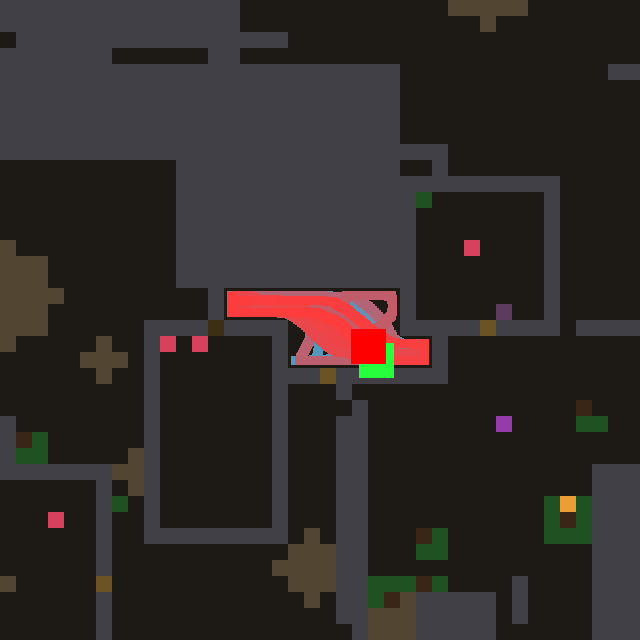
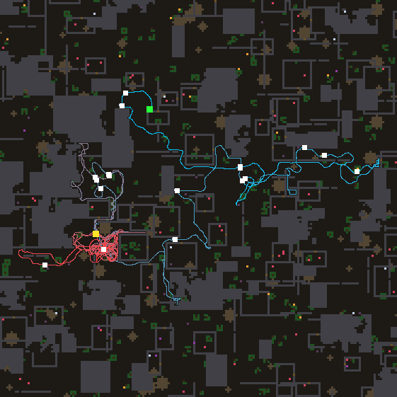
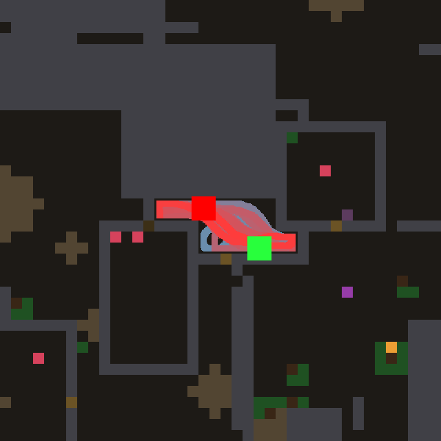
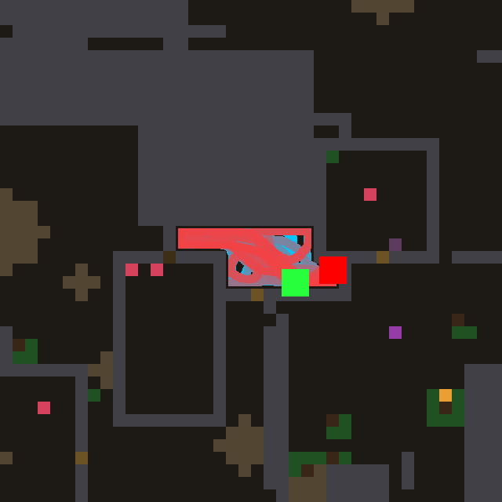
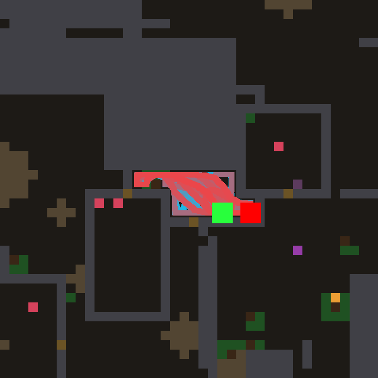
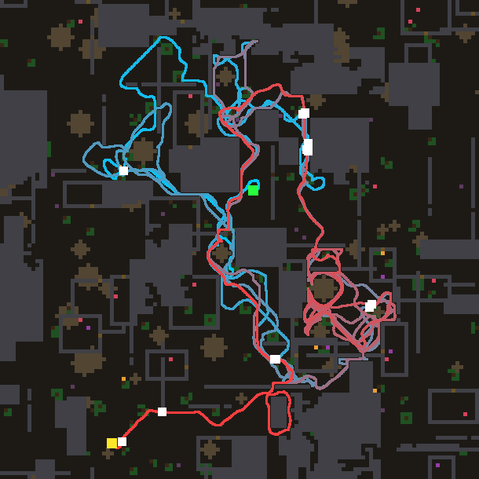

# Night lab summary — 2026-11-04T11:14:39
Model `agent-in-session (mailbox)`, 12.44 h, 43 design turns (8 deep), model busy 0.35 h, waited for other users 0 min, resumed 0x.
```
                                   train  immortal   holdout  immortal
reference wave (#0)                 14.8  11/20    19.6  15/16
confine, hand-written (#1)          25.7  19/20    25.7  14/16
CONTROL: #1 tuned 212x              30.7  19/20    24.2  15/16
#30 (turn 27, tuned 6x)             31.4  19/20    27.2  16/16
#44 (turn 42, tuned 1x)             30.1  19/20    30.2  16/16
#32 (turn 29, tuned 5x)             30.5  19/20    30.5  16/16
#43 (turn 41, tuned 5x)             29.9  19/20    28.6  16/16
#35 (turn 32, tuned 5x)             28.8  19/20    30.8  16/16
```

**FINAL worlds** (32 worlds nobody selected on, not even the model through the prompt):

```
reference wave (#0)                 18.8 meals  immortal 28/32
confine, hand-written (#1)          24.5 meals  immortal 28/32
CONTROL: #1 tuned 212x              25.8 meals  immortal 28/32
#19 tuned 5x                        26.9 meals  immortal 30/32
#35 tuned 5x                        29.8 meals  immortal 31/32
#32 tuned 5x                        26.9 meals  immortal 28/32
#30 tuned 6x                        28.2 meals  immortal 29/32
#44 tuned 1x                        27.2 meals  immortal 28/32
#19 as written                      27.1 meals  immortal 30/32
```
Design turns: 43 valid (43 first try, 0 after repair), 0 never loaded, 1 constants-only twins. Evaluations: {'llm': 256, 'control': 212, 'holdout': 20}.

Prediction error (|predicted - actual| meals, before tuning): first half 4.8, second half 3.3 over 43 predictions — the theory got better at predicting.

## Timeline

```
   0.54 h  turns   2  champion #3 train  25.8 hold 29.3125  |  control train  25.7 hold 25.6875
   1.09 h  turns   4  champion #3 train  26.7 hold 27.3125  |  control train  25.7 hold 25.6875
   1.62 h  turns   6  champion #3 train  26.7 hold 27.3125  |  control train  25.7 hold 25.6875
   2.13 h  turns   8  champion #3 train  26.7 hold 27.3125  |  control train  25.7 hold 25.6875
   2.66 h  turns  10  champion #3 train  26.7 hold 27.3125  |  control train  27.3 hold 25.4375
   3.17 h  turns  12  champion #3 train  26.7 hold 27.3125  |  control train  27.3 hold 25.4375
   3.70 h  turns  14  champion #3 train  26.7 hold 27.3125  |  control train  27.3 hold 25.4375
   4.23 h  turns  16  champion #18 train  27.7 hold  29.0  |  control train  27.3 hold 25.4375
   4.79 h  turns  18  champion #18 train  27.7 hold  29.0  |  control train  27.3 hold 25.4375
   5.33 h  turns  20  champion #18 train  27.7 hold  29.0  |  control train  27.3 hold 25.4375
   5.89 h  turns  23  champion #23 train  29.6 hold 27.8125  |  control train  27.3 hold 25.4375
   6.42 h  turns  25  champion #23 train  29.6 hold 27.8125  |  control train  28.4 hold 26.3125
   6.98 h  turns  27  champion #23 train  29.6 hold 27.8125  |  control train  28.6 hold 30.625
   7.60 h  turns  29  champion #30 train  31.4 hold 27.1875  |  control train  30.7 hold 24.25
   8.14 h  turns  30  champion #30 train  31.4 hold 27.1875  |  control train  30.7 hold 24.25
   8.65 h  turns  32  champion #30 train  31.4 hold 27.1875  |  control train  30.7 hold 24.25
   9.18 h  turns  33  champion #30 train  31.4 hold 27.1875  |  control train  30.7 hold 24.25
   9.71 h  turns  35  champion #30 train  31.4 hold 27.1875  |  control train  30.7 hold 24.25
  10.26 h  turns  37  champion #30 train  31.4 hold 27.1875  |  control train  30.7 hold 24.25
  10.80 h  turns  39  champion #30 train  31.4 hold 27.1875  |  control train  30.7 hold 24.25
  11.33 h  turns  41  champion #30 train  31.4 hold 27.1875  |  control train  30.7 hold 24.25
  11.91 h  turns  42  champion #30 train  31.4 hold 27.1875  |  control train  30.7 hold 24.25
  12.03 h  turns  43  champion #30 train  31.4 hold 27.1875  |  control train  30.7 hold 24.25
```

## Champion #19

**Hypothesis:** In sealed pockets and walled rooms (the observer's world 16 and world 2: many presses, few doors) the wave leaks through every wall cell alike, so the nearest rock is pressed as often as the door. The harness already teaches the leak per hue (a door that opens raises it, rock that does nothing lowers it); a DOORNESS contrast amplifies a wall cell's leak by how much it exceeds the mean leak of the solid cells around it, so a door or rubble tile in a rock wall becomes the one bright exit, while the knowledge-priced wave (#18, best untuned) is kept.

As written: 24.8 meals; tuned 5x: 27.1.

```nomos
channel source
channel solid
channel free
channel thing
channel scent
channel bad
channel here
channel leak
channel value
channel dark
channel door
channel injection
channel wave
channel trail

rule track:
  when 0.9454
  set trail = max(here, 0.7833 * trail)

rule darkness:
  when 1.493
  set dark = 0.4482 * (1 - free) * (1 - solid) + 0.5 * avg8(dark)

# a wall cell that gives more than the walls around it stands out: contrast of its taught leak against its solid neighbours' mean
rule doorness:
  when 1
  set door = clamp(leak + 2.026 * (leak - sum8(solid * leak) / (sum8(solid) + 0.01)) * min(1, 0.5 * sum8(solid)), 0, 1)

rule inject:
  when 1
  set injection = max(where(scent + thing < 0.05, 0, source), thing * (0.959 - bad), where(scent + thing < 0.05, source, 0) * (0.3 + 2.43 * dark)) / (1.371 + 0.5 * sum8(solid))

# unknown ground costs extra; walls pass the wave by their CONTRASTED leak, so doors outshine the rock around them
rule plan:
  when 1
  set wave = max(injection, (1 - 0.08 * (1 - free)) * max(0.94 * max4(wave), 0.916214 * max8(wave))) * (1 - solid * (1 - door))

rule read:
  when 1.002
  set value = wave * (1.051 - 0.3434 * trail)
```

## Theory, first version (1.54 h)

1. Exploration is the lever; frontier quality matters. Darkness-weighted frontier (#3) is the train leader (26.7 tuned, holdout 27.3) over plain confinement (#1, 25.7/25.7).
2. Do not walk back. The footprint trail (#4) is the best holdout (30.0) with equal train (25.9); it rescued worlds 3 and 6 (5->26, 4->29), the dithering worlds.
3. Splitting food and frontier into two waves with different discounts hurts (#5, 21.6): one shared discount keeps food and frontier comparable.
4. Extra pull terms layered on top so far cost meals untuned: random regional preference (#6, 24.4, holdout 24.9), wall breach (#7, 23.2 raw, 26.2 tuned, world 16 still 0), larder/trapline (#8, 24.6 raw, untuned). Each new source competes with the frontier and distracts.
5. Per-world scores swing 2 <-> 28 between near-identical laws: one world is not evidence; trust holdout.
6. World 16 (sealed pocket) starves every law, breach included.

## Theory, last version (11.59 h)

BEST HONEST STRUCTURE: #32 (30.5 untuned, holdout 30.5): persistent multiplicative wave; sources confined by sum8(solid); darkness-weighted frontier; footprint dimming at the read-out; steps priced by map knowledge (unknown ground dearer unless predicted floor, guessed wall continuations pass half, seen walls by door contrast).
LOAD-BEARING (ablations): darkness+trail (24.6 without, #29), door contrast (26.7, #36), read-out dimming even with a trail price (25.1, #43).
KNOWLEDGE GOES INTO STEP PRICES: +2 to +3 meals each time (#18, #23, #32); the same knowledge as source worth collapses (22.1, #33).
SETTLED NEGATIVES: new pulls (leaves 18.3, room source changed nothing, #32 twin), changing distance pricing either way (additive 16.9, trust horizon 21.9), plan speed either way (12.8, 26.7, 28.4).
SATURATED: further priors and two-scale confinement 28.1-28.8.
Tuning overfits (#30 31.4 -> 27.2 holdout; control 30.7 -> 24.2). World 16 starves everything.

## Observations

**#3 on world 16** — 

The agent spends its whole life inside one small walled pocket (a 4x12 box, start and death in the same spot), sweeping back and forth along it and never leaving, so it never even reaches the food lying a short walk away in the neighbouring rooms.
It does press and break things (3 doors, 5 breaks), but after each press it drifts back into the pocket instead of walking through, so the openings it makes do not turn into a route out.
The failure is that inside a sealed pocket every boundary cell is known solid, so there are no frontier marks (unknown cells touching known-free ones) and the value field has nothing to point at except leak through walls, which is weak and spread evenly around the whole box.
A fix: give solid cells that have unknown space behind them (a wall with darkness on its far side, especially one whose leak was taught high by a door opening) a source of their own when no frontier exists, so the wave leads the agent into one specific wall and through it, and keep that target (a lingering source) until it is passed.

**#3 on world 2** — 

Early in life the agent ranges widely and eats steadily (most meals lie along the long cyan path), but in the late part it gets stuck in one spot at the lower left, looping in tight circles inside a 13x13 box for its last stretch with no meals there.
Many of the remaining food dots sit inside small walled rooms (the outlined squares), and the agent opened 0 doors while making 100 idle presses, so it is being called by food it can smell or see behind walls and keeps pressing stone instead of finding the room's door.
The loops look like the wave leaking through the nearest wall toward the smelled food: the agent is led into the same stone, presses, slides off, circles back, and repeats.
A fix: remember the wall cells it has pressed without result (solid cells next to `here` that stay solid) and stop letting the wave leak through those cells for a long while, so the path through the wall moves to other cells of the room's boundary until it reaches the door, or the agent gives up and leaves.

**#18 on world 16** — 

The agent is born in the same small two-corridor pocket as before and again spends its whole life there: it walks more than the earlier champion (615 cells of distance vs 284) but only ever over the same ~58 cells, sweeping from end to end until it starves at the far end of the upper corridor.
The pocket's only ways out are the brown door/rubble tiles at its ends and below it, and it opened just one door and broke five things while making 21 idle presses, so most of its pressing lands on rock rather than on those tiles.
Food is a few cells away in the neighbouring rooms, but behind solid walls the wave sees only an even leak through every wall cell, so nothing makes a door tile stand out from the rock around it, and once a press fails the agent swings back to the other end.
One mechanism: make the wave leak through a wall cell in proportion to how unlike the surrounding rock it is (the taught per-hue `leak` contrasted against its neighbours' leak, e.g. leak minus the mean leak of the wall cells around it), so door and rubble tiles become the bright exits of a sealed pocket and the agent presses them rather than the rock.

**#23 on world 16** — 

Same world, same trap: the agent is born in the small two-corridor pocket and spends its whole life sweeping it (65 cells visited, a 4x12 box for its last 500 ticks) until it starves at the east end, with food a few cells away in the neighbouring rooms.
It is not passive: it opened 5 doors and broke 5 things, but made 106 idle presses, and after each opening it swings back into the pocket instead of stepping through, so the openings never become a way out.
The pull that brings it back is the pocket itself: all values are local and short-lived, and the footprint trail fades within a few thoughts, so each time it turns round the far end of the pocket looks fresh again.
One mechanism: a slow HABITUATION field that accumulates wherever the agent spends time (much slower to fade than the trail) and dims the value there, so after a few hundred ticks in one small area everything familiar is dark and the only bright cells left are beyond the doors it has opened.

**#30 on world 16** — 

The new best law fails world 16 exactly like its predecessors: born in the two-corridor pocket, it sweeps the same ~63 cells for its whole life and starves at the east end, never reaching the food in the rooms around it.
What changed is the pressing: 182 idle presses and 0 doors or breaks (earlier laws opened 1-5 doors here), so the door contrast now concentrates its pushes on a few rock cells instead of spreading them, and none of those cells is one of the brown door/rubble tiles at the pocket's ends and below it.
The contrast can only light a door once the door's hue has been pressed and taught; a door never pressed keeps the innate leak and does not stand out from untaught rock, while repeatedly pressed rock is the cell the wave keeps returning to.
One mechanism: make a wall cell's pull through the wave decay with the number of presses it has already received without giving (a per-cell, not per-hue, refusal count that dims its leak), so after a few failed pushes on one rock cell the next-best wall cell becomes the target and every boundary cell of a pocket, the doors included, eventually gets tried.

**#30 on world 18** — 

On world 18 the agent stays alive all 8000 ticks and covers a lot of ground (990 cells), but eats only 17 times: it shuttles up and down the same long north-south corridor through the middle of the map several times (the cyan and red tracks overlap there) and ends in a tangle of loops in the rooms on the right, where it eats once.
Much of the remaining food sits inside small walled rooms (the outlined squares, many with a dot inside, especially on the left and lower left), and the agent opened 0 doors with 45 idle presses, so it walks past enclosed food again and again without getting in.
The repeated corridor runs look like the plan re-choosing between the two halves of the map as the map forgets one of them, so the trip back is made from scratch each time instead of to a remembered target.
One mechanism: treat a closed room that the map has seen whole (a rectangle of wall with unknown or food inside) as a door search target, a weak source on its wall cells that fades per cell after each press, so the agent walks round a room's boundary pressing until the door gives instead of passing it by.

GIF: `champion.gif` (world 5, first 4000 ticks).
