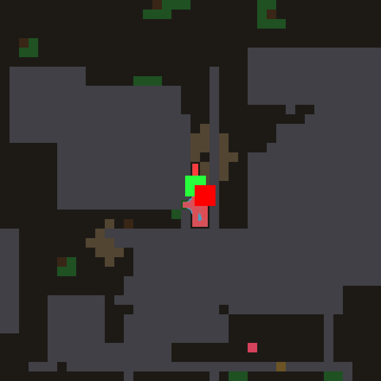
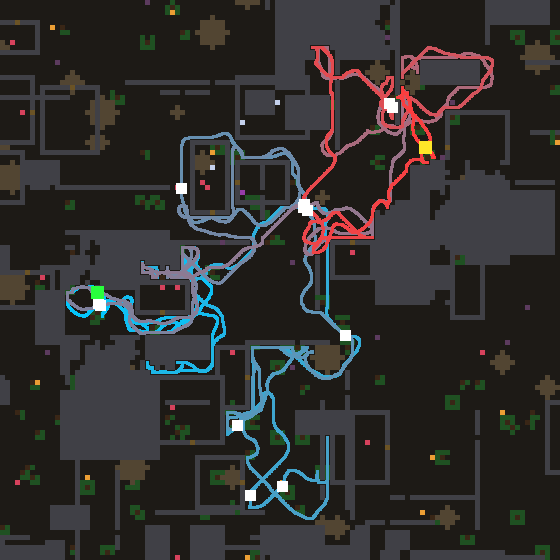
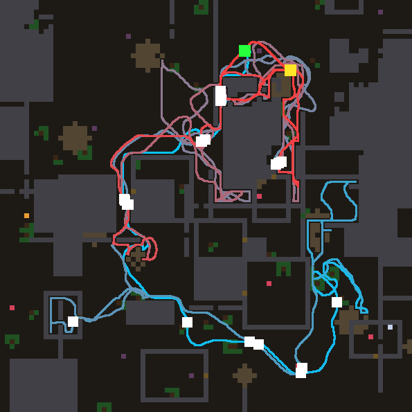
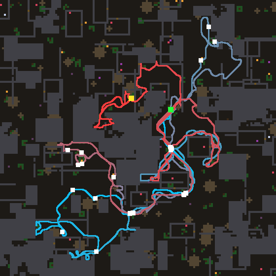

# night lab — 2026-11-04T12:47:59

Model `agent-in-session (mailbox)` | 12.0 h | world default | train [100, 101, 102, 103, 104, 105, 106, 107, 108, 109, 110, 111, 112, 113, 114, 115, 116, 117, 118, 119] | holdout [120, 121, 122, 123, 124, 125, 126, 127, 128, 129, 130, 131, 132, 133, 134, 135] | 8000 ticks/life | tune 5 | deep every 5 | theory every 6 | observe every 8

- anchor #0 `laws/atlas_wave.nomos`: train 20.4 meals [21, 36, 36, 18, 25, 34, 20, 12, 2, 26, 13, 15, 28, 35, 33, 10, 21, 18, 0, 5], holdout 15.5

- anchor #1 `laws/atlas_confine.nomos`: train 23.2 meals [20, 30, 20, 31, 25, 35, 45, 25, 17, 30, 0, 18, 21, 9, 44, 26, 3, 37, 0, 28], holdout 23.6

- anchor #2 `laws/atlas_ghost.nomos`: train 22.7 meals [21, 27, 29, 40, 21, 7, 14, 5, 12, 23, 16, 27, 28, 23, 34, 12, 12, 30, 25, 48], holdout 17.9

> 12:53 model job `design` started

---

## Turn 0 -> island #3

**Hypothesis:** The confinement law has no memory: when the geodesic smell bearing flips between the two ways round a wall, its source hops and the agent oscillates (the trap the ghost law fixed), while the ghost law lacks confinement and is lured into nooks. Here a lingering ghost of every source (erased under the agent) is injected through the confinement divisor, and remembered refusals (`bad`) mute injection, so the target is both stable over time and discounted where it is hemmed in.

Prediction 25.0, got **25.8** meals, fitness 510, per world [22, 37, 31, 25, 17, 43, 22, 17, 34, 20, 0, 36, 33, 6, 43, 25, 35, 36, 19, 14]; model 26.1 s, repairs 0

value on the test map: max 1.00, mean 0.53, 0% at the cap -> healthy: the best neighbour points at the source

```nomos
channel source
channel thing
channel solid
channel here
channel bad
channel value
channel ghost: init 0
channel confinement
channel injection

# memory: a source lingers after the paint moves on, erased where the agent stands
rule linger:
  when 1
  set ghost = max(source, thing, 0.99 * ghost) * (1 - here) * (1 - max8(here))

# local solidity around a cell: high in nooks and dead ends
rule calc_conf:
  when 1
  set confinement = sum8(solid)

# remembered sources, discounted by confinement and muted where something burned
rule inject:
  when 1
  set injection = ghost / (1 + 0.5 * confinement) * (1 - bad)

# discounted Bellman wave through passable cells
rule wave:
  when 1
  set value = max(injection, max(0.94 * max4(value), 0.916214 * max8(value))) * (1 - solid * (1 - leak))
```

> 13:06 model job `design` started

---

## Turn 1 -> island #4

**Hypothesis:** Exploration is a flat 0.12 on every frontier cell, so a crack into a one-cell pocket pulls as hard as an opening onto a wide unexplored region; most meals come from exploration, so the frontier should be worth what lies beyond it. This law keeps #3's lingering ghost + confinement, and adds a relaxed "roominess" field (smoothed density of unknown cells) that scales a recomputed frontier source, so the agent heads for large unknown areas (and the map edge, beyond which everything is unknown) rather than probing pockets.

Prediction 27.0, got **26.2** meals, fitness 521, per world [37, 30, 27, 17, 40, 30, 18, 34, 7, 36, 0, 37, 28, 23, 44, 26, 36, 31, 0, 23]; model 40.1 s, repairs 0

value on the test map: max 1.00, mean 0.53, 0% at the cap -> healthy: the best neighbour points at the source

```nomos
channel source
channel thing
channel solid
channel free
channel here
channel bad
channel value
channel ghost: init 0
channel confinement
channel unk
channel room
channel front
channel injection

# what is not yet known: neither seen free nor seen solid
rule unknown:
  when 1
  set unk = (free < 0.2) * (solid < 0.5)

# smoothed density of the unknown around a cell (relaxes each pass, bounded in [0,1])
rule roominess:
  when 1
  set room = 0.5 * unk + 0.5 * avg8(room)

# frontier: an unknown cell touching a known-free one
rule frontier:
  when 1
  set front = unk * (max8(free) > 0.5)

# memory: a source lingers after the paint moves on, erased where the agent stands
rule linger:
  when 1
  set ghost = max(source, thing, 0.99 * ghost) * (1 - here) * (1 - max8(here))

# local solidity: high in nooks and dead ends
rule calc_conf:
  when 1
  set confinement = sum8(solid)

# frontier worth what lies beyond it: open unknown beats a crack into a pocket
rule inject:
  when 1
  set injection = max(ghost, 0.3 * front * room * room) / (1 + 0.5 * confinement) * (1 - bad)

# discounted Bellman wave through passable cells
rule wave:
  when 1
  set value = max(injection, max(0.94 * max4(value), 0.916214 * max8(value))) * (1 - solid * (1 - leak))
```

### Holdout checkpoint at 0.57 h

```
  #3   train 28.9 meals  holdout 22.5  (tuned 5x) | The confinement law has no memory: when the geodesic smell bearing flips between the two ways round a wall, it
  #4   train 26.2 meals  holdout 28.9  (tuned 4x) | Exploration is a flat 0.12 on every frontier cell, so a crack into a one-cell pocket pulls as hard as an openi
  #0   train 20.4 meals  holdout 15.5  (hand-written) | the reference Bellman wave
  #1   train 23.2 meals  holdout 23.6  (hand-written) | Confinement suppression (night lab 2026-09-23, champion #35): a source hemmed in by solid counts less, so loca
  #2   train 22.7 meals  holdout 17.9  (hand-written) | sources linger (ghost), erased under the agent
  CONTROL: #1's law, constants tuned by random search 8x: train 27.6 meals, holdout 23.2
```

> 13:24 model job `design` started

---

## Turn 2 -> island #5

**Hypothesis:** 70% of food spots are renewable and regrow ~1200 ticks after being eaten, but every law so far forgets a spot the moment its morsel is gone, so it only ever eats what exploration stumbles on. A larder channel remembers where morsels were seen and a per-cell harvest clock rises from 0 (just eaten) toward 1 (due), injecting the spot as a growing source as regrowth approaches; a spot found empty when due is erased, so one-shot spots are not camped. Built on #4 (ghost + confinement + roominess frontier), this turns local patches into a revisited pantry instead of a one-time find.

Prediction 28.0, got **26.6** meals, fitness 532, per world [37, 30, 36, 17, 40, 30, 18, 34, 7, 36, 0, 37, 28, 23, 44, 26, 36, 31, 0, 23]; model 64.1 s, repairs 0; vocabulary twin of #4

value on the test map: max 1.00, mean 0.53, 0% at the cap -> healthy: the best neighbour points at the source

```nomos
channel source
channel thing
channel solid
channel free
channel here
channel bad
channel value
channel ghost: init 0
channel confinement
channel unk
channel room
channel front
channel larder
channel clock
channel injection

# a place where a morsel was seen, remembered long; forgotten if found empty when due
rule remember_spot:
  when 1
  set larder = max(thing, 0.9998 * larder * (1 - max(here, max8(here)) * (clock > 0.9)))

# time since the spot last held a morsel: 0 while seen, rises toward 1 at regrowth
rule harvest_clock:
  when 1
  set clock = where(thing > 0.5, 0, min(1, clock + 0.0004))

# what is not yet known: neither seen free nor seen solid
rule unknown:
  when 1
  set unk = (free < 0.2) * (solid < 0.5)

# smoothed density of the unknown around a cell
rule roominess:
  when 1
  set room = 0.5 * unk + 0.5 * avg8(room)

# frontier: an unknown cell touching a known-free one
rule frontier:
  when 1
  set front = unk * (max8(free) > 0.5)

# a source lingers after the paint moves on, erased where the agent stands
rule linger:
  when 1
  set ghost = max(source, thing, 0.99 * ghost) * (1 - here) * (1 - max8(here))

# local solidity: high in nooks and dead ends
rule calc_conf:
  when 1
  set confinement = sum8(solid)

# sources: what is sensed, wide unknown, and eaten spots coming due again
rule inject:
  when 1
  set injection = max(ghost, 0.3 * front * room * room, 0.5 * larder * clock * clock) / (1 + 0.5 * confinement) * (1 - bad)

# discounted Bellman wave through passable cells
rule wave:
  when 1
  set value = max(injection, max(0.94 * max4(value), 0.916214 * max8(value))) * (1 - solid * (1 - leak))
```

> 13:42 model job `design` started

---

## Turn 3 -> island #6

**Hypothesis:** The agent's failure modes are dithering between two targets and re-walking ground it has already searched, and nothing in the rule knows where the agent has been. A stigmergic trail channel (laid at `here`, fading over hundreds of ticks, scrolled with the map) makes walked cells slightly less conductive to the wave, so ties and near-ties break toward fresh ground and away from backtracking, while a strong food source still pulls through a walked corridor. Built on the lingering ghost only (no confinement, no roominess), so the effect of self-avoidance is measured on its own.

Prediction 24.0, got **23.1** meals, fitness 474, per world [16, 19, 31, 24, 27, 37, 16, 15, 17, 22, 14, 31, 22, 30, 25, 18, 29, 18, 20, 31]; model 30.0 s, repairs 0

value on the test map: max 1.00, mean 0.53, 0% at the cap -> healthy: the best neighbour points at the source

```nomos
channel source
channel thing
channel solid
channel here
channel bad
channel value
channel ghost: init 0
channel trail: init 0

# stigmergy: the agent's own recent path, laid where it stands, fading over hundreds of ticks
rule lay_trail:
  when 1
  set trail = max(here, 0.999 * trail)

# a source lingers after the paint moves on, erased where the agent stands
rule linger:
  when 1
  set ghost = max(source, thing, 0.99 * ghost) * (1 - here) * (1 - max8(here)) * (1 - bad)

# the wave flows a little less through ground already walked: no backtracking, no two-goal dithering
rule wave:
  when 1
  set value = max(ghost, max(0.94 * max4(value), 0.916214 * max8(value))) * (1 - solid * (1 - leak)) * (1 - 0.08 * trail)
```

> 13:44 model job `observe` started

---

## Observer: #3 on world 110



`{'meals': 0, 'ticks': 4221, 'alive': False, 'distance': 228.1, 'cells_visited': 23, 'last500_box': '4x1', 'doors': 0, 'breaks': 11, 'idle_presses': 24, 'nightcaps': 0}`

The agent is born in a narrow sealed slot about one cell wide and four tall, walled by rock with patches of brown rubble right beside it, and it never leaves: the whole 4221-tick life is spent pacing up and down that slot (last 500 ticks in a 4x1 box) until it starves. It does try to dig — 11 breaks and 24 idle presses — but the presses are spread over different wall cells (much of it on plain rock), so no single rubble cell is ever chipped all the way through. The world outside is open and has food in reach (green spots above and to the left), so this is not a lack of food but a failure to commit to one exit. Confinement suppression makes it worse here: every source in a pocket is divided down, so the wave in the slot is weak and keeps re-pointing as the faint frontier/smell marks shift. The fix I would try first is a dig commitment: a per-cell memory that grows while the agent presses a solid cell and raises that cell's leak (its conductivity to the wave), so the wave keeps leading into the same rubble cell until it gives way instead of hopping between walls.

### Holdout checkpoint at 1.11 h

```
  #3   train 28.9 meals  holdout 22.5  (tuned 6x) | The confinement law has no memory: when the geodesic smell bearing flips between the two ways round a wall, it
  #5   train 26.6 meals  holdout 28.7  (tuned 5x) | 70% of food spots are renewable and regrow ~1200 ticks after being eaten, but every law so far forgets a spot 
  #4   train 26.2 meals  holdout 28.9  (tuned 5x) | Exploration is a flat 0.12 on every frontier cell, so a crack into a one-cell pocket pulls as hard as an openi
  #6   train 23.1 meals  holdout  -    (tuned 4x) | The agent's failure modes are dithering between two targets and re-walking ground it has already searched, and
  #0   train 20.4 meals  holdout 15.5  (hand-written) | the reference Bellman wave
  #1   train 23.2 meals  holdout 23.6  (hand-written) | Confinement suppression (night lab 2026-09-23, champion #35): a source hemmed in by solid counts less, so loca
  #2   train 22.7 meals  holdout 17.9  (hand-written) | sources linger (ghost), erased under the agent
  CONTROL: #1's law, constants tuned by random search 20x: train 27.6 meals, holdout 23.2
```

> 13:55 model job `deep` started

---

## Turn 4 (DEEP) -> island #7

**Hypothesis:** Evidence: #6 (ghost + a stigmergic trail) is the only law that ever escaped world 110's sealed slot (14 meals vs 0 for every other law), while confinement + roominess (#3/#4) carry the open worlds; the observer saw the agent pace the slot pressing scattered walls. This law adds a FRUSTRATION state: accumulated dwell time, smoothed into a `crowd` field, is high only where the agent has paced for long; there it (a) multiplies the wall leak (so a taught-leaky rubble cell becomes the clear way out while learned-dead rock stays low), (b) lifts the confinement suppression, and (c) a faint pull from every unknown cell gives the wave something beyond a sealed wall to aim at. In open ground dwell nev

Prediction 29.0, got **27.0** meals, fitness 550, per world [34, 25, 36, 30, 37, 27, 7, 32, 23, 24, 29, 35, 18, 27, 35, 28, 26, 6, 29, 32]; model 50.1 s, repairs 0; vocabulary twin of #4

value on the test map: max 1.00, mean 0.53, 0% at the cap -> healthy: the best neighbour points at the source

```nomos
channel source
channel thing
channel solid
channel free
channel here
channel bad
channel leak
channel value
channel ghost: init 0
channel confinement
channel unk
channel room
channel front
channel trail: init 0
channel dwell: init 0
channel crowd: init 0
channel injection

# any visit: the recent path (max), and accumulated time spent on a cell (sum, saturating)
rule lay_trail:
  when 1
  set trail = max(here, 0.999 * trail)
rule dwell_time:
  when 1
  set dwell = min(1, 0.998 * dwell + 0.02 * here)

# frustration: smoothed dwell — high only where the agent has paced for long (a pocket)
rule frustration:
  when 1
  set crowd = 0.5 * dwell + 0.5 * avg8(crowd)

# what is not yet known, the frontier, and how much unknown lies around
rule unknown:
  when 1
  set unk = (free < 0.2) * (solid < 0.5)
rule roominess:
  when 1
  set room = 0.5 * unk + 0.5 * avg8(room)
rule frontier:
  when 1
  set front = unk * (max8(free) > 0.5)

# a source lingers after the paint moves on, erased where the agent stands
rule linger:
  when 1
  set ghost = max(source, thing, 0.99 * ghost) * (1 - here) * (1 - max8(here))

rule calc_conf:
  when 1
  set confinement = sum8(solid)

# sources: sensed, wide frontier, and a faint pull of ALL unknown (the only thing beyond a sealed wall);
# confinement suppression is lifted where the agent is frustrated
rule inject:
  when 1
  set injection = max(ghost, 0.3 * front * room * room, 0.04 * unk) / (1 + 0.5 * confinement * (1 - crowd)) * (1 - bad)

# the wave: walls near long dwelling conduct more (a taught-leaky wall most), walked ground a little less
rule wave:
  when 1
  set value = max(injection, max(0.94 * max4(value), 0.916214 * max8(value))) * (1 - solid * (1 - min(1, leak * (1 + 3 * crowd)))) * (1 - 0.08 * trail)
```

> 14:10 model job `design` started

---

## Turn 5 -> island #8

**Hypothesis:** Axis: the far-vs-near trade-off. One wave gives every source the same 0.94/cell horizon, so a wide frontier ten cells away competes with a narrow one beside the agent and it zig-zags across the map instead of sweeping it. Here food (the source with the harness's 0.12 frontier marks subtracted, lingering) and exploration run as two separate waves with separate horizons — food far-sighted at 0.94/cell, exploration short-sighted at 0.85/cell — and the agent follows the larger; #7's frustration (dwell-opened walls, lifted confinement) and trail are kept as the shared conductance, so nearest-frontier sweeping is the only change.

Prediction 31.0, got **25.7** meals, fitness 518, per world [20, 27, 22, 33, 21, 33, 10, 25, 23, 48, 26, 28, 26, 18, 33, 26, 26, 18, 12, 39]; model 38.1 s, repairs 0; vocabulary twin of #7

value on the test map: max 1.00, mean 0.53, 0% at the cap -> healthy: the best neighbour points at the source

```nomos
channel source
channel thing
channel solid
channel free
channel here
channel bad
channel leak
channel value
channel ghost: init 0
channel confinement
channel unk
channel room
channel front
channel trail: init 0
channel dwell: init 0
channel crowd: init 0
channel conduct
channel fwave
channel xwave

rule lay_trail:
  when 1
  set trail = max(here, 0.999 * trail)
rule dwell_time:
  when 1
  set dwell = min(1, 0.998 * dwell + 0.02 * here)
rule frustration:
  when 1
  set crowd = 0.5 * dwell + 0.5 * avg8(crowd)
rule unknown:
  when 1
  set unk = (free < 0.2) * (solid < 0.5)
rule roominess:
  when 1
  set room = 0.5 * unk + 0.5 * avg8(room)
# the harness's own frontier, recomputed: unknown touching known-free
rule frontier:
  when 1
  set front = unk * (max8(free) > 0.5)
rule calc_conf:
  when 1
  set confinement = sum8(solid)
# how much wave a cell lets through (frustration opens walls, walked ground resists a little)
rule conductance:
  when 1
  set conduct = (1 - solid * (1 - min(1, leak * (1 + 3 * crowd)))) * (1 - 0.08 * trail)

# FOOD alone: the source with the harness's 0.12 frontier marks taken out, lingering
rule linger:
  when 1
  set ghost = max(source - 0.12 * front, thing, 0.99 * ghost) * (1 - here) * (1 - max8(here)) * (1 - bad)

# two waves with their own horizons: food carries far (0.94/cell) ...
rule food_wave:
  when 1
  set fwave = max(ghost / (1 + 0.5 * confinement * (1 - crowd)), max(0.94 * max4(fwave), 0.916214 * max8(fwave))) * conduct
# ... exploration is short-sighted (0.85/cell): sweep the nearest wide frontier, not a far one
rule explore_wave:
  when 1
  set xwave = max(max(0.3 * front * room * room, 0.04 * unk) / (1 + 0.5 * confinement * (1 - crowd)), max(0.85 * max4(xwave), 0.7943 * max8(xwave))) * conduct

rule combine:
  when 1
  set value = max(fwave, xwave)
```

> 14:15 model job `theory` started

---

## Theory (after 6 design turns)

Helps: memory + confinement together (#3 untuned 25.8 vs confine 23.2, ghost 22.7), but tuned #3 fell to 22.5 on holdout, so its tuned constants overfit. Weighting the frontier by how much unknown lies beyond it (#4, #5) generalises best: holdout 28.9/28.7, above train. Escaping sealed pockets is a real, separate failure: every law scored 0 on world 110 until the trail (#6: 14) and dwell-driven frustration that opens nearby walls (#7: 29 there, best train 32.2, holdout pending).
Neutral: the larder/regrowth clock (#5 = #4 on 19 of 20 worlds; spots leave the 25-cell map before they regrow). Trail alone costs meals in open worlds (#6 23.1).
Hurts: short-sighted exploration as a separate fast-decaying wave (#8 25.7 vs #7 27.0 untuned): far frontiers matter.
Untried: poison/appetite use, commitment to one target over thoughts, reading corridor geometry, why #7 lost worlds 116/117.

### Holdout checkpoint at 1.64 h

```
  #7   train 32.2 meals  holdout 27.2  (tuned 5x) | Evidence: #6 (ghost + a stigmergic trail) is the only law that ever escaped world 110's sealed slot (14 meals 
  #3   train 28.9 meals  holdout 22.5  (tuned 7x) | The confinement law has no memory: when the geodesic smell bearing flips between the two ways round a wall, it
  #5   train 26.6 meals  holdout 28.7  (tuned 5x) | 70% of food spots are renewable and regrow ~1200 ticks after being eaten, but every law so far forgets a spot 
  #4   train 26.2 meals  holdout 28.9  (tuned 5x) | Exploration is a flat 0.12 on every frontier cell, so a crack into a one-cell pocket pulls as hard as an openi
  #8   train 25.7 meals  holdout  -    (tuned 3x) | Axis: the far-vs-near trade-off. One wave gives every source the same 0.94/cell horizon, so a wide frontier te
  #6   train 23.1 meals  holdout  -    (tuned 5x) | The agent's failure modes are dithering between two targets and re-walking ground it has already searched, and
  #0   train 20.4 meals  holdout 15.5  (hand-written) | the reference Bellman wave
  #1   train 23.2 meals  holdout 23.6  (hand-written) | Confinement suppression (night lab 2026-09-23, champion #35): a source hemmed in by solid counts less, so loca
  #2   train 22.7 meals  holdout 17.9  (hand-written) | sources linger (ghost), erased under the agent
  CONTROL: #1's law, constants tuned by random search 30x: train 27.6 meals, holdout 23.2
```

> 14:29 model job `design` started

---

## Turn 6 -> island #9

**Hypothesis:** Axis: commitment in the agent's own motion. Every law so far re-decides from scratch each thought, so near-ties between two targets or two frontiers flip the step back and forth (the trail in #6/#7 only fought this indirectly by damping walked ground). Here a fast-fading `recent` memory of the last cells walked gives each neighbour of the agent a `momentum` score (how freshly the cell opposite it, across the agent, was left), and the read-out boosts the planned value there by up to 10%: the agent keeps its heading unless another way is clearly better, which turns dithering into sweeps. The plan itself is #7's wave (frustration, roominess frontier, ghost, confinement) with the trail term remo

Prediction 29.0, got **25.4** meals, fitness 518, per world [23, 24, 31, 30, 27, 20, 28, 25, 26, 31, 29, 25, 26, 10, 32, 24, 23, 20, 28, 26]; model 56.1 s, repairs 0; vocabulary twin of #7

value on the test map: max 1.00, mean 0.53, 0% at the cap -> healthy: the best neighbour points at the source

```nomos
channel source
channel thing
channel solid
channel free
channel here
channel bad
channel leak
channel value
channel ghost: init 0
channel confinement
channel unk
channel room
channel front
channel dwell: init 0
channel crowd: init 0
channel injection
channel recent: init 0
channel momentum
channel plan

# a short memory of the last few cells walked: the cell just left is bright, older ones fade fast
rule recency:
  when 1
  set recent = max(here, 0.95 * recent)

# momentum: a neighbour of the agent scores how freshly the cell OPPOSITE it (across the agent) was left
rule heading:
  when 1
  set momentum = max(shift(here, 1, 0) * shift(recent, 2, 0), shift(here, -1, 0) * shift(recent, -2, 0), shift(here, 0, 1) * shift(recent, 0, 2), shift(here, 0, -1) * shift(recent, 0, -2), shift(here, 1, 1) * shift(recent, 2, 2), shift(here, -1, -1) * shift(recent, -2, -2), shift(here, 1, -1) * shift(recent, 2, -2), shift(here, -1, 1) * shift(recent, -2, 2))

rule dwell_time:
  when 1
  set dwell = min(1, 0.998 * dwell + 0.02 * here)
rule frustration:
  when 1
  set crowd = 0.5 * dwell + 0.5 * avg8(crowd)
rule unknown:
  when 1
  set unk = (free < 0.2) * (solid < 0.5)
rule roominess:
  when 1
  set room = 0.5 * unk + 0.5 * avg8(room)
rule frontier:
  when 1
  set front = unk * (max8(free) > 0.5)
rule linger:
  when 1
  set ghost = max(source, thing, 0.99 * ghost) * (1 - here) * (1 - max8(here))
rule calc_conf:
  when 1
  set confinement = sum8(solid)
rule inject:
  when 1
  set injection = max(ghost, 0.3 * front * room * room, 0.04 * unk) / (1 + 0.5 * confinement * (1 - crowd)) * (1 - bad)

# the plan: #7's wave without the trail term (momentum replaces it)
rule wave:
  when 1
  set plan = max(injection, max(0.94 * max4(plan), 0.916214 * max8(plan))) * (1 - solid * (1 - min(1, leak * (1 + 3 * crowd))))

# the read-out: keep going the way you were going unless another way is clearly better
rule commit:
  when 1
  set value = plan * (1 + 0.1 * momentum)
```

> 14:43 model job `design` started

---

## Turn 7 -> island #10

**Hypothesis:** Axis: reading the map's geometry. The wave treats a route through never-seen cells exactly like a route over known ground, so it plans paths through unknown territory that turn out walled, and it cannot tell a doorway (a gap flanked by solid on opposite sides) from a nook, so confinement suppression also mutes the frontier at doors that open new rooms. This law adds a `gateway` field (gap detection with shift) that doubles a frontier source at a gap and exempts it from confinement, and a risk discount on cells not known free, so plans prefer known ground and exits; #7's frustration/trail/roominess substrate is kept unchanged so the geometry is the only thing under test.

Prediction 30.0, got **27.9** meals, fitness 558, per world [25, 37, 31, 25, 34, 21, 33, 34, 37, 38, 31, 18, 1, 15, 47, 22, 28, 19, 24, 39]; model 58.1 s, repairs 0; vocabulary twin of #7, #8

value on the test map: max 1.00, mean 0.53, 0% at the cap -> healthy: the best neighbour points at the source

```nomos
channel source
channel thing
channel solid
channel free
channel here
channel bad
channel leak
channel value
channel ghost: init 0
channel confinement
channel unk
channel room
channel front
channel trail: init 0
channel dwell: init 0
channel crowd: init 0
channel gateway
channel conduct
channel injection

rule lay_trail:
  when 1
  set trail = max(here, 0.999 * trail)
rule dwell_time:
  when 1
  set dwell = min(1, 0.998 * dwell + 0.02 * here)
rule frustration:
  when 1
  set crowd = 0.5 * dwell + 0.5 * avg8(crowd)
rule unknown:
  when 1
  set unk = (free < 0.2) * (solid < 0.5)
rule roominess:
  when 1
  set room = 0.5 * unk + 0.5 * avg8(room)
rule frontier:
  when 1
  set front = unk * (max8(free) > 0.5)

# GEOMETRY: a gap — a cell flanked by solid on two opposite sides (a doorway or corridor mouth)
rule gaps:
  when 1
  set gateway = max(shift(solid, 1, 0) * shift(solid, -1, 0), shift(solid, 0, 1) * shift(solid, 0, -1)) * (1 - solid)

rule linger:
  when 1
  set ghost = max(source, thing, 0.99 * ghost) * (1 - here) * (1 - max8(here))
rule calc_conf:
  when 1
  set confinement = sum8(solid)

# a frontier at a gap opens a new room: worth more; a gap is not a nook, so it escapes confinement
rule inject:
  when 1
  set injection = max(ghost, 0.3 * front * room * room * (1 + gateway), 0.04 * unk) / (1 + 0.5 * confinement * (1 - crowd) * (1 - gateway)) * (1 - bad)

# DISTRUST: a route through cells never seen free may be walled — it conducts a little less than known ground
rule conductance:
  when 1
  set conduct = (1 - solid * (1 - min(1, leak * (1 + 3 * crowd)))) * (1 - 0.08 * trail) * (1 - 0.04 * (1 - free) * (1 - solid))

rule wave:
  when 1
  set value = max(injection, max(0.94 * max4(value), 0.916214 * max8(value))) * conduct
```

> 14:47 model job `observe` started

---

## Observer: #7 on world 117



`{'meals': 13, 'ticks': 8000, 'alive': True, 'distance': 1490.7, 'cells_visited': 902, 'last500_box': '33x24', 'doors': 0, 'breaks': 3, 'idle_presses': 42, 'nightcaps': 0}`

This world is a town of many small walled rooms with food scattered both outside and inside them; the agent lives the whole 8000 ticks, eats 13 times, and spends most of its life walking loop after loop around the OUTSIDE of room walls (the blue and red tracks trace room perimeters two and three times over). Food dots sit inside rooms whose walls it walks right along, yet it opens no door (doors 0) while pressing walls 42 times for nothing, so the wave is leading it into plain wall cells rather than the rooms' doors. Late in life (red) it is confined to one block of rooms in the upper right, circling the same corridors, so it is not starving for lack of food but for lack of a way in. The trail and frustration terms make walls it has lingered beside more conductive, which spreads the leak over whichever stone it happens to be next to, instead of the one cell that actually opens. The mechanism I would try is a thin-wall detector: a solid cell with free (or a seen thing) on both opposite sides is a door candidate and keeps its leak, while solid cells backed by more solid get almost none, so the wave pours through doorways and the presses land on doors.

### Holdout checkpoint at 2.17 h

```
  #7   train 32.2 meals  holdout 27.2  (tuned 5x) | Evidence: #6 (ghost + a stigmergic trail) is the only law that ever escaped world 110's sealed slot (14 meals 
  #3   train 28.9 meals  holdout 22.5  (tuned 7x) | The confinement law has no memory: when the geodesic smell bearing flips between the two ways round a wall, it
  #10  train 27.9 meals  holdout 28.2  (tuned 4x) | Axis: reading the map's geometry. The wave treats a route through never-seen cells exactly like a route over k
  #5   train 26.6 meals  holdout 28.7  (tuned 5x) | 70% of food spots are renewable and regrow ~1200 ticks after being eaten, but every law so far forgets a spot 
  #4   train 26.2 meals  holdout 28.9  (tuned 5x) | Exploration is a flat 0.12 on every frontier cell, so a crack into a one-cell pocket pulls as hard as an openi
  #8   train 25.7 meals  holdout  -    (tuned 5x) | Axis: the far-vs-near trade-off. One wave gives every source the same 0.94/cell horizon, so a wide frontier te
  #9   train 25.4 meals  holdout  -    (tuned 5x) | Axis: commitment in the agent's own motion. Every law so far re-decides from scratch each thought, so near-tie
  #6   train 23.1 meals  holdout  -    (tuned 5x) | The agent's failure modes are dithering between two targets and re-walking ground it has already searched, and
  #0   train 20.4 meals  holdout 15.5  (hand-written) | the reference Bellman wave
  #1   train 23.2 meals  holdout 23.6  (hand-written) | Confinement suppression (night lab 2026-09-23, champion #35): a source hemmed in by solid counts less, so loca
  #2   train 22.7 meals  holdout 17.9  (hand-written) | sources linger (ghost), erased under the agent
  CONTROL: #1's law, constants tuned by random search 41x: train 27.6 meals, holdout 23.2
```

> 15:01 model job `design` started

---

## Turn 8 -> island #11

**Hypothesis:** The observer saw #7 on world 117 circle the outsides of small rooms full of food, pressing plain wall 42 times and opening no door: the leak is spread evenly over every solid cell, so the wave pours into thick rock as readily as into a one-cell room wall where a door can be. A `thinwall` detector (a solid cell with non-solid on both sides along an axis) keeps the taught leak only on thin walls and cuts thick rock to a third, so plans lead into room walls and doors (where the per-hue leak learning then picks the door) instead of rock masses; frustration still multiplies both, so a sealed pocket can still be dug out. Built on #10 (best untuned, 27.9), the wall-thickness rule is the one change.

Prediction 29.0, got **27.9** meals, fitness 560, per world [41, 31, 39, 28, 24, 35, 32, 35, 18, 33, 27, 20, 1, 18, 29, 29, 27, 33, 24, 34]; model 36.1 s, repairs 0; vocabulary twin of #10, #7

value on the test map: max 1.00, mean 0.53, 0% at the cap -> healthy: the best neighbour points at the source

```nomos
channel source
channel thing
channel solid
channel free
channel here
channel bad
channel leak
channel value
channel ghost: init 0
channel confinement
channel unk
channel room
channel front
channel trail: init 0
channel dwell: init 0
channel crowd: init 0
channel gateway
channel thinwall
channel conduct
channel injection

rule lay_trail:
  when 1
  set trail = max(here, 0.999 * trail)
rule dwell_time:
  when 1
  set dwell = min(1, 0.998 * dwell + 0.02 * here)
rule frustration:
  when 1
  set crowd = 0.5 * dwell + 0.5 * avg8(crowd)
rule unknown:
  when 1
  set unk = (free < 0.2) * (solid < 0.5)
rule roominess:
  when 1
  set room = 0.5 * unk + 0.5 * avg8(room)
rule frontier:
  when 1
  set front = unk * (max8(free) > 0.5)
rule gaps:
  when 1
  set gateway = max(shift(solid, 1, 0) * shift(solid, -1, 0), shift(solid, 0, 1) * shift(solid, 0, -1)) * (1 - solid)

# DOOR CANDIDATE: a solid cell only one cell thick along some axis (a room wall), not a mass of rock
rule thin_walls:
  when 1
  set thinwall = solid * max((1 - shift(solid, 1, 0)) * (1 - shift(solid, -1, 0)), (1 - shift(solid, 0, 1)) * (1 - shift(solid, 0, -1)))

rule linger:
  when 1
  set ghost = max(source, thing, 0.99 * ghost) * (1 - here) * (1 - max8(here))
rule calc_conf:
  when 1
  set confinement = sum8(solid)
rule inject:
  when 1
  set injection = max(ghost, 0.3 * front * room * room * (1 + gateway), 0.04 * unk) / (1 + 0.5 * confinement * (1 - crowd) * (1 - gateway)) * (1 - bad)

# the leak goes where a wall can open: thin walls keep their taught leak, rock mass keeps a third of it;
# frustration still raises both; known ground is trusted over unknown
rule conductance:
  when 1
  set conduct = (1 - solid * (1 - min(1, leak * (0.3 + 0.7 * thinwall) * (1 + 3 * crowd)))) * (1 - 0.08 * trail) * (1 - 0.04 * (1 - free) * (1 - solid))

rule wave:
  when 1
  set value = max(injection, max(0.94 * max4(value), 0.916214 * max8(value))) * conduct
```

> 15:20 model job `deep` started

---

## Turn 9 (DEEP) -> island #12

**Hypothesis:** Bold axis: AREA-RESTRICTED SEARCH, the classic optimal-foraging rule. Food in this world is clumped by habitat (stocked rooms hold two berries, trees two fruits, caves several mushrooms), yet every law weighs exploration the same everywhere and walks off after a meal. Here a meal (the agent beside a wanted morsel) leaves a LUCK mark pinned to that world spot (it scrolls with the map) and fading over a few hundred ticks; its PATCH (a few cells, falling off with distance) triples the frontier there and lifts confinement suppression, so the agent combs the clump — including the nooks and rooms beside it — before ranging out, and far from luck the law is #7 as before. I also drop #7's trail term

Prediction 29.5, got **26.9** meals, fitness 543, per world [20, 32, 31, 34, 36, 38, 23, 31, 26, 34, 0, 28, 25, 32, 34, 28, 21, 21, 21, 23]; model 58.1 s, repairs 0; vocabulary twin of #7

value on the test map: max 1.00, mean 0.53, 0% at the cap -> healthy: the best neighbour points at the source

```nomos
channel source
channel thing
channel solid
channel free
channel here
channel bad
channel leak
channel value
channel ghost: init 0
channel confinement
channel unk
channel room
channel front
channel dwell: init 0
channel crowd: init 0
channel feast
channel luck: init 0
channel patch: init 0
channel injection

# a MEAL is happening where the agent stands next to a wanted morsel
rule meal:
  when 1
  set feast = here * max(thing, max8(thing)) * (1 - bad)

# LUCK: where meals happened, pinned to the world (it scrolls with the map), fading over a few hundred ticks
rule remember_luck:
  when 1
  set luck = max(feast, 0.998 * luck)

# the PATCH around a lucky spot: a few cells of radius, falling off with distance
rule patch_extent:
  when 1
  set patch = max(luck, 0.8 * max8(patch))

rule dwell_time:
  when 1
  set dwell = min(1, 0.998 * dwell + 0.02 * here)
rule frustration:
  when 1
  set crowd = 0.5 * dwell + 0.5 * avg8(crowd)
rule unknown:
  when 1
  set unk = (free < 0.2) * (solid < 0.5)
rule roominess:
  when 1
  set room = 0.5 * unk + 0.5 * avg8(room)
rule frontier:
  when 1
  set front = unk * (max8(free) > 0.5)
rule linger:
  when 1
  set ghost = max(source, thing, 0.99 * ghost) * (1 - here) * (1 - max8(here))
rule calc_conf:
  when 1
  set confinement = sum8(solid)

# AREA-RESTRICTED SEARCH: food grows in patches, so unexplored ground near a recent meal is worth
# up to 3x (and its nooks are not suppressed); far from luck the frontier is weighed as before
rule inject:
  when 1
  set injection = max(ghost, 0.3 * front * room * room * (1 + 2 * patch), 0.04 * unk) / (1 + 0.5 * confinement * (1 - crowd) * (1 - patch)) * (1 - bad)

# #7's wave without the trail term
rule wave:
  when 1
  set value = max(injection, max(0.94 * max4(value), 0.916214 * max8(value))) * (1 - solid * (1 - min(1, leak * (1 + 3 * crowd))))
```

### Holdout checkpoint at 2.71 h

```
  #7   train 32.2 meals  holdout 27.2  (tuned 5x) | Evidence: #6 (ghost + a stigmergic trail) is the only law that ever escaped world 110's sealed slot (14 meals 
  #3   train 28.9 meals  holdout 22.5  (tuned 7x) | The confinement law has no memory: when the geodesic smell bearing flips between the two ways round a wall, it
  #11  train 28.2 meals  holdout 25.5  (tuned 5x) | The observer saw #7 on world 117 circle the outsides of small rooms full of food, pressing plain wall 42 times
  #10  train 27.9 meals  holdout 28.2  (tuned 5x) | Axis: reading the map's geometry. The wave treats a route through never-seen cells exactly like a route over k
  #12  train 26.9 meals  holdout  -    (tuned 2x) | Bold axis: AREA-RESTRICTED SEARCH, the classic optimal-foraging rule. Food in this world is clumped by habitat
  #5   train 26.6 meals  holdout 28.7  (tuned 5x) | 70% of food spots are renewable and regrow ~1200 ticks after being eaten, but every law so far forgets a spot 
  #4   train 26.2 meals  holdout 28.9  (tuned 5x) | Exploration is a flat 0.12 on every frontier cell, so a crack into a one-cell pocket pulls as hard as an openi
  #8   train 25.7 meals  holdout  -    (tuned 5x) | Axis: the far-vs-near trade-off. One wave gives every source the same 0.94/cell horizon, so a wide frontier te
  #0   train 20.4 meals  holdout 15.5  (hand-written) | the reference Bellman wave
  #1   train 23.2 meals  holdout 23.6  (hand-written) | Confinement suppression (night lab 2026-09-23, champion #35): a source hemmed in by solid counts less, so loca
  #2   train 22.7 meals  holdout 17.9  (hand-written) | sources linger (ghost), erased under the agent
  CONTROL: #1's law, constants tuned by random search 48x: train 27.6 meals, holdout 23.2
```

> 15:40 model job `design` started

---

## Turn 10 -> island #13

**Hypothesis:** A synthesis test of the two mechanisms that each fixed a hard world without breaking another: heading momentum (#9: worlds 116/117 at 28/20 where the trail law #7 had 7/6, and still out of the world-110 pocket at 29, 20/20 immortal) and thin-wall leak (#11: world 117 6 -> 33 by leading presses into room walls instead of rock), on #7's frustration/roominess/ghost/confinement substrate — with the trail, gateway and unknown-route risk dropped (the last two are the only common factor of #10/#11's collapse to 1 meal on world 112). If momentum + thin walls are additive, the law should keep #9's floor and #11's town worlds.

Prediction 29.0, got **26.1** meals, fitness 511, per world [31, 27, 23, 30, 29, 27, 15, 29, 12, 34, 30, 19, 31, 27, 30, 31, 21, 23, 26, 28]; model 70.1 s, repairs 0; vocabulary twin of #9, #11

value on the test map: max 1.00, mean 0.53, 0% at the cap -> healthy: the best neighbour points at the source

```nomos
channel source
channel thing
channel solid
channel free
channel here
channel bad
channel leak
channel value
channel ghost: init 0
channel confinement
channel unk
channel room
channel front
channel dwell: init 0
channel crowd: init 0
channel recent: init 0
channel momentum
channel thinwall
channel plan
channel injection

rule recency:
  when 1
  set recent = max(here, 0.95 * recent)
# a neighbour of the agent scores how freshly the cell opposite it was left
rule heading:
  when 1
  set momentum = max(shift(here, 1, 0) * shift(recent, 2, 0), shift(here, -1, 0) * shift(recent, -2, 0), shift(here, 0, 1) * shift(recent, 0, 2), shift(here, 0, -1) * shift(recent, 0, -2), shift(here, 1, 1) * shift(recent, 2, 2), shift(here, -1, -1) * shift(recent, -2, -2), shift(here, 1, -1) * shift(recent, 2, -2), shift(here, -1, 1) * shift(recent, -2, 2))
rule dwell_time:
  when 1
  set dwell = min(1, 0.998 * dwell + 0.02 * here)
rule frustration:
  when 1
  set crowd = 0.5 * dwell + 0.5 * avg8(crowd)
rule unknown:
  when 1
  set unk = (free < 0.2) * (solid < 0.5)
rule roominess:
  when 1
  set room = 0.5 * unk + 0.5 * avg8(room)
rule frontier:
  when 1
  set front = unk * (max8(free) > 0.5)
# a solid cell one cell thick along some axis: a room wall where a door can be, not rock mass
rule thin_walls:
  when 1
  set thinwall = solid * max((1 - shift(solid, 1, 0)) * (1 - shift(solid, -1, 0)), (1 - shift(solid, 0, 1)) * (1 - shift(solid, 0, -1)))
rule linger:
  when 1
  set ghost = max(source, thing, 0.99 * ghost) * (1 - here) * (1 - max8(here))
rule calc_conf:
  when 1
  set confinement = sum8(solid)
rule inject:
  when 1
  set injection = max(ghost, 0.3 * front * room * room, 0.04 * unk) / (1 + 0.5 * confinement * (1 - crowd)) * (1 - bad)
# the leak lives in thin walls; frustration raises it; no trail term
rule wave:
  when 1
  set plan = max(injection, max(0.94 * max4(plan), 0.916214 * max8(plan))) * (1 - solid * (1 - min(1, leak * (0.3 + 0.7 * thinwall) * (1 + 3 * crowd))))
# keep going the way you were going unless another way is clearly better
rule commit:
  when 1
  set value = plan * (1 + 0.1 * momentum)
```

> 16:01 model job `design` started

### Holdout checkpoint at 3.22 h

```
  #7   train 32.2 meals  holdout 27.2  (tuned 5x) | Evidence: #6 (ghost + a stigmergic trail) is the only law that ever escaped world 110's sealed slot (14 meals 
  #3   train 28.9 meals  holdout 22.5  (tuned 7x) | The confinement law has no memory: when the geodesic smell bearing flips between the two ways round a wall, it
  #11  train 28.2 meals  holdout 25.5  (tuned 5x) | The observer saw #7 on world 117 circle the outsides of small rooms full of food, pressing plain wall 42 times
  #10  train 27.9 meals  holdout 28.2  (tuned 5x) | Axis: reading the map's geometry. The wave treats a route through never-seen cells exactly like a route over k
  #13  train 29.3 meals  holdout  -    (tuned 5x) | A synthesis test of the two mechanisms that each fixed a hard world without breaking another: heading momentum
  #12  train 26.9 meals  holdout  -    (tuned 5x) | Bold axis: AREA-RESTRICTED SEARCH, the classic optimal-foraging rule. Food in this world is clumped by habitat
  #5   train 26.6 meals  holdout 28.7  (tuned 5x) | 70% of food spots are renewable and regrow ~1200 ticks after being eaten, but every law so far forgets a spot 
  #4   train 26.2 meals  holdout 28.9  (tuned 5x) | Exploration is a flat 0.12 on every frontier cell, so a crack into a one-cell pocket pulls as hard as an openi
  #0   train 20.4 meals  holdout 15.5  (hand-written) | the reference Bellman wave
  #1   train 23.2 meals  holdout 23.6  (hand-written) | Confinement suppression (night lab 2026-09-23, champion #35): a source hemmed in by solid counts less, so loca
  #2   train 22.7 meals  holdout 17.9  (hand-written) | sources linger (ghost), erased under the agent
  CONTROL: #1's law, constants tuned by random search 56x: train 27.6 meals, holdout 23.2
```

---

## Turn 11 -> island #14

**Hypothesis:** Bold axis: change the PHYSICS of exploration, not its weights. Every law so far plans exploration with a max-wave, which only ever sees the single best frontier cell, so roominess had to be bolted on to say how much unknown lies beyond it. Here exploration is a HARMONIC potential — each cell takes the discounted MEAN of its neighbours (0.99*avg8, bounded: weights sum below one, no saturation cliff) clamped at frontier sources — so many frontier cells together pull harder than one crack and the field's gradient points at the mass of the unknown; food keeps its own Bellman max-wave (sources with the frontier marks subtracted, lingering), and the agent follows the larger of the two. Frustration

Prediction 28.0, got **18.9** meals, fitness 358, per world [22, 23, 21, 26, 20, 22, 32, 18, 21, 29, 0, 15, 14, 25, 21, 11, 22, 13, 0, 22]; model 84.2 s, repairs 0

value on the test map: max 1.00, mean 0.53, 0% at the cap -> healthy: the best neighbour points at the source

```nomos
channel source
channel thing
channel solid
channel free
channel here
channel bad
channel leak
channel value
channel unk
channel front
channel confinement
channel dwell: init 0
channel crowd: init 0
channel recent: init 0
channel momentum
channel conduct
channel morsel: init 0
channel foodplan: init 0
channel lure: init 0
channel plan

rule recency:
  when 1
  set recent = max(here, 0.95 * recent)
rule heading:
  when 1
  set momentum = max(shift(here, 1, 0) * shift(recent, 2, 0), shift(here, -1, 0) * shift(recent, -2, 0), shift(here, 0, 1) * shift(recent, 0, 2), shift(here, 0, -1) * shift(recent, 0, -2), shift(here, 1, 1) * shift(recent, 2, 2), shift(here, -1, -1) * shift(recent, -2, -2), shift(here, 1, -1) * shift(recent, 2, -2), shift(here, -1, 1) * shift(recent, -2, 2))
rule dwell_time:
  when 1
  set dwell = min(1, 0.998 * dwell + 0.02 * here)
rule frustration:
  when 1
  set crowd = 0.5 * dwell + 0.5 * avg8(crowd)
rule unknown:
  when 1
  set unk = (free < 0.2) * (solid < 0.5)
rule frontier:
  when 1
  set front = unk * (max8(free) > 0.5)
rule calc_conf:
  when 1
  set confinement = sum8(solid)
rule conductance:
  when 1
  set conduct = 1 - solid * (1 - min(1, leak * (1 + 3 * crowd)))

# FOOD only (the harness's 0.12 frontier marks taken out), lingering, erased under the agent
rule food_memory:
  when 1
  set morsel = max(source - 0.12 * front, thing, 0.99 * morsel) * (1 - here) * (1 - max8(here)) * (1 - bad)
# food is planned by Bellman: the single best target, discounted by distance
rule food_wave:
  when 1
  set foodplan = max(morsel / (1 + 0.5 * confinement * (1 - crowd)), max(0.94 * max4(foodplan), 0.916214 * max8(foodplan))) * conduct

# EXPLORATION is a harmonic potential: a cell takes the discounted MEAN of its neighbours, so many
# frontier cells together pull harder than one — the mass of the unknown, not its nearest crack
rule lure_field:
  when 1
  set lure = max(0.3 * front / (1 + 0.5 * confinement * (1 - crowd)), 0.04 * unk, 0.99 * avg8(lure)) * conduct

rule combine:
  when 1
  set plan = max(foodplan, lure)
rule commit:
  when 1
  set value = plan * (1 + 0.1 * momentum)
```

> 16:07 model job `theory` started

---

## Theory (after 12 design turns)

Untuned, every Bellman-based structure since #3 lands at 25-28 meals (#3 25.8 ... #10/#11 27.9): within noise of each other; tuning adds 1-5 on train and mostly gives it back on holdout (#3 28.9->22.5, #7 32.2->27.2). Generalises: roominess-weighted frontier (#4/#5 holdout 28.9/28.7). Hard worlds are mechanism-specific: pocket 110 needs frustration (dwell opens walls) plus a symmetry breaker, trail or momentum (#7, #9: 29; #12 with neither: 0); town 117 needs leak only in thin walls (#11: 33 vs #7 6). Momentum raises the floor (#9, #13: 20/20 immortal, min 10-12) but not the mean. Gateway + unknown-route risk broke world 112 (#10/#11: 1 meal).
Hurts: any non-max exploration physics — harmonic mean field #14 18.9, fast-decaying explore wave #8 25.7. Neutral: larder clock, area-restricted search (#12 26.9).
Untried: why open worlds plateau at ~28 — speed/turning, what eats time between meals.

> 16:22 model job `design` started

---

## Turn 12 -> island #15

**Hypothesis:** Axis: the SCALE of exploration (my theory's open question: why open worlds plateau near 28). The map is only 25 cells and forgets what scrolls off, so a frontier-greedy walker keeps turning back toward nearby cracks and re-sweeps the same blocks (the observer's room-perimeter loops). This law keeps a LONG COURSE — a heading vector averaged over hundreds of ticks, stored at the agent's own cell and gathered back from the ring after each scroll — and, only while exploring (nothing worth 0.3 in play), boosts neighbours that keep that course and damps those that turn back, a Lévy-like straight sweep across new ground; once food is in play the plan alone decides. The substrate is #13's minus its 

Prediction 28.5, got **33.4** meals, fitness 656, per world [28, 27, 37, 27, 31, 34, 33, 41, 31, 32, 33, 46, 30, 41, 29, 31, 39, 32, 32, 34]; model 98.2 s, repairs 0; vocabulary twin of #13, #9

value on the test map: max 1.00, mean 0.53, 0% at the cap -> healthy: the best neighbour points at the source

```nomos
channel source
channel thing
channel solid
channel free
channel here
channel bad
channel leak
channel value
channel ghost: init 0
channel confinement
channel unk
channel room
channel front
channel dwell: init 0
channel crowd: init 0
channel thinwall
channel recent: init 0
channel coursex: init 0
channel coursey: init 0
channel align
channel plan
channel injection

rule recency:
  when 1
  set recent = max(here, 0.95 * recent)
# the agent's LONG COURSE, a vector kept at the agent's own cell: gathered back from the ring after
# the map scrolls (sum8), slowly averaged with the step just taken (away from the freshest cell left)
rule course_x:
  when 1
  set coursex = here * (0.998 * (coursex + sum8(coursex)) + 0.002 * (shift(recent, 1, 0) - shift(recent, -1, 0)))
rule course_y:
  when 1
  set coursey = here * (0.998 * (coursey + sum8(coursey)) + 0.002 * (shift(recent, 0, 1) - shift(recent, 0, -1)))
# each neighbour of the agent: how well stepping onto it keeps the long course
rule alignment:
  when 1
  set align = shift(here, 1, 0) * shift(coursex, 1, 0) - shift(here, -1, 0) * shift(coursex, -1, 0) + shift(here, 0, 1) * shift(coursey, 0, 1) - shift(here, 0, -1) * shift(coursey, 0, -1) + 0.7 * (shift(here, 1, 1) * (shift(coursex, 1, 1) + shift(coursey, 1, 1)) - shift(here, -1, -1) * (shift(coursex, -1, -1) + shift(coursey, -1, -1)) + shift(here, 1, -1) * (shift(coursex, 1, -1) - shift(coursey, 1, -1)) + shift(here, -1, 1) * (shift(coursey, -1, 1) - shift(coursex, -1, 1)))

rule dwell_time:
  when 1
  set dwell = min(1, 0.998 * dwell + 0.02 * here)
rule frustration:
  when 1
  set crowd = 0.5 * dwell + 0.5 * avg8(crowd)
rule unknown:
  when 1
  set unk = (free < 0.2) * (solid < 0.5)
rule roominess:
  when 1
  set room = 0.5 * unk + 0.5 * avg8(room)
rule frontier:
  when 1
  set front = unk * (max8(free) > 0.5)
rule thin_walls:
  when 1
  set thinwall = solid * max((1 - shift(solid, 1, 0)) * (1 - shift(solid, -1, 0)), (1 - shift(solid, 0, 1)) * (1 - shift(solid, 0, -1)))
rule linger:
  when 1
  set ghost = max(source, thing, 0.99 * ghost) * (1 - here) * (1 - max8(here))
rule calc_conf:
  when 1
  set confinement = sum8(solid)
rule inject:
  when 1
  set injection = max(ghost, 0.3 * front * room * room, 0.04 * unk) / (1 + 0.5 * confinement * (1 - crowd)) * (1 - bad)
rule wave:
  when 1
  set plan = max(injection, max(0.94 * max4(plan), 0.916214 * max8(plan))) * (1 - solid * (1 - min(1, leak * (0.3 + 0.7 * thinwall) * (1 + 3 * crowd))))
# EXPLORING (nothing worth 0.3 in play): hold the long course, so the walk sweeps far instead of
# turning back for every nearby crack; with food in play the plan alone decides
rule steer:
  when 1
  set value = plan * (1 + 0.5 * clamp(align, -1, 1) * (plan < 0.3))
```

### Holdout checkpoint at 3.86 h

```
  #7   train 34.1 meals  holdout 28.4  (tuned 6x) | Evidence: #6 (ghost + a stigmergic trail) is the only law that ever escaped world 110's sealed slot (14 meals 
  #15  train 33.4 meals  holdout 33.0  (tuned 1x) | Axis: the SCALE of exploration (my theory's open question: why open worlds plateau near 28). The map is only 2
  #3   train 28.9 meals  holdout 22.5  (tuned 7x) | The confinement law has no memory: when the geodesic smell bearing flips between the two ways round a wall, it
  #11  train 28.2 meals  holdout 25.5  (tuned 6x) | The observer saw #7 on world 117 circle the outsides of small rooms full of food, pressing plain wall 42 times
  #10  train 27.9 meals  holdout 28.2  (tuned 5x) | Axis: reading the map's geometry. The wave treats a route through never-seen cells exactly like a route over k
  #13  train 29.3 meals  holdout  -    (tuned 5x) | A synthesis test of the two mechanisms that each fixed a hard world without breaking another: heading momentum
  #12  train 26.9 meals  holdout  -    (tuned 5x) | Bold axis: AREA-RESTRICTED SEARCH, the classic optimal-foraging rule. Food in this world is clumped by habitat
  #5   train 26.6 meals  holdout 28.7  (tuned 5x) | 70% of food spots are renewable and regrow ~1200 ticks after being eaten, but every law so far forgets a spot 
  #0   train 20.4 meals  holdout 15.5  (hand-written) | the reference Bellman wave
  #1   train 23.2 meals  holdout 23.6  (hand-written) | Confinement suppression (night lab 2026-09-23, champion #35): a source hemmed in by solid counts less, so loca
  #2   train 22.7 meals  holdout 17.9  (hand-written) | sources linger (ghost), erased under the agent
  CONTROL: #1's law, constants tuned by random search 64x: train 29.8 meals, holdout 25.1
```

> 16:56 model job `design` started

---

## Turn 13 -> island #16

**Hypothesis:** #15's long course broke the plateau (33.4 untuned vs 25-28, 20/20 immortal, worst world 27), but it acts on the STEP, only when nothing worth 0.3 is in play. Question: is the gain from holding a heading step by step, or from choosing far GOALS along a course? Here the same long-course vector is broadcast over the map (signed parts carried outward by max8) and weights the frontier SOURCES by where they lie along it — frontier ahead up to 2x, behind down to 0 — while the step read-out is the plain wave again. If the goal-level course matches #15, the mechanism is "sweep in one direction at large scale"; if it falls back toward 28, the step-level hold (not turning back) is what pays.

Prediction 31.0, got **33.0** meals, fitness 655, per world [29, 35, 42, 41, 34, 37, 27, 31, 31, 28, 7, 30, 32, 43, 41, 29, 36, 43, 35, 30]; model 54.1 s, repairs 0

value on the test map: max 1.00, mean 0.53, 0% at the cap -> healthy: the best neighbour points at the source

```nomos
channel source
channel thing
channel solid
channel free
channel here
channel bad
channel leak
channel value
channel ghost: init 0
channel confinement
channel unk
channel room
channel front
channel dwell: init 0
channel crowd: init 0
channel thinwall
channel recent: init 0
channel coursex: init 0
channel coursey: init 0
channel beamxp: init 0
channel beamxn: init 0
channel beamyp: init 0
channel beamyn: init 0
channel ahead
channel injection

rule recency:
  when 1
  set recent = max(here, 0.95 * recent)
# the LONG COURSE at the agent's cell, gathered back after each scroll (as #15)
rule course_x:
  when 1
  set coursex = here * (0.998 * (coursex + sum8(coursex)) + 0.002 * (shift(recent, 1, 0) - shift(recent, -1, 0)))
rule course_y:
  when 1
  set coursey = here * (0.998 * (coursey + sum8(coursey)) + 0.002 * (shift(recent, 0, 1) - shift(recent, 0, -1)))
# BROADCAST the course over the whole map (signed parts carried by max, 3% loss per cell)
rule beam_xp:
  when 1
  set beamxp = where(here, max(coursex, 0), 0.97 * max8(beamxp))
rule beam_xn:
  when 1
  set beamxn = where(here, max(0 - coursex, 0), 0.97 * max8(beamxn))
rule beam_yp:
  when 1
  set beamyp = where(here, max(coursey, 0), 0.97 * max8(beamyp))
rule beam_yn:
  when 1
  set beamyn = where(here, max(0 - coursey, 0), 0.97 * max8(beamyn))
# how far a cell lies along the course, as seen from the agent (cosine x course strength)
rule along_course:
  when 1
  set ahead = ((posx() - 0.4828) * (beamxp - beamxn) + (posy() - 0.4828) * (beamyp - beamyn)) / (sqrt((posx() - 0.4828) * (posx() - 0.4828) + (posy() - 0.4828) * (posy() - 0.4828)) + 0.01)

rule dwell_time:
  when 1
  set dwell = min(1, 0.998 * dwell + 0.02 * here)
rule frustration:
  when 1
  set crowd = 0.5 * dwell + 0.5 * avg8(crowd)
rule unknown:
  when 1
  set unk = (free < 0.2) * (solid < 0.5)
rule roominess:
  when 1
  set room = 0.5 * unk + 0.5 * avg8(room)
rule frontier:
  when 1
  set front = unk * (max8(free) > 0.5)
rule thin_walls:
  when 1
  set thinwall = solid * max((1 - shift(solid, 1, 0)) * (1 - shift(solid, -1, 0)), (1 - shift(solid, 0, 1)) * (1 - shift(solid, 0, -1)))
rule linger:
  when 1
  set ghost = max(source, thing, 0.99 * ghost) * (1 - here) * (1 - max8(here))
rule calc_conf:
  when 1
  set confinement = sum8(solid)
# the course chooses the GOAL, not the step: frontier ahead along the course worth up to 2x, behind down to 0
rule inject:
  when 1
  set injection = max(ghost, 0.3 * front * room * room * clamp(1 + 2 * ahead, 0, 2), 0.04 * unk) / (1 + 0.5 * confinement * (1 - crowd)) * (1 - bad)
rule wave:
  when 1
  set value = max(injection, max(0.94 * max4(value), 0.916214 * max8(value))) * (1 - solid * (1 - min(1, leak * (0.3 + 0.7 * thinwall) * (1 + 3 * crowd))))
```

### Holdout checkpoint at 4.46 h

```
  #7   train 34.1 meals  holdout 28.4  (tuned 6x) | Evidence: #6 (ghost + a stigmergic trail) is the only law that ever escaped world 110's sealed slot (14 meals 
  #15  train 33.5 meals  holdout 28.8  (tuned 5x) | Axis: the SCALE of exploration (my theory's open question: why open worlds plateau near 28). The map is only 2
  #16  train 33.0 meals  holdout 33.8  (tuned 2x) | #15's long course broke the plateau (33.4 untuned vs 25-28, 20/20 immortal, worst world 27), but it acts on th
  #3   train 28.9 meals  holdout 22.5  (tuned 7x) | The confinement law has no memory: when the geodesic smell bearing flips between the two ways round a wall, it
  #11  train 28.2 meals  holdout 25.5  (tuned 6x) | The observer saw #7 on world 117 circle the outsides of small rooms full of food, pressing plain wall 42 times
  #10  train 27.9 meals  holdout 28.2  (tuned 5x) | Axis: reading the map's geometry. The wave treats a route through never-seen cells exactly like a route over k
  #13  train 29.3 meals  holdout  -    (tuned 5x) | A synthesis test of the two mechanisms that each fixed a hard world without breaking another: heading momentum
  #12  train 26.9 meals  holdout  -    (tuned 5x) | Bold axis: AREA-RESTRICTED SEARCH, the classic optimal-foraging rule. Food in this world is clumped by habitat
  #0   train 20.4 meals  holdout 15.5  (hand-written) | the reference Bellman wave
  #1   train 23.2 meals  holdout 23.6  (hand-written) | Confinement suppression (night lab 2026-09-23, champion #35): a source hemmed in by solid counts less, so loca
  #2   train 22.7 meals  holdout 17.9  (hand-written) | sources linger (ghost), erased under the agent
  CONTROL: #1's law, constants tuned by random search 71x: train 29.8 meals, holdout 25.1
```

> 17:27 model job `deep` started

---

## Turn 14 (DEEP) -> island #17

**Hypothesis:** Both placements of the long course broke the plateau (#15 step-level 33.4, #16 goal-level 33.0 untuned, holdout 33.8), so large-scale directed sweeping is real; area-restricted search alone was neutral (#12 26.9) because without a course there was no ballistic phase to contrast with. This law is the classic INTERMITTENT SEARCH of optimal-foraging theory: far from recent luck the agent relocates ballistically (course weights frontier goals, as #16, and holds the step while exploring, as #15); a meal pins a fading luck patch to its world spot, and inside the patch the course lets go entirely and the patch's frontier is worth up to 3x, so it scans the clump (stocked rooms, trees, caves hold sev

Prediction 34.0, got **31.4** meals, fitness 609, per world [29, 28, 39, 36, 25, 29, 32, 42, 37, 35, 34, 33, 28, 19, 47, 30, 24, 32, 19, 31]; model 48.3 s, repairs 0; vocabulary twin of #16

value on the test map: max 1.00, mean 0.53, 0% at the cap -> healthy: the best neighbour points at the source

```nomos
channel source
channel thing
channel solid
channel free
channel here
channel bad
channel leak
channel value
channel ghost: init 0
channel confinement
channel unk
channel room
channel front
channel dwell: init 0
channel crowd: init 0
channel thinwall
channel recent: init 0
channel coursex: init 0
channel coursey: init 0
channel beamxp: init 0
channel beamxn: init 0
channel beamyp: init 0
channel beamyn: init 0
channel ahead
channel align
channel feast
channel luck: init 0
channel patch: init 0
channel plan
channel injection

rule recency:
  when 1
  set recent = max(here, 0.95 * recent)
# LONG COURSE at the agent's cell (as #15/#16) and its broadcast over the map (as #16)
rule course_x:
  when 1
  set coursex = here * (0.998 * (coursex + sum8(coursex)) + 0.002 * (shift(recent, 1, 0) - shift(recent, -1, 0)))
rule course_y:
  when 1
  set coursey = here * (0.998 * (coursey + sum8(coursey)) + 0.002 * (shift(recent, 0, 1) - shift(recent, 0, -1)))
rule beam_xp:
  when 1
  set beamxp = where(here, max(coursex, 0), 0.97 * max8(beamxp))
rule beam_xn:
  when 1
  set beamxn = where(here, max(0 - coursex, 0), 0.97 * max8(beamxn))
rule beam_yp:
  when 1
  set beamyp = where(here, max(coursey, 0), 0.97 * max8(beamyp))
rule beam_yn:
  when 1
  set beamyn = where(here, max(0 - coursey, 0), 0.97 * max8(beamyn))
rule along_course:
  when 1
  set ahead = ((posx() - 0.4828) * (beamxp - beamxn) + (posy() - 0.4828) * (beamyp - beamyn)) / (sqrt((posx() - 0.4828) * (posx() - 0.4828) + (posy() - 0.4828) * (posy() - 0.4828)) + 0.01)
rule alignment:
  when 1
  set align = shift(here, 1, 0) * shift(coursex, 1, 0) - shift(here, -1, 0) * shift(coursex, -1, 0) + shift(here, 0, 1) * shift(coursey, 0, 1) - shift(here, 0, -1) * shift(coursey, 0, -1) + 0.7 * (shift(here, 1, 1) * (shift(coursex, 1, 1) + shift(coursey, 1, 1)) - shift(here, -1, -1) * (shift(coursex, -1, -1) + shift(coursey, -1, -1)) + shift(here, 1, -1) * (shift(coursex, 1, -1) - shift(coursey, 1, -1)) + shift(here, -1, 1) * (shift(coursey, -1, 1) - shift(coursex, -1, 1)))

# a MEAL marks its world spot (LUCK, fading over a few hundred ticks); its PATCH spans a few cells
rule meal:
  when 1
  set feast = here * max(thing, max8(thing)) * (1 - bad)
rule remember_luck:
  when 1
  set luck = max(feast, 0.998 * luck)
rule patch_extent:
  when 1
  set patch = max(luck, 0.8 * max8(patch))

rule dwell_time:
  when 1
  set dwell = min(1, 0.998 * dwell + 0.02 * here)
rule frustration:
  when 1
  set crowd = 0.5 * dwell + 0.5 * avg8(crowd)
rule unknown:
  when 1
  set unk = (free < 0.2) * (solid < 0.5)
rule roominess:
  when 1
  set room = 0.5 * unk + 0.5 * avg8(room)
rule frontier:
  when 1
  set front = unk * (max8(free) > 0.5)
rule thin_walls:
  when 1
  set thinwall = solid * max((1 - shift(solid, 1, 0)) * (1 - shift(solid, -1, 0)), (1 - shift(solid, 0, 1)) * (1 - shift(solid, 0, -1)))
rule linger:
  when 1
  set ghost = max(source, thing, 0.99 * ghost) * (1 - here) * (1 - max8(here))
rule calc_conf:
  when 1
  set confinement = sum8(solid)
# INTERMITTENT SEARCH: far from luck the frontier is weighed along the course (ballistic relocation);
# inside a patch the course lets go and the patch's own frontier is worth more (local scanning)
rule inject:
  when 1
  set injection = max(ghost, 0.3 * front * room * room * clamp(1 + 2 * ahead * (1 - patch), 0, 2) * (1 + 2 * patch), 0.04 * unk) / (1 + 0.5 * confinement * (1 - crowd)) * (1 - bad)
rule wave:
  when 1
  set plan = max(injection, max(0.94 * max4(plan), 0.916214 * max8(plan))) * (1 - solid * (1 - min(1, leak * (0.3 + 0.7 * thinwall) * (1 + 3 * crowd))))
# the step holds the course while exploring, except inside a patch
rule steer:
  when 1
  set value = plan * (1 + 0.5 * clamp(align, -1, 1) * (plan < 0.3) * (1 - patch))
```

### Holdout checkpoint at 4.97 h

```
  #7   train 34.1 meals  holdout 28.4  (tuned 6x) | Evidence: #6 (ghost + a stigmergic trail) is the only law that ever escaped world 110's sealed slot (14 meals 
  #15  train 33.5 meals  holdout 28.8  (tuned 5x) | Axis: the SCALE of exploration (my theory's open question: why open worlds plateau near 28). The map is only 2
  #16  train 33.0 meals  holdout 33.8  (tuned 5x) | #15's long course broke the plateau (33.4 untuned vs 25-28, 20/20 immortal, worst world 27), but it acts on th
  #17  train 31.4 meals  holdout  -    (tuned 2x) | Both placements of the long course broke the plateau (#15 step-level 33.4, #16 goal-level 33.0 untuned, holdou
  #3   train 28.9 meals  holdout 22.5  (tuned 7x) | The confinement law has no memory: when the geodesic smell bearing flips between the two ways round a wall, it
  #11  train 28.2 meals  holdout 25.5  (tuned 6x) | The observer saw #7 on world 117 circle the outsides of small rooms full of food, pressing plain wall 42 times
  #10  train 27.9 meals  holdout 28.2  (tuned 5x) | Axis: reading the map's geometry. The wave treats a route through never-seen cells exactly like a route over k
  #13  train 29.3 meals  holdout  -    (tuned 5x) | A synthesis test of the two mechanisms that each fixed a hard world without breaking another: heading momentum
  #0   train 20.4 meals  holdout 15.5  (hand-written) | the reference Bellman wave
  #1   train 23.2 meals  holdout 23.6  (hand-written) | Confinement suppression (night lab 2026-09-23, champion #35): a source hemmed in by solid counts less, so loca
  #2   train 22.7 meals  holdout 17.9  (hand-written) | sources linger (ghost), erased under the agent
  CONTROL: #1's law, constants tuned by random search 76x: train 29.8 meals, holdout 25.1
```

> 17:58 model job `design` started

---

## Turn 15 -> island #18

**Hypothesis:** Axis: doors as frontier. Most stocked food sits in rooms (three stocked rooms per chunk, two berries each) and a closed room is invisible: its interior is unknown space walled off from every known-free cell, so it never becomes frontier, and the agent walks its perimeter (the observer's world-117 loops). Here a thin wall whose hue the body has TAUGHT to give (leak above the innate 0.5), with known ground on one side and walled-off unknown on the other, is injected as a strong source — a door is the frontier of a room — so once one door has opened, every door of that hue becomes a target and rooms get emptied. Built on #16 (goal-level long course, holdout 33.8), so the door source is the only

Prediction 34.0, got **33.7** meals, fitness 675, per world [25, 31, 44, 40, 34, 37, 27, 31, 31, 28, 29, 34, 33, 31, 49, 30, 36, 43, 31, 30]; model 46.2 s, repairs 0; vocabulary twin of #16, #17

value on the test map: max 1.00, mean 0.53, 0% at the cap -> healthy: the best neighbour points at the source

```nomos
channel source
channel thing
channel solid
channel free
channel here
channel bad
channel leak
channel value
channel ghost: init 0
channel confinement
channel unk
channel room
channel front
channel dwell: init 0
channel crowd: init 0
channel thinwall
channel recent: init 0
channel coursex: init 0
channel coursey: init 0
channel beamxp: init 0
channel beamxn: init 0
channel beamyp: init 0
channel beamyn: init 0
channel ahead
channel hidden
channel door
channel injection

rule recency:
  when 1
  set recent = max(here, 0.95 * recent)
rule course_x:
  when 1
  set coursex = here * (0.998 * (coursex + sum8(coursex)) + 0.002 * (shift(recent, 1, 0) - shift(recent, -1, 0)))
rule course_y:
  when 1
  set coursey = here * (0.998 * (coursey + sum8(coursey)) + 0.002 * (shift(recent, 0, 1) - shift(recent, 0, -1)))
rule beam_xp:
  when 1
  set beamxp = where(here, max(coursex, 0), 0.97 * max8(beamxp))
rule beam_xn:
  when 1
  set beamxn = where(here, max(0 - coursex, 0), 0.97 * max8(beamxn))
rule beam_yp:
  when 1
  set beamyp = where(here, max(coursey, 0), 0.97 * max8(beamyp))
rule beam_yn:
  when 1
  set beamyn = where(here, max(0 - coursey, 0), 0.97 * max8(beamyn))
rule along_course:
  when 1
  set ahead = ((posx() - 0.4828) * (beamxp - beamxn) + (posy() - 0.4828) * (beamyp - beamyn)) / (sqrt((posx() - 0.4828) * (posx() - 0.4828) + (posy() - 0.4828) * (posy() - 0.4828)) + 0.01)
rule dwell_time:
  when 1
  set dwell = min(1, 0.998 * dwell + 0.02 * here)
rule frustration:
  when 1
  set crowd = 0.5 * dwell + 0.5 * avg8(crowd)
rule unknown:
  when 1
  set unk = (free < 0.2) * (solid < 0.5)
rule roominess:
  when 1
  set room = 0.5 * unk + 0.5 * avg8(room)
rule frontier:
  when 1
  set front = unk * (max8(free) > 0.5)
rule thin_walls:
  when 1
  set thinwall = solid * max((1 - shift(solid, 1, 0)) * (1 - shift(solid, -1, 0)), (1 - shift(solid, 0, 1)) * (1 - shift(solid, 0, -1)))
# an unexplored space BEHIND a wall: unknown cells walled off from every known-free cell
rule walled_off:
  when 1
  set hidden = unk * (max8(free) < 0.5) * (max8(solid) > 0.5)
# DOORS AS FRONTIER: a thin wall whose hue has been taught to give (leak above the innate 0.5),
# with known ground on one side and hidden space on the other, is a way into a new room
rule doorways:
  when 1
  set door = thinwall * clamp(2 * (leak - 0.5), 0, 1) * (max8(free) > 0.5) * max8(hidden)
rule linger:
  when 1
  set ghost = max(source, thing, 0.99 * ghost) * (1 - here) * (1 - max8(here))
rule calc_conf:
  when 1
  set confinement = sum8(solid)
rule inject:
  when 1
  set injection = max(ghost, 0.3 * front * room * room * clamp(1 + 2 * ahead, 0, 2), 0.4 * door, 0.04 * unk) / (1 + 0.5 * confinement * (1 - crowd)) * (1 - bad)
rule wave:
  when 1
  set value = max(injection, max(0.94 * max4(value), 0.916214 * max8(value))) * (1 - solid * (1 - min(1, leak * (0.3 + 0.7 * thinwall) * (1 + 3 * crowd))))
```

> 18:04 model job `observe` started

---

## Observer: #7 on world 100



`{'meals': 22, 'ticks': 8000, 'alive': True, 'distance': 1194.3, 'cells_visited': 703, 'last500_box': '30x16', 'doors': 1, 'breaks': 150, 'idle_presses': 58, 'nightcaps': 0}`

Early in life (cyan) the agent ranges widely to the south and east through a district of walled blocks and eats steadily, about one meal per room-sized stretch of new ground. From mid-life on (pink to red) it comes back north and spends the rest of its 8000 ticks orbiting the same large central block and the two corridors beside it, tracing the same loop four or five times, eating now and then at the same few spots near the start. It also spends a lot of effort on walls — 150 breaks and 58 idle presses for a single door — so much of the late loop is chipping rubble around that block rather than walking to new ground. Most of the map (west, far east, south-west rooms with food dots) is never visited, so the low score is a coverage failure: once the near frontier is exhausted the wave keeps bringing it back to the familiar ring. The mechanism I would add is a long-term heading kept over hundreds of ticks that, while only exploring, favours steps and frontier goals that continue the course, so the walk sweeps away into unvisited districts instead of circling the home block.

### Holdout checkpoint at 5.57 h

```
  #7   train 34.1 meals  holdout 28.4  (tuned 6x) | Evidence: #6 (ghost + a stigmergic trail) is the only law that ever escaped world 110's sealed slot (14 meals 
  #18  train 33.7 meals  holdout 34.8  (tuned 3x) | Axis: doors as frontier. Most stocked food sits in rooms (three stocked rooms per chunk, two berries each) and
  #15  train 33.5 meals  holdout 28.8  (tuned 5x) | Axis: the SCALE of exploration (my theory's open question: why open worlds plateau near 28). The map is only 2
  #16  train 33.0 meals  holdout 33.8  (tuned 5x) | #15's long course broke the plateau (33.4 untuned vs 25-28, 20/20 immortal, worst world 27), but it acts on th
  #17  train 31.4 meals  holdout  -    (tuned 5x) | Both placements of the long course broke the plateau (#15 step-level 33.4, #16 goal-level 33.0 untuned, holdou
  #3   train 28.9 meals  holdout 22.5  (tuned 7x) | The confinement law has no memory: when the geodesic smell bearing flips between the two ways round a wall, it
  #11  train 28.2 meals  holdout 25.5  (tuned 6x) | The observer saw #7 on world 117 circle the outsides of small rooms full of food, pressing plain wall 42 times
  #10  train 27.9 meals  holdout 28.2  (tuned 5x) | Axis: reading the map's geometry. The wave treats a route through never-seen cells exactly like a route over k
  #0   train 20.4 meals  holdout 15.5  (hand-written) | the reference Bellman wave
  #1   train 23.2 meals  holdout 23.6  (hand-written) | Confinement suppression (night lab 2026-09-23, champion #35): a source hemmed in by solid counts less, so loca
  #2   train 22.7 meals  holdout 17.9  (hand-written) | sources linger (ghost), erased under the agent
  CONTROL: #1's law, constants tuned by random search 81x: train 29.8 meals, holdout 25.1
```

> 18:32 model job `design` started

---

## Turn 16 -> island #19

**Hypothesis:** Axis: reading MATERIAL by sight. The harness paints the brightness of every ray hit, and in this world brightness names the material: stone 0.50 never gives, a door 0.77 is brighter than any other solid (rubble 0.59, crate 0.67, trunk 0.41), yet every law so far leaks the wave equally into all solids until per-hue pressing teaches otherwise — the observer saw 58 idle presses and 150 rubble chips for one door. Here stone is recognised on sight and conducts a tenth of its leak (so plans route round rock and the pocket's way out is its rubble), and any door with walled-off unexplored space behind it is a frontier source from the first glimpse, no lesson needed. Built on #18 (doors-as-frontier, 

Prediction 35.0, got **33.8** meals, fitness 655, per world [30, 32, 43, 45, 34, 36, 35, 36, 31, 35, 35, 9, 26, 42, 32, 33, 48, 29, 34, 30]; model 66.2 s, repairs 0; vocabulary twin of #18, #16, #17

value on the test map: max 1.00, mean 0.53, 0% at the cap -> healthy: the best neighbour points at the source

```nomos
channel source
channel thing
channel solid
channel free
channel here
channel bad
channel leak
channel value
channel ghost: init 0
channel confinement
channel unk
channel room
channel front
channel dwell: init 0
channel crowd: init 0
channel thinwall
channel recent: init 0
channel coursex: init 0
channel coursey: init 0
channel beamxp: init 0
channel beamxn: init 0
channel beamyp: init 0
channel beamyn: init 0
channel ahead
channel hidden
channel door
channel stone
channel injection

rule recency:
  when 1
  set recent = max(here, 0.95 * recent)
rule course_x:
  when 1
  set coursex = here * (0.998 * (coursex + sum8(coursex)) + 0.002 * (shift(recent, 1, 0) - shift(recent, -1, 0)))
rule course_y:
  when 1
  set coursey = here * (0.998 * (coursey + sum8(coursey)) + 0.002 * (shift(recent, 0, 1) - shift(recent, 0, -1)))
rule beam_xp:
  when 1
  set beamxp = where(here, max(coursex, 0), 0.97 * max8(beamxp))
rule beam_xn:
  when 1
  set beamxn = where(here, max(0 - coursex, 0), 0.97 * max8(beamxn))
rule beam_yp:
  when 1
  set beamyp = where(here, max(coursey, 0), 0.97 * max8(beamyp))
rule beam_yn:
  when 1
  set beamyn = where(here, max(0 - coursey, 0), 0.97 * max8(beamyn))
rule along_course:
  when 1
  set ahead = ((posx() - 0.4828) * (beamxp - beamxn) + (posy() - 0.4828) * (beamyp - beamyn)) / (sqrt((posx() - 0.4828) * (posx() - 0.4828) + (posy() - 0.4828) * (posy() - 0.4828)) + 0.01)
rule dwell_time:
  when 1
  set dwell = min(1, 0.998 * dwell + 0.02 * here)
rule frustration:
  when 1
  set crowd = 0.5 * dwell + 0.5 * avg8(crowd)
rule unknown:
  when 1
  set unk = (free < 0.2) * (solid < 0.5)
rule roominess:
  when 1
  set room = 0.5 * unk + 0.5 * avg8(room)
rule frontier:
  when 1
  set front = unk * (max8(free) > 0.5)
rule thin_walls:
  when 1
  set thinwall = solid * max((1 - shift(solid, 1, 0)) * (1 - shift(solid, -1, 0)), (1 - shift(solid, 0, 1)) * (1 - shift(solid, 0, -1)))
# an unexplored space BEHIND a wall: unknown cells walled off from every known-free cell
# an unexplored space BEHIND a wall: unknown cells walled off from every known-free cell
rule walled_off:
  when 1
  set hidden = unk * (max8(free) < 0.5) * (max8(solid) > 0.5)
# MATERIAL BY LOOK (brightness of what the rays hit): stone 0.50 never gives (chipped rubble dims below it); a door ~0.77 is
# brighter than any other solid (rubble 0.59, trunk 0.41, crate 0.67) — known on sight, not taught
rule plain_stone:
  when 1
  set stone = solid * (bright > 0.49) * (bright < 0.515)
rule doorways:
  when 1
  set door = solid * (bright > 0.72) * max8(hidden)
rule linger:
  when 1
  set ghost = max(source, thing, 0.99 * ghost) * (1 - here) * (1 - max8(here))
rule calc_conf:
  when 1
  set confinement = sum8(solid)
# a door with unexplored space behind it is a frontier
rule inject:
  when 1
  set injection = max(ghost, 0.3 * front * room * room * clamp(1 + 2 * ahead, 0, 2), 0.4 * door, 0.04 * unk) / (1 + 0.5 * confinement * (1 - crowd)) * (1 - bad)
# the wave leaks through what can give and not through plain stone, whatever the hue learning says
rule wave:
  when 1
  set value = max(injection, max(0.94 * max4(value), 0.916214 * max8(value))) * (1 - solid * (1 - min(1, leak * (0.3 + 0.7 * thinwall) * (1 + 3 * crowd) * (1 - 0.9 * stone))))
```

### Holdout checkpoint at 6.12 h

```
  #7   train 34.1 meals  holdout 28.4  (tuned 6x) | Evidence: #6 (ghost + a stigmergic trail) is the only law that ever escaped world 110's sealed slot (14 meals 
  #18  train 33.7 meals  holdout 34.8  (tuned 6x) | Axis: doors as frontier. Most stocked food sits in rooms (three stocked rooms per chunk, two berries each) and
  #15  train 33.5 meals  holdout 28.8  (tuned 5x) | Axis: the SCALE of exploration (my theory's open question: why open worlds plateau near 28). The map is only 2
  #16  train 33.0 meals  holdout 33.8  (tuned 5x) | #15's long course broke the plateau (33.4 untuned vs 25-28, 20/20 immortal, worst world 27), but it acts on th
  #19  train 33.8 meals  holdout  -    (tuned 3x) | Axis: reading MATERIAL by sight. The harness paints the brightness of every ray hit, and in this world brightn
  #17  train 31.4 meals  holdout  -    (tuned 5x) | Both placements of the long course broke the plateau (#15 step-level 33.4, #16 goal-level 33.0 untuned, holdou
  #3   train 28.9 meals  holdout 22.5  (tuned 7x) | The confinement law has no memory: when the geodesic smell bearing flips between the two ways round a wall, it
  #11  train 28.2 meals  holdout 25.5  (tuned 6x) | The observer saw #7 on world 117 circle the outsides of small rooms full of food, pressing plain wall 42 times
  #0   train 20.4 meals  holdout 15.5  (hand-written) | the reference Bellman wave
  #1   train 23.2 meals  holdout 23.6  (hand-written) | Confinement suppression (night lab 2026-09-23, champion #35): a source hemmed in by solid counts less, so loca
  #2   train 22.7 meals  holdout 17.9  (hand-written) | sources linger (ghost), erased under the agent
  CONTROL: #1's law, constants tuned by random search 87x: train 29.8 meals, holdout 25.1
```

> 19:05 model job `design` started

---

## Turn 17 -> island #20

**Hypothesis:** Axis: a HABITAT prior. Fruit grows only right beside a trunk, and leaves are walkable but opaque, so a tree's fruit is usually hidden from sight under its own canopy; the world's colours say where food should be, and brightness reads them (trunk 0.41, leaves 0.58). Here a seen trunk makes the leaf cells around it (and the free cells touching it) a modest source, unless the agent has looked there lately — a `picked` memory laid at its own ring fades over about the 1200-tick regrowth time — so the agent checks under every canopy it passes and comes back to known trees roughly when their fruit is due. Built on #18 (long course + doors-as-frontier, holdout 34.8); the orchard source is the only c

Prediction 34.5, got **31.9** meals, fitness 631, per world [27, 38, 34, 37, 27, 28, 33, 27, 29, 38, 29, 31, 27, 37, 37, 23, 30, 41, 35, 30]; model 44.3 s, repairs 0; vocabulary twin of #19, #18, #16

value on the test map: max 1.00, mean 0.53, 0% at the cap -> healthy: the best neighbour points at the source

```nomos
channel source
channel thing
channel solid
channel free
channel here
channel bad
channel leak
channel value
channel ghost: init 0
channel confinement
channel unk
channel room
channel front
channel dwell: init 0
channel crowd: init 0
channel thinwall
channel recent: init 0
channel coursex: init 0
channel coursey: init 0
channel beamxp: init 0
channel beamxn: init 0
channel beamyp: init 0
channel beamyn: init 0
channel ahead
channel hidden
channel door
channel trunk
channel canopy
channel picked: init 0
channel orchard
channel injection

rule recency:
  when 1
  set recent = max(here, 0.95 * recent)
rule course_x:
  when 1
  set coursex = here * (0.998 * (coursex + sum8(coursex)) + 0.002 * (shift(recent, 1, 0) - shift(recent, -1, 0)))
rule course_y:
  when 1
  set coursey = here * (0.998 * (coursey + sum8(coursey)) + 0.002 * (shift(recent, 0, 1) - shift(recent, 0, -1)))
rule beam_xp:
  when 1
  set beamxp = where(here, max(coursex, 0), 0.97 * max8(beamxp))
rule beam_xn:
  when 1
  set beamxn = where(here, max(0 - coursex, 0), 0.97 * max8(beamxn))
rule beam_yp:
  when 1
  set beamyp = where(here, max(coursey, 0), 0.97 * max8(beamyp))
rule beam_yn:
  when 1
  set beamyn = where(here, max(0 - coursey, 0), 0.97 * max8(beamyn))
rule along_course:
  when 1
  set ahead = ((posx() - 0.4828) * (beamxp - beamxn) + (posy() - 0.4828) * (beamyp - beamyn)) / (sqrt((posx() - 0.4828) * (posx() - 0.4828) + (posy() - 0.4828) * (posy() - 0.4828)) + 0.01)
rule dwell_time:
  when 1
  set dwell = min(1, 0.998 * dwell + 0.02 * here)
rule frustration:
  when 1
  set crowd = 0.5 * dwell + 0.5 * avg8(crowd)
rule unknown:
  when 1
  set unk = (free < 0.2) * (solid < 0.5)
rule roominess:
  when 1
  set room = 0.5 * unk + 0.5 * avg8(room)
rule frontier:
  when 1
  set front = unk * (max8(free) > 0.5)
rule thin_walls:
  when 1
  set thinwall = solid * max((1 - shift(solid, 1, 0)) * (1 - shift(solid, -1, 0)), (1 - shift(solid, 0, 1)) * (1 - shift(solid, 0, -1)))
# an unexplored space BEHIND a wall: unknown cells walled off from every known-free cell
rule walled_off:
  when 1
  set hidden = unk * (max8(free) < 0.5) * (max8(solid) > 0.5)
# DOORS AS FRONTIER: a thin wall whose hue has been taught to give (leak above the innate 0.5),
# with known ground on one side and hidden space on the other, is a way into a new room
rule doorways:
  when 1
  set door = thinwall * clamp(2 * (leak - 0.5), 0, 1) * (max8(free) > 0.5) * max8(hidden)
# HABITAT BY LOOK: a trunk (solid, brightness 0.41) bears fruit right beside it, under leaves
# (walkable, opaque, 0.58) that hide it from sight — the canopy around a trunk is a likely meal
rule trunks:
  when 1
  set trunk = solid * (bright > 0.39) * (bright < 0.425)
rule canopies:
  when 1
  set canopy = (1 - solid) * (bright > 0.56) * (bright < 0.6) * max8(trunk)
# where the agent has already looked lately (its own ring), remembered about as long as fruit takes to regrow
rule looked:
  when 1
  set picked = max(max(here, max8(here)), 0.9995 * picked)
rule orchards:
  when 1
  set orchard = max(canopy, 0.5 * max8(trunk) * (1 - solid)) * (1 - picked)
rule linger:
  when 1
  set ghost = max(source, thing, 0.99 * ghost) * (1 - here) * (1 - max8(here))
rule calc_conf:
  when 1
  set confinement = sum8(solid)
rule inject:
  when 1
  set injection = max(ghost, 0.3 * front * room * room * clamp(1 + 2 * ahead, 0, 2), 0.4 * door, 0.35 * orchard, 0.04 * unk) / (1 + 0.5 * confinement * (1 - crowd)) * (1 - bad)
rule wave:
  when 1
  set value = max(injection, max(0.94 * max4(value), 0.916214 * max8(value))) * (1 - solid * (1 - min(1, leak * (0.3 + 0.7 * thinwall) * (1 + 3 * crowd))))
```

> 19:12 model job `theory` started

---

## Theory (after 18 design turns)

The one large structural gain is the SCALE of exploration: a long course (heading averaged over hundreds of ticks, kept at the agent's cell) lifts untuned meals from the 25-28 plateau to ~33 (#15 33.4 step-level, #16 33.0 goal-level, holdout 33.8; 20/20 immortal), because the 25-cell forgetting map otherwise re-sweeps home blocks (observer, world 100). Additions on top of the course are within noise: doors-as-frontier #18 33.7 (best holdout 34.8, and escapes pocket 110), material-by-brightness #19 33.8; slightly negative: intermittent search #17 31.4, tree/canopy prior #20 31.9 (patches and habitat priors pull the walk back, against the course). Before the course: roominess frontier generalises; frustration + a symmetry breaker escapes pockets; thin-wall leak fixes the room town 117. Hurts: non-max exploration (#14 18.9). Tuned constants mostly fail to transfer (#7 34.1->28.4).
Untried: changing the course itself — re-aiming it when the walk loops, course-weighted smell.

### Holdout checkpoint at 6.62 h

```
  #7   train 34.1 meals  holdout 28.4  (tuned 6x) | Evidence: #6 (ghost + a stigmergic trail) is the only law that ever escaped world 110's sealed slot (14 meals 
  #18  train 33.7 meals  holdout 34.8  (tuned 6x) | Axis: doors as frontier. Most stocked food sits in rooms (three stocked rooms per chunk, two berries each) and
  #15  train 33.5 meals  holdout 28.8  (tuned 6x) | Axis: the SCALE of exploration (my theory's open question: why open worlds plateau near 28). The map is only 2
  #16  train 33.0 meals  holdout 33.8  (tuned 5x) | #15's long course broke the plateau (33.4 untuned vs 25-28, 20/20 immortal, worst world 27), but it acts on th
  #19  train 33.8 meals  holdout  -    (tuned 5x) | Axis: reading MATERIAL by sight. The harness paints the brightness of every ray hit, and in this world brightn
  #20  train 31.9 meals  holdout  -    (tuned 3x) | Axis: a HABITAT prior. Fruit grows only right beside a trunk, and leaves are walkable but opaque, so a tree's 
  #17  train 31.4 meals  holdout  -    (tuned 5x) | Both placements of the long course broke the plateau (#15 step-level 33.4, #16 goal-level 33.0 untuned, holdou
  #3   train 28.9 meals  holdout 22.5  (tuned 7x) | The confinement law has no memory: when the geodesic smell bearing flips between the two ways round a wall, it
  #0   train 20.4 meals  holdout 15.5  (hand-written) | the reference Bellman wave
  #1   train 23.2 meals  holdout 23.6  (hand-written) | Confinement suppression (night lab 2026-09-23, champion #35): a source hemmed in by solid counts less, so loca
  #2   train 22.7 meals  holdout 17.9  (hand-written) | sources linger (ghost), erased under the agent
  CONTROL: #1's law, constants tuned by random search 93x: train 29.8 meals, holdout 25.1
```

> 19:37 model job `design` started

---

## Turn 18 -> island #21

**Hypothesis:** The course is the one structure that moved the mean (25-28 -> ~33), but its pull is proportional to how straight the recent walk was: when the walk orbits a block (the observer's world-100 loops), the averaged heading shrinks toward zero and the course stops acting exactly when it is needed. Here the course is NORMALISED at the agent's cell before it is broadcast, so a looping walk still carries a full-strength direction — whichever way the loop drifts — and the frontier goals along it keep pulling the agent out of the orbit into new ground; on straight runs nothing changes. Built on #18 (course + doors-as-frontier, holdout 34.8); normalisation is the one change (the goal weight becomes 1 + 

Prediction 34.5, got **35.1** meals, fitness 691, per world [34, 25, 31, 33, 35, 38, 39, 43, 35, 34, 30, 43, 36, 28, 41, 33, 41, 40, 30, 33]; model 24.3 s, repairs 0; vocabulary twin of #18, #19, #16, #20, #17

value on the test map: max 1.00, mean 0.53, 0% at the cap -> healthy: the best neighbour points at the source

```nomos
channel source
channel thing
channel solid
channel free
channel here
channel bad
channel leak
channel value
channel ghost: init 0
channel confinement
channel unk
channel room
channel front
channel dwell: init 0
channel crowd: init 0
channel thinwall
channel recent: init 0
channel coursex: init 0
channel coursey: init 0
channel unitx
channel unity
channel beamxp: init 0
channel beamxn: init 0
channel beamyp: init 0
channel beamyn: init 0
channel ahead
channel hidden
channel door
channel injection

rule recency:
  when 1
  set recent = max(here, 0.95 * recent)
rule course_x:
  when 1
  set coursex = here * (0.998 * (coursex + sum8(coursex)) + 0.002 * (shift(recent, 1, 0) - shift(recent, -1, 0)))
rule course_y:
  when 1
  set coursey = here * (0.998 * (coursey + sum8(coursey)) + 0.002 * (shift(recent, 0, 1) - shift(recent, 0, -1)))
# RE-AIM: the course as a UNIT direction at the agent's cell. A looping walk averages to a short
# vector whose pull used to vanish; normalised, it keeps full strength in whatever way the loop
# drifts, so an orbit is broken instead of tolerated
rule unit_x:
  when 1
  set unitx = here * coursex / (sqrt(coursex * coursex + coursey * coursey) + 0.02)
rule unit_y:
  when 1
  set unity = here * coursey / (sqrt(coursex * coursex + coursey * coursey) + 0.02)
rule beam_xp:
  when 1
  set beamxp = where(here, max(unitx, 0), 0.97 * max8(beamxp))
rule beam_xn:
  when 1
  set beamxn = where(here, max(0 - unitx, 0), 0.97 * max8(beamxn))
rule beam_yp:
  when 1
  set beamyp = where(here, max(unity, 0), 0.97 * max8(beamyp))
rule beam_yn:
  when 1
  set beamyn = where(here, max(0 - unity, 0), 0.97 * max8(beamyn))
rule along_course:
  when 1
  set ahead = ((posx() - 0.4828) * (beamxp - beamxn) + (posy() - 0.4828) * (beamyp - beamyn)) / (sqrt((posx() - 0.4828) * (posx() - 0.4828) + (posy() - 0.4828) * (posy() - 0.4828)) + 0.01)
rule dwell_time:
  when 1
  set dwell = min(1, 0.998 * dwell + 0.02 * here)
rule frustration:
  when 1
  set crowd = 0.5 * dwell + 0.5 * avg8(crowd)
rule unknown:
  when 1
  set unk = (free < 0.2) * (solid < 0.5)
rule roominess:
  when 1
  set room = 0.5 * unk + 0.5 * avg8(room)
rule frontier:
  when 1
  set front = unk * (max8(free) > 0.5)
rule thin_walls:
  when 1
  set thinwall = solid * max((1 - shift(solid, 1, 0)) * (1 - shift(solid, -1, 0)), (1 - shift(solid, 0, 1)) * (1 - shift(solid, 0, -1)))
# an unexplored space BEHIND a wall: unknown cells walled off from every known-free cell
rule walled_off:
  when 1
  set hidden = unk * (max8(free) < 0.5) * (max8(solid) > 0.5)
# DOORS AS FRONTIER: a thin wall whose hue has been taught to give (leak above the innate 0.5),
# with known ground on one side and hidden space on the other, is a way into a new room
rule doorways:
  when 1
  set door = thinwall * clamp(2 * (leak - 0.5), 0, 1) * (max8(free) > 0.5) * max8(hidden)
rule linger:
  when 1
  set ghost = max(source, thing, 0.99 * ghost) * (1 - here) * (1 - max8(here))
rule calc_conf:
  when 1
  set confinement = sum8(solid)
rule inject:
  when 1
  set injection = max(ghost, 0.3 * front * room * room * clamp(1 + ahead, 0, 2), 0.4 * door, 0.04 * unk) / (1 + 0.5 * confinement * (1 - crowd)) * (1 - bad)
rule wave:
  when 1
  set value = max(injection, max(0.94 * max4(value), 0.916214 * max8(value))) * (1 - solid * (1 - min(1, leak * (0.3 + 0.7 * thinwall) * (1 + 3 * crowd))))
```

### Holdout checkpoint at 7.23 h

```
  #7   train 34.1 meals  holdout 28.4  (tuned 6x) | Evidence: #6 (ghost + a stigmergic trail) is the only law that ever escaped world 110's sealed slot (14 meals 
  #21  train 35.1 meals  holdout 34.6  (tuned 3x) | The course is the one structure that moved the mean (25-28 -> ~33), but its pull is proportional to how straig
  #18  train 33.7 meals  holdout 34.8  (tuned 6x) | Axis: doors as frontier. Most stocked food sits in rooms (three stocked rooms per chunk, two berries each) and
  #15  train 33.5 meals  holdout 28.8  (tuned 6x) | Axis: the SCALE of exploration (my theory's open question: why open worlds plateau near 28). The map is only 2
  #16  train 33.0 meals  holdout 33.8  (tuned 5x) | #15's long course broke the plateau (33.4 untuned vs 25-28, 20/20 immortal, worst world 27), but it acts on th
  #19  train 33.8 meals  holdout  -    (tuned 5x) | Axis: reading MATERIAL by sight. The harness paints the brightness of every ray hit, and in this world brightn
  #20  train 31.9 meals  holdout  -    (tuned 5x) | Axis: a HABITAT prior. Fruit grows only right beside a trunk, and leaves are walkable but opaque, so a tree's 
  #17  train 31.4 meals  holdout  -    (tuned 5x) | Both placements of the long course broke the plateau (#15 step-level 33.4, #16 goal-level 33.0 untuned, holdou
  #0   train 20.4 meals  holdout 15.5  (hand-written) | the reference Bellman wave
  #1   train 23.2 meals  holdout 23.6  (hand-written) | Confinement suppression (night lab 2026-09-23, champion #35): a source hemmed in by solid counts less, so loca
  #2   train 22.7 meals  holdout 17.9  (hand-written) | sources linger (ghost), erased under the agent
  CONTROL: #1's law, constants tuned by random search 98x: train 29.8 meals, holdout 25.1
```

> 20:09 model job `deep` started

---

## Turn 19 (DEEP) -> island #22

**Hypothesis:** Bold axis: an ANISOTROPIC wave — the course built into the physics of distance instead of bolted onto the frontier. Every law so far discounts a step by 0.94 whatever its direction, so the course could only re-weight frontier goals (#16/#21) or the final step (#15), while food and paths stayed isotropic. Here the discount of each of the eight neighbour terms depends on whether the step runs along the broadcast unit course (0.96) or against it (0.92), all factors below one so no saturation: planned paths bend toward the course, frontier ahead beats frontier behind without any goal weighting, and of two equal foods the one ahead wins, so the agent stops doubling back. Built on #21 (unit course

Prediction 34.0, got **32.2** meals, fitness 644, per world [38, 25, 33, 33, 36, 40, 20, 27, 35, 45, 28, 46, 35, 32, 26, 32, 33, 23, 28, 30]; model 58.1 s, repairs 0; vocabulary twin of #21, #18

value on the test map: max 1.00, mean 0.53, 0% at the cap -> healthy: the best neighbour points at the source

```nomos
channel source
channel thing
channel solid
channel free
channel here
channel bad
channel leak
channel value
channel ghost: init 0
channel confinement
channel unk
channel room
channel front
channel dwell: init 0
channel crowd: init 0
channel thinwall
channel recent: init 0
channel coursex: init 0
channel coursey: init 0
channel unitx
channel unity
channel beamxp: init 0
channel beamxn: init 0
channel beamyp: init 0
channel beamyn: init 0
channel ux
channel uy
channel hidden
channel door
channel injection

rule recency:
  when 1
  set recent = max(here, 0.95 * recent)
rule course_x:
  when 1
  set coursex = here * (0.998 * (coursex + sum8(coursex)) + 0.002 * (shift(recent, 1, 0) - shift(recent, -1, 0)))
rule course_y:
  when 1
  set coursey = here * (0.998 * (coursey + sum8(coursey)) + 0.002 * (shift(recent, 0, 1) - shift(recent, 0, -1)))
# RE-AIM: the course as a UNIT direction at the agent's cell. A looping walk averages to a short
# vector whose pull used to vanish; normalised, it keeps full strength in whatever way the loop
# drifts, so an orbit is broken instead of tolerated
rule unit_x:
  when 1
  set unitx = here * coursex / (sqrt(coursex * coursex + coursey * coursey) + 0.02)
rule unit_y:
  when 1
  set unity = here * coursey / (sqrt(coursex * coursex + coursey * coursey) + 0.02)
rule beam_xp:
  when 1
  set beamxp = where(here, max(unitx, 0), 0.97 * max8(beamxp))
rule beam_xn:
  when 1
  set beamxn = where(here, max(0 - unitx, 0), 0.97 * max8(beamxn))
rule beam_yp:
  when 1
  set beamyp = where(here, max(unity, 0), 0.97 * max8(beamyp))
rule beam_yn:
  when 1
  set beamyn = where(here, max(0 - unity, 0), 0.97 * max8(beamyn))
# the unit course as a signed field over the map
rule course_field_x:
  when 1
  set ux = beamxp - beamxn
rule course_field_y:
  when 1
  set uy = beamyp - beamyn
rule dwell_time:
  when 1
  set dwell = min(1, 0.998 * dwell + 0.02 * here)
rule frustration:
  when 1
  set crowd = 0.5 * dwell + 0.5 * avg8(crowd)
rule unknown:
  when 1
  set unk = (free < 0.2) * (solid < 0.5)
rule roominess:
  when 1
  set room = 0.5 * unk + 0.5 * avg8(room)
rule frontier:
  when 1
  set front = unk * (max8(free) > 0.5)
rule thin_walls:
  when 1
  set thinwall = solid * max((1 - shift(solid, 1, 0)) * (1 - shift(solid, -1, 0)), (1 - shift(solid, 0, 1)) * (1 - shift(solid, 0, -1)))
# an unexplored space BEHIND a wall: unknown cells walled off from every known-free cell
rule walled_off:
  when 1
  set hidden = unk * (max8(free) < 0.5) * (max8(solid) > 0.5)
# DOORS AS FRONTIER: a thin wall whose hue has been taught to give (leak above the innate 0.5),
# with known ground on one side and hidden space on the other, is a way into a new room
rule doorways:
  when 1
  set door = thinwall * clamp(2 * (leak - 0.5), 0, 1) * (max8(free) > 0.5) * max8(hidden)
rule linger:
  when 1
  set ghost = max(source, thing, 0.99 * ghost) * (1 - here) * (1 - max8(here))
rule calc_conf:
  when 1
  set confinement = sum8(solid)
rule inject:
  when 1
  set injection = max(ghost, 0.3 * front * room * room, 0.4 * door, 0.04 * unk) / (1 + 0.5 * confinement * (1 - crowd)) * (1 - bad)
# ANISOTROPIC WAVE: a step along the course costs less than a step against it (0.96 vs 0.92 per
# cell, every factor below 1), so paths, frontier goals and food alike are weighed by the course
rule wave:
  when 1
  set value = max(injection, shift(value, 1, 0) * (0.94 - 0.02 * ux), shift(value, -1, 0) * (0.94 + 0.02 * ux), shift(value, 0, 1) * (0.94 - 0.02 * uy), shift(value, 0, -1) * (0.94 + 0.02 * uy), shift(value, 1, 1) * (0.9162 - 0.0141 * (ux + uy)), shift(value, -1, -1) * (0.9162 + 0.0141 * (ux + uy)), shift(value, 1, -1) * (0.9162 - 0.0141 * (ux - uy)), shift(value, -1, 1) * (0.9162 + 0.0141 * (ux - uy))) * (1 - solid * (1 - min(1, leak * (0.3 + 0.7 * thinwall) * (1 + 3 * crowd))))
```

> 20:34 model job `design` started

### Holdout checkpoint at 7.77 h

```
  #7   train 34.1 meals  holdout 28.4  (tuned 6x) | Evidence: #6 (ghost + a stigmergic trail) is the only law that ever escaped world 110's sealed slot (14 meals 
  #21  train 35.1 meals  holdout 34.6  (tuned 5x) | The course is the one structure that moved the mean (25-28 -> ~33), but its pull is proportional to how straig
  #18  train 33.7 meals  holdout 34.8  (tuned 6x) | Axis: doors as frontier. Most stocked food sits in rooms (three stocked rooms per chunk, two berries each) and
  #15  train 33.5 meals  holdout 28.8  (tuned 6x) | Axis: the SCALE of exploration (my theory's open question: why open worlds plateau near 28). The map is only 2
  #16  train 33.0 meals  holdout 33.8  (tuned 5x) | #15's long course broke the plateau (33.4 untuned vs 25-28, 20/20 immortal, worst world 27), but it acts on th
  #19  train 33.8 meals  holdout  -    (tuned 5x) | Axis: reading MATERIAL by sight. The harness paints the brightness of every ray hit, and in this world brightn
  #22  train 32.2 meals  holdout  -    (tuned 5x) | Bold axis: an ANISOTROPIC wave — the course built into the physics of distance instead of bolted onto the fron
  #20  train 31.9 meals  holdout  -    (tuned 5x) | Axis: a HABITAT prior. Fruit grows only right beside a trunk, and leaves are walkable but opaque, so a tree's 
  #0   train 20.4 meals  holdout 15.5  (hand-written) | the reference Bellman wave
  #1   train 23.2 meals  holdout 23.6  (hand-written) | Confinement suppression (night lab 2026-09-23, champion #35): a source hemmed in by solid counts less, so loca
  #2   train 22.7 meals  holdout 17.9  (hand-written) | sources linger (ghost), erased under the agent
  CONTROL: #1's law, constants tuned by random search 105x: train 29.8 meals, holdout 25.1
```

---

## Turn 20 -> island #23

**Hypothesis:** Axis: what memory is for. Every law since #3 lingers the WHOLE source, including the harness's flat 0.12 frontier marks, so each frontier cell the agent has just looked at leaves a fading phantom pull — mostly behind it, and never course-weighted — that works against the course (#22 showed the course pays at the level of goals, not paths, so stray goals matter). Here memory is for food only: the frontier marks are subtracted from the source before it lingers, smells and seen morsels still persist and are erased under the agent, and exploration comes solely from the live, course-weighted, roominess-weighted frontier. Built on #21 (unit course + doors, 35.1 untuned); the memory split is the on

Prediction 35.5, got **31.9** meals, fitness 651, per world [41, 25, 30, 44, 33, 35, 21, 37, 29, 34, 33, 22, 26, 29, 40, 22, 37, 40, 25, 35]; model 28.2 s, repairs 0; vocabulary twin of #21, #18, #19, #16, #22, #20

value on the test map: max 1.00, mean 0.53, 0% at the cap -> healthy: the best neighbour points at the source

```nomos
channel source
channel thing
channel solid
channel free
channel here
channel bad
channel leak
channel value
channel morsel: init 0
channel confinement
channel unk
channel room
channel front
channel dwell: init 0
channel crowd: init 0
channel thinwall
channel recent: init 0
channel coursex: init 0
channel coursey: init 0
channel unitx
channel unity
channel beamxp: init 0
channel beamxn: init 0
channel beamyp: init 0
channel beamyn: init 0
channel ahead
channel hidden
channel door
channel injection

rule recency:
  when 1
  set recent = max(here, 0.95 * recent)
rule course_x:
  when 1
  set coursex = here * (0.998 * (coursex + sum8(coursex)) + 0.002 * (shift(recent, 1, 0) - shift(recent, -1, 0)))
rule course_y:
  when 1
  set coursey = here * (0.998 * (coursey + sum8(coursey)) + 0.002 * (shift(recent, 0, 1) - shift(recent, 0, -1)))
# RE-AIM: the course as a UNIT direction at the agent's cell. A looping walk averages to a short
# vector whose pull used to vanish; normalised, it keeps full strength in whatever way the loop
# drifts, so an orbit is broken instead of tolerated
rule unit_x:
  when 1
  set unitx = here * coursex / (sqrt(coursex * coursex + coursey * coursey) + 0.02)
rule unit_y:
  when 1
  set unity = here * coursey / (sqrt(coursex * coursex + coursey * coursey) + 0.02)
rule beam_xp:
  when 1
  set beamxp = where(here, max(unitx, 0), 0.97 * max8(beamxp))
rule beam_xn:
  when 1
  set beamxn = where(here, max(0 - unitx, 0), 0.97 * max8(beamxn))
rule beam_yp:
  when 1
  set beamyp = where(here, max(unity, 0), 0.97 * max8(beamyp))
rule beam_yn:
  when 1
  set beamyn = where(here, max(0 - unity, 0), 0.97 * max8(beamyn))
rule along_course:
  when 1
  set ahead = ((posx() - 0.4828) * (beamxp - beamxn) + (posy() - 0.4828) * (beamyp - beamyn)) / (sqrt((posx() - 0.4828) * (posx() - 0.4828) + (posy() - 0.4828) * (posy() - 0.4828)) + 0.01)
rule dwell_time:
  when 1
  set dwell = min(1, 0.998 * dwell + 0.02 * here)
rule frustration:
  when 1
  set crowd = 0.5 * dwell + 0.5 * avg8(crowd)
rule unknown:
  when 1
  set unk = (free < 0.2) * (solid < 0.5)
rule roominess:
  when 1
  set room = 0.5 * unk + 0.5 * avg8(room)
rule frontier:
  when 1
  set front = unk * (max8(free) > 0.5)
rule thin_walls:
  when 1
  set thinwall = solid * max((1 - shift(solid, 1, 0)) * (1 - shift(solid, -1, 0)), (1 - shift(solid, 0, 1)) * (1 - shift(solid, 0, -1)))
# an unexplored space BEHIND a wall: unknown cells walled off from every known-free cell
rule walled_off:
  when 1
  set hidden = unk * (max8(free) < 0.5) * (max8(solid) > 0.5)
# DOORS AS FRONTIER: a thin wall whose hue has been taught to give (leak above the innate 0.5),
# with known ground on one side and hidden space on the other, is a way into a new room
rule doorways:
  when 1
  set door = thinwall * clamp(2 * (leak - 0.5), 0, 1) * (max8(free) > 0.5) * max8(hidden)
# MEMORY FOR FOOD ONLY: the harness's 0.12 frontier marks are subtracted before anything lingers,
# so explored edges leave no phantom pulls behind the agent (those were never course-weighted);
# smells and seen morsels still linger, erased where the agent stands
rule food_memory:
  when 1
  set morsel = max(source - 0.12 * front, thing, 0.99 * morsel) * (1 - here) * (1 - max8(here))
rule calc_conf:
  when 1
  set confinement = sum8(solid)
rule inject:
  when 1
  set injection = max(morsel, 0.3 * front * room * room * clamp(1 + ahead, 0, 2), 0.4 * door, 0.04 * unk) / (1 + 0.5 * confinement * (1 - crowd)) * (1 - bad)
rule wave:
  when 1
  set value = max(injection, max(0.94 * max4(value), 0.916214 * max8(value))) * (1 - solid * (1 - min(1, leak * (0.3 + 0.7 * thinwall) * (1 + 3 * crowd))))
```

> 20:57 model job `design` started

---

## Turn 21 -> island #24

**Hypothesis:** Axis: commitment to ONE TARGET over thoughts, the oldest untried item in my notes, built with the inheritance primitive. Every source cell keeps a random id while it is a source, the wave carries the id of the source each cell's value comes from (argmax8 of value), the agent's current target is the id at its own cell, broadcast outward from the centre (argmax8 of centrality), and the source with that id counts 30% more — hysteresis on the choice of target, not on the step (#9's step momentum did not move the mean) or the course. Near-ties between two foods, or between food and a frontier, stop flipping the walk; a clearly better target still wins. Built on #21 (unit course + doors); the test

Prediction 35.0, got **29.7** meals, fitness 584, per world [35, 28, 25, 35, 32, 38, 13, 33, 30, 37, 25, 29, 29, 26, 36, 18, 33, 27, 25, 40]; model 40.2 s, repairs 0; vocabulary twin of #21, #23

value on the test map: max 1.30, mean 0.69, 0% at the cap -> healthy: the best neighbour points at the source

```nomos
channel source
channel thing
channel solid
channel free
channel here
channel bad
channel leak
channel value
channel ghost: init 0
channel confinement
channel unk
channel room
channel front
channel dwell: init 0
channel crowd: init 0
channel thinwall
channel recent: init 0
channel coursex: init 0
channel coursey: init 0
channel unitx
channel unity
channel beamxp: init 0
channel beamxn: init 0
channel beamyp: init 0
channel beamyn: init 0
channel ahead
channel hidden
channel door
channel injection
channel sid: init 0
channel tag: init 0
channel centrality
channel aim: init 0
channel locked

rule recency:
  when 1
  set recent = max(here, 0.95 * recent)
rule course_x:
  when 1
  set coursex = here * (0.998 * (coursex + sum8(coursex)) + 0.002 * (shift(recent, 1, 0) - shift(recent, -1, 0)))
rule course_y:
  when 1
  set coursey = here * (0.998 * (coursey + sum8(coursey)) + 0.002 * (shift(recent, 0, 1) - shift(recent, 0, -1)))
# RE-AIM: the course as a UNIT direction at the agent's cell. A looping walk averages to a short
# vector whose pull used to vanish; normalised, it keeps full strength in whatever way the loop
# drifts, so an orbit is broken instead of tolerated
rule unit_x:
  when 1
  set unitx = here * coursex / (sqrt(coursex * coursex + coursey * coursey) + 0.02)
rule unit_y:
  when 1
  set unity = here * coursey / (sqrt(coursex * coursex + coursey * coursey) + 0.02)
rule beam_xp:
  when 1
  set beamxp = where(here, max(unitx, 0), 0.97 * max8(beamxp))
rule beam_xn:
  when 1
  set beamxn = where(here, max(0 - unitx, 0), 0.97 * max8(beamxn))
rule beam_yp:
  when 1
  set beamyp = where(here, max(unity, 0), 0.97 * max8(beamyp))
rule beam_yn:
  when 1
  set beamyn = where(here, max(0 - unity, 0), 0.97 * max8(beamyn))
rule along_course:
  when 1
  set ahead = ((posx() - 0.4828) * (beamxp - beamxn) + (posy() - 0.4828) * (beamyp - beamyn)) / (sqrt((posx() - 0.4828) * (posx() - 0.4828) + (posy() - 0.4828) * (posy() - 0.4828)) + 0.01)
rule dwell_time:
  when 1
  set dwell = min(1, 0.998 * dwell + 0.02 * here)
rule frustration:
  when 1
  set crowd = 0.5 * dwell + 0.5 * avg8(crowd)
rule unknown:
  when 1
  set unk = (free < 0.2) * (solid < 0.5)
rule roominess:
  when 1
  set room = 0.5 * unk + 0.5 * avg8(room)
rule frontier:
  when 1
  set front = unk * (max8(free) > 0.5)
rule thin_walls:
  when 1
  set thinwall = solid * max((1 - shift(solid, 1, 0)) * (1 - shift(solid, -1, 0)), (1 - shift(solid, 0, 1)) * (1 - shift(solid, 0, -1)))
# an unexplored space BEHIND a wall: unknown cells walled off from every known-free cell
rule walled_off:
  when 1
  set hidden = unk * (max8(free) < 0.5) * (max8(solid) > 0.5)
# DOORS AS FRONTIER: a thin wall whose hue has been taught to give (leak above the innate 0.5),
# with known ground on one side and hidden space on the other, is a way into a new room
rule doorways:
  when 1
  set door = thinwall * clamp(2 * (leak - 0.5), 0, 1) * (max8(free) > 0.5) * max8(hidden)
rule linger:
  when 1
  set ghost = max(source, thing, 0.99 * ghost) * (1 - here) * (1 - max8(here))
rule calc_conf:
  when 1
  set confinement = sum8(solid)
rule inject:
  when 1
  set injection = max(ghost, 0.3 * front * room * room * clamp(1 + ahead, 0, 2), 0.4 * door, 0.04 * unk) / (1 + 0.5 * confinement * (1 - crowd)) * (1 - bad)
# TARGET IDENTITY: every source cell keeps a random id while it stays a source; the wave carries
# the id of the source its value comes from (argmax8 = inherit from the best neighbour)
rule source_id:
  when 1
  set sid = where(injection > 0.05, where(sid > 0, sid, uniform(0.001, 1)), 0)
rule carry_tag:
  when 1
  set tag = where(injection >= 0.94 * max8(value), sid, argmax8(value, tag))
# the agent's current target is the tag at its own cell; it spreads outward from the centre
rule central:
  when 1
  set centrality = 1 - sqrt((posx() - 0.4828) * (posx() - 0.4828) + (posy() - 0.4828) * (posy() - 0.4828))
rule broadcast_aim:
  when 1
  set aim = where(here, tag, argmax8(centrality, aim))
# COMMITMENT: the source the agent is already heading for counts 30% more, so a near-tie between
# two targets no longer flips the walk back and forth
rule lock:
  when 1
  set locked = injection * (1 + 0.3 * (abs(sid - aim) < 0.00001) * (sid > 0))
rule wave:
  when 1
  set value = max(locked, max(0.94 * max4(value), 0.916214 * max8(value))) * (1 - solid * (1 - min(1, leak * (0.3 + 0.7 * thinwall) * (1 + 3 * crowd))))
```

### Holdout checkpoint at 8.32 h

```
  #7   train 34.1 meals  holdout 28.4  (tuned 7x) | Evidence: #6 (ghost + a stigmergic trail) is the only law that ever escaped world 110's sealed slot (14 meals 
  #21  train 35.1 meals  holdout 34.6  (tuned 5x) | The course is the one structure that moved the mean (25-28 -> ~33), but its pull is proportional to how straig
  #18  train 33.7 meals  holdout 34.8  (tuned 6x) | Axis: doors as frontier. Most stocked food sits in rooms (three stocked rooms per chunk, two berries each) and
  #15  train 33.5 meals  holdout 28.8  (tuned 6x) | Axis: the SCALE of exploration (my theory's open question: why open worlds plateau near 28). The map is only 2
  #16  train 33.0 meals  holdout 33.8  (tuned 5x) | #15's long course broke the plateau (33.4 untuned vs 25-28, 20/20 immortal, worst world 27), but it acts on th
  #19  train 33.8 meals  holdout  -    (tuned 5x) | Axis: reading MATERIAL by sight. The harness paints the brightness of every ray hit, and in this world brightn
  #23  train 31.9 meals  holdout  -    (tuned 5x) | Axis: what memory is for. Every law since #3 lingers the WHOLE source, including the harness's flat 0.12 front
  #22  train 32.2 meals  holdout  -    (tuned 5x) | Bold axis: an ANISOTROPIC wave — the course built into the physics of distance instead of bolted onto the fron
  #0   train 20.4 meals  holdout 15.5  (hand-written) | the reference Bellman wave
  #1   train 23.2 meals  holdout 23.6  (hand-written) | Confinement suppression (night lab 2026-09-23, champion #35): a source hemmed in by solid counts less, so loca
  #2   train 22.7 meals  holdout 17.9  (hand-written) | sources linger (ghost), erased under the agent
  CONTROL: #1's law, constants tuned by random search 111x: train 29.8 meals, holdout 25.1
```

> 21:29 model job `design` started

---

## Turn 22 -> island #25

**Hypothesis:** Axis: parsimony — which parts of the champion actually carry the meals. Every mechanism added on top of #21 lost (anisotropy #22 32.2, food-only memory #23 31.9, target lock #24 29.7), and #21 itself is a stack of eight mechanisms of which only the course clearly moved the mean. This law keeps only three — the unit long course weighting a roominess frontier, and lingering sources — over the plain leaky wave, and drops confinement, frustration, thin-wall leak, doors and the unknown pull. My prediction is that it eats close to #21 on most worlds and loses only on the mechanism-specific ones (the pocket 110, the room town 117), so the stack is insurance for a few worlds, not a source of mean.

Prediction 31.5, got **28.8** meals, fitness 553, per world [25, 32, 35, 24, 33, 33, 24, 40, 20, 35, 0, 27, 29, 33, 39, 37, 27, 30, 21, 31]; model 24.1 s, repairs 0; vocabulary twin of #21, #16

value on the test map: max 1.00, mean 0.53, 0% at the cap -> healthy: the best neighbour points at the source

```nomos
channel source
channel thing
channel solid
channel free
channel here
channel bad
channel value
channel ghost: init 0
channel unk
channel room
channel front
channel recent: init 0
channel coursex: init 0
channel coursey: init 0
channel unitx
channel unity
channel beamxp: init 0
channel beamxn: init 0
channel beamyp: init 0
channel beamyn: init 0
channel ahead
channel injection

# the LONG COURSE as a unit direction at the agent's cell, broadcast over the map
rule recency:
  when 1
  set recent = max(here, 0.95 * recent)
rule course_x:
  when 1
  set coursex = here * (0.998 * (coursex + sum8(coursex)) + 0.002 * (shift(recent, 1, 0) - shift(recent, -1, 0)))
rule course_y:
  when 1
  set coursey = here * (0.998 * (coursey + sum8(coursey)) + 0.002 * (shift(recent, 0, 1) - shift(recent, 0, -1)))
rule unit_x:
  when 1
  set unitx = here * coursex / (sqrt(coursex * coursex + coursey * coursey) + 0.02)
rule unit_y:
  when 1
  set unity = here * coursey / (sqrt(coursex * coursex + coursey * coursey) + 0.02)
rule beam_xp:
  when 1
  set beamxp = where(here, max(unitx, 0), 0.97 * max8(beamxp))
rule beam_xn:
  when 1
  set beamxn = where(here, max(0 - unitx, 0), 0.97 * max8(beamxn))
rule beam_yp:
  when 1
  set beamyp = where(here, max(unity, 0), 0.97 * max8(beamyp))
rule beam_yn:
  when 1
  set beamyn = where(here, max(0 - unity, 0), 0.97 * max8(beamyn))
rule along_course:
  when 1
  set ahead = ((posx() - 0.4828) * (beamxp - beamxn) + (posy() - 0.4828) * (beamyp - beamyn)) / (sqrt((posx() - 0.4828) * (posx() - 0.4828) + (posy() - 0.4828) * (posy() - 0.4828)) + 0.01)

# the frontier, weighed by how much unknown lies beyond it
rule unknown:
  when 1
  set unk = (free < 0.2) * (solid < 0.5)
rule roominess:
  when 1
  set room = 0.5 * unk + 0.5 * avg8(room)
rule frontier:
  when 1
  set front = unk * (max8(free) > 0.5)
# sources linger, erased where the agent stands
rule linger:
  when 1
  set ghost = max(source, thing, 0.99 * ghost) * (1 - here) * (1 - max8(here))

# nothing else: no confinement, no frustration, no thin walls, no doors
rule inject:
  when 1
  set injection = max(ghost, 0.3 * front * room * room * clamp(1 + ahead, 0, 2)) * (1 - bad)
rule wave:
  when 1
  set value = max(injection, max(0.94 * max4(value), 0.916214 * max8(value))) * (1 - solid * (1 - leak))
```

### Holdout checkpoint at 8.83 h

```
  #7   train 34.1 meals  holdout 28.4  (tuned 7x) | Evidence: #6 (ghost + a stigmergic trail) is the only law that ever escaped world 110's sealed slot (14 meals 
  #21  train 35.1 meals  holdout 34.6  (tuned 5x) | The course is the one structure that moved the mean (25-28 -> ~33), but its pull is proportional to how straig
  #18  train 33.7 meals  holdout 34.8  (tuned 6x) | Axis: doors as frontier. Most stocked food sits in rooms (three stocked rooms per chunk, two berries each) and
  #15  train 33.5 meals  holdout 28.8  (tuned 6x) | Axis: the SCALE of exploration (my theory's open question: why open worlds plateau near 28). The map is only 2
  #16  train 33.0 meals  holdout 33.8  (tuned 5x) | #15's long course broke the plateau (33.4 untuned vs 25-28, 20/20 immortal, worst world 27), but it acts on th
  #19  train 33.8 meals  holdout  -    (tuned 5x) | Axis: reading MATERIAL by sight. The harness paints the brightness of every ray hit, and in this world brightn
  #23  train 31.9 meals  holdout  -    (tuned 5x) | Axis: what memory is for. Every law since #3 lingers the WHOLE source, including the harness's flat 0.12 front
  #22  train 32.2 meals  holdout  -    (tuned 5x) | Bold axis: an ANISOTROPIC wave — the course built into the physics of distance instead of bolted onto the fron
  #0   train 20.4 meals  holdout 15.5  (hand-written) | the reference Bellman wave
  #1   train 23.2 meals  holdout 23.6  (hand-written) | Confinement suppression (night lab 2026-09-23, champion #35): a source hemmed in by solid counts less, so loca
  #2   train 22.7 meals  holdout 17.9  (hand-written) | sources linger (ghost), erased under the agent
  CONTROL: #1's law, constants tuned by random search 118x: train 29.8 meals, holdout 25.1
```

> 21:49 model job `design` started

---

## Turn 23 -> island #26

**Hypothesis:** Axis: what a meal should do to memory. Smell is painted at a slightly different spot each thought as the agent closes in on a morsel, and the lingering ghost keeps every one of those paints; erasure happens only under the agent's own ring, so after a meal a scatter of phantom sources of the morsel it just ate stays behind for tens of ticks and can pull it back. Here a meal spreads a short-lived SATED field a few cells out (fading in ~30 ticks) and the lingering part of the ghost is wiped inside it — fresh paints and seen morsels are untouched — so the agent leaves an eaten spot cleanly and the course takes over. Built on #21 (unit course + doors, 35.1); the meal wipe is the one change.

Prediction 35.5, got **34.7** meals, fitness 700, per world [31, 45, 40, 40, 27, 47, 41, 41, 30, 40, 18, 35, 33, 30, 35, 31, 29, 34, 29, 38]; model 44.3 s, repairs 0; vocabulary twin of #21, #23, #18, #19, #16, #22

value on the test map: max 1.00, mean 0.53, 0% at the cap -> healthy: the best neighbour points at the source

```nomos
channel source
channel thing
channel solid
channel free
channel here
channel bad
channel leak
channel value
channel ghost: init 0
channel confinement
channel unk
channel room
channel front
channel dwell: init 0
channel crowd: init 0
channel thinwall
channel recent: init 0
channel coursex: init 0
channel coursey: init 0
channel unitx
channel unity
channel beamxp: init 0
channel beamxn: init 0
channel beamyp: init 0
channel beamyn: init 0
channel ahead
channel hidden
channel door
channel injection
channel feast
channel sated: init 0

rule recency:
  when 1
  set recent = max(here, 0.95 * recent)
rule course_x:
  when 1
  set coursex = here * (0.998 * (coursex + sum8(coursex)) + 0.002 * (shift(recent, 1, 0) - shift(recent, -1, 0)))
rule course_y:
  when 1
  set coursey = here * (0.998 * (coursey + sum8(coursey)) + 0.002 * (shift(recent, 0, 1) - shift(recent, 0, -1)))
# RE-AIM: the course as a UNIT direction at the agent's cell. A looping walk averages to a short
# vector whose pull used to vanish; normalised, it keeps full strength in whatever way the loop
# drifts, so an orbit is broken instead of tolerated
rule unit_x:
  when 1
  set unitx = here * coursex / (sqrt(coursex * coursex + coursey * coursey) + 0.02)
rule unit_y:
  when 1
  set unity = here * coursey / (sqrt(coursex * coursex + coursey * coursey) + 0.02)
rule beam_xp:
  when 1
  set beamxp = where(here, max(unitx, 0), 0.97 * max8(beamxp))
rule beam_xn:
  when 1
  set beamxn = where(here, max(0 - unitx, 0), 0.97 * max8(beamxn))
rule beam_yp:
  when 1
  set beamyp = where(here, max(unity, 0), 0.97 * max8(beamyp))
rule beam_yn:
  when 1
  set beamyn = where(here, max(0 - unity, 0), 0.97 * max8(beamyn))
rule along_course:
  when 1
  set ahead = ((posx() - 0.4828) * (beamxp - beamxn) + (posy() - 0.4828) * (beamyp - beamyn)) / (sqrt((posx() - 0.4828) * (posx() - 0.4828) + (posy() - 0.4828) * (posy() - 0.4828)) + 0.01)
rule dwell_time:
  when 1
  set dwell = min(1, 0.998 * dwell + 0.02 * here)
rule frustration:
  when 1
  set crowd = 0.5 * dwell + 0.5 * avg8(crowd)
rule unknown:
  when 1
  set unk = (free < 0.2) * (solid < 0.5)
rule roominess:
  when 1
  set room = 0.5 * unk + 0.5 * avg8(room)
rule frontier:
  when 1
  set front = unk * (max8(free) > 0.5)
rule thin_walls:
  when 1
  set thinwall = solid * max((1 - shift(solid, 1, 0)) * (1 - shift(solid, -1, 0)), (1 - shift(solid, 0, 1)) * (1 - shift(solid, 0, -1)))
# an unexplored space BEHIND a wall: unknown cells walled off from every known-free cell
rule walled_off:
  when 1
  set hidden = unk * (max8(free) < 0.5) * (max8(solid) > 0.5)
# DOORS AS FRONTIER: a thin wall whose hue has been taught to give (leak above the innate 0.5),
# with known ground on one side and hidden space on the other, is a way into a new room
rule doorways:
  when 1
  set door = thinwall * clamp(2 * (leak - 0.5), 0, 1) * (max8(free) > 0.5) * max8(hidden)
# SATIATION WIPES THE EVIDENCE: a meal (the agent beside a wanted morsel) spreads a short-lived
# 'sated' field a few cells out; inside it the lingering ghosts of that morsel's smell — painted at
# slightly wrong places as the agent closed in — are erased, so it does not circle back to phantoms
rule meal:
  when 1
  set feast = here * max(thing, max8(thing)) * (1 - bad)
rule satiation:
  when 1
  set sated = max(feast, 0.8 * max8(sated), 0.97 * sated)
rule linger:
  when 1
  set ghost = max(source, thing, 0.99 * ghost * (1 - sated)) * (1 - here) * (1 - max8(here))
rule calc_conf:
  when 1
  set confinement = sum8(solid)
rule inject:
  when 1
  set injection = max(ghost, 0.3 * front * room * room * clamp(1 + ahead, 0, 2), 0.4 * door, 0.04 * unk) / (1 + 0.5 * confinement * (1 - crowd)) * (1 - bad)
rule wave:
  when 1
  set value = max(injection, max(0.94 * max4(value), 0.916214 * max8(value))) * (1 - solid * (1 - min(1, leak * (0.3 + 0.7 * thinwall) * (1 + 3 * crowd))))
```

> 21:55 model job `theory` started

---

## Theory (after 24 design turns)

One structural gain dominates: a long COURSE (heading averaged over hundreds of ticks, kept at the agent's cell) weighting frontier goals lifts untuned meals from the 25-28 plateau to ~33 (#15, #16), and normalising it to a unit direction, so loops keep a full pull, gives the best law, #21 35.1 (holdout 34.6). The rest of the stack matters too: stripping #21 to course + roominess + memory (#25) fell to 28.8, losing ~5 on ordinary worlds as well as 0 in pocket 110 — confinement, frustration, thin-wall leak and doors are not just insurance. The course pays at the level of GOALS, not paths: anisotropic discount #22 32.2. Commitment hurts: target lock #24 29.7, step momentum #9; flexibility matters. Memory of explored edges helps (food-only memory #23 31.9). Neutral: meal wipe #26 34.7, doors/material/patches/habitat. Hurts: non-max exploration #14.
Untried: course timescale as structure, re-aiming the course toward the unknown.

> 22:00 model job `observe` started

---

## Observer: #7 on world 112



`{'meals': 24, 'ticks': 8000, 'alive': True, 'distance': 1504.4, 'cells_visited': 978, 'last500_box': '20x27', 'doors': 0, 'breaks': 12, 'idle_presses': 118, 'nightcaps': 0}`

This is a dense town of small walled rooms; the agent survives the whole life and eats 24 times, mostly in the open streets, making three long excursions (south-west early, north-east, then west and north late) that all start from and return through the same crossroads just below its spawn, which it crosses four or five times. Many food dots sit inside small closed rooms along its route (centre, east, north-west), and it enters none of them: 0 doors opened against 118 idle presses, so it repeatedly leans on wall cells that do not give, while the actual doors of those rooms stay shut. The pressing also costs time at each room it passes, slowing the sweep. The failing is wall choice, not effort: the leak treats every wall alike, so the wave leads into plain stone as often as into a door. The one mechanism I would add is recognising a door by its look (doors are the brightest solid) and giving only those cells the leak, so presses land on doors and the stocked rooms get opened.

### Holdout checkpoint at 9.43 h

```
  #7   train 34.1 meals  holdout 28.4  (tuned 7x) | Evidence: #6 (ghost + a stigmergic trail) is the only law that ever escaped world 110's sealed slot (14 meals 
  #26  train 34.7 meals  holdout 31.4  (tuned 3x) | Axis: what a meal should do to memory. Smell is painted at a slightly different spot each thought as the agent
  #21  train 35.1 meals  holdout 34.6  (tuned 5x) | The course is the one structure that moved the mean (25-28 -> ~33), but its pull is proportional to how straig
  #18  train 33.7 meals  holdout 34.8  (tuned 6x) | Axis: doors as frontier. Most stocked food sits in rooms (three stocked rooms per chunk, two berries each) and
  #15  train 33.5 meals  holdout 28.8  (tuned 6x) | Axis: the SCALE of exploration (my theory's open question: why open worlds plateau near 28). The map is only 2
  #16  train 33.0 meals  holdout 33.8  (tuned 5x) | #15's long course broke the plateau (33.4 untuned vs 25-28, 20/20 immortal, worst world 27), but it acts on th
  #19  train 33.8 meals  holdout  -    (tuned 5x) | Axis: reading MATERIAL by sight. The harness paints the brightness of every ray hit, and in this world brightn
  #23  train 31.9 meals  holdout  -    (tuned 5x) | Axis: what memory is for. Every law since #3 lingers the WHOLE source, including the harness's flat 0.12 front
  #0   train 20.4 meals  holdout 15.5  (hand-written) | the reference Bellman wave
  #1   train 23.2 meals  holdout 23.6  (hand-written) | Confinement suppression (night lab 2026-09-23, champion #35): a source hemmed in by solid counts less, so loca
  #2   train 22.7 meals  holdout 17.9  (hand-written) | sources linger (ghost), erased under the agent
  CONTROL: #1's law, constants tuned by random search 124x: train 29.8 meals, holdout 25.1
```

> 22:22 model job `deep` started

---

## Turn 24 (DEEP) -> island #27

**Hypothesis:** The course is the one mechanism that moved the mean, but it only EXTRAPOLATES: it is the average of the steps already taken, so it keeps the agent going wherever food or walls happened to send it, including back toward a known hub (the observer's world-112 crossroads crossed five times). Here the course has a second input, an INFORMATION GRADIENT: a slow relaxation smooths the unknown over ~6 cells, and its difference three cells either side of the agent is added to the course update alongside the step, so the long heading bends toward where the map knows least — a sweep that steers itself into unexplored districts rather than one that merely persists. Built on #21 (unit course + doors, 35.1

Prediction 36.0, got **32.8** meals, fitness 632, per world [33, 33, 42, 39, 41, 49, 32, 33, 34, 23, 32, 30, 26, 33, 37, 26, 24, 35, 19, 35]; model 30.2 s, repairs 0; vocabulary twin of #21, #26, #23, #18, #19, #16

value on the test map: max 1.00, mean 0.53, 0% at the cap -> healthy: the best neighbour points at the source

```nomos
channel source
channel thing
channel solid
channel free
channel here
channel bad
channel leak
channel value
channel ghost: init 0
channel confinement
channel unk
channel room
channel front
channel dwell: init 0
channel crowd: init 0
channel thinwall
channel recent: init 0
channel info: init 0
channel coursex: init 0
channel coursey: init 0
channel unitx
channel unity
channel beamxp: init 0
channel beamxn: init 0
channel beamyp: init 0
channel beamyn: init 0
channel ahead
channel hidden
channel door
channel injection

rule recency:
  when 1
  set recent = max(here, 0.95 * recent)
# INFORMATION FIELD: the unknown, smoothed over ~6 cells (a slow relaxation, bounded in [0,1])
rule information:
  when 1
  set info = 0.98 * avg8(info) + 0.02 * (free < 0.2) * (solid < 0.5)
# RE-AIMED COURSE: averaged from the steps taken AND from the information gradient at the agent
# (unknown three cells east minus three cells west, etc.), so the long heading bends toward
# where the map knows least instead of only extrapolating where the walk already went
rule course_x:
  when 1
  set coursex = here * (0.998 * (coursex + sum8(coursex)) + 0.002 * (shift(recent, 1, 0) - shift(recent, -1, 0)) + 0.004 * (shift(info, -3, 0) - shift(info, 3, 0)))
rule course_y:
  when 1
  set coursey = here * (0.998 * (coursey + sum8(coursey)) + 0.002 * (shift(recent, 0, 1) - shift(recent, 0, -1)) + 0.004 * (shift(info, 0, -3) - shift(info, 0, 3)))
# RE-AIM: the course as a UNIT direction at the agent's cell. A looping walk averages to a short
# vector whose pull used to vanish; normalised, it keeps full strength in whatever way the loop
# drifts, so an orbit is broken instead of tolerated
rule unit_x:
  when 1
  set unitx = here * coursex / (sqrt(coursex * coursex + coursey * coursey) + 0.02)
rule unit_y:
  when 1
  set unity = here * coursey / (sqrt(coursex * coursex + coursey * coursey) + 0.02)
rule beam_xp:
  when 1
  set beamxp = where(here, max(unitx, 0), 0.97 * max8(beamxp))
rule beam_xn:
  when 1
  set beamxn = where(here, max(0 - unitx, 0), 0.97 * max8(beamxn))
rule beam_yp:
  when 1
  set beamyp = where(here, max(unity, 0), 0.97 * max8(beamyp))
rule beam_yn:
  when 1
  set beamyn = where(here, max(0 - unity, 0), 0.97 * max8(beamyn))
rule along_course:
  when 1
  set ahead = ((posx() - 0.4828) * (beamxp - beamxn) + (posy() - 0.4828) * (beamyp - beamyn)) / (sqrt((posx() - 0.4828) * (posx() - 0.4828) + (posy() - 0.4828) * (posy() - 0.4828)) + 0.01)
rule dwell_time:
  when 1
  set dwell = min(1, 0.998 * dwell + 0.02 * here)
rule frustration:
  when 1
  set crowd = 0.5 * dwell + 0.5 * avg8(crowd)
rule unknown:
  when 1
  set unk = (free < 0.2) * (solid < 0.5)
rule roominess:
  when 1
  set room = 0.5 * unk + 0.5 * avg8(room)
rule frontier:
  when 1
  set front = unk * (max8(free) > 0.5)
rule thin_walls:
  when 1
  set thinwall = solid * max((1 - shift(solid, 1, 0)) * (1 - shift(solid, -1, 0)), (1 - shift(solid, 0, 1)) * (1 - shift(solid, 0, -1)))
# an unexplored space BEHIND a wall: unknown cells walled off from every known-free cell
rule walled_off:
  when 1
  set hidden = unk * (max8(free) < 0.5) * (max8(solid) > 0.5)
# DOORS AS FRONTIER: a thin wall whose hue has been taught to give (leak above the innate 0.5),
# with known ground on one side and hidden space on the other, is a way into a new room
rule doorways:
  when 1
  set door = thinwall * clamp(2 * (leak - 0.5), 0, 1) * (max8(free) > 0.5) * max8(hidden)
rule linger:
  when 1
  set ghost = max(source, thing, 0.99 * ghost) * (1 - here) * (1 - max8(here))
rule calc_conf:
  when 1
  set confinement = sum8(solid)
rule inject:
  when 1
  set injection = max(ghost, 0.3 * front * room * room * clamp(1 + ahead, 0, 2), 0.4 * door, 0.04 * unk) / (1 + 0.5 * confinement * (1 - crowd)) * (1 - bad)
rule wave:
  when 1
  set value = max(injection, max(0.94 * max4(value), 0.916214 * max8(value))) * (1 - solid * (1 - min(1, leak * (0.3 + 0.7 * thinwall) * (1 + 3 * crowd))))
```

### Holdout checkpoint at 9.96 h

```
  #7   train 34.1 meals  holdout 28.4  (tuned 7x) | Evidence: #6 (ghost + a stigmergic trail) is the only law that ever escaped world 110's sealed slot (14 meals 
  #26  train 34.7 meals  holdout 31.4  (tuned 6x) | Axis: what a meal should do to memory. Smell is painted at a slightly different spot each thought as the agent
  #21  train 35.1 meals  holdout 34.6  (tuned 5x) | The course is the one structure that moved the mean (25-28 -> ~33), but its pull is proportional to how straig
  #18  train 33.7 meals  holdout 34.8  (tuned 6x) | Axis: doors as frontier. Most stocked food sits in rooms (three stocked rooms per chunk, two berries each) and
  #15  train 33.5 meals  holdout 28.8  (tuned 6x) | Axis: the SCALE of exploration (my theory's open question: why open worlds plateau near 28). The map is only 2
  #16  train 33.0 meals  holdout 33.8  (tuned 5x) | #15's long course broke the plateau (33.4 untuned vs 25-28, 20/20 immortal, worst world 27), but it acts on th
  #19  train 33.8 meals  holdout  -    (tuned 5x) | Axis: reading MATERIAL by sight. The harness paints the brightness of every ray hit, and in this world brightn
  #23  train 31.9 meals  holdout  -    (tuned 5x) | Axis: what memory is for. Every law since #3 lingers the WHOLE source, including the harness's flat 0.12 front
  #0   train 20.4 meals  holdout 15.5  (hand-written) | the reference Bellman wave
  #1   train 23.2 meals  holdout 23.6  (hand-written) | Confinement suppression (night lab 2026-09-23, champion #35): a source hemmed in by solid counts less, so loca
  #2   train 22.7 meals  holdout 17.9  (hand-written) | sources linger (ghost), erased under the agent
  CONTROL: #1's law, constants tuned by random search 130x: train 29.8 meals, holdout 25.1
```

> 22:57 model job `design` started

---

## Turn 25 -> island #28

**Hypothesis:** A flaw of the champion's course, read off its own algebra: on a unit course the frontier weight 1 + ahead is exactly 0 for a frontier straight behind, so at a dead end, a sealed corridor or the world's rim the only exploration left has no pull at all until the course itself rotates, hundreds of ticks later (and the re-aiming attempts #27/#22 lost because they weakened the course everywhere, not where it fails). Here frustration — the dwell field that already opens walls in pockets — also fades the course's say, so wherever the agent has been pacing the frontier is weighed evenly again, and a floor of 0.2 keeps any frontier behind alive; on open runs crowd is ~0 and the law is #21. Built on #

Prediction 35.5, got **34.6** meals, fitness 681, per world [34, 25, 31, 33, 35, 38, 39, 43, 35, 34, 30, 50, 36, 31, 41, 25, 30, 40, 30, 33]; model 36.2 s, repairs 0; vocabulary twin of #21, #27, #26, #23, #18, #19

value on the test map: max 1.00, mean 0.53, 0% at the cap -> healthy: the best neighbour points at the source

```nomos
channel source
channel thing
channel solid
channel free
channel here
channel bad
channel leak
channel value
channel ghost: init 0
channel confinement
channel unk
channel room
channel front
channel dwell: init 0
channel crowd: init 0
channel thinwall
channel recent: init 0
channel coursex: init 0
channel coursey: init 0
channel unitx
channel unity
channel beamxp: init 0
channel beamxn: init 0
channel beamyp: init 0
channel beamyn: init 0
channel ahead
channel hidden
channel door
channel injection

rule recency:
  when 1
  set recent = max(here, 0.95 * recent)
rule course_x:
  when 1
  set coursex = here * (0.998 * (coursex + sum8(coursex)) + 0.002 * (shift(recent, 1, 0) - shift(recent, -1, 0)))
rule course_y:
  when 1
  set coursey = here * (0.998 * (coursey + sum8(coursey)) + 0.002 * (shift(recent, 0, 1) - shift(recent, 0, -1)))
# RE-AIM: the course as a UNIT direction at the agent's cell. A looping walk averages to a short
# vector whose pull used to vanish; normalised, it keeps full strength in whatever way the loop
# drifts, so an orbit is broken instead of tolerated
rule unit_x:
  when 1
  set unitx = here * coursex / (sqrt(coursex * coursex + coursey * coursey) + 0.02)
rule unit_y:
  when 1
  set unity = here * coursey / (sqrt(coursex * coursex + coursey * coursey) + 0.02)
rule beam_xp:
  when 1
  set beamxp = where(here, max(unitx, 0), 0.97 * max8(beamxp))
rule beam_xn:
  when 1
  set beamxn = where(here, max(0 - unitx, 0), 0.97 * max8(beamxn))
rule beam_yp:
  when 1
  set beamyp = where(here, max(unity, 0), 0.97 * max8(beamyp))
rule beam_yn:
  when 1
  set beamyn = where(here, max(0 - unity, 0), 0.97 * max8(beamyn))
rule along_course:
  when 1
  set ahead = ((posx() - 0.4828) * (beamxp - beamxn) + (posy() - 0.4828) * (beamyp - beamyn)) / (sqrt((posx() - 0.4828) * (posx() - 0.4828) + (posy() - 0.4828) * (posy() - 0.4828)) + 0.01)
rule dwell_time:
  when 1
  set dwell = min(1, 0.998 * dwell + 0.02 * here)
rule frustration:
  when 1
  set crowd = 0.5 * dwell + 0.5 * avg8(crowd)
rule unknown:
  when 1
  set unk = (free < 0.2) * (solid < 0.5)
rule roominess:
  when 1
  set room = 0.5 * unk + 0.5 * avg8(room)
rule frontier:
  when 1
  set front = unk * (max8(free) > 0.5)
rule thin_walls:
  when 1
  set thinwall = solid * max((1 - shift(solid, 1, 0)) * (1 - shift(solid, -1, 0)), (1 - shift(solid, 0, 1)) * (1 - shift(solid, 0, -1)))
# an unexplored space BEHIND a wall: unknown cells walled off from every known-free cell
rule walled_off:
  when 1
  set hidden = unk * (max8(free) < 0.5) * (max8(solid) > 0.5)
# DOORS AS FRONTIER: a thin wall whose hue has been taught to give (leak above the innate 0.5),
# with known ground on one side and hidden space on the other, is a way into a new room
rule doorways:
  when 1
  set door = thinwall * clamp(2 * (leak - 0.5), 0, 1) * (max8(free) > 0.5) * max8(hidden)
rule linger:
  when 1
  set ghost = max(source, thing, 0.99 * ghost) * (1 - here) * (1 - max8(here))
rule calc_conf:
  when 1
  set confinement = sum8(solid)
# THE COURSE LETS GO WHEN STUCK: on a unit course a frontier straight behind weighed exactly 0, so at
# a dead end the agent could not turn back until the course itself turned (hundreds of ticks); now
# frustration (long dwelling) fades the course's say, and nothing behind ever weighs below a fifth
rule inject:
  when 1
  set injection = max(ghost, 0.3 * front * room * room * clamp(1 + ahead * (1 - crowd), 0.2, 2), 0.4 * door, 0.04 * unk) / (1 + 0.5 * confinement * (1 - crowd)) * (1 - bad)
rule wave:
  when 1
  set value = max(injection, max(0.94 * max4(value), 0.916214 * max8(value))) * (1 - solid * (1 - min(1, leak * (0.3 + 0.7 * thinwall) * (1 + 3 * crowd))))
```
