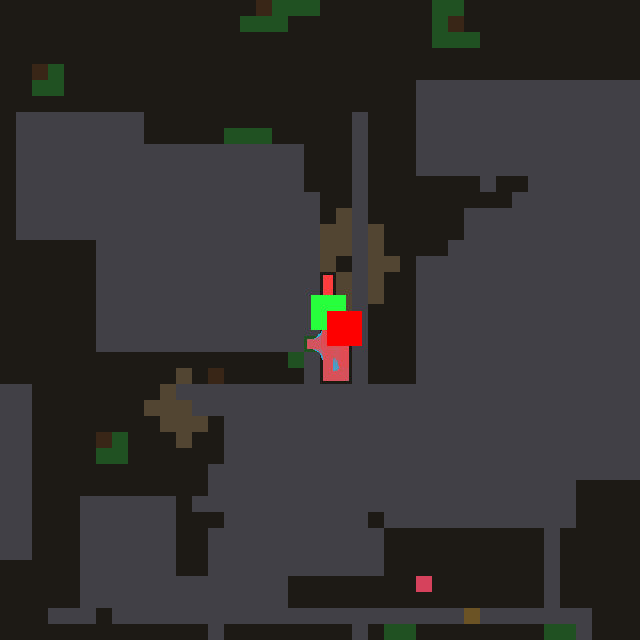
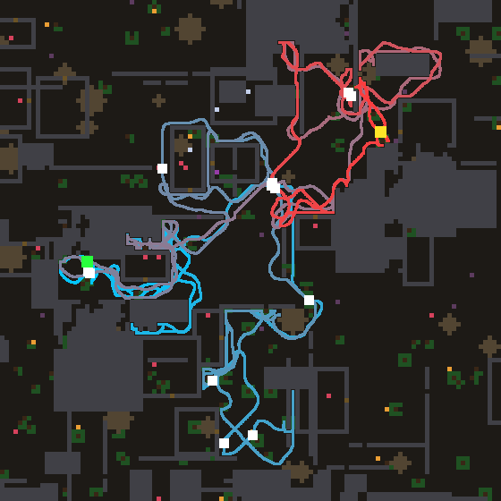
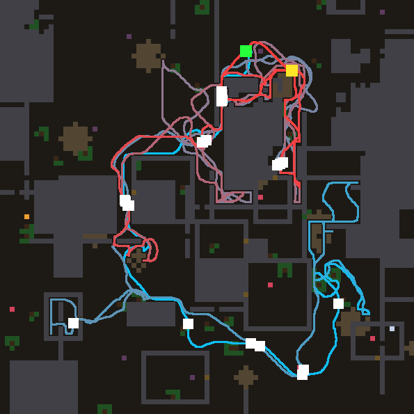
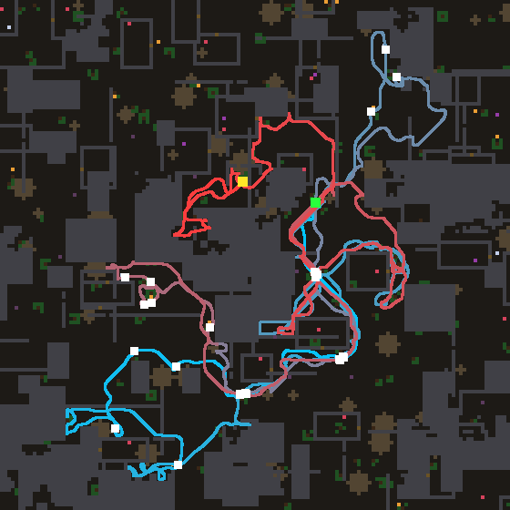

# Night lab summary — 2026-11-04T12:47:59
Model `agent-in-session (mailbox)`, 12.68 h, 30 design turns (6 deep), model busy 0.40 h, waited for other users 0 min, resumed 2x.
```
                                   train  immortal   holdout  immortal
reference wave (#0)                 20.4  17/20    15.5  12/16
confine, hand-written (#1)          23.2  17/20    23.6  13/16
CONTROL: #1 tuned 153x              29.8  19/20    25.1  14/16
#7 (turn 4, tuned 7x)               34.1  20/20    28.4  16/16
#26 (turn 23, tuned 6x)             34.7  20/20    31.4  16/16
#21 (turn 18, tuned 5x)             35.1  20/20    34.6  16/16
#28 (turn 25, tuned 5x)             34.6  20/20    35.7  16/16
#18 (turn 15, tuned 6x)             33.7  20/20    34.8  16/16
```

**FINAL worlds** (32 worlds nobody selected on, not even the model through the prompt):

```
reference wave (#0)                 18.8 meals  immortal 28/32
confine, hand-written (#1)          24.5 meals  immortal 28/32
CONTROL: #1 tuned 153x              23.4 meals  immortal 30/32
#28 tuned 5x                        33.1 meals  immortal 31/32
#21 tuned 5x                        32.8 meals  immortal 31/32
#18 tuned 6x                        34.3 meals  immortal 31/32
#7 tuned 7x                         27.8 meals  immortal 30/32
#26 tuned 6x                        30.5 meals  immortal 29/32
```
Design turns: 30 valid (30 first try, 0 after repair), 0 never loaded, 0 constants-only twins. Evaluations: {'llm': 183, 'control': 153, 'holdout': 16}.

Prediction error (|predicted - actual| meals, before tuning): first half 2.8, second half 3.4 over 30 predictions — no gain in prediction.

## Timeline

```
   0.57 h  turns   2  champion #3 train  28.9 hold  22.5  |  control train  27.6 hold 23.25
   1.11 h  turns   4  champion #3 train  28.9 hold  22.5  |  control train  27.6 hold 23.25
   1.64 h  turns   6  champion #7 train  32.2 hold 27.25  |  control train  27.6 hold 23.25
   2.17 h  turns   8  champion #7 train  32.2 hold 27.25  |  control train  27.6 hold 23.25
   2.71 h  turns  10  champion #7 train  32.2 hold 27.25  |  control train  27.6 hold 23.25
   3.22 h  turns  11  champion #7 train  32.2 hold 27.25  |  control train  27.6 hold 23.25
   3.86 h  turns  13  champion #7 train  34.1 hold 28.4375  |  control train  29.8 hold 25.125
   4.46 h  turns  14  champion #7 train  34.1 hold 28.4375  |  control train  29.8 hold 25.125
   4.97 h  turns  15  champion #7 train  34.1 hold 28.4375  |  control train  29.8 hold 25.125
   5.57 h  turns  16  champion #7 train  34.1 hold 28.4375  |  control train  29.8 hold 25.125
   6.12 h  turns  17  champion #7 train  34.1 hold 28.4375  |  control train  29.8 hold 25.125
   6.62 h  turns  18  champion #7 train  34.1 hold 28.4375  |  control train  29.8 hold 25.125
   7.23 h  turns  19  champion #7 train  34.1 hold 28.4375  |  control train  29.8 hold 25.125
   7.77 h  turns  20  champion #7 train  34.1 hold 28.4375  |  control train  29.8 hold 25.125
   8.32 h  turns  22  champion #7 train  34.1 hold 28.4375  |  control train  29.8 hold 25.125
   8.83 h  turns  23  champion #7 train  34.1 hold 28.4375  |  control train  29.8 hold 25.125
   9.43 h  turns  24  champion #7 train  34.1 hold 28.4375  |  control train  29.8 hold 25.125
   9.96 h  turns  25  champion #7 train  34.1 hold 28.4375  |  control train  29.8 hold 25.125
  10.47 h  turns  26  champion #7 train  34.1 hold 28.4375  |  control train  29.8 hold 25.125
  11.01 h  turns  27  champion #7 train  34.1 hold 28.4375  |  control train  29.8 hold 25.125
  11.53 h  turns  29  champion #7 train  34.1 hold 28.4375  |  control train  29.8 hold 25.125
  12.10 h  turns  30  champion #7 train  34.1 hold 28.4375  |  control train  29.8 hold 25.125
```

## Champion #28

**Hypothesis:** A flaw of the champion's course, read off its own algebra: on a unit course the frontier weight 1 + ahead is exactly 0 for a frontier straight behind, so at a dead end, a sealed corridor or the world's rim the only exploration left has no pull at all until the course itself rotates, hundreds of ticks later (and the re-aiming attempts #27/#22 lost because they weakened the course everywhere, not where it fails). Here frustration — the dwell field that already opens walls in pockets — also fades the course's say, so wherever the agent has been pacing the frontier is weighed evenly again, and a floor of 0.2 keeps any frontier behind alive; on open runs crowd is ~0 and the law is #21. Built on #

As written: 34.6 meals; tuned 5x: 34.6.

```nomos
channel source
channel thing
channel solid
channel free
channel here
channel bad
channel leak
channel value
channel ghost: init 0
channel confinement
channel unk
channel room
channel front
channel dwell: init 0
channel crowd: init 0
channel thinwall
channel recent: init 0
channel coursex: init 0
channel coursey: init 0
channel unitx
channel unity
channel beamxp: init 0
channel beamxn: init 0
channel beamyp: init 0
channel beamyn: init 0
channel ahead
channel hidden
channel door
channel injection

rule recency:
  when 1
  set recent = max(here, 0.95 * recent)
rule course_x:
  when 1
  set coursex = here * (0.998 * (coursex + sum8(coursex)) + 0.002 * (shift(recent, 1, 0) - shift(recent, -1, 0)))
rule course_y:
  when 1
  set coursey = here * (0.998 * (coursey + sum8(coursey)) + 0.002 * (shift(recent, 0, 1) - shift(recent, 0, -1)))
# RE-AIM: the course as a UNIT direction at the agent's cell. A looping walk averages to a short
# vector whose pull used to vanish; normalised, it keeps full strength in whatever way the loop
# drifts, so an orbit is broken instead of tolerated
rule unit_x:
  when 1
  set unitx = here * coursex / (sqrt(coursex * coursex + coursey * coursey) + 0.02)
rule unit_y:
  when 1
  set unity = here * coursey / (sqrt(coursex * coursex + coursey * coursey) + 0.02)
rule beam_xp:
  when 1
  set beamxp = where(here, max(unitx, 0), 0.97 * max8(beamxp))
rule beam_xn:
  when 1
  set beamxn = where(here, max(0 - unitx, 0), 0.97 * max8(beamxn))
rule beam_yp:
  when 1
  set beamyp = where(here, max(unity, 0), 0.97 * max8(beamyp))
rule beam_yn:
  when 1
  set beamyn = where(here, max(0 - unity, 0), 0.97 * max8(beamyn))
rule along_course:
  when 1
  set ahead = ((posx() - 0.4828) * (beamxp - beamxn) + (posy() - 0.4828) * (beamyp - beamyn)) / (sqrt((posx() - 0.4828) * (posx() - 0.4828) + (posy() - 0.4828) * (posy() - 0.4828)) + 0.01)
rule dwell_time:
  when 1
  set dwell = min(1, 0.998 * dwell + 0.02 * here)
rule frustration:
  when 1
  set crowd = 0.5 * dwell + 0.5 * avg8(crowd)
rule unknown:
  when 1
  set unk = (free < 0.2) * (solid < 0.5)
rule roominess:
  when 1
  set room = 0.5 * unk + 0.5 * avg8(room)
rule frontier:
  when 1
  set front = unk * (max8(free) > 0.5)
rule thin_walls:
  when 1
  set thinwall = solid * max((1 - shift(solid, 1, 0)) * (1 - shift(solid, -1, 0)), (1 - shift(solid, 0, 1)) * (1 - shift(solid, 0, -1)))
# an unexplored space BEHIND a wall: unknown cells walled off from every known-free cell
rule walled_off:
  when 1
  set hidden = unk * (max8(free) < 0.5) * (max8(solid) > 0.5)
# DOORS AS FRONTIER: a thin wall whose hue has been taught to give (leak above the innate 0.5),
# with known ground on one side and hidden space on the other, is a way into a new room
rule doorways:
  when 1
  set door = thinwall * clamp(2 * (leak - 0.5), 0, 1) * (max8(free) > 0.5) * max8(hidden)
rule linger:
  when 1
  set ghost = max(source, thing, 0.99 * ghost) * (1 - here) * (1 - max8(here))
rule calc_conf:
  when 1
  set confinement = sum8(solid)
# THE COURSE LETS GO WHEN STUCK: on a unit course a frontier straight behind weighed exactly 0, so at
# a dead end the agent could not turn back until the course itself turned (hundreds of ticks); now
# frustration (long dwelling) fades the course's say, and nothing behind ever weighs below a fifth
rule inject:
  when 1
  set injection = max(ghost, 0.3 * front * room * room * clamp(1 + ahead * (1 - crowd), 0.2, 2), 0.4 * door, 0.04 * unk) / (1 + 0.5 * confinement * (1 - crowd)) * (1 - bad)
rule wave:
  when 1
  set value = max(injection, max(0.94 * max4(value), 0.916214 * max8(value))) * (1 - solid * (1 - min(1, leak * (0.3 + 0.7 * thinwall) * (1 + 3 * crowd))))
```

## Theory, first version (1.48 h)

Helps: memory + confinement together (#3 untuned 25.8 vs confine 23.2, ghost 22.7), but tuned #3 fell to 22.5 on holdout, so its tuned constants overfit. Weighting the frontier by how much unknown lies beyond it (#4, #5) generalises best: holdout 28.9/28.7, above train. Escaping sealed pockets is a real, separate failure: every law scored 0 on world 110 until the trail (#6: 14) and dwell-driven frustration that opens nearby walls (#7: 29 there, best train 32.2, holdout pending).
Neutral: the larder/regrowth clock (#5 = #4 on 19 of 20 worlds; spots leave the 25-cell map before they regrow). Trail alone costs meals in open worlds (#6 23.1).
Hurts: short-sighted exploration as a separate fast-decaying wave (#8 25.7 vs #7 27.0 untuned): far frontiers matter.
Untried: poison/appetite use, commitment to one target over thoughts, reading corridor geometry, why #7 lost worlds 116/117.

## Theory, last version (9.21 h)

One structural gain dominates: a long COURSE (heading averaged over hundreds of ticks, kept at the agent's cell) weighting frontier goals lifts untuned meals from the 25-28 plateau to ~33 (#15, #16), and normalising it to a unit direction, so loops keep a full pull, gives the best law, #21 35.1 (holdout 34.6). The rest of the stack matters too: stripping #21 to course + roominess + memory (#25) fell to 28.8, losing ~5 on ordinary worlds as well as 0 in pocket 110 — confinement, frustration, thin-wall leak and doors are not just insurance. The course pays at the level of GOALS, not paths: anisotropic discount #22 32.2. Commitment hurts: target lock #24 29.7, step momentum #9; flexibility matters. Memory of explored edges helps (food-only memory #23 31.9). Neutral: meal wipe #26 34.7, doors/material/patches/habitat. Hurts: non-max exploration #14.
Untried: course timescale as structure, re-aiming the course toward the unknown.

## Observations

**#3 on world 110** — 

The agent is born in a narrow sealed slot about one cell wide and four tall, walled by rock with patches of brown rubble right beside it, and it never leaves: the whole 4221-tick life is spent pacing up and down that slot (last 500 ticks in a 4x1 box) until it starves. It does try to dig — 11 breaks and 24 idle presses — but the presses are spread over different wall cells (much of it on plain rock), so no single rubble cell is ever chipped all the way through. The world outside is open and has food in reach (green spots above and to the left), so this is not a lack of food but a failure to commit to one exit. Confinement suppression makes it worse here: every source in a pocket is divided down, so the wave in the slot is weak and keeps re-pointing as the faint frontier/smell marks shift. The fix I would try first is a dig commitment: a per-cell memory that grows while the agent presses a solid cell and raises that cell's leak (its conductivity to the wave), so the wave keeps leading into the same rubble cell until it gives way instead of hopping between walls.

**#7 on world 117** — 

This world is a town of many small walled rooms with food scattered both outside and inside them; the agent lives the whole 8000 ticks, eats 13 times, and spends most of its life walking loop after loop around the OUTSIDE of room walls (the blue and red tracks trace room perimeters two and three times over). Food dots sit inside rooms whose walls it walks right along, yet it opens no door (doors 0) while pressing walls 42 times for nothing, so the wave is leading it into plain wall cells rather than the rooms' doors. Late in life (red) it is confined to one block of rooms in the upper right, circling the same corridors, so it is not starving for lack of food but for lack of a way in. The trail and frustration terms make walls it has lingered beside more conductive, which spreads the leak over whichever stone it happens to be next to, instead of the one cell that actually opens. The mechanism I would try is a thin-wall detector: a solid cell with free (or a seen thing) on both opposite sides is a door candidate and keeps its leak, while solid cells backed by more solid get almost none, so the wave pours through doorways and the presses land on doors.

**#7 on world 100** — 

Early in life (cyan) the agent ranges widely to the south and east through a district of walled blocks and eats steadily, about one meal per room-sized stretch of new ground. From mid-life on (pink to red) it comes back north and spends the rest of its 8000 ticks orbiting the same large central block and the two corridors beside it, tracing the same loop four or five times, eating now and then at the same few spots near the start. It also spends a lot of effort on walls — 150 breaks and 58 idle presses for a single door — so much of the late loop is chipping rubble around that block rather than walking to new ground. Most of the map (west, far east, south-west rooms with food dots) is never visited, so the low score is a coverage failure: once the near frontier is exhausted the wave keeps bringing it back to the familiar ring. The mechanism I would add is a long-term heading kept over hundreds of ticks that, while only exploring, favours steps and frontier goals that continue the course, so the walk sweeps away into unvisited districts instead of circling the home block.

**#7 on world 112** — 

This is a dense town of small walled rooms; the agent survives the whole life and eats 24 times, mostly in the open streets, making three long excursions (south-west early, north-east, then west and north late) that all start from and return through the same crossroads just below its spawn, which it crosses four or five times. Many food dots sit inside small closed rooms along its route (centre, east, north-west), and it enters none of them: 0 doors opened against 118 idle presses, so it repeatedly leans on wall cells that do not give, while the actual doors of those rooms stay shut. The pressing also costs time at each room it passes, slowing the sweep. The failing is wall choice, not effort: the leak treats every wall alike, so the wave leads into plain stone as often as into a door. The one mechanism I would add is recognising a door by its look (doors are the brightest solid) and giving only those cells the leak, so presses land on doors and the stocked rooms get opened.

GIF: `champion.gif` (world 100, first 4000 ticks).
