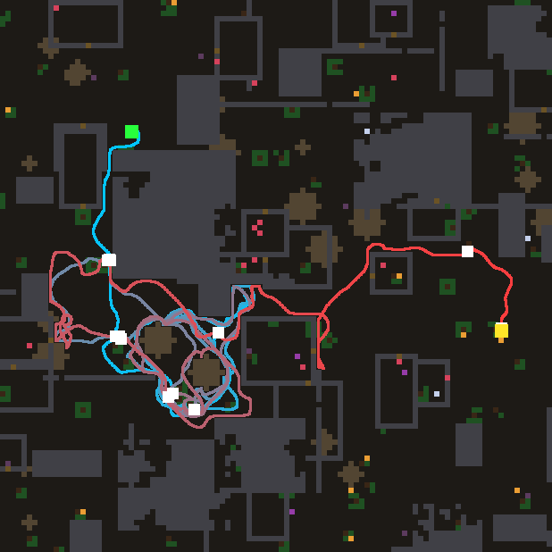

# night lab — 2026-11-04T09:18:50

Model `agent-in-session (mailbox)` | 1.0 h | world default | train [0, 1, 2, 3, 4, 5, 6, 7] | holdout [20, 21, 22, 23, 24, 25, 26, 27] | 4000 ticks/life | tune 5 | deep every 5 | theory every 6 | observe every 8

- anchor #0 `laws/atlas_wave.nomos`: train 10.9 meals [18, 14, 10, 23, 8, 4, 5, 5], holdout 11.0

- anchor #1 `laws/atlas_confine.nomos`: train 16.1 meals [22, 24, 13, 16, 15, 9, 13, 17], holdout 17.2

- anchor #2 `laws/atlas_ghost.nomos`: train 10.4 meals [13, 5, 10, 7, 10, 10, 13, 15], holdout 10.6

> 09:20 model job `design` started

---

## Turn 0 -> island #3

**Hypothesis:** Confinement judged by the 8 neighbours sees a nook but not a dead-end region a few cells deep. A persistent ROOM channel — known free space blurred over the map, kept between thoughts — measures how open the region around each cell is, so sources and frontier marks inside pockets and corridors fade while those in open country (where more food and more frontier lie beyond) win. The agent commits to open regions and stops being pulled into dead pockets.

Prediction 17.0, got **12.5** meals, fitness 255, per world [22, 18, 17, 8, 8, 4, 12, 11]; model 26.0 s, repairs 0

value on the test map: max 1.00, mean 0.53, 0% at the cap -> healthy: the best neighbour points at the source

```nomos
channel source
channel solid
channel free
channel thing
channel here
channel value
channel room: init 0
channel injection

# Regional openness: known-free space, diffused over the map and remembered.
rule openness:
  when 1
  set room = clamp(0.6 * avg8(room) + 0.4 * free * (1 - solid), 0, 1)

# A source counts in proportion to how open its region is.
rule inject:
  when 1
  set injection = max(thing, source) * (0.3 + 0.7 * room)

# The Bellman wave over the weighted sources.
rule wave:
  when 1
  set value = max(injection, max(0.94 * max4(value), 0.916214 * max8(value))) * (1 - solid * (1 - leak))
```

> 09:22 model job `design` started

---

## Turn 1 -> island #4

**Hypothesis:** The agent remembers where it has walked: a TRAIL channel stamped under `here`, scrolling with the map and fading slowly. Cells on the trail pass on less of the wave and their sources count less, so stepping back onto the cell it just left is never the brightest choice — this breaks the two-cell limit cycle at a flipping smell bearing and pushes the agent onto fresh ground, while confinement suppression keeps nooks from dominating.

Prediction 18.0, got **14.5** meals, fitness 281, per world [16, 13, 12, 17, 24, 6, 11, 17]; model 18.1 s, repairs 0

value on the test map: max 1.00, mean 0.53, 0% at the cap -> healthy: the best neighbour points at the source

```nomos
channel source
channel solid
channel thing
channel here
channel value
channel trail: init 0
channel confinement
channel injection

# Where I have been: stamped under the agent, fading slowly, scrolls with the map.
rule walk:
  when 1
  set trail = clamp(max(here, 0.97 * trail), 0, 1)

# Local confinement, as in the best law.
rule calc_conf:
  when 1
  set confinement = sum8(solid)

# Sources hemmed in, or on ground already walked, count less.
rule inject:
  when 1
  set injection = max(thing, source * (1 - 0.6 * trail)) / (1 + 0.5 * confinement)

# Bellman wave; a walked cell passes on less, so backtracking is never the best step.
rule wave:
  when 1
  set value = max(injection, max(0.94 * max4(value), 0.916214 * max8(value))) * (1 - solid * (1 - leak)) * (1 - 0.3 * trail)
```

> 09:25 model job `design` started

---

## Turn 2 -> island #5

**Hypothesis:** All frontier marks are equally faint, so the agent explores the nearest edge of the known map even when only a sliver of unknown lies behind it. A persistent VOID channel diffuses "unknown" (neither free nor solid) over the map, so each frontier mark is weighted by how much undiscovered country lies behind it; the agent heads for big unexplored regions, where unseen food is, instead of nibbling the borders of what it already knows. Confinement suppression is kept.

Prediction 17.0, got **16.2** meals, fitness 316, per world [18, 17, 15, 13, 16, 21, 14, 16]; model 14.1 s, repairs 0

value on the test map: max 0.50, mean 0.26, 0% at the cap -> healthy: the best neighbour points at the source

```nomos
channel source
channel solid
channel free
channel thing
channel value
channel void: init 0
channel confinement
channel injection

# How much undiscovered country surrounds a cell, diffused and remembered.
rule unknown_mass:
  when 1
  set void = clamp(0.7 * avg8(void) + 0.3 * (1 - free) * (1 - solid), 0, 1)

# Local confinement, as in the best law.
rule calc_conf:
  when 1
  set confinement = sum8(solid)

# A source is worth more where a lot of unknown lies behind it; nooks count less.
rule inject:
  when 1
  set injection = max(thing, source * (0.5 + 1.5 * void)) / (1 + 0.5 * confinement)

# The Bellman wave.
rule wave:
  when 1
  set value = max(injection, max(0.94 * max4(value), 0.916214 * max8(value))) * (1 - solid * (1 - leak))
```

> 09:28 model job `design` started

---

## Turn 3 -> island #6

**Hypothesis:** The wave crosses unknown cells as cheaply as walked ones, so a smelled source behind unexplored ground draws the agent straight across terrain that is often wall, and it wastes ticks bumping and re-routing. Here the wave pays an extra toll to cross cells that are neither known free nor known solid (distrust of the unseen), so routes run through known-free ground and the agent reaches food on paths that exist, while the frontier itself (a source on the unknown edge) still pulls through the void weighting of the best law.

Prediction 18.5, got **13.5** meals, fitness 250, per world [18, 12, 12, 18, 14, 9, 9, 16]; model 20.1 s, repairs 0; vocabulary twin of #5

value on the test map: max 0.38, mean 0.20, 0% at the cap -> healthy: the best neighbour points at the source

```nomos
channel source
channel solid
channel free
channel thing
channel value
channel void: init 0
channel confinement
channel injection
channel toll

# How much undiscovered country surrounds a cell, diffused and remembered.
rule unknown_mass:
  when 1
  set void = clamp(0.7 * avg8(void) + 0.3 * (1 - free) * (1 - solid), 0, 1)

# Local confinement, as in the best law.
rule calc_conf:
  when 1
  set confinement = sum8(solid)

# The fraction of the wave a cell passes on: an unknown cell is distrusted.
rule distrust:
  when 1
  set toll = 1 - 0.08 * (1 - free) * (1 - solid)

# A source is worth more where a lot of unknown lies behind it; nooks count less.
rule inject:
  when 1
  set injection = max(thing, source * (0.5 + 1.5 * void)) / (1.3 + 0.5 * confinement)

# The Bellman wave, slower through the unknown.
rule wave:
  when 1
  set value = max(injection, toll * max(0.94 * max4(value), 0.916214 * max8(value))) * (1 - solid * (1 - leak))
```

> 09:29 model job `observe` started

---

## Observer: #5 on world 7



`{'meals': 12, 'ticks': 4000, 'alive': True, 'distance': 881.2, 'cells_visited': 452, 'last500_box': '23x50', 'doors': 0, 'breaks': 0, 'idle_presses': 24, 'nightcaps': 0}`

The agent walks south from the start, finds a patch of regrowing food around two brown rubble mounds west of centre, and spends roughly three quarters of its life circling those two mounds on the same loops, re-eating at the same four or five spots.
It is not stuck or pacing a wall — it eats — but it never leaves a region of about 15x15 cells while the map is full of food dots to the north, east and south that it never sees.
Only in the last quarter (the red track) does it break east through the doorway and eat once more on open ground, which shows the frontier pull exists but is drowned out by the smell of the known patch.
The void weighting cannot help here because the trouble is not the frontier marks but the nearby smell sources, which keep full weight however long the agent has been grazing there.
One mechanism: a slowly fading visit-density ("boredom") channel stamped where the agent walks, which discounts smell sources in heavily grazed ground so that after a few laps the frontier outweighs the local patch.

> 09:32 model job `deep` started

---

## Turn 4 (DEEP) -> island #7

**Hypothesis:** One wave mixes two different wants — food it smells or sees, and unknown ground to explore — so a regrowing patch nearby always outshines the faint frontier and the agent grazes one loop for thousands of ticks (observer, world 7). Here they are two separate waves, FOOD and EXPLORE, and a slow GRAZE field (stamped where the agent walks, diffused, fading over hundreds of ticks) discounts the food wave only where the agent has already been grazing; after a few laps of a patch the explore wave wins and the agent leaves for unseen country, and returns once the boredom has faded and the patch has regrown.

Prediction 19.0, got **15.4** meals, fitness 308, per world [17, 17, 23, 20, 10, 13, 4, 19]; model 40.1 s, repairs 0

value on the test map: max 0.50, mean 0.26, 0% at the cap -> healthy: the best neighbour points at the source

```nomos
channel source
channel solid
channel free
channel thing
channel scent
channel here
channel value
channel void: init 0
channel graze: init 0
channel confinement
channel food
channel explore

# How much undiscovered country surrounds a cell, diffused and remembered.
rule unknown_mass:
  when 1
  set void = clamp(0.7 * avg8(void) + 0.3 * (1 - free) * (1 - solid), 0, 1)

# Boredom: stamped where the agent walks, spread over the patch, fading slowly.
rule grazing:
  when 1
  set graze = clamp(0.9995 * (0.6 * graze + 0.4 * avg8(graze)) + 0.03 * here, 0, 1)

# Local confinement, as in the best law.
rule calc_conf:
  when 1
  set confinement = sum8(solid)

# The food wave: only what is smelled or seen.
rule food_wave:
  when 1
  set food = max(where(scent + thing > 0, source, 0) / (1 + 0.5 * confinement), max(0.94 * max4(food), 0.916214 * max8(food))) * (1 - solid * (1 - leak))

# The explore wave: only frontier marks, weighted by the unknown behind them.
rule explore_wave:
  when 1
  set explore = max(where(scent + thing > 0, 0, source) * (0.5 + 1.5 * void) / (1 + 0.5 * confinement), max(0.94 * max4(explore), 0.916214 * max8(explore))) * (1 - solid * (1 - leak))

# Food is worth less where I have been grazing; the stronger want leads.
rule decide:
  when 1
  set value = max(food * (1 - 0.8 * graze), explore)
```

> 09:36 model job `design` started
