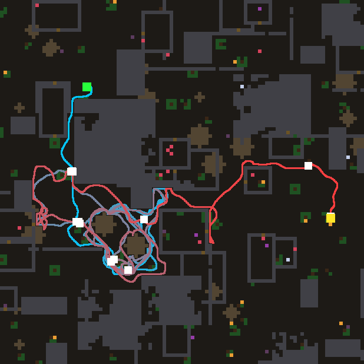
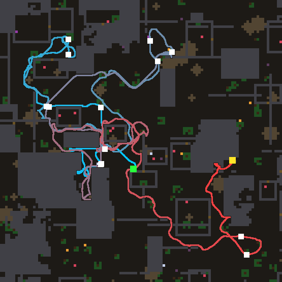

# Night lab summary — 2026-11-04T09:18:50
Model `agent-in-session (mailbox)`, 1.06 h, 17 design turns (3 deep), model busy 0.12 h, waited for other users 0 min, resumed 0x.
```
                                   train  immortal   holdout  immortal
reference wave (#0)                 10.9   8/8    11.0   8/8
confine, hand-written (#1)          16.1   8/8    17.2   7/8
CONTROL: #1 tuned 96x               17.4   8/8    11.9   7/8
#5 (turn 2, tuned 9x)               17.9   8/8    12.9   8/8
#19 (turn 16, tuned 2x)             17.5   8/8    12.4   7/8
#13 (turn 10, tuned 7x)             17.9   8/8    13.8   7/8
#10 (turn 7, tuned 7x)              16.0   8/8    10.6   8/8
#16 (turn 13, tuned 5x)             16.1   8/8    17.9   8/8
```

**FINAL worlds** (8 worlds nobody selected on, not even the model through the prompt):

```
reference wave (#0)                 12.6 meals  immortal 8/8
confine, hand-written (#1)          15.2 meals  immortal 8/8
CONTROL: #1 tuned 96x               13.1 meals  immortal 8/8
#16 tuned 5x                        11.8 meals  immortal 8/8
#7 tuned 7x                         14.0 meals  immortal 8/8
#13 tuned 7x                        12.4 meals  immortal 8/8
#5 tuned 9x                         13.1 meals  immortal 8/8
#19 tuned 2x                        15.9 meals  immortal 8/8
```
Design turns: 17 valid (17 first try, 0 after repair), 0 never loaded, 0 constants-only twins. Evaluations: {'llm': 113, 'control': 96, 'holdout': 7}.

Prediction error (|predicted - actual| meals, before tuning): first half 3.4, second half 3.5 over 17 predictions — no gain in prediction.

## Timeline

```
   0.52 h  turns   9  champion #5 train  17.9 hold 12.875  |  control train  17.4 hold 11.875
   1.02 h  turns  17  champion #5 train  17.9 hold 12.875  |  control train  17.4 hold 11.875
```

## Champion #16

**Hypothesis:** Some frontier marks never go away — unknown cells inside sealed rooms or behind rock, seen from outside but unreachable — and they keep pulling the agent round the same walls (the circling of world 2). Here each cell keeps a STALE clock that runs while it stays a bare frontier mark (no smell, no thing) and resets the moment it stops being one, and a frontier mark loses weight as it goes stale: fresh edges of the map pull, old unreachable ones fade, so the agent stops orbiting what it cannot reach. Learned doors, void weighting and confinement (#13, best raw) are kept.

As written: 16.1 meals; tuned 5x: 16.1.

```nomos
channel source
channel solid
channel free
channel thing
channel scent
channel value
channel void: init 0
channel stale: init 0
channel door
channel injection

# How long a cell has been a bare frontier mark; reset when it stops being one.
rule age_frontier:
  when 1
  set stale = where(source * (1 - thing) * (1 - min(scent * 100, 1)) > 0, clamp(stale + 0.002, 0, 1), 0)

# How much undiscovered country surrounds a cell, diffused and remembered.
rule unknown_mass:
  when 1
  set void = clamp(0.7 * avg8(void) + 0.3 * (1 - free) * (1 - solid), 0, 1)

# A learned door: solid whose leak was taught above the innate guess, with unknown beyond.
rule doors:
  when 1
  set door = solid * clamp(2 * (leak - 0.5), 0, 1) * max8(void)

# Food as is; frontier by the unknown behind it, fading as it goes stale; doors.
rule inject:
  when 1
  set injection = max(thing, source * (0.5 + 1.5 * void) * (1 - 0.8 * stale), 0.8 * door) / (1.3 + 0.5 * sum8(solid))

# The Bellman wave; a door cell keeps its own injection.
rule wave:
  when 1
  set value = max(injection, max(0.94 * max4(value), 0.916214 * max8(value)) * (1 - solid * (1 - leak)))
```

## Theory, first version (0.31 h)

Helps: suppressing sources hemmed in by solid (confinement, #1: 16.1 vs plain wave 10.9) and weighting each source by how much unknown lies behind it (void, #5: 16.2 raw, 17.9 tuned, the only law above #1). Both re-rank WHERE to go, toward open, unexplored country; meals come from exploration. All laws so far are immortal on all 8 worlds, so the score is foraging rate, not survival.
Hurts or does not help: blurred openness of known free ground (#3, 12.5), a walking trail that damps the wave (#4, 14.5), extra toll on unknown cells (#6, 13.5), boosting dense food patches (#8, 13.8) — anything that makes known food or known ground more attractive, or slows the wave, loses. Splitting food and explore waves with grazing boredom (#7, 15.4) helped worlds 2-3 but collapsed world 6 (4).
Untried: commitment to one target, using `bad`, reading doors/leak, far-vs-near discount shape. Caveat: no holdout yet for #5; its +1.7 from tuning may not transfer.

## Theory, last version (0.68 h)

Biggest fact is on holdout: tuning on 8 train worlds overfits. #5 tuned 17.9 train -> 12.9 holdout; control (#1 tuned) 17.4 -> 11.9, while #1 untuned holds 17.2; #10 16.0 -> 10.6. Only #7 (separate food and explore waves) held: 15.4 -> 16.0. Train gaps under ~2 meals are noise.
Helps on train, before tuning: confinement (#1 16.1 vs wave 10.9), void weighting of frontier (#5 16.2), learned doors as sources of unknown country (#13 17.9, best raw, holdout pending). All re-rank where to explore.
Hurts: anything that damps or tolls the wave or biases the step (trail #4 14.5, unknown toll #6 13.5, nearness #9 14.5, momentum #11 13.0), boosting known food (cluster #8 13.8, regrowth memory #12 12.4), random whims (#14 13.1).
Untried: door + two-wave split together; `bad`; judging laws by holdout, not train.

## Observations

**#5 on world 7** — 

The agent walks south from the start, finds a patch of regrowing food around two brown rubble mounds west of centre, and spends roughly three quarters of its life circling those two mounds on the same loops, re-eating at the same four or five spots.
It is not stuck or pacing a wall — it eats — but it never leaves a region of about 15x15 cells while the map is full of food dots to the north, east and south that it never sees.
Only in the last quarter (the red track) does it break east through the doorway and eat once more on open ground, which shows the frontier pull exists but is drowned out by the smell of the known patch.
The void weighting cannot help here because the trouble is not the frontier marks but the nearby smell sources, which keep full weight however long the agent has been grazing there.
One mechanism: a slowly fading visit-density ("boredom") channel stamped where the agent walks, which discounts smell sources in heavily grazed ground so that after a few laps the frontier outweighs the local patch.

**#5 on world 2** — 

The agent spends the first third exploring well to the north-west and eats about nine times, then in the middle third (pink track) it circles round and round two small walled rooms just west of its start, a few cells across, which have food sitting inside them.
It never gets in: doors 0 and breaks 0, so it paces the outside of the room walls, pulled by the food it sees or smells inside, while the wave routes it round the room instead of into the wall.
Only late (red track) does it give up and walk south-east into open country, where it eats twice more; several other closed rooms with food dots inside are passed by the same way.
The failure is that a wall between the agent and visible food is treated as an obstacle to route around, not as something to press on.
One mechanism: make a solid cell that borders a room holding seen food or smell a source of its own (a door candidate), so the wave leads the agent straight into that wall where it presses INTERACT and opens the room.

GIF: `champion.gif` (world 3, first 4000 ticks).
